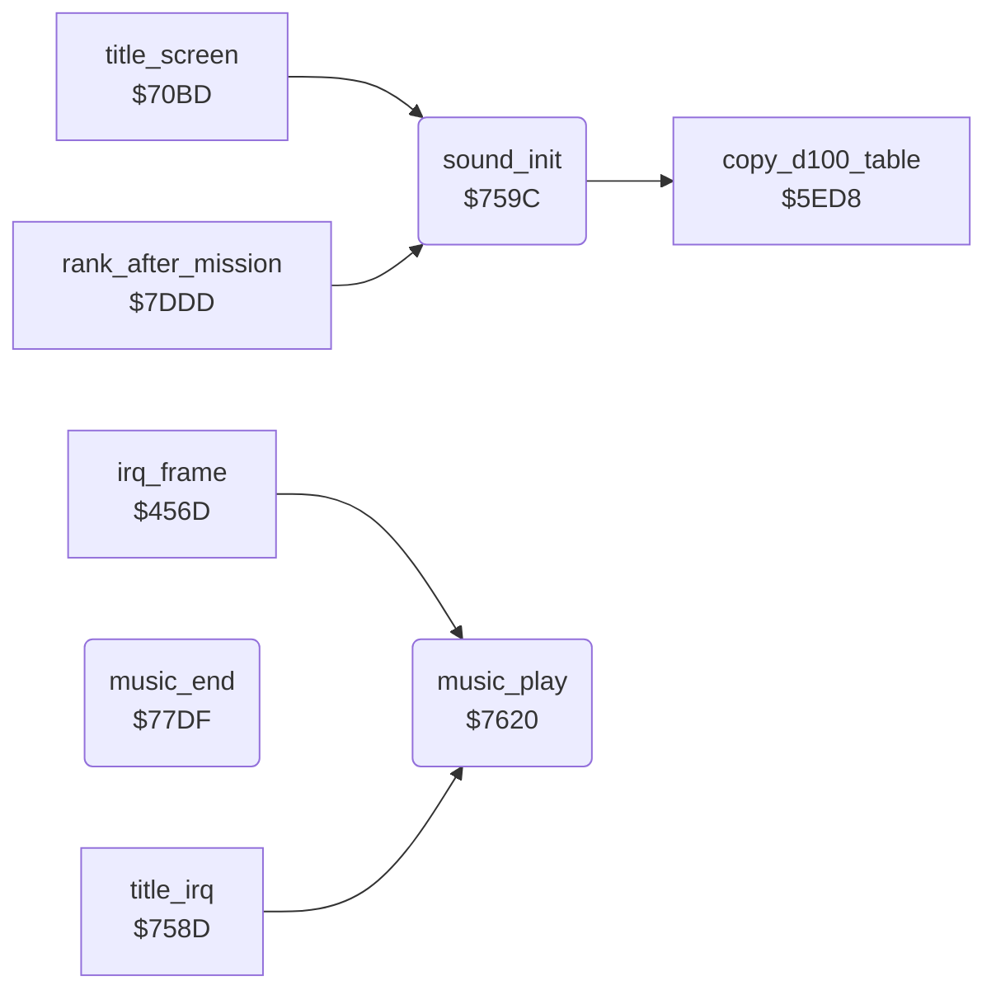

<!-- Generated by c64-docs from knowledge revision 20261025T214620.804-eudhn0 and .c64-re-tools/local/generated/src/source-map.json. Do not edit: change the knowledge, generate the source again, then run docs.ts generate. -->
# music/music_player.asm: Sound initialization and title tune

Range `$759C-$7B61`. Source: [music/music_player.asm](../../../../src/music/music_player.asm). Index: [the reference](../../index.md).

## Routines

| Routine | Address | Reached from | Summary |
|---|---|---|---|
| [`sound_init`](music_player.md#sound_init) | `$759C` | [`title_screen`](../screen/title_screen.md#title_screen), [`rank_after_mission`](../game/rank.md#rank_after_mission) | Clears the SID, sets the three voices to pulse, volume 6 AND $409c, and starts the tune. |
| [`music_play`](music_player.md#music_play) | `$7620` | [`irq_frame`](../irq/frame_irq.md#irq_frame), [`title_irq`](../irq/title_irq.md#title_irq) | Plays the tune: each 3 frames (music_tempo) it reads the next note of each voice whose duration count is 0. |
| [`music_end`](music_player.md#music_end) | `$77DF` |  | End of the tune: sets $4085 = $ff. |

## Data

| Range | Type | Name | Read by | Written by |
|---|---|---|---|---|
| [`$77E5`](../../../../src/music/music_player.asm#L266)-`$77F0` | bytes of 12 | [`note_freq_lo`](../../../../src/music/music_player.asm#L265) | [`music_play`](music_player.md#music_play) |  |
| [`$77F1`](../../../../src/music/music_player.asm#L268)-`$77FC` | bytes of 12 | [`note_freq_hi`](../../../../src/music/music_player.asm#L267) | [`music_play`](music_player.md#music_play) |  |
| [`$77FD`](../../../../src/music/music_player.asm#L270) | bytes | [`music_tempo`](../../../../src/music/music_player.asm#L269) | [`sound_init`](music_player.md#sound_init), [`music_play`](music_player.md#music_play) |  |
| [`$77FE`](../../../../src/music/music_player.asm#L273)-`$7927` | bytes of 2 | [`tune_voice1`](../../../../src/music/music_player.asm#L272) |  |  |
| [`$7928`](../../../../src/music/music_player.asm#L424)-`$7A2D` | bytes of 2 | [`tune_voice2`](../../../../src/music/music_player.asm#L423) |  |  |
| [`$7A2E`](../../../../src/music/music_player.asm#L557)-`$7B61` | bytes of 2 | [`tune_voice3`](../../../../src/music/music_player.asm#L556) |  |  |

## Call graph

A solid arrow is a call, a thick arrow a table entry. Rounded nodes are in this file.

## Details

### [`sound_init`](../../../../src/music/music_player.asm#L6) `$759C`

*routine*

Clears the SID, sets the three voices to pulse, volume 6 AND $409c, and starts the tune. Then calls $5ed8.

- **Called from:** [`title_screen`](../screen/title_screen.md#title_screen), [`rank_after_mission`](../game/rank.md#rank_after_mission)
- **Calls:** [`copy_d100_table`](../protection/d100_table.md#copy_d100_table)
- **Reads:** [`sound_volume`](../data/variables.md#sound_volume), [`music_tempo`](music_player.md#music_tempo)
- **Writes:** [`FRELO1`](../../memory-map.md#FRELO1), [`CUTLO`](../../memory-map.md#CUTLO), [`music_ended`](../data/variables.md#music_ended), [`ATDCY1`](../../memory-map.md#ATDCY1), [`ATDCY2`](../../memory-map.md#ATDCY2), [`ATDCY3`](../../memory-map.md#ATDCY3), [`SUREL1`](../../memory-map.md#SUREL1), [`SUREL2`](../../memory-map.md#SUREL2), [`SUREL3`](../../memory-map.md#SUREL3), [`SIGVOL`](../../memory-map.md#SIGVOL), [`PWHI1`](../../memory-map.md#PWHI1), [`PWHI2`](../../memory-map.md#PWHI2) and 14 more

| Label | Address | Comment |
|---|---|---|
| [`sound_init_clear_sid`](../../../../src/music/music_player.asm#L9) | `$75A0` |  |

### [`music_play`](../../../../src/music/music_player.asm#L51) `$7620`

*routine*

Plays the tune: each 3 frames (music_tempo) it reads the next note of each voice whose duration count is 0.

- **Called from:** [`irq_frame`](../irq/frame_irq.md#irq_frame), [`title_irq`](../irq/title_irq.md#title_irq)
- **Jumps to:** [`music_end`](music_player.md#music_end)
- **Reads:** [`music_tempo_count`](../../memory-map.md#music_tempo_count), [`music_tempo`](music_player.md#music_tempo), [`music_dur_1`](../../memory-map.md#music_dur_1), [`music_ptr_1`](../../memory-map.md#music_ptr_1), [`row_ptr`](../../memory-map.md#row_ptr), [`note_freq_lo`](music_player.md#note_freq_lo), [`note_freq_hi`](music_player.md#note_freq_hi), [`music_freq_1`](../../memory-map.md#music_freq_1), [`music_dur_2`](../../memory-map.md#music_dur_2), [`music_ptr_2`](../../memory-map.md#music_ptr_2), [`music_freq_2`](../../memory-map.md#music_freq_2), [`music_dur_3`](../../memory-map.md#music_dur_3) and 8 more
- **Writes:** [`music_tempo_count`](../../memory-map.md#music_tempo_count), [`row_ptr`](../../memory-map.md#row_ptr), [`row_ptr_hi`](../../memory-map.md#row_ptr_hi), [`music_dur_1`](../../memory-map.md#music_dur_1), [`music_freq_1`](../../memory-map.md#music_freq_1), [`music_wave_1`](../../memory-map.md#music_wave_1), [`music_gate_1`](../../memory-map.md#music_gate_1), [`music_ptr_1`](../../memory-map.md#music_ptr_1), [`music_dur_2`](../../memory-map.md#music_dur_2), [`music_freq_2`](../../memory-map.md#music_freq_2), [`music_wave_2`](../../memory-map.md#music_wave_2), [`music_gate_2`](../../memory-map.md#music_gate_2) and 15 more

| Label | Address | Comment |
|---|---|---|
| [`music_play_tick`](../../../../src/music/music_player.asm#L55) | `$7628` |  |
| [`music_voice1_next`](../../../../src/music/music_player.asm#L62) | `$7637` |  |
| [`music_voice1_note`](../../../../src/music/music_player.asm#L68) | `$764A` |  |
| [`music_voice1_pitch`](../../../../src/music/music_player.asm#L74) | `$7655` | Low nibble = note 0-11, high nibble = octave; the frequency is shifted right 7 - octave times. |
| [`music_voice1_octave`](../../../../src/music/music_player.asm#L91) | `$7670` |  |
| [`music_voice1_gate_on`](../../../../src/music/music_player.asm#L97) | `$767C` | Pulse waveform, gate on. |
| [`music_voice1_rest`](../../../../src/music/music_player.asm#L101) | `$7684` |  |
| [`music_voice1_advance`](../../../../src/music/music_player.asm#L104) | `$7689` |  |
| [`music_voice2`](../../../../src/music/music_player.asm#L113) | `$769C` |  |
| [`music_voice2_next`](../../../../src/music/music_player.asm#L117) | `$76A4` |  |
| [`music_voice2_note`](../../../../src/music/music_player.asm#L124) | `$76B7` |  |
| [`music_voice2_pitch`](../../../../src/music/music_player.asm#L130) | `$76C2` |  |
| [`music_voice2_octave`](../../../../src/music/music_player.asm#L147) | `$76DD` |  |
| [`music_voice2_gate_on`](../../../../src/music/music_player.asm#L153) | `$76E9` |  |
| [`music_voice2_rest`](../../../../src/music/music_player.asm#L157) | `$76F1` |  |
| [`music_voice2_advance`](../../../../src/music/music_player.asm#L160) | `$76F6` |  |
| [`music_voice3`](../../../../src/music/music_player.asm#L169) | `$7709` |  |
| [`music_voice3_next`](../../../../src/music/music_player.asm#L173) | `$7711` |  |
| [`music_voice3_note`](../../../../src/music/music_player.asm#L180) | `$7724` |  |
| [`music_voice3_pitch`](../../../../src/music/music_player.asm#L186) | `$772F` |  |
| [`music_voice3_octave`](../../../../src/music/music_player.asm#L203) | `$774A` |  |
| [`music_voice3_gate_on`](../../../../src/music/music_player.asm#L209) | `$7756` |  |
| [`music_voice3_rest`](../../../../src/music/music_player.asm#L213) | `$775E` |  |
| [`music_voice3_advance`](../../../../src/music/music_player.asm#L216) | `$7763` |  |
| [`music_write_sid`](../../../../src/music/music_player.asm#L225) | `$7776` | Writes the three frequencies; a new note writes $40 first to restart the envelope. |
| [`music_write_voice2`](../../../../src/music/music_player.asm#L235) | `$77AA` |  |
| [`music_write_voice3`](../../../../src/music/music_player.asm#L242) | `$77BA` |  |
| [`music_count_down`](../../../../src/music/music_player.asm#L249) | `$77CA` |  |
| [`music_play_done`](../../../../src/music/music_player.asm#L257) | `$77DE` |  |

### [`music_end`](../../../../src/music/music_player.asm#L260) `$77DF`

*routine*

End of the tune: sets $4085 = $ff. The title screen then starts the demo.

- **Jumped to from:** [`music_play`](music_player.md#music_play)
- **Writes:** [`music_ended`](../data/variables.md#music_ended)

### [`note_freq_lo`](../../../../src/music/music_player.asm#L265) `$77E5-$77F0`

*data*

SID frequency of the 12 notes of the top octave, low bytes, then high bytes at $77f1.

- **Read by:** [`music_play`](music_player.md#music_play)

### [`note_freq_hi`](../../../../src/music/music_player.asm#L267) `$77F1-$77FC`

*data*

- **Read by:** [`music_play`](music_player.md#music_play)

### [`music_tempo`](../../../../src/music/music_player.asm#L269) `$77FD`

*data*

Frames per tune tick (3). music_play reloads its counter with this value minus 1 and ticks when it goes below 0.

- **Read by:** [`sound_init`](music_player.md#sound_init), [`music_play`](music_player.md#music_play)

### [`tune_voice1`](../../../../src/music/music_player.asm#L272) `$77FE-$7927`

*data*

Title tune, voice 1: pairs of note and duration in ticks. Note $80 = rest; duration 0 ends the tune.

### [`tune_voice2`](../../../../src/music/music_player.asm#L423) `$7928-$7A2D`

*data*

Title tune, voice 2: pairs of note and duration.

### [`tune_voice3`](../../../../src/music/music_player.asm#L556) `$7A2E-$7B61`

*data*

Title tune, voice 3: pairs of note and duration.
