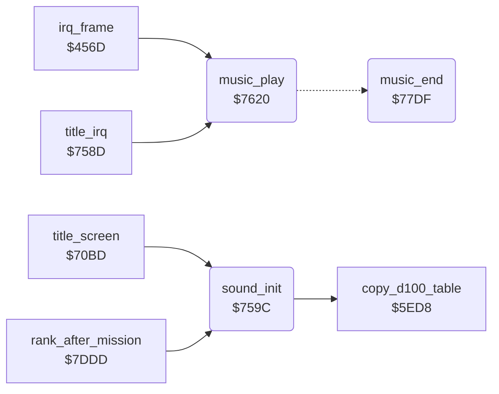

<!-- Generated by c64-docs from knowledge revision 20261024T232120.926-729orp and .c64-re-tools/local/generated/src/source-map.json. Do not edit: change the knowledge, generate the source again, then run docs.ts generate. -->
# music/music_player.asm: Sound initialization and title tune

Range `$759C-$7B61`. Source: [music/music_player.asm](../../../../src/music/music_player.asm). Index: [the reference](../../index.md).

## Call graph

A solid arrow is a call, a thick arrow a table entry, a dotted arrow a jump. Rounded nodes are in this file.

## Data

| Range | Type | Name | Read by | Written by |
|---|---|---|---|---|
| [`$77E5`](../../../../src/music/music_player.asm#L266)-`$77F0` | bytes of 12 | [`note_freq_lo`](../../../../src/music/music_player.asm#L265) | [`music_play`](music_player.md#music_play) |  |
| [`$77F1`](../../../../src/music/music_player.asm#L268)-`$77FC` | bytes of 12 | [`note_freq_hi`](../../../../src/music/music_player.asm#L267) | [`music_play`](music_player.md#music_play) |  |
| [`$77FD`](../../../../src/music/music_player.asm#L270) | bytes | [`music_tempo`](../../../../src/music/music_player.asm#L269) | [`sound_init`](music_player.md#sound_init), [`music_play`](music_player.md#music_play) |  |
| [`$77FE`](../../../../src/music/music_player.asm#L273)-`$7927` | bytes of 2 | [`tune_voice1`](../../../../src/music/music_player.asm#L272) |  |  |
| [`$7928`](../../../../src/music/music_player.asm#L424)-`$7A2D` | bytes of 2 | [`tune_voice2`](../../../../src/music/music_player.asm#L423) |  |  |
| [`$7A2E`](../../../../src/music/music_player.asm#L557)-`$7B61` | bytes of 2 | [`tune_voice3`](../../../../src/music/music_player.asm#L556) |  |  |

## Names

### [`sound_init`](../../../../src/music/music_player.asm#L6) `$759C`

*routine*

Clears the SID, sets the three voices to pulse, volume 6 AND $409c, and starts the tune. Then calls $5ed8.

- **Called from:** [`title_screen`](../screen/title_screen.md#title_screen) [`$7173`](../../../../src/screen/title_screen.asm#L84), [`rank_after_mission`](../game/rank.md#rank_after_mission) [`$7ECF`](../../../../src/game/rank.asm#L228)
- **Calls:** [`copy_d100_table`](../protection/d100_table.md#copy_d100_table)
- **Reads:** [`sound_volume`](../data/variables.md#sound_volume), [`music_tempo`](music_player.md#music_tempo)
- **Writes:** [`FRELO1`](../../memory-map.md#FRELO1), [`CUTLO`](../../memory-map.md#CUTLO), [`music_ended`](../data/variables.md#music_ended), [`ATDCY1`](../../memory-map.md#ATDCY1), [`ATDCY2`](../../memory-map.md#ATDCY2), [`ATDCY3`](../../memory-map.md#ATDCY3), [`SUREL1`](../../memory-map.md#SUREL1), [`SUREL2`](../../memory-map.md#SUREL2), [`SUREL3`](../../memory-map.md#SUREL3), [`SIGVOL`](../../memory-map.md#SIGVOL), [`PWHI1`](../../memory-map.md#PWHI1), [`PWHI2`](../../memory-map.md#PWHI2), [`PWHI3`](../../memory-map.md#PWHI3), [`VCREG1`](../../memory-map.md#VCREG1), [`VCREG2`](../../memory-map.md#VCREG2), [`VCREG3`](../../memory-map.md#VCREG3), [`music_ptr_1`](../../memory-map.md#music_ptr_1), [`music_ptr_1+1`](../../memory-map.md#music_ptr_1), [`music_ptr_2`](../../memory-map.md#music_ptr_2), [`music_ptr_2+1`](../../memory-map.md#music_ptr_2), [`music_ptr_3`](../../memory-map.md#music_ptr_3), [`music_ptr_3+1`](../../memory-map.md#music_ptr_3), [`music_dur_1`](../../memory-map.md#music_dur_1), [`music_dur_2`](../../memory-map.md#music_dur_2), [`music_dur_3`](../../memory-map.md#music_dur_3), [`music_gate_1`](../../memory-map.md#music_gate_1), [`music_gate_2`](../../memory-map.md#music_gate_2), [`music_gate_3`](../../memory-map.md#music_gate_3), [`music_tempo_count`](../../memory-map.md#music_tempo_count)

### [`sound_init_clear_sid`](../../../../src/music/music_player.asm#L9) `$75A0`

*label*

- **Jumped to from:** [`sound_init`](music_player.md#sound_init) [`$75A4`](../../../../src/music/music_player.asm#L12)

### [`music_play`](../../../../src/music/music_player.asm#L51) `$7620`

*routine*

Plays the tune: each 3 frames (music_tempo) it reads the next note of each voice whose duration count is 0.

- **Called from:** [`irq_frame`](../irq/frame_irq.md#irq_frame) [`$4839`](../../../../src/irq/frame_irq.asm#L362), [`title_irq`](../irq/title_irq.md#title_irq) [`$7590`](../../../../src/irq/title_irq.asm#L8)
- **Jumps to:** [`music_end`](music_player.md#music_end)
- **Reads:** [`music_tempo_count`](../../memory-map.md#music_tempo_count), [`music_tempo`](music_player.md#music_tempo), [`music_dur_1`](../../memory-map.md#music_dur_1), [`music_ptr_1`](../../memory-map.md#music_ptr_1), [`music_ptr_1+1`](../../memory-map.md#music_ptr_1), [`row_ptr`](../../memory-map.md#row_ptr), [`note_freq_lo`](music_player.md#note_freq_lo), [`note_freq_hi`](music_player.md#note_freq_hi), [`music_freq_1+1`](../../memory-map.md#music_freq_1), [`music_freq_1`](../../memory-map.md#music_freq_1), [`music_dur_2`](../../memory-map.md#music_dur_2), [`music_ptr_2`](../../memory-map.md#music_ptr_2), [`music_ptr_2+1`](../../memory-map.md#music_ptr_2), [`music_freq_2+1`](../../memory-map.md#music_freq_2), [`music_freq_2`](../../memory-map.md#music_freq_2), [`music_dur_3`](../../memory-map.md#music_dur_3), [`music_ptr_3`](../../memory-map.md#music_ptr_3), [`music_ptr_3+1`](../../memory-map.md#music_ptr_3), [`music_freq_3+1`](../../memory-map.md#music_freq_3), [`music_freq_3`](../../memory-map.md#music_freq_3), [`music_gate_1`](../../memory-map.md#music_gate_1), [`music_wave_1`](../../memory-map.md#music_wave_1), [`music_gate_2`](../../memory-map.md#music_gate_2), [`music_wave_2`](../../memory-map.md#music_wave_2), [`music_gate_3`](../../memory-map.md#music_gate_3), [`music_wave_3`](../../memory-map.md#music_wave_3)
- **Writes:** [`music_tempo_count`](../../memory-map.md#music_tempo_count), [`row_ptr`](../../memory-map.md#row_ptr), [`row_ptr_hi`](../../memory-map.md#row_ptr_hi), [`music_dur_1`](../../memory-map.md#music_dur_1), [`music_freq_1`](../../memory-map.md#music_freq_1), [`music_freq_1+1`](../../memory-map.md#music_freq_1), [`music_wave_1`](../../memory-map.md#music_wave_1), [`music_gate_1`](../../memory-map.md#music_gate_1), [`music_ptr_1`](../../memory-map.md#music_ptr_1), [`music_ptr_1+1`](../../memory-map.md#music_ptr_1), [`music_dur_2`](../../memory-map.md#music_dur_2), [`music_freq_2`](../../memory-map.md#music_freq_2), [`music_freq_2+1`](../../memory-map.md#music_freq_2), [`music_wave_2`](../../memory-map.md#music_wave_2), [`music_gate_2`](../../memory-map.md#music_gate_2), [`music_ptr_2`](../../memory-map.md#music_ptr_2), [`music_ptr_2+1`](../../memory-map.md#music_ptr_2), [`music_dur_3`](../../memory-map.md#music_dur_3), [`music_freq_3`](../../memory-map.md#music_freq_3), [`music_freq_3+1`](../../memory-map.md#music_freq_3), [`music_wave_3`](../../memory-map.md#music_wave_3), [`music_gate_3`](../../memory-map.md#music_gate_3), [`music_ptr_3`](../../memory-map.md#music_ptr_3), [`music_ptr_3+1`](../../memory-map.md#music_ptr_3), [`FRELO1`](../../memory-map.md#FRELO1), [`FREHI1`](../../memory-map.md#FREHI1), [`FRELO2`](../../memory-map.md#FRELO2), [`FREHI2`](../../memory-map.md#FREHI2), [`FRELO3`](../../memory-map.md#FRELO3), [`FREHI3`](../../memory-map.md#FREHI3), [`VCREG1`](../../memory-map.md#VCREG1), [`VCREG2`](../../memory-map.md#VCREG2), [`VCREG3`](../../memory-map.md#VCREG3)

### [`music_play_tick`](../../../../src/music/music_player.asm#L55) `$7628`

*label*

- **Jumped to from:** [`music_play`](music_player.md#music_play) [`$7623`](../../../../src/music/music_player.asm#L53)

### [`music_voice1_next`](../../../../src/music/music_player.asm#L62) `$7637`

*label*

- **Jumped to from:** [`music_play`](music_player.md#music_play) [`$7632`](../../../../src/music/music_player.asm#L60)

### [`music_voice1_note`](../../../../src/music/music_player.asm#L68) `$764A`

*label*

- **Jumped to from:** [`music_play`](music_player.md#music_play) [`$7645`](../../../../src/music/music_player.asm#L66)

### [`music_voice1_pitch`](../../../../src/music/music_player.asm#L74) `$7655`

*label*

Low nibble = note 0-11, high nibble = octave; the frequency is shifted right 7 - octave times.

- **Jumped to from:** [`music_play`](music_player.md#music_play) [`$7650`](../../../../src/music/music_player.asm#L72)

### [`music_voice1_octave`](../../../../src/music/music_player.asm#L91) `$7670`

*label*

- **Jumped to from:** [`music_play`](music_player.md#music_play) [`$7679`](../../../../src/music/music_player.asm#L96)

### [`music_voice1_gate_on`](../../../../src/music/music_player.asm#L97) `$767C`

*label*

Pulse waveform, gate on.

- **Jumped to from:** [`music_play`](music_player.md#music_play) [`$7670`](../../../../src/music/music_player.asm#L92)

### [`music_voice1_rest`](../../../../src/music/music_player.asm#L101) `$7684`

*label*

- **Jumped to from:** [`music_play`](music_player.md#music_play) [`$7652`](../../../../src/music/music_player.asm#L73)

### [`music_voice1_advance`](../../../../src/music/music_player.asm#L104) `$7689`

*label*

- **Jumped to from:** [`music_play`](music_player.md#music_play) [`$7681`](../../../../src/music/music_player.asm#L100)

### [`music_voice2`](../../../../src/music/music_player.asm#L113) `$769C`

*label*

- **Jumped to from:** [`music_play`](music_player.md#music_play) [`$7634`](../../../../src/music/music_player.asm#L61), [`music_play`](music_player.md#music_play) [`$7697`](../../../../src/music/music_player.asm#L111)

### [`music_voice2_next`](../../../../src/music/music_player.asm#L117) `$76A4`

*label*

- **Jumped to from:** [`music_play`](music_player.md#music_play) [`$769F`](../../../../src/music/music_player.asm#L115)

### [`music_voice2_note`](../../../../src/music/music_player.asm#L124) `$76B7`

*label*

- **Jumped to from:** [`music_play`](music_player.md#music_play) [`$76B2`](../../../../src/music/music_player.asm#L121)

### [`music_voice2_pitch`](../../../../src/music/music_player.asm#L130) `$76C2`

*label*

- **Jumped to from:** [`music_play`](music_player.md#music_play) [`$76BD`](../../../../src/music/music_player.asm#L128)

### [`music_voice2_octave`](../../../../src/music/music_player.asm#L147) `$76DD`

*label*

- **Jumped to from:** [`music_play`](music_player.md#music_play) [`$76E6`](../../../../src/music/music_player.asm#L152)

### [`music_voice2_gate_on`](../../../../src/music/music_player.asm#L153) `$76E9`

*label*

- **Jumped to from:** [`music_play`](music_player.md#music_play) [`$76DD`](../../../../src/music/music_player.asm#L148)

### [`music_voice2_rest`](../../../../src/music/music_player.asm#L157) `$76F1`

*label*

- **Jumped to from:** [`music_play`](music_player.md#music_play) [`$76BF`](../../../../src/music/music_player.asm#L129)

### [`music_voice2_advance`](../../../../src/music/music_player.asm#L160) `$76F6`

*label*

- **Jumped to from:** [`music_play`](music_player.md#music_play) [`$76EE`](../../../../src/music/music_player.asm#L156)

### [`music_voice3`](../../../../src/music/music_player.asm#L169) `$7709`

*label*

- **Jumped to from:** [`music_play`](music_player.md#music_play) [`$76A1`](../../../../src/music/music_player.asm#L116), [`music_play`](music_player.md#music_play) [`$7704`](../../../../src/music/music_player.asm#L167)

### [`music_voice3_next`](../../../../src/music/music_player.asm#L173) `$7711`

*label*

- **Jumped to from:** [`music_play`](music_player.md#music_play) [`$770C`](../../../../src/music/music_player.asm#L171)

### [`music_voice3_note`](../../../../src/music/music_player.asm#L180) `$7724`

*label*

- **Jumped to from:** [`music_play`](music_player.md#music_play) [`$771F`](../../../../src/music/music_player.asm#L177)

### [`music_voice3_pitch`](../../../../src/music/music_player.asm#L186) `$772F`

*label*

- **Jumped to from:** [`music_play`](music_player.md#music_play) [`$772A`](../../../../src/music/music_player.asm#L184)

### [`music_voice3_octave`](../../../../src/music/music_player.asm#L203) `$774A`

*label*

- **Jumped to from:** [`music_play`](music_player.md#music_play) [`$7753`](../../../../src/music/music_player.asm#L208)

### [`music_voice3_gate_on`](../../../../src/music/music_player.asm#L209) `$7756`

*label*

- **Jumped to from:** [`music_play`](music_player.md#music_play) [`$774A`](../../../../src/music/music_player.asm#L204)

### [`music_voice3_rest`](../../../../src/music/music_player.asm#L213) `$775E`

*label*

- **Jumped to from:** [`music_play`](music_player.md#music_play) [`$772C`](../../../../src/music/music_player.asm#L185)

### [`music_voice3_advance`](../../../../src/music/music_player.asm#L216) `$7763`

*label*

- **Jumped to from:** [`music_play`](music_player.md#music_play) [`$775B`](../../../../src/music/music_player.asm#L212)

### [`music_write_sid`](../../../../src/music/music_player.asm#L225) `$7776`

*label*

Writes the three frequencies; a new note writes $40 first to restart the envelope.

- **Jumped to from:** [`music_play`](music_player.md#music_play) [`$770E`](../../../../src/music/music_player.asm#L172), [`music_play`](music_player.md#music_play) [`$7771`](../../../../src/music/music_player.asm#L223)

### [`music_write_voice2`](../../../../src/music/music_player.asm#L235) `$77AA`

*label*

- **Jumped to from:** [`music_play`](music_player.md#music_play) [`$779D`](../../../../src/music/music_player.asm#L230)

### [`music_write_voice3`](../../../../src/music/music_player.asm#L242) `$77BA`

*label*

- **Jumped to from:** [`music_play`](music_player.md#music_play) [`$77AD`](../../../../src/music/music_player.asm#L237)

### [`music_count_down`](../../../../src/music/music_player.asm#L249) `$77CA`

*label*

- **Jumped to from:** [`music_play`](music_player.md#music_play) [`$77BD`](../../../../src/music/music_player.asm#L244)

### [`music_play_done`](../../../../src/music/music_player.asm#L257) `$77DE`

*label*

- **Jumped to from:** [`music_play`](music_player.md#music_play) [`$7625`](../../../../src/music/music_player.asm#L54)

### [`music_end`](../../../../src/music/music_player.asm#L260) `$77DF`

*routine*

End of the tune: sets $4085 = $ff. The title screen then starts the demo.

- **Jumped to from:** [`music_play`](music_player.md#music_play) [`$7647`](../../../../src/music/music_player.asm#L67), [`music_play`](music_player.md#music_play) [`$76B4`](../../../../src/music/music_player.asm#L123), [`music_play`](music_player.md#music_play) [`$7721`](../../../../src/music/music_player.asm#L179)
- **Writes:** [`music_ended`](../data/variables.md#music_ended)

### [`note_freq_lo`](../../../../src/music/music_player.asm#L265) `$77E5-$77F0`

*data*

SID frequency of the 12 notes of the top octave, low bytes, then high bytes at $77f1.

- **Read by:** [`music_play`](music_player.md#music_play) [`$7659`](../../../../src/music/music_player.asm#L78), [`music_play`](music_player.md#music_play) [`$76C6`](../../../../src/music/music_player.asm#L134), [`music_play`](music_player.md#music_play) [`$7733`](../../../../src/music/music_player.asm#L190)

### [`note_freq_hi`](../../../../src/music/music_player.asm#L267) `$77F1-$77FC`

*data*

- **Read by:** [`music_play`](music_player.md#music_play) [`$765F`](../../../../src/music/music_player.asm#L80), [`music_play`](music_player.md#music_play) [`$76CC`](../../../../src/music/music_player.asm#L136), [`music_play`](music_player.md#music_play) [`$7739`](../../../../src/music/music_player.asm#L192)

### [`music_tempo`](../../../../src/music/music_player.asm#L269) `$77FD`

*data*

Frames per tune tick (3). music_play reloads its counter with this value minus 1 and ticks when it goes below 0.

- **Read by:** [`sound_init`](music_player.md#sound_init) [`$7616`](../../../../src/music/music_player.asm#L46), [`music_play`](music_player.md#music_play) [`$7628`](../../../../src/music/music_player.asm#L56)

### [`tune_voice1`](../../../../src/music/music_player.asm#L272) `$77FE-$7927`

*data*

Title tune, voice 1: pairs of note and duration in ticks. Note $80 = rest; duration 0 ends the tune.

### [`tune_voice2`](../../../../src/music/music_player.asm#L423) `$7928-$7A2D`

*data*

Title tune, voice 2: pairs of note and duration.

### [`tune_voice3`](../../../../src/music/music_player.asm#L556) `$7A2E-$7B61`

*data*

Title tune, voice 3: pairs of note and duration.
