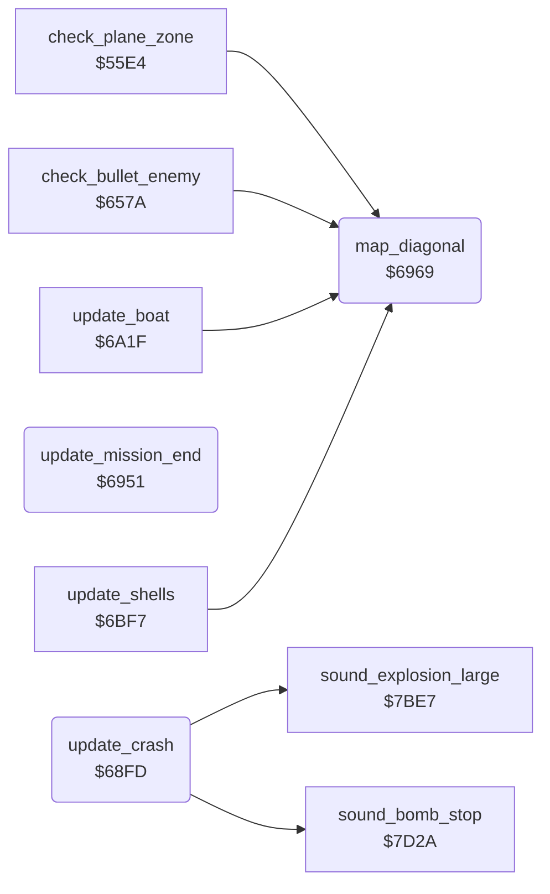

<!-- Generated by c64-docs from knowledge revision 20261025T214620.804-eudhn0 and .c64-re-tools/local/generated/src/source-map.json. Do not edit: change the knowledge, generate the source again, then run docs.ts generate. -->
# plane/crash.asm: Crash and mission end sequences

Range `$68FD-$6973`. Source: [plane/crash.asm](../../../../src/plane/crash.asm). Index: [the reference](../../index.md).

## Routines

| Routine | Address | Reached from | Summary |
|---|---|---|---|
| [`update_crash`](crash.md#update_crash) | `$68FD` | [`$4449`](../../../../src/screen/status_line.asm#L74) | Runs in each main loop pass after a crash (from main_loop_draw_status): shows the wreck, stops the engine sound, counts down $4072 and then goes to rank_after_crash. |
| [`update_mission_end`](crash.md#update_mission_end) | `$6951` | [`$4451`](../../../../src/screen/status_line.asm#L78) | Runs in each main loop pass when $4089 = 1 (mission done): counts down $4072 to $96 and then goes to rank_after_mission. |
| [`map_diagonal`](crash.md#map_diagonal) | `$6969` | [`check_plane_zone`](../ground/city_water_55e4.md#check_plane_zone), [`check_bullet_enemy`](weapons.md#check_bullet_enemy), [`update_boat`](../enemy/boat.md#update_boat), [`update_shells`](../enemy/flak_shells.md#update_shells) | Returns A = X + Y / 2: the diagonal line of a screen position. |

## Call graph

A solid arrow is a call, a thick arrow a table entry. Rounded nodes are in this file.

## Details

### [`update_crash`](../../../../src/plane/crash.asm#L6) `$68FD`

*routine*

Runs in each main loop pass after a crash (from main_loop_draw_status): shows the wreck, stops the engine sound, counts down $4072 and then goes to rank_after_crash.

- **Called from:** [`$4449`](../../../../src/screen/status_line.asm#L74)
- **Calls:** [`sound_bomb_stop`](../sound/sound_effects.md#sound_bomb_stop), [`sound_explosion_large`](../sound/sound_effects.md#sound_explosion_large)
- **Jumps to:** [`rank_after_crash`](../game/rank.md#rank_after_crash)
- **Reads:** [`sprite_mc_mask`](../data/variables.md#sprite_mc_mask), [`plane_x`](../data/variables.md#plane_x), [`plane_y`](../data/variables.md#plane_y), [`crash_timer`](../data/variables.md#crash_timer)
- **Writes:** [`game_frozen`](../data/variables.md#game_frozen), [`plane_frame`](../data/variables.md#plane_frame), [`shadow_frame`](../data/variables.md#shadow_frame), [`plane_colour`](../data/variables.md#plane_colour), [`shadow_colour`](../data/variables.md#shadow_colour), [`VCREG1`](../../memory-map.md#VCREG1), [`status_bg_colour`](../data/variables.md#status_bg_colour), [`sprite_mc_mask`](../data/variables.md#sprite_mc_mask), [`shadow_x`](../data/variables.md#shadow_x), [`shadow_y`](../data/variables.md#shadow_y), [`flash_timer`](../data/variables.md#flash_timer), [`crash_timer`](../data/variables.md#crash_timer)

| Label | Address | Comment |
|---|---|---|
| [`update_crash_timer`](../../../../src/plane/crash.asm#L37) | `$6948` |  |
| [`update_crash_end`](../../../../src/plane/crash.asm#L41) | `$694E` |  |

### [`update_mission_end`](../../../../src/plane/crash.asm#L44) `$6951`

*routine*

Runs in each main loop pass when $4089 = 1 (mission done): counts down $4072 to $96 and then goes to rank_after_mission.

- **Called from:** [`$4451`](../../../../src/screen/status_line.asm#L78)
- **Jumps to:** [`rank_after_mission`](../game/rank.md#rank_after_mission)
- **Reads:** [`crash_timer`](../data/variables.md#crash_timer)
- **Writes:** [`game_frozen`](../data/variables.md#game_frozen), [`status_bg_colour`](../data/variables.md#status_bg_colour), [`crash_timer`](../data/variables.md#crash_timer)

| Label | Address | Comment |
|---|---|---|
| [`update_mission_end_rank`](../../../../src/plane/crash.asm#L54) | `$6966` |  |

### [`map_diagonal`](../../../../src/plane/crash.asm#L57) `$6969`

*routine*

Returns A = X + Y / 2: the diagonal line of a screen position. Uses $4091. X and Y do not change.

- **Called from:** [`check_plane_zone`](../ground/city_water_55e4.md#check_plane_zone), [`check_bullet_enemy`](weapons.md#check_bullet_enemy), [`update_boat`](../enemy/boat.md#update_boat), [`update_shells`](../enemy/flak_shells.md#update_shells)
- **Reads:** [`diag_temp`](../data/variables.md#diag_temp)
- **Writes:** [`diag_temp`](../data/variables.md#diag_temp)
