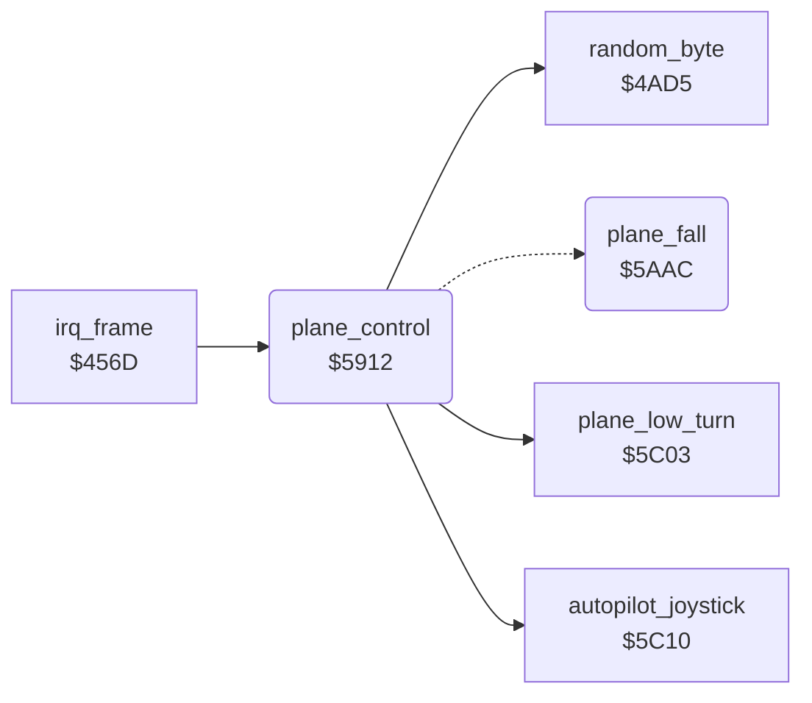

<!-- Generated by c64-docs from knowledge revision 20261024T232120.926-729orp and .c64-re-tools/local/generated/src/source-map.json. Do not edit: change the knowledge, generate the source again, then run docs.ts generate. -->
# plane/plane_control.asm: Player plane control

Range `$5912-$5AD0`. Source: [plane/plane_control.asm](../../../../src/plane/plane_control.asm). Index: [the reference](../../index.md).

## Call graph

A solid arrow is a call, a thick arrow a table entry, a dotted arrow a jump. Rounded nodes are in this file.

## Names

### [`plane_control`](../../../../src/plane/plane_control.asm#L6) `$5912`

*routine*

Reads the joystick in port 2 and moves the plane (sprite 0) and its shadow (sprite 6): X, ground Y and altitude $40da.

- **Called from:** [`irq_frame`](../irq/frame_irq.md#irq_frame) [`$46C1`](../../../../src/irq/frame_irq.asm#L170)
- **Calls:** [`autopilot_joystick`](../input/autopilot.md#autopilot_joystick), [`random_byte`](../game/random.md#random_byte), [`plane_low_turn`](plane_limits.md#plane_low_turn)
- **Jumps to:** [`plane_fall`](plane_control.md#plane_fall)
- **Reads:** [`plane_failing`](../data/variables.md#plane_failing), [`CIAPRA`](../../memory-map.md#CIAPRA), [`opt_reverse_control`](../data/variables.md#opt_reverse_control), [`zp_count`](../../memory-map.md#zp_count), [`demo_mode`](../data/variables.md#demo_mode), [`engine_damage`](../data/variables.md#engine_damage), [`altitude`](../data/variables.md#altitude), [`joy_state`](../data/variables.md#joy_state), [`climb_blocked`](../data/variables.md#climb_blocked), [`damage_motor`](../data/variables.md#damage_motor), [`frame_count`](../data/variables.md#frame_count), [`shadow_x`](../data/variables.md#shadow_x), [`zp_temp6`](../../memory-map.md#zp_temp6), [`zp_temp4`](../../memory-map.md#zp_temp4), [`plane_state`](../data/variables.md#plane_state), [`shadow_y`](../data/variables.md#shadow_y), [`zp_temp5`](../../memory-map.md#zp_temp5), [`shadow_frame`](../data/variables.md#shadow_frame), [`plane_frame`](../data/variables.md#plane_frame), [`invincible`](../data/variables.md#invincible), [`sprite_mc_mask`](../data/variables.md#sprite_mc_mask)
- **Writes:** [`climb_blocked`](../data/variables.md#climb_blocked), [`diving`](../data/variables.md#diving), [`zp_temp6`](../../memory-map.md#zp_temp6), [`zp_temp4`](../../memory-map.md#zp_temp4), [`zp_temp5`](../../memory-map.md#zp_temp5), [`CIAPRA`](../../memory-map.md#CIAPRA), [`CIAPRB`](../../memory-map.md#CIAPRB), [`zp_count`](../../memory-map.md#zp_count), [`altitude`](../data/variables.md#altitude), [`joy_state`](../data/variables.md#joy_state), [`plane_frame`](../data/variables.md#plane_frame), [`shadow_frame`](../data/variables.md#shadow_frame), [`plane_moved_y`](../data/variables.md#plane_moved_y), [`shadow_x`](../data/variables.md#shadow_x), [`shadow_y`](../data/variables.md#shadow_y), [`plane_y`](../data/variables.md#plane_y), [`plane_colour`](../data/variables.md#plane_colour), [`shadow_colour`](../data/variables.md#shadow_colour), [`plane_x`](../data/variables.md#plane_x), [`engine_damage`](../data/variables.md#engine_damage), [`plane_failing`](../data/variables.md#plane_failing), [`sprite_mc_mask`](../data/variables.md#sprite_mc_mask)

### [`plane_control_read`](../../../../src/plane/plane_control.asm#L14) `$5921`

*label*

- **Jumped to from:** [`plane_control`](plane_control.md#plane_control) [`$5915`](../../../../src/plane/plane_control.asm#L8), [`plane_control`](plane_control.md#plane_control) [`$591C`](../../../../src/plane/plane_control.asm#L11)

### [`plane_control_demo`](../../../../src/plane/plane_control.asm#L40) `$5952`

*label*

demo_mode nonzero: the autopilot gives the joystick value. title_screen sets demo_mode when the tune ends.

- **Jumped to from:** [`plane_control`](plane_control.md#plane_control) [`$593C`](../../../../src/plane/plane_control.asm#L26)

### [`plane_control_motor`](../../../../src/plane/plane_control.asm#L44) `$595A`

*label*

$4070 nonzero: a random value replaces the joystick and the plane sinks.

- **Jumped to from:** [`plane_control`](plane_control.md#plane_control) [`$5955`](../../../../src/plane/plane_control.asm#L42)

### [`plane_control_steer`](../../../../src/plane/plane_control.asm#L49) `$5965`

*label*

$4016 = joystick bits, low = pressed.

- **Jumped to from:** [`plane_control`](plane_control.md#plane_control) [`$595D`](../../../../src/plane/plane_control.asm#L46)

### [`plane_control_right`](../../../../src/plane/plane_control.asm#L61) `$5980`

*label*

- **Jumped to from:** [`plane_control`](plane_control.md#plane_control) [`$596A`](../../../../src/plane/plane_control.asm#L52)

### [`plane_control_level`](../../../../src/plane/plane_control.asm#L73) `$599B`

*label*

Level flight: plane image $e0, shadow image $e6.

- **Jumped to from:** [`plane_control`](plane_control.md#plane_control) [`$5985`](../../../../src/plane/plane_control.asm#L64)

### [`plane_control_vertical`](../../../../src/plane/plane_control.asm#L78) `$59A5`

*label*

- **Jumped to from:** [`plane_control`](plane_control.md#plane_control) [`$597D`](../../../../src/plane/plane_control.asm#L60), [`plane_control`](plane_control.md#plane_control) [`$5998`](../../../../src/plane/plane_control.asm#L72)

### [`plane_control_fwd`](../../../../src/plane/plane_control.asm#L85) `$59B2`

*label*

- **Jumped to from:** [`plane_control`](plane_control.md#plane_control) [`$59AC`](../../../../src/plane/plane_control.asm#L82)

### [`plane_control_fwd_done`](../../../../src/plane/plane_control.asm#L92) `$59C0`

*label*

- **Jumped to from:** [`plane_control`](plane_control.md#plane_control) [`$59B5`](../../../../src/plane/plane_control.asm#L87)

### [`plane_control_back_test`](../../../../src/plane/plane_control.asm#L94) `$59C3`

*label*

$0a or $06: bit 0 with left or right.

- **Jumped to from:** [`plane_control`](plane_control.md#plane_control) [`$59B0`](../../../../src/plane/plane_control.asm#L84)

### [`plane_control_back`](../../../../src/plane/plane_control.asm#L99) `$59CB`

*label*

Ground Y step +2: the plane moves down the screen.

- **Jumped to from:** [`plane_control`](plane_control.md#plane_control) [`$59C5`](../../../../src/plane/plane_control.asm#L96)

### [`plane_control_climb_test`](../../../../src/plane/plane_control.asm#L104) `$59D5`

*label*

Bit 1 alone: climb by 2, unless climb_blocked $4045 is set.

- **Jumped to from:** [`plane_control`](plane_control.md#plane_control) [`$59C9`](../../../../src/plane/plane_control.asm#L98)

### [`plane_control_dive_test`](../../../../src/plane/plane_control.asm#L112) `$59E5`

*label*

Bit 0 alone: dive by 2 and set the dive flag $4046.

- **Jumped to from:** [`plane_control`](plane_control.md#plane_control) [`$59D7`](../../../../src/plane/plane_control.asm#L106)

### [`plane_control_apply`](../../../../src/plane/plane_control.asm#L120) `$59F5`

*label*

$40bb nonzero: the plane does not move when frame bit 1 is set.

- **Jumped to from:** [`plane_control`](plane_control.md#plane_control) [`$59C0`](../../../../src/plane/plane_control.asm#L93), [`plane_control`](plane_control.md#plane_control) [`$59D2`](../../../../src/plane/plane_control.asm#L103), [`plane_control`](plane_control.md#plane_control) [`$59DC`](../../../../src/plane/plane_control.asm#L108), [`plane_control`](plane_control.md#plane_control) [`$59E2`](../../../../src/plane/plane_control.asm#L111), [`plane_control`](plane_control.md#plane_control) [`$59EA`](../../../../src/plane/plane_control.asm#L115)

### [`plane_control_move_x`](../../../../src/plane/plane_control.asm#L127) `$5A04`

*label*

- **Jumped to from:** [`plane_control`](plane_control.md#plane_control) [`$59F8`](../../../../src/plane/plane_control.asm#L122), [`plane_control`](plane_control.md#plane_control) [`$59FF`](../../../../src/plane/plane_control.asm#L125)

### [`plane_control_x_max`](../../../../src/plane/plane_control.asm#L136) `$5A17`

*label*

- **Jumped to from:** [`plane_control`](plane_control.md#plane_control) [`$5A12`](../../../../src/plane/plane_control.asm#L134)

### [`plane_control_altitude`](../../../../src/plane/plane_control.asm#L141) `$5A21`

*label*

- **Jumped to from:** [`plane_control`](plane_control.md#plane_control) [`$5A1C`](../../../../src/plane/plane_control.asm#L139)

### [`plane_control_alt_min`](../../../../src/plane/plane_control.asm#L154) `$5A3B`

*label*

- **Jumped to from:** [`plane_control`](plane_control.md#plane_control) [`$5A31`](../../../../src/plane/plane_control.asm#L149), [`plane_control`](plane_control.md#plane_control) [`$5A35`](../../../../src/plane/plane_control.asm#L151)

### [`plane_control_ground_y`](../../../../src/plane/plane_control.asm#L157) `$5A40`

*label*

- **Jumped to from:** [`plane_control`](plane_control.md#plane_control) [`$5A2A`](../../../../src/plane/plane_control.asm#L146), [`plane_control`](plane_control.md#plane_control) [`$5A39`](../../../../src/plane/plane_control.asm#L153)

### [`plane_control_set_y`](../../../../src/plane/plane_control.asm#L161) `$5A46`

*label*

- **Jumped to from:** [`plane_control`](plane_control.md#plane_control) [`$5A4F`](../../../../src/plane/plane_control.asm#L166)

### [`plane_control_plane_y`](../../../../src/plane/plane_control.asm#L167) `$5A52`

*label*

Plane Y = shadow Y - altitude.

- **Jumped to from:** [`plane_control`](plane_control.md#plane_control) [`$5A4B`](../../../../src/plane/plane_control.asm#L164)

### [`plane_control_free`](../../../../src/plane/plane_control.asm#L176) `$5A65`

*label*

- **Jumped to from:** [`plane_control`](plane_control.md#plane_control) [`$5A5B`](../../../../src/plane/plane_control.asm#L172)

### [`plane_control_sprites`](../../../../src/plane/plane_control.asm#L179) `$5A6A`

*label*

Plane white, shadow black.

- **Jumped to from:** [`plane_control`](plane_control.md#plane_control) [`$5A01`](../../../../src/plane/plane_control.asm#L126), [`plane_control`](plane_control.md#plane_control) [`$5A62`](../../../../src/plane/plane_control.asm#L175)

### [`plane_control_flags`](../../../../src/plane/plane_control.asm#L203) `$5AA1`

*label*

- **Jumped to from:** [`plane_control`](plane_control.md#plane_control) [`$5A92`](../../../../src/plane/plane_control.asm#L197)

### [`plane_fall`](../../../../src/plane/plane_control.asm#L210) `$5AAC`

*routine*

Crash state 2: the plane falls. Spin images $fc/$fd, plane black, altitude - 1 each frame.

- **Jumped to from:** [`plane_control`](plane_control.md#plane_control) [`$591E`](../../../../src/plane/plane_control.asm#L13)
- **Reads:** [`frame_count`](../data/variables.md#frame_count), [`zp_count`](../../memory-map.md#zp_count), [`altitude`](../data/variables.md#altitude), [`shadow_y`](../data/variables.md#shadow_y)
- **Writes:** [`zp_count`](../../memory-map.md#zp_count), [`shadow_frame`](../data/variables.md#shadow_frame), [`plane_frame`](../data/variables.md#plane_frame), [`plane_colour`](../data/variables.md#plane_colour), [`altitude`](../data/variables.md#altitude), [`plane_y`](../data/variables.md#plane_y)
