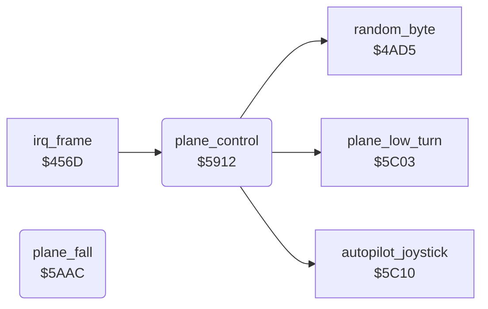

<!-- Generated by c64-docs from knowledge revision 20261025T214620.804-eudhn0 and .c64-re-tools/local/generated/src/source-map.json. Do not edit: change the knowledge, generate the source again, then run docs.ts generate. -->
# plane/plane_control.asm: Player plane control

Range `$5912-$5AD0`. Source: [plane/plane_control.asm](../../../../src/plane/plane_control.asm). Index: [the reference](../../index.md).

## Routines

| Routine | Address | Reached from | Summary |
|---|---|---|---|
| [`plane_control`](plane_control.md#plane_control) | `$5912` | [`irq_frame`](../irq/frame_irq.md#irq_frame) | Reads the joystick in port 2 and moves the plane (sprite 0) and its shadow (sprite 6): X, ground Y and altitude $40da. |
| [`plane_fall`](plane_control.md#plane_fall) | `$5AAC` |  | Crash state 2: the plane falls. |

## Call graph

A solid arrow is a call, a thick arrow a table entry. Rounded nodes are in this file.

## Details

### [`plane_control`](../../../../src/plane/plane_control.asm#L6) `$5912`

*routine*

Reads the joystick in port 2 and moves the plane (sprite 0) and its shadow (sprite 6): X, ground Y and altitude $40da.

- **Called from:** [`irq_frame`](../irq/frame_irq.md#irq_frame)
- **Calls:** [`autopilot_joystick`](../input/autopilot.md#autopilot_joystick), [`random_byte`](../game/random.md#random_byte), [`plane_low_turn`](plane_limits.md#plane_low_turn)
- **Jumps to:** [`plane_fall`](plane_control.md#plane_fall)
- **Reads:** [`plane_failing`](../data/variables.md#plane_failing), [`CIAPRA`](../../memory-map.md#CIAPRA), [`opt_reverse_control`](../data/variables.md#opt_reverse_control), [`zp_count`](../../memory-map.md#zp_count), [`demo_mode`](../data/variables.md#demo_mode), [`engine_damage`](../data/variables.md#engine_damage), [`altitude`](../data/variables.md#altitude), [`joy_state`](../data/variables.md#joy_state), [`climb_blocked`](../data/variables.md#climb_blocked), [`damage_motor`](../data/variables.md#damage_motor), [`frame_count`](../data/variables.md#frame_count), [`shadow_x`](../data/variables.md#shadow_x) and 9 more
- **Writes:** [`climb_blocked`](../data/variables.md#climb_blocked), [`diving`](../data/variables.md#diving), [`zp_temp6`](../../memory-map.md#zp_temp6), [`zp_temp4`](../../memory-map.md#zp_temp4), [`zp_temp5`](../../memory-map.md#zp_temp5), [`CIAPRA`](../../memory-map.md#CIAPRA), [`CIAPRB`](../../memory-map.md#CIAPRB), [`zp_count`](../../memory-map.md#zp_count), [`altitude`](../data/variables.md#altitude), [`joy_state`](../data/variables.md#joy_state), [`plane_frame`](../data/variables.md#plane_frame), [`shadow_frame`](../data/variables.md#shadow_frame) and 10 more

| Label | Address | Comment |
|---|---|---|
| [`plane_control_read`](../../../../src/plane/plane_control.asm#L14) | `$5921` |  |
| [`plane_control_demo`](../../../../src/plane/plane_control.asm#L40) | `$5952` | demo_mode nonzero: the autopilot gives the joystick value. title_screen sets demo_mode when the tune ends. |
| [`plane_control_motor`](../../../../src/plane/plane_control.asm#L44) | `$595A` | $4070 nonzero: a random value replaces the joystick and the plane sinks. |
| [`plane_control_steer`](../../../../src/plane/plane_control.asm#L49) | `$5965` | $4016 = joystick bits, low = pressed. |
| [`plane_control_right`](../../../../src/plane/plane_control.asm#L61) | `$5980` |  |
| [`plane_control_level`](../../../../src/plane/plane_control.asm#L73) | `$599B` | Level flight: plane image $e0, shadow image $e6. |
| [`plane_control_vertical`](../../../../src/plane/plane_control.asm#L78) | `$59A5` |  |
| [`plane_control_fwd`](../../../../src/plane/plane_control.asm#L85) | `$59B2` |  |
| [`plane_control_fwd_done`](../../../../src/plane/plane_control.asm#L92) | `$59C0` |  |
| [`plane_control_back_test`](../../../../src/plane/plane_control.asm#L94) | `$59C3` | $0a or $06: bit 0 with left or right. |
| [`plane_control_back`](../../../../src/plane/plane_control.asm#L99) | `$59CB` | Ground Y step +2: the plane moves down the screen. |
| [`plane_control_climb_test`](../../../../src/plane/plane_control.asm#L104) | `$59D5` | Bit 1 alone: climb by 2, unless climb_blocked $4045 is set. |
| [`plane_control_dive_test`](../../../../src/plane/plane_control.asm#L112) | `$59E5` | Bit 0 alone: dive by 2 and set the dive flag $4046. |
| [`plane_control_apply`](../../../../src/plane/plane_control.asm#L120) | `$59F5` | $40bb nonzero: the plane does not move when frame bit 1 is set. |
| [`plane_control_move_x`](../../../../src/plane/plane_control.asm#L127) | `$5A04` |  |
| [`plane_control_x_max`](../../../../src/plane/plane_control.asm#L136) | `$5A17` |  |
| [`plane_control_altitude`](../../../../src/plane/plane_control.asm#L141) | `$5A21` |  |
| [`plane_control_alt_min`](../../../../src/plane/plane_control.asm#L154) | `$5A3B` |  |
| [`plane_control_ground_y`](../../../../src/plane/plane_control.asm#L157) | `$5A40` |  |
| [`plane_control_set_y`](../../../../src/plane/plane_control.asm#L161) | `$5A46` |  |
| [`plane_control_plane_y`](../../../../src/plane/plane_control.asm#L167) | `$5A52` | Plane Y = shadow Y - altitude. |
| [`plane_control_free`](../../../../src/plane/plane_control.asm#L176) | `$5A65` |  |
| [`plane_control_sprites`](../../../../src/plane/plane_control.asm#L179) | `$5A6A` | Plane white, shadow black. |
| [`plane_control_flags`](../../../../src/plane/plane_control.asm#L203) | `$5AA1` |  |

### [`plane_fall`](../../../../src/plane/plane_control.asm#L210) `$5AAC`

*routine*

Crash state 2: the plane falls. Spin images $fc/$fd, plane black, altitude - 1 each frame.

- **Jumped to from:** [`plane_control`](plane_control.md#plane_control)
- **Reads:** [`frame_count`](../data/variables.md#frame_count), [`zp_count`](../../memory-map.md#zp_count), [`altitude`](../data/variables.md#altitude), [`shadow_y`](../data/variables.md#shadow_y)
- **Writes:** [`zp_count`](../../memory-map.md#zp_count), [`shadow_frame`](../data/variables.md#shadow_frame), [`plane_frame`](../data/variables.md#plane_frame), [`plane_colour`](../data/variables.md#plane_colour), [`altitude`](../data/variables.md#altitude), [`plane_y`](../data/variables.md#plane_y)
