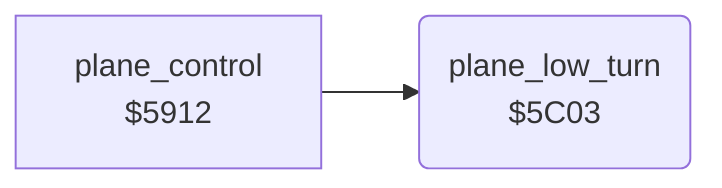

<!-- Generated by c64-docs from knowledge revision 20261024T232120.926-729orp and .c64-re-tools/local/generated/src/source-map.json. Do not edit: change the knowledge, generate the source again, then run docs.ts generate. -->
# plane/plane_limits.asm: Plane low-turn check and drift

Range `$5C03-$5C0F`. Source: [plane/plane_limits.asm](../../../../src/plane/plane_limits.asm). Index: [the reference](../../index.md).

## Call graph

A solid arrow is a call, a thick arrow a table entry, a dotted arrow a jump. Rounded nodes are in this file.

## Names

### [`plane_low_turn`](../../../../src/plane/plane_limits.asm#L6) `$5C03`

*routine*

Called when the plane banks. Below altitude 4 the wing touches the ground: sets the hit flag $4050.

- **Called from:** [`plane_control`](plane_control.md#plane_control) [`$597A`](../../../../src/plane/plane_control.asm#L59), [`plane_control`](plane_control.md#plane_control) [`$5995`](../../../../src/plane/plane_control.asm#L71)
- **Reads:** [`altitude`](../data/variables.md#altitude)
- **Writes:** [`crash_flag`](../data/variables.md#crash_flag)

### [`plane_low_turn_exit`](../../../../src/plane/plane_limits.asm#L12) `$5C0F`

*label*

- **Jumped to from:** [`plane_low_turn`](plane_limits.md#plane_low_turn) [`$5C08`](../../../../src/plane/plane_limits.asm#L9)
