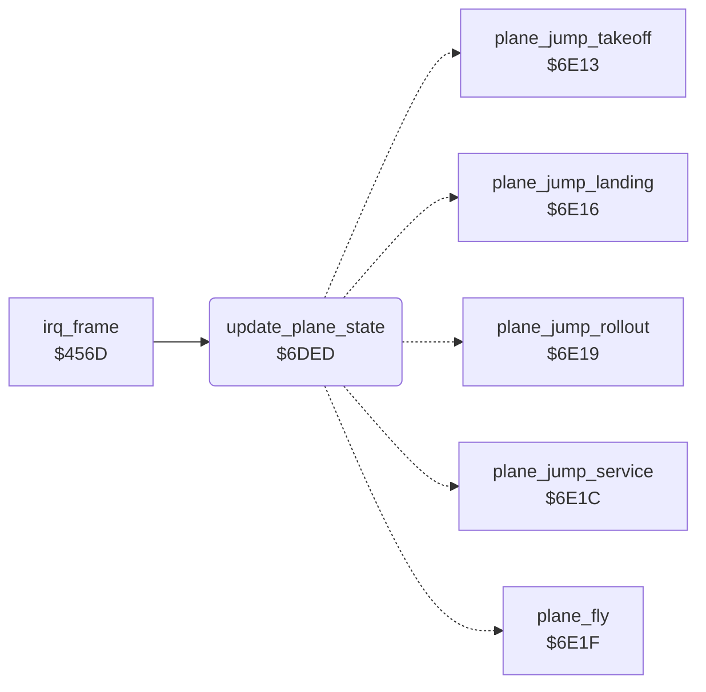

<!-- Generated by c64-docs from knowledge revision 20261024T232120.926-729orp and .c64-re-tools/local/generated/src/source-map.json. Do not edit: change the knowledge, generate the source again, then run docs.ts generate. -->
# plane/plane_state.asm: Plane ground state dispatch

Range `$6DED-$6E12`. Source: [plane/plane_state.asm](../../../../src/plane/plane_state.asm). Index: [the reference](../../index.md).

## Call graph

A solid arrow is a call, a thick arrow a table entry, a dotted arrow a jump. Rounded nodes are in this file.

## Names

### [`update_plane_state`](../../../../src/plane/plane_state.asm#L6) `$6DED`

*routine*

Sets the even-frame flag $405c from the frame counter. On even frames, runs the routine for the ground state $4059.
$405d = flag of the frame before.

- **Called from:** [`irq_frame`](../irq/frame_irq.md#irq_frame) [`$46B0`](../../../../src/irq/frame_irq.asm#L164)
- **Jumps to:** [`plane_fly`](plane_states.md#plane_fly), [`plane_jump_takeoff`](plane_states.md#plane_jump_takeoff), [`plane_jump_landing`](plane_states.md#plane_jump_landing), [`plane_jump_rollout`](plane_states.md#plane_jump_rollout), [`plane_jump_service`](plane_states.md#plane_jump_service)
- **Reads:** [`frame_odd`](../data/variables.md#frame_odd), [`frame_count`](../data/variables.md#frame_count), [`plane_state`](../data/variables.md#plane_state)
- **Writes:** [`frame_odd_prev`](../data/variables.md#frame_odd_prev), [`frame_odd`](../data/variables.md#frame_odd)

### [`update_plane_state_dispatch`](../../../../src/plane/plane_state.asm#L14) `$6DFE`

*label*

- **Jumped to from:** [`update_plane_state`](plane_state.md#update_plane_state) [`$6DFB`](../../../../src/plane/plane_state.asm#L12)
