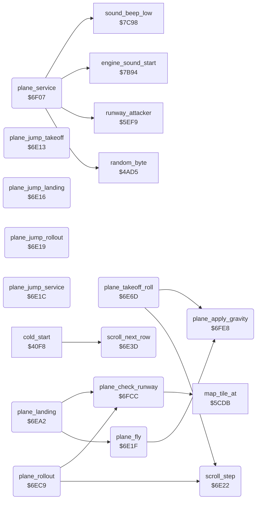

<!-- Generated by c64-docs from knowledge revision 20261025T214620.804-eudhn0 and .c64-re-tools/local/generated/src/source-map.json. Do not edit: change the knowledge, generate the source again, then run docs.ts generate. -->
# plane/plane_states.asm: Plane states: flight, take-off, landing, service

Range `$6E13-$7000`. Source: [plane/plane_states.asm](../../../../src/plane/plane_states.asm). Index: [the reference](../../index.md).

## Routines

| Routine | Address | Reached from | Summary |
|---|---|---|---|
| [`plane_jump_takeoff`](plane_states.md#plane_jump_takeoff) | `$6E13` | [`update_plane_state`](plane_state.md#update_plane_state) | Jump targets of the plane state dispatcher at $6dfe. |
| [`plane_jump_landing`](plane_states.md#plane_jump_landing) | `$6E16` | [`update_plane_state`](plane_state.md#update_plane_state) | State 3: jumps to plane_landing. |
| [`plane_jump_rollout`](plane_states.md#plane_jump_rollout) | `$6E19` | [`update_plane_state`](plane_state.md#update_plane_state) | State 4: jumps to plane_rollout. |
| [`plane_jump_service`](plane_states.md#plane_jump_service) | `$6E1C` | [`update_plane_state`](plane_state.md#update_plane_state) | State 5: jumps to plane_service. |
| [`plane_fly`](plane_states.md#plane_fly) | `$6E1F` | [`plane_landing`](plane_states.md#plane_landing), [`update_plane_state`](plane_state.md#update_plane_state) | State 0, flight: applies gravity, then moves the scroll one step. |
| [`scroll_step`](plane_states.md#scroll_step) | `$6E22` | [`plane_takeoff_roll`](plane_states.md#plane_takeoff_roll), [`plane_rollout`](plane_states.md#plane_rollout) | Moves the diagonal scroll one fine step: $400f += 2, $400e -= 2. |
| [`scroll_next_row`](plane_states.md#scroll_next_row) | `$6E3D` | [`cold_start`](../init/game_start.md#cold_start) | Sets $4011 = 0, $407b = 1, and moves the map row pointer $400c/$400d back $7f bytes; after 48 rows it starts again at $977f. |
| [`plane_takeoff_roll`](plane_states.md#plane_takeoff_roll) | `$6E6D` |  | State 1, take-off roll: adds $4096 to speed $405a. |
| [`plane_landing`](plane_states.md#plane_landing) | `$6EA2` |  | State 3, over an airfield: flies as state 0. |
| [`plane_rollout`](plane_states.md#plane_rollout) | `$6EC9` |  | State 4, roll-out: checks the runway and decreases speed by up to 4 per frame. |
| [`plane_service`](plane_states.md#plane_service) | `$6F07` |  | State 5, on the runway: fills fuel to 200, bombs to 30, then repairs one damage flag per step. |
| [`plane_check_runway`](plane_states.md#plane_check_runway) | `$6FCC` | [`plane_landing`](plane_states.md#plane_landing), [`plane_rollout`](plane_states.md#plane_rollout) | Reads the screen character under the plane (via $5cdb). |
| [`plane_apply_gravity`](plane_states.md#plane_apply_gravity) | `$6FE8` | [`plane_fly`](plane_states.md#plane_fly), [`plane_takeoff_roll`](plane_states.md#plane_takeoff_roll) | With gravity on ($4008), on frames where $405e AND 6 is 0 and the joystick is centred, decreases altitude $40da by 1. |

## Data

| Range | Type | Name | Read by | Written by |
|---|---|---|---|---|
| [`$6E13`](../../../../src/plane/plane_states.asm#L7)-`$6E1E` | jumps | [`plane_jump_takeoff`](../../../../src/plane/plane_states.asm#L6) |  |  |

## Call graph

A solid arrow is a call, a thick arrow a table entry. Rounded nodes are in this file.

## Details

### [`plane_jump_takeoff`](../../../../src/plane/plane_states.asm#L6) `$6E13`

*routine*

Jump targets of the plane state dispatcher at $6dfe. State $4059: 1 take-off roll, 3 landing, 4 roll-out, 5 service.
States 1, 2 and above 5: take-off roll.

- **Jumped to from:** [`update_plane_state`](plane_state.md#update_plane_state)
- **Jumps to:** [`plane_takeoff_roll`](plane_states.md#plane_takeoff_roll)

### [`plane_jump_landing`](../../../../src/plane/plane_states.asm#L9) `$6E16`

*routine*

State 3: jumps to plane_landing.

- **Jumped to from:** [`update_plane_state`](plane_state.md#update_plane_state)
- **Jumps to:** [`plane_landing`](plane_states.md#plane_landing)

### [`plane_jump_rollout`](../../../../src/plane/plane_states.asm#L12) `$6E19`

*routine*

State 4: jumps to plane_rollout.

- **Jumped to from:** [`update_plane_state`](plane_state.md#update_plane_state)
- **Jumps to:** [`plane_rollout`](plane_states.md#plane_rollout)

### [`plane_jump_service`](../../../../src/plane/plane_states.asm#L15) `$6E1C`

*routine*

State 5: jumps to plane_service.

- **Jumped to from:** [`update_plane_state`](plane_state.md#update_plane_state)
- **Jumps to:** [`plane_service`](plane_states.md#plane_service)

### [`plane_fly`](../../../../src/plane/plane_states.asm#L18) `$6E1F`

*routine*

State 0, flight: applies gravity, then moves the scroll one step.

- **Called from:** [`plane_landing`](plane_states.md#plane_landing)
- **Jumped to from:** [`update_plane_state`](plane_state.md#update_plane_state)
- **Calls:** [`plane_apply_gravity`](plane_states.md#plane_apply_gravity)

### [`scroll_step`](../../../../src/plane/plane_states.asm#L21) `$6E22`

*routine*

Moves the diagonal scroll one fine step: $400f += 2, $400e -= 2. After four steps it continues at scroll_next_row.
Mixes the random seed (see $4ad5).

- **Called from:** [`plane_takeoff_roll`](plane_states.md#plane_takeoff_roll), [`plane_rollout`](plane_states.md#plane_rollout)
- **Jumps to:** [`scroll_step_done`](plane_states.md#scroll_step_done)
- **Reads:** [`scroll_frames`](../data/variables.md#scroll_frames), [`scroll_fine_y`](../data/variables.md#scroll_fine_y), [`scroll_fine_x`](../data/variables.md#scroll_fine_x)
- **Writes:** [`scroll_frames`](../data/variables.md#scroll_frames), [`scroll_fine_y`](../data/variables.md#scroll_fine_y), [`scroll_fine_x`](../data/variables.md#scroll_fine_x)

### [`scroll_next_row`](../../../../src/plane/plane_states.asm#L33) `$6E3D`

*routine*

Sets $4011 = 0, $407b = 1, and moves the map row pointer $400c/$400d back $7f bytes; after 48 rows it starts again at $977f.

- **Called from:** [`cold_start`](../init/game_start.md#cold_start)
- **Reads:** [`map_row_ptr`](../data/variables.md#map_row_ptr), [`map_row_ptr_hi`](../data/variables.md#map_row_ptr_hi), [`map_row_index`](../data/variables.md#map_row_index)
- **Writes:** [`screen_copy_done`](../data/variables.md#screen_copy_done), [`map_row_request`](../data/variables.md#map_row_request), [`map_row_ptr`](../data/variables.md#map_row_ptr), [`map_row_ptr_hi`](../data/variables.md#map_row_ptr_hi), [`map_row_index`](../data/variables.md#map_row_index)

| Label | Address | Comment |
|---|---|---|
| [`scroll_step_done`](../../../../src/plane/plane_states.asm#L53) | `$6E6C` |  |

### [`plane_takeoff_roll`](../../../../src/plane/plane_states.asm#L56) `$6E6D`

*routine*

State 1, take-off roll: adds $4096 to speed $405a. At speed 200 it sets state 0 (flight).

- **Jumped to from:** [`plane_jump_takeoff`](plane_states.md#plane_jump_takeoff)
- **Entry of:** [`plane_jump_takeoff`](../../tables.md#plane_jump_takeoff)
- **Calls:** [`scroll_step`](plane_states.md#scroll_step), [`plane_apply_gravity`](plane_states.md#plane_apply_gravity)
- **Reads:** [`speed`](../data/variables.md#speed), [`takeoff_accel`](../data/variables.md#takeoff_accel), [`altitude`](../data/variables.md#altitude)
- **Writes:** [`speed`](../data/variables.md#speed), [`plane_state`](../data/variables.md#plane_state), [`crash_flag`](../data/variables.md#crash_flag)

| Label | Address | Comment |
|---|---|---|
| [`plane_takeoff_roll_check_alt`](../../../../src/plane/plane_states.asm#L68) | `$6E88` |  |
| [`plane_takeoff_roll_done`](../../../../src/plane/plane_states.asm#L79) | `$6EA1` |  |

### [`plane_landing`](../../../../src/plane/plane_states.asm#L82) `$6EA2`

*routine*

State 3, over an airfield: flies as state 0. Below altitude 3 it checks the runway and sets state 4 (roll-out).

- **Jumped to from:** [`plane_jump_landing`](plane_states.md#plane_jump_landing)
- **Entry of:** [`plane_jump_takeoff`](../../tables.md#plane_jump_takeoff)
- **Calls:** [`plane_fly`](plane_states.md#plane_fly), [`plane_check_runway`](plane_states.md#plane_check_runway)
- **Reads:** [`altitude`](../data/variables.md#altitude), [`airfield_countdown`](../data/variables.md#airfield_countdown)
- **Writes:** [`plane_state`](../data/variables.md#plane_state), [`section_end`](../data/variables.md#section_end), [`status_sprite_ptr`](../data/variables.md#status_sprite_ptr)

| Label | Address | Comment |
|---|---|---|
| [`plane_landing_check_field`](../../../../src/plane/plane_states.asm#L90) | `$6EB4` | $4058 set: the airfield is passed; back to state 0, $4074 = 1. |
| [`plane_landing_done`](../../../../src/plane/plane_states.asm#L97) | `$6EC3` | Status letter $b0: L (landing). |

### [`plane_rollout`](../../../../src/plane/plane_states.asm#L102) `$6EC9`

*routine*

State 4, roll-out: checks the runway and decreases speed by up to 4 per frame. At speed 0 it goes to state 5.

- **Jumped to from:** [`plane_jump_rollout`](plane_states.md#plane_jump_rollout)
- **Entry of:** [`plane_jump_takeoff`](../../tables.md#plane_jump_takeoff)
- **Calls:** [`scroll_step`](plane_states.md#scroll_step), [`plane_check_runway`](plane_states.md#plane_check_runway)
- **Reads:** [`speed`](../data/variables.md#speed), [`special_targets`](../data/variables.md#special_targets), [`special_targets_1`](../data/variables.md#special_targets_1), [`special_targets_2`](../data/variables.md#special_targets_2)
- **Writes:** [`speed`](../data/variables.md#speed), [`plane_state`](../data/variables.md#plane_state), [`refuel_delay`](../data/variables.md#refuel_delay), [`mission_done`](../data/variables.md#mission_done), [`altitude`](../data/variables.md#altitude)

| Label | Address | Comment |
|---|---|---|
| [`plane_rollout_stopped`](../../../../src/plane/plane_states.asm#L113) | `$6EE3` | All three special targets $409f-$40a1 destroyed: the mission is complete. |
| [`plane_rollout_to_service`](../../../../src/plane/plane_states.asm#L118) | `$6EEE` |  |
| [`plane_rollout_mission_done`](../../../../src/plane/plane_states.asm#L124) | `$6EF9` | Mission complete flag $4089; the main loop then calls $6951. |
| [`plane_rollout_moving`](../../../../src/plane/plane_states.asm#L128) | `$6F01` |  |

### [`plane_service`](../../../../src/plane/plane_states.asm#L133) `$6F07`

*routine*

State 5, on the runway: fills fuel to 200, bombs to 30, then repairs one damage flag per step. Fire starts the take-off.
Status letter $af: empty.

- **Jumped to from:** [`plane_jump_service`](plane_states.md#plane_jump_service)
- **Entry of:** [`plane_jump_takeoff`](../../tables.md#plane_jump_takeoff)
- **Calls:** [`runway_attacker`](../enemy/runway_attacker.md#runway_attacker), [`sound_beep_low`](../sound/sound_effects.md#sound_beep_low), [`random_byte`](../game/random.md#random_byte), [`engine_sound_start`](../sound/sound_effects.md#engine_sound_start)
- **Reads:** [`joy_state`](../data/variables.md#joy_state), [`frame_count`](../data/variables.md#frame_count), [`refuel_delay`](../data/variables.md#refuel_delay), [`refuel_stage`](../data/variables.md#refuel_stage), [`fuel`](../data/variables.md#fuel), [`bombs`](../data/variables.md#bombs), [`damage_fuel`](../data/variables.md#damage_fuel), [`sprite_enable`](../data/variables.md#sprite_enable), [`enemy_dy`](../data/variables.md#enemy_dy)
- **Writes:** [`status_sprite_ptr`](../data/variables.md#status_sprite_ptr), [`altitude`](../data/variables.md#altitude), [`quiet_timer`](../data/variables.md#quiet_timer), [`refuel_delay`](../data/variables.md#refuel_delay), [`refuel_stage`](../data/variables.md#refuel_stage), [`fuel`](../data/variables.md#fuel), [`bombs`](../data/variables.md#bombs), [`damage_fuel`](../data/variables.md#damage_fuel), [`plane_state`](../data/variables.md#plane_state), [`plane_failing`](../data/variables.md#plane_failing), [`takeoff_accel`](../data/variables.md#takeoff_accel), [`sprite_enable`](../data/variables.md#sprite_enable) and 3 more

| Label | Address | Comment |
|---|---|---|
| [`plane_service_step`](../../../../src/plane/plane_states.asm#L145) | `$6F23` |  |
| [`plane_service_wait`](../../../../src/plane/plane_states.asm#L153) | `$6F34` |  |
| [`plane_service_next`](../../../../src/plane/plane_states.asm#L155) | `$6F37` | Service step $405f: $ff fuel, $fe bombs, 4..0 damage flags. |
| [`plane_service_fuel`](../../../../src/plane/plane_states.asm#L160) | `$6F41` |  |
| [`plane_service_fuel_full`](../../../../src/plane/plane_states.asm#L168) | `$6F52` |  |
| [`plane_service_bombs`](../../../../src/plane/plane_states.asm#L173) | `$6F5D` |  |
| [`plane_service_bombs_full`](../../../../src/plane/plane_states.asm#L182) | `$6F6E` |  |
| [`plane_service_repair`](../../../../src/plane/plane_states.asm#L187) | `$6F79` |  |
| [`plane_service_repair_loop`](../../../../src/plane/plane_states.asm#L191) | `$6F80` |  |
| [`plane_start_takeoff`](../../../../src/plane/plane_states.asm#L202) | `$6F96` | Starts the take-off roll: state 1, random acceleration 1 or 2 in $4096, sprite 2 off, engine sound on. |
| [`plane_service_done`](../../../../src/plane/plane_states.asm#L225) | `$6FCB` |  |

### [`plane_check_runway`](../../../../src/plane/plane_states.asm#L228) `$6FCC`

*routine*

Reads the screen character under the plane (via $5cdb). A character outside $61-$64 (runway) sets the crash flag $4050.

- **Called from:** [`plane_landing`](plane_states.md#plane_landing), [`plane_rollout`](plane_states.md#plane_rollout)
- **Calls:** [`map_tile_at`](../ground/map_tile.md#map_tile_at)
- **Reads:** [`shadow_y`](../data/variables.md#shadow_y), [`shadow_x`](../data/variables.md#shadow_x)
- **Writes:** [`crash_flag`](../data/variables.md#crash_flag)

| Label | Address | Comment |
|---|---|---|
| [`plane_check_runway_crash`](../../../../src/plane/plane_states.asm#L241) | `$6FE2` |  |

### [`plane_apply_gravity`](../../../../src/plane/plane_states.asm#L246) `$6FE8`

*routine*

With gravity on ($4008), on frames where $405e AND 6 is 0 and the joystick is centred, decreases altitude $40da by 1.

- **Called from:** [`plane_fly`](plane_states.md#plane_fly), [`plane_takeoff_roll`](plane_states.md#plane_takeoff_roll)
- **Reads:** [`opt_gravity`](../data/variables.md#opt_gravity), [`frame_count`](../data/variables.md#frame_count), [`joy_state`](../data/variables.md#joy_state), [`altitude`](../data/variables.md#altitude)
- **Writes:** [`altitude`](../data/variables.md#altitude)

| Label | Address | Comment |
|---|---|---|
| [`plane_apply_gravity_done`](../../../../src/plane/plane_states.asm#L257) | `$7000` |  |
