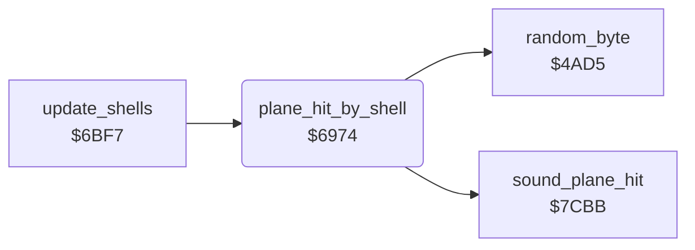

<!-- Generated by c64-docs from knowledge revision 20261025T214620.804-eudhn0 and .c64-re-tools/local/generated/src/source-map.json. Do not edit: change the knowledge, generate the source again, then run docs.ts generate. -->
# plane/shell_damage.asm: Shell hits on the plane

Range `$6974-$69B1`. Source: [plane/shell_damage.asm](../../../../src/plane/shell_damage.asm). Index: [the reference](../../index.md).

## Routines

| Routine | Address | Reached from | Summary |
|---|---|---|---|
| [`plane_hit_by_shell`](shell_damage.md#plane_hit_by_shell) | `$6974` | [`update_shells`](../enemy/flak_shells.md#update_shells) | A shell hits the plane: red plane and border, sets one damage flag $40b9-$40bc at random. |

## Call graph

A solid arrow is a call, a thick arrow a table entry. Rounded nodes are in this file.

## Details

### [`plane_hit_by_shell`](../../../../src/plane/shell_damage.asm#L6) `$6974`

*routine*

A shell hits the plane: red plane and border, sets one damage flag $40b9-$40bc at random. With all four set, crash state $4069 = 2.
sound_plane_hit

- **Called from:** [`update_shells`](../enemy/flak_shells.md#update_shells)
- **Calls:** [`sound_plane_hit`](../sound/sound_effects.md#sound_plane_hit), [`random_byte`](../game/random.md#random_byte)
- **Reads:** [`zp_count`](../../memory-map.md#zp_count), [`damage_fuel`](../data/variables.md#damage_fuel), [`zp_temp4`](../../memory-map.md#zp_temp4)
- **Writes:** [`plane_frame`](../data/variables.md#plane_frame), [`EXTCOL`](../../memory-map.md#EXTCOL), [`plane_colour`](../data/variables.md#plane_colour), [`zp_count`](../../memory-map.md#zp_count), [`zp_temp4`](../../memory-map.md#zp_temp4), [`damage_fuel`](../data/variables.md#damage_fuel), [`plane_failing`](../data/variables.md#plane_failing)

| Label | Address | Comment |
|---|---|---|
| [`plane_hit_by_shell_search`](../../../../src/plane/shell_damage.asm#L18) | `$698F` |  |
| [`plane_hit_by_shell_next`](../../../../src/plane/shell_damage.asm#L25) | `$699C` |  |
| [`plane_hit_by_shell_all`](../../../../src/plane/shell_damage.asm#L35) | `$69AC` |  |
