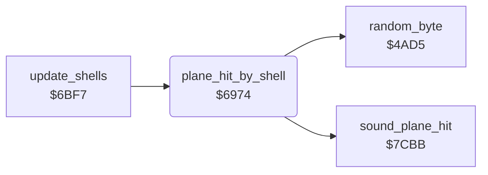

<!-- Generated by c64-docs from knowledge revision 20261024T232120.926-729orp and .c64-re-tools/local/generated/src/source-map.json. Do not edit: change the knowledge, generate the source again, then run docs.ts generate. -->
# plane/shell_damage.asm: Shell hits on the plane

Range `$6974-$69B1`. Source: [plane/shell_damage.asm](../../../../src/plane/shell_damage.asm). Index: [the reference](../../index.md).

## Call graph

A solid arrow is a call, a thick arrow a table entry, a dotted arrow a jump. Rounded nodes are in this file.

## Names

### [`plane_hit_by_shell`](../../../../src/plane/shell_damage.asm#L6) `$6974`

*routine*

A shell hits the plane: red plane and border, sets one damage flag $40b9-$40bc at random. With all four set, crash state $4069 = 2.
sound_plane_hit

- **Called from:** [`update_shells`](../enemy/flak_shells.md#update_shells) [`$6D7B`](../../../../src/enemy/flak_shells.asm#L183)
- **Calls:** [`sound_plane_hit`](../sound/sound_effects.md#sound_plane_hit), [`random_byte`](../game/random.md#random_byte)
- **Reads:** [`zp_count`](../../memory-map.md#zp_count), [`damage_fuel`](../data/variables.md#damage_fuel), [`zp_temp4`](../../memory-map.md#zp_temp4)
- **Writes:** [`plane_frame`](../data/variables.md#plane_frame), [`EXTCOL`](../../memory-map.md#EXTCOL), [`plane_colour`](../data/variables.md#plane_colour), [`zp_count`](../../memory-map.md#zp_count), [`zp_temp4`](../../memory-map.md#zp_temp4), [`damage_fuel`](../data/variables.md#damage_fuel), [`plane_failing`](../data/variables.md#plane_failing)

### [`plane_hit_by_shell_search`](../../../../src/plane/shell_damage.asm#L18) `$698F`

*label*

- **Jumped to from:** [`plane_hit_by_shell`](shell_damage.md#plane_hit_by_shell) [`$69A9`](../../../../src/plane/shell_damage.asm#L34)

### [`plane_hit_by_shell_next`](../../../../src/plane/shell_damage.asm#L25) `$699C`

*label*

- **Jumped to from:** [`plane_hit_by_shell`](shell_damage.md#plane_hit_by_shell) [`$6994`](../../../../src/plane/shell_damage.asm#L21)

### [`plane_hit_by_shell_all`](../../../../src/plane/shell_damage.asm#L35) `$69AC`

*label*

- **Jumped to from:** [`plane_hit_by_shell`](shell_damage.md#plane_hit_by_shell) [`$699E`](../../../../src/plane/shell_damage.asm#L28)
