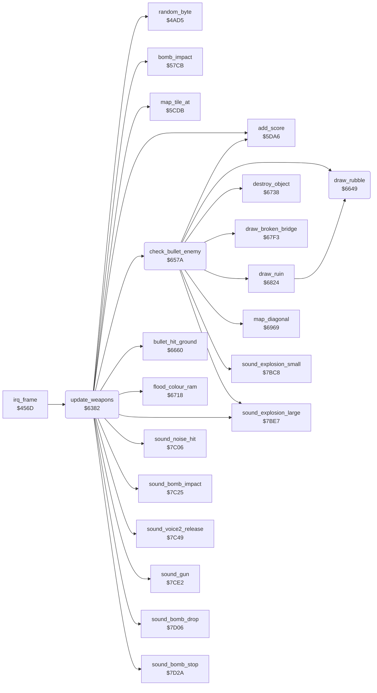

<!-- Generated by c64-docs from knowledge revision 20261025T214620.804-eudhn0 and .c64-re-tools/local/generated/src/source-map.json. Do not edit: change the knowledge, generate the source again, then run docs.ts generate. -->
# plane/weapons.asm: Bombs and bullets of the plane

Range `$6382-$665F`. Source: [plane/weapons.asm](../../../../src/plane/weapons.asm). Index: [the reference](../../index.md).

## Routines

| Routine | Address | Reached from | Summary |
|---|---|---|---|
| [`update_weapons`](weapons.md#update_weapons) | `$6382` | [`irq_frame`](../irq/frame_irq.md#irq_frame) | Updates the bomb and the bullet each frame: starts, moves and ends them. |
| [`end_bomb`](weapons.md#end_bomb) | `$64D3` | [`bomb_impact`](../ground/bomb_impact.md#bomb_impact), [`destroy_object`](../ground/ground_hits.md#destroy_object), [`clear_flak_gun`](../ground/ground_hits.md#clear_flak_gun), [`draw_ruin`](../ground/ground_hits.md#draw_ruin) | Ends the bomb: hides sprite 2, clears the falling flag $4047 and stops the bomb sound. |
| [`end_bullet`](weapons.md#end_bullet) | `$6549` | [`bullet_hit_ground`](../ground/ground_hits.md#bullet_hit_ground) | Ends the bullet: clears $404b and hides sprite 3. |
| [`check_bullet_enemy`](weapons.md#check_bullet_enemy) | `$657A` | [`update_weapons`](weapons.md#update_weapons) | Checks if the bullet line hits the enemy plane. |
| [`draw_rubble`](weapons.md#draw_rubble) | `$6649` | [`check_bullet_enemy`](weapons.md#check_bullet_enemy), [`draw_ruin`](../ground/ground_hits.md#draw_ruin) | Draws rubble tiles $7c $7d and $7e $7f (2x2) at the map address in $fb/$fc. |

## Call graph

A solid arrow is a call, a thick arrow a table entry. Rounded nodes are in this file.

## Details

### [`update_weapons`](../../../../src/plane/weapons.asm#L6) `$6382`

*routine*

Updates the bomb and the bullet each frame: starts, moves and ends them. Bomb damage and gun damage jam the release at random.
$40ba = bomb damage.

- **Called from:** [`irq_frame`](../irq/frame_irq.md#irq_frame)
- **Calls:** [`random_byte`](../game/random.md#random_byte), [`sound_voice2_release`](../sound/sound_effects.md#sound_voice2_release), [`sound_bomb_drop`](../sound/sound_effects.md#sound_bomb_drop), [`bomb_impact`](../ground/bomb_impact.md#bomb_impact), [`map_tile_at`](../ground/map_tile.md#map_tile_at), [`sound_explosion_large`](../sound/sound_effects.md#sound_explosion_large), [`flood_colour_ram`](../ground/ground_hits.md#flood_colour_ram), [`add_score`](../game/score.md#add_score), [`sound_noise_hit`](../sound/sound_effects.md#sound_noise_hit), [`sound_bomb_impact`](../sound/sound_effects.md#sound_bomb_impact), [`sound_bomb_stop`](../sound/sound_effects.md#sound_bomb_stop), [`sound_gun`](../sound/sound_effects.md#sound_gun) and 2 more
- **Jumps to:** [`update_weapons_object_type`](weapons.md#update_weapons_object_type)
- **Reads:** [`damage_bombs`](../data/variables.md#damage_bombs), [`bomb_jammed`](../data/variables.md#bomb_jammed), [`damage_gun`](../data/variables.md#damage_gun), [`gun_jammed`](../data/variables.md#gun_jammed), [`splash_timer`](../data/variables.md#splash_timer), [`splash_ptr`](../data/variables.md#splash_ptr), [`splash_ptr_hi`](../data/variables.md#splash_ptr_hi), [`map_ptr`](../../memory-map.md#map_ptr), [`speed`](../data/variables.md#speed), [`bomb_falling`](../data/variables.md#bomb_falling), [`joy_state`](../data/variables.md#joy_state), [`diving`](../data/variables.md#diving) and 19 more
- **Writes:** [`bomb_jammed`](../data/variables.md#bomb_jammed), [`gun_jammed`](../data/variables.md#gun_jammed), [`splash_timer`](../data/variables.md#splash_timer), [`map_ptr`](../../memory-map.md#map_ptr), [`map_ptr_hi`](../../memory-map.md#map_ptr_hi), [`bombs`](../data/variables.md#bombs), [`bomb_ground_y`](../data/variables.md#bomb_ground_y), [`bomb_x`](../data/variables.md#bomb_x), [`bomb_height`](../data/variables.md#bomb_height), [`bomb_falling`](../data/variables.md#bomb_falling), [`sprite_enable`](../data/variables.md#sprite_enable), [`bomb_frame`](../data/variables.md#bomb_frame) and 16 more

| Label | Address | Comment |
|---|---|---|
| [`update_weapons_set_bomb_jam`](../../../../src/plane/weapons.asm#L14) | `$6393` |  |
| [`update_weapons_gun_damage`](../../../../src/plane/weapons.asm#L16) | `$6396` | $40bc = gun damage. |
| [`update_weapons_set_gun_jam`](../../../../src/plane/weapons.asm#L24) | `$63A7` |  |
| [`update_weapons_burst`](../../../../src/plane/weapons.asm#L27) | `$63AA` | Counts down the burst timer $406e. At zero, puts tiles $01 $01 back at the address in $406c/$406d. |
| [`update_weapons_speed`](../../../../src/plane/weapons.asm#L39) | `$63CA` |  |
| [`update_weapons_bomb`](../../../../src/plane/weapons.asm#L45) | `$63D2` | Bomb: if no bomb falls, fire + down drops a bomb when the release is free and bombs are left. $4047 = $ff while a bomb falls. |
| [`update_weapons_to_gun`](../../../../src/plane/weapons.asm#L57) | `$63ED` |  |
| [`update_weapons_drop_bomb`](../../../../src/plane/weapons.asm#L60) | `$63F0` | Drops a bomb: one bomb less, sound, bomb sprite 2 at the shadow, fall height = altitude - 6. |
| [`update_weapons_bomb_falls`](../../../../src/plane/weapons.asm#L91) | `$6423` |  |
| [`update_weapons_bomb_height`](../../../../src/plane/weapons.asm#L96) | `$642D` |  |
| [`update_weapons_bomb_lands`](../../../../src/plane/weapons.asm#L107) | `$6444` | The bomb is on the ground. Reads the two map tiles under the bomb and selects crater, burst or a hit object. |
| [`update_weapons_bomb_tile`](../../../../src/plane/weapons.asm#L126) | `$6466` | Moves $fb/$fc to the hit tile. Tiles $a7-$b7 are airfield tiles. |
| [`update_weapons_hit_airfield`](../../../../src/plane/weapons.asm#L145) | `$6487` | $4079 = 1: the next airfield is drawn with scrambled tiles. |
| [`update_weapons_hit_object`](../../../../src/plane/weapons.asm#L150) | `$6491` |  |
| [`update_weapons_crater`](../../../../src/plane/weapons.asm#L153) | `$6494` | Makes a crater: tile $6a on the two tiles, but not on tiles $01. $4092 = 2: short screen flash. |
| [`update_weapons_crater_right`](../../../../src/plane/weapons.asm#L163) | `$64A8` |  |
| [`update_weapons_crater_done`](../../../../src/plane/weapons.asm#L170) | `$64B3` |  |
| [`update_weapons_burst_start`](../../../../src/plane/weapons.asm#L173) | `$64B6` | The bomb hits tile $01: shows burst tiles $74/$75 for 8 frames and keeps their address in $406c/$406d. |
| [`update_weapons_gun`](../../../../src/plane/weapons.asm#L194) | `$64E6` | Bullet: if no bullet flies, fire shoots a bullet when the gun is not jammed. $404b = 1 while a bullet flies. |
| [`update_weapons_done`](../../../../src/plane/weapons.asm#L202) | `$64F7` |  |
| [`update_weapons_fire_bullet`](../../../../src/plane/weapons.asm#L205) | `$64F8` | Starts a bullet at the shadow: $404d = ground y, $40c7 = sprite 3 x, $404c = height (altitude). |
| [`update_weapons_bullet_moves`](../../../../src/plane/weapons.asm#L225) | `$6525` | sound_gun |
| [`update_weapons_bullet_hits`](../../../../src/plane/weapons.asm#L250) | `$6557` | Bullet colour 1 (white). |
| [`update_weapons_exit`](../../../../src/plane/weapons.asm#L265) | `$6579` |  |

### [`end_bomb`](../../../../src/plane/weapons.asm#L185) `$64D3`

*label*

Ends the bomb: hides sprite 2, clears the falling flag $4047 and stops the bomb sound.

- **Jumped to from:** [`bomb_impact`](../ground/bomb_impact.md#bomb_impact), [`update_weapons`](weapons.md#update_weapons), [`check_bullet_enemy`](weapons.md#check_bullet_enemy), [`destroy_object`](../ground/ground_hits.md#destroy_object), [`clear_flak_gun`](../ground/ground_hits.md#clear_flak_gun), [`draw_ruin`](../ground/ground_hits.md#draw_ruin)

### [`end_bullet`](../../../../src/plane/weapons.asm#L243) `$6549`

*label*

Ends the bullet: clears $404b and hides sprite 3.

- **Jumped to from:** [`update_weapons`](weapons.md#update_weapons), [`bullet_hit_ground`](../ground/ground_hits.md#bullet_hit_ground)

### [`check_bullet_enemy`](../../../../src/plane/weapons.asm#L268) `$657A`

*routine*

Checks if the bullet line hits the enemy plane. Out: A = 0 (Z set) for a hit, A = 1 for no hit.

- **Called from:** [`update_weapons`](weapons.md#update_weapons)
- **Calls:** [`map_diagonal`](crash.md#map_diagonal), [`destroy_object`](../ground/ground_hits.md#destroy_object), [`draw_ruin`](../ground/ground_hits.md#draw_ruin), [`add_score`](../game/score.md#add_score), [`sound_explosion_small`](../sound/sound_effects.md#sound_explosion_small), [`draw_rubble`](weapons.md#draw_rubble), [`sound_explosion_large`](../sound/sound_effects.md#sound_explosion_large), [`draw_broken_bridge`](../ground/ground_hits.md#draw_broken_bridge)
- **Jumps to:** [`update_weapons_object_c4`](../ground/ground_hits.md#update_weapons_object_c4), [`end_bomb`](weapons.md#end_bomb), [`update_weapons_target`](../ground/ground_hits.md#update_weapons_target), [`update_weapons_bridge`](../ground/ground_hits.md#update_weapons_bridge), [`draw_rubble`](weapons.md#draw_rubble)
- **Reads:** [`status_bg_colour`](../data/variables.md#status_bg_colour), [`shadow_x`](../data/variables.md#shadow_x), [`shadow_y`](../data/variables.md#shadow_y), [`enemy_shadow_x`](../data/variables.md#enemy_shadow_x), [`enemy_shadow_y`](../data/variables.md#enemy_shadow_y), [`zp_temp5`](../../memory-map.md#zp_temp5), [`map_ptr`](../../memory-map.md#map_ptr), [`map_ptr_hi`](../../memory-map.md#map_ptr_hi)
- **Writes:** [`zp_temp5`](../../memory-map.md#zp_temp5), [`zp_temp6`](../../memory-map.md#zp_temp6), [`flash_timer`](../data/variables.md#flash_timer), [`map_ptr`](../../memory-map.md#map_ptr), [`map_ptr_hi`](../../memory-map.md#map_ptr_hi), [`zp_count`](../../memory-map.md#zp_count)

| Label | Address | Comment |
|---|---|---|
| [`check_bullet_enemy_line`](../../../../src/plane/weapons.asm#L273) | `$6584` | Diagonal line of the plane shadow. |
| [`check_bullet_enemy_miss`](../../../../src/plane/weapons.asm#L292) | `$65AA` |  |
| [`update_weapons_object_type`](../../../../src/plane/weapons.asm#L296) | `$65AD` | The bomb hits a tile >= $80. Selects the object by the tile value and destroys it. $4092 = 4: screen flash and shake. |
| [`update_weapons_object_b8`](../../../../src/plane/weapons.asm#L305) | `$65BD` | Tiles $b8-$bb: 2x2 object. |
| [`update_weapons_object_81`](../../../../src/plane/weapons.asm#L313) | `$65CB` | Tiles $81-$98: target buildings. |
| [`update_weapons_object_cd`](../../../../src/plane/weapons.asm#L320) | `$65D6` | Tiles $cd-$d8. |
| [`update_weapons_tile_above`](../../../../src/plane/weapons.asm#L331) | `$65EC` | $fb/$fc - $80: the tile one map row higher. |
| [`update_weapons_rubble`](../../../../src/plane/weapons.asm#L354) | `$6612` |  |
| [`update_weapons_object_a1`](../../../../src/plane/weapons.asm#L360) | `$6620` |  |
| [`update_weapons_object_da`](../../../../src/plane/weapons.asm#L371) | `$6637` | All other tiles go to draw_rubble and return without end_bomb. |

### [`draw_rubble`](../../../../src/plane/weapons.asm#L380) `$6649`

*routine*

Draws rubble tiles $7c $7d and $7e $7f (2x2) at the map address in $fb/$fc. The second row is $80 bytes higher.

- **Called from:** [`check_bullet_enemy`](weapons.md#check_bullet_enemy), [`draw_ruin`](../ground/ground_hits.md#draw_ruin)
- **Jumped to from:** [`check_bullet_enemy`](weapons.md#check_bullet_enemy)
- **Reads:** [`map_ptr`](../../memory-map.md#map_ptr)
