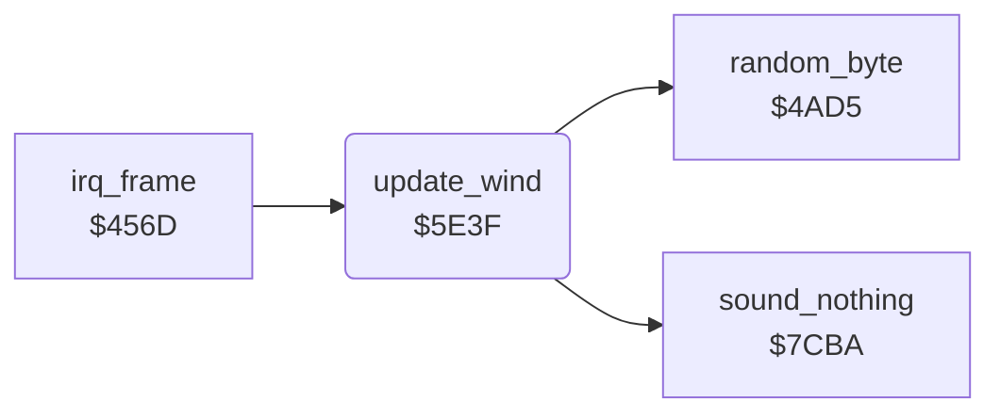

<!-- Generated by c64-docs from knowledge revision 20261025T214620.804-eudhn0 and .c64-re-tools/local/generated/src/source-map.json. Do not edit: change the knowledge, generate the source again, then run docs.ts generate. -->
# plane/wind.asm: Wind

Range `$5E3F-$5ED7`. Source: [plane/wind.asm](../../../../src/plane/wind.asm). Index: [the reference](../../index.md).

## Routines

| Routine | Address | Reached from | Summary |
|---|---|---|---|
| [`update_wind`](wind.md#update_wind) | `$5E3F` | [`irq_frame`](../irq/frame_irq.md#irq_frame) | Starts wind at random (seed < $400b), pushes the plane and the enemy plane with it, and shows W in the status line. |

## Call graph

A solid arrow is a call, a thick arrow a table entry. Rounded nodes are in this file.

## Details

### [`update_wind`](../../../../src/plane/wind.asm#L6) `$5E3F`

*routine*

Starts wind at random (seed < $400b), pushes the plane and the enemy plane with it, and shows W in the status line.

- **Called from:** [`irq_frame`](../irq/frame_irq.md#irq_frame)
- **Calls:** [`random_byte`](../game/random.md#random_byte), [`sound_nothing`](../sound/sound_effects.md#sound_nothing)
- **Reads:** [`wind_active`](../data/variables.md#wind_active), [`quiet_timer`](../data/variables.md#quiet_timer), [`plane_state`](../data/variables.md#plane_state), [`random_seed`](../../memory-map.md#random_seed), [`difficulty`](../data/variables.md#difficulty), [`wind_dx`](../data/variables.md#wind_dx), [`frame_count`](../data/variables.md#frame_count), [`shadow_x`](../data/variables.md#shadow_x), [`altitude`](../data/variables.md#altitude), [`wind_dy`](../data/variables.md#wind_dy), [`enemy_timer`](../data/variables.md#enemy_timer), [`enemy_shadow_x`](../data/variables.md#enemy_shadow_x) and 1 more
- **Writes:** [`wind_dx`](../data/variables.md#wind_dx), [`wind_dy`](../data/variables.md#wind_dy), [`wind_active`](../data/variables.md#wind_active), [`status_sprite_ptr`](../data/variables.md#status_sprite_ptr), [`shadow_x`](../data/variables.md#shadow_x), [`altitude`](../data/variables.md#altitude), [`enemy_shadow_x`](../data/variables.md#enemy_shadow_x), [`enemy_altitude`](../data/variables.md#enemy_altitude)

| Label | Address | Comment |
|---|---|---|
| [`update_wind_exit`](../../../../src/plane/wind.asm#L16) | `$5E55` |  |
| [`update_wind_start`](../../../../src/plane/wind.asm#L18) | `$5E56` |  |
| [`update_wind_dir`](../../../../src/plane/wind.asm#L24) | `$5E61` |  |
| [`update_wind_sound`](../../../../src/plane/wind.asm#L37) | `$5E79` |  |
| [`update_wind_push`](../../../../src/plane/wind.asm#L39) | `$5E7C` | Status sprite $b3: letter W. |
| [`update_wind_plane`](../../../../src/plane/wind.asm#L47) | `$5E8B` |  |
| [`update_wind_enemy`](../../../../src/plane/wind.asm#L58) | `$5EA3` | $4041 = 0: an enemy plane is active. |
| [`update_wind_end_test`](../../../../src/plane/wind.asm#L71) | `$5EC0` |  |
| [`update_wind_stop`](../../../../src/plane/wind.asm#L78) | `$5ECD` |  |
