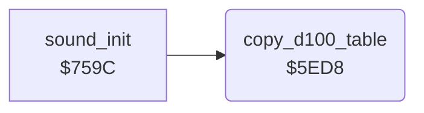

<!-- Generated by c64-docs from knowledge revision 20261024T232120.926-729orp and .c64-re-tools/local/generated/src/source-map.json. Do not edit: change the knowledge, generate the source again, then run docs.ts generate. -->
# protection/d100_table.asm: Loader table copy

Range `$5ED8-$5EF8`. Source: [protection/d100_table.asm](../../../../src/protection/d100_table.asm). Index: [the reference](../../index.md).

## Call graph

A solid arrow is a call, a thick arrow a table entry, a dotted arrow a jump. Rounded nodes are in this file.

## Names

### [`copy_d100_table`](../../../../src/protection/d100_table.asm#L6) `$5ED8`

*routine*

Copies 256 bytes from RAM $d100 under I/O to $1000. sound_init calls it (title start, end of a mission). The anonymous crack replaced the STA $1000,Y with three NOPs.

- **Called from:** [`sound_init`](../music/music_player.md#sound_init) [`$761C`](../../../../src/music/music_player.asm#L48)
- **Reads:** [`R6510`](../../memory-map.md#R6510), [`flak_best_dist`](../../memory-map.md#flak_best_dist)
- **Writes:** [`R6510`](../../memory-map.md#R6510)

### [`copy_d100_table_loop`](../../../../src/protection/d100_table.asm#L15) `$5EE7`

*label*

Self-modified: operand $1100 becomes $d100.

- **Jumped to from:** [`copy_d100_table`](d100_table.md#copy_d100_table) [`$5EEE`](../../../../src/protection/d100_table.asm#L32)

### [`copy_d100_src_hi`](../../../../src/protection/d100_table.asm#L16) `$5EE9-$5EF8`

*variable*

- **Written by:** [`copy_d100_table`](d100_table.md#copy_d100_table) [`$5EDB`](../../../../src/protection/d100_table.asm#L9), [`copy_d100_table`](d100_table.md#copy_d100_table) [`$5EF2`](../../../../src/protection/d100_table.asm#L34)
