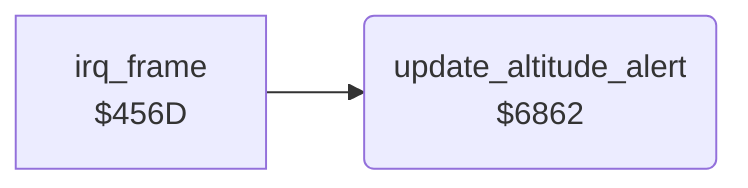

<!-- Generated by c64-docs from knowledge revision 20261025T214620.804-eudhn0 and .c64-re-tools/local/generated/src/source-map.json. Do not edit: change the knowledge, generate the source again, then run docs.ts generate. -->
# screen/altitude_alert.asm: Enemy altitude marks and the status line colour

Range `$6862-$68FC`. Source: [screen/altitude_alert.asm](../../../../src/screen/altitude_alert.asm). Index: [the reference](../../index.md).

## Routines

| Routine | Address | Reached from | Summary |
|---|---|---|---|
| [`update_altitude_alert`](altitude_alert.md#update_altitude_alert) | `$6862` | [`irq_frame`](../irq/frame_irq.md#irq_frame) | Shows the altitude of the enemy plane relative to the plane, and sets the status line colour $4052 for the altitude. |

## Call graph

A solid arrow is a call, a thick arrow a table entry. Rounded nodes are in this file.

## Details

### [`update_altitude_alert`](../../../../src/screen/altitude_alert.asm#L6) `$6862`

*routine*

Shows the altitude of the enemy plane relative to the plane, and sets the status line colour $4052 for the altitude.

- **Called from:** [`irq_frame`](../irq/frame_irq.md#irq_frame)
- **Reads:** [`enemy_timer`](../data/variables.md#enemy_timer), [`enemy_explode_timer`](../data/variables.md#enemy_explode_timer), [`altitude`](../data/variables.md#altitude), [`enemy_altitude`](../data/variables.md#enemy_altitude), [`obstacle_altitude`](../data/variables.md#obstacle_altitude), [`frame_count`](../data/variables.md#frame_count), [`plane_state`](../data/variables.md#plane_state)
- **Writes:** `$0C27`, `$0C4F`, [`status_rows`](../../memory-map.md#status_rows), [`status_bg_colour`](../data/variables.md#status_bg_colour), [`crash_flag`](../data/variables.md#crash_flag), [`altitude`](../data/variables.md#altitude), [`low_flight`](../data/variables.md#low_flight)

| Label | Address | Comment |
|---|---|---|
| [`update_altitude_alert_above`](../../../../src/screen/altitude_alert.asm#L26) | `$6891` | Mark $2d: the enemy plane is higher. |
| [`update_altitude_alert_below`](../../../../src/screen/altitude_alert.asm#L30) | `$6899` | Mark $2e: the enemy plane is lower. |
| [`update_altitude_alert_level`](../../../../src/screen/altitude_alert.asm#L34) | `$68A1` | Colour $0e (light blue): same altitude. |
| [`update_altitude_alert_ground`](../../../../src/screen/altitude_alert.asm#L38) | `$68A7` | Altitude below 0: crash ($4050 = 1) and altitude 0. |
| [`update_altitude_alert_low`](../../../../src/screen/altitude_alert.asm#L45) | `$68B6` |  |
| [`update_altitude_alert_obstacle`](../../../../src/screen/altitude_alert.asm#L54) | `$68C8` | Altitude below 26: colour 9 and $406f = 9 (low). |
| [`update_altitude_alert_clear`](../../../../src/screen/altitude_alert.asm#L67) | `$68E7` |  |
| [`update_altitude_alert_state`](../../../../src/screen/altitude_alert.asm#L71) | `$68ED` | Ground states 1, 4 and 5 (runway): colour 0. |
