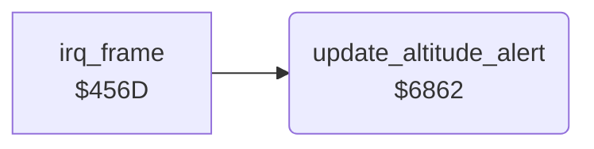

<!-- Generated by c64-docs from knowledge revision 20261024T232120.926-729orp and .c64-re-tools/local/generated/src/source-map.json. Do not edit: change the knowledge, generate the source again, then run docs.ts generate. -->
# screen/altitude_alert.asm: Enemy altitude marks and the status line colour

Range `$6862-$68FC`. Source: [screen/altitude_alert.asm](../../../../src/screen/altitude_alert.asm). Index: [the reference](../../index.md).

## Call graph

A solid arrow is a call, a thick arrow a table entry, a dotted arrow a jump. Rounded nodes are in this file.

## Names

### [`update_altitude_alert`](../../../../src/screen/altitude_alert.asm#L6) `$6862`

*routine*

Shows the altitude of the enemy plane relative to the plane, and sets the status line colour $4052 for the altitude.

- **Called from:** [`irq_frame`](../irq/frame_irq.md#irq_frame) [`$46C4`](../../../../src/irq/frame_irq.asm#L171)
- **Reads:** [`enemy_timer`](../data/variables.md#enemy_timer), [`enemy_explode_timer`](../data/variables.md#enemy_explode_timer), [`altitude`](../data/variables.md#altitude), [`enemy_altitude`](../data/variables.md#enemy_altitude), [`obstacle_altitude`](../data/variables.md#obstacle_altitude), [`frame_count`](../data/variables.md#frame_count), [`plane_state`](../data/variables.md#plane_state)
- **Writes:** `$0C27`, `$0C4F`, [`status_rows+38`](../../memory-map.md#status_rows), [`status_rows+78`](../../memory-map.md#status_rows), [`status_bg_colour`](../data/variables.md#status_bg_colour), [`crash_flag`](../data/variables.md#crash_flag), [`altitude`](../data/variables.md#altitude), [`low_flight`](../data/variables.md#low_flight)

### [`update_altitude_alert_above`](../../../../src/screen/altitude_alert.asm#L26) `$6891`

*label*

Mark $2d: the enemy plane is higher.

- **Jumped to from:** [`update_altitude_alert`](altitude_alert.md#update_altitude_alert) [`$6885`](../../../../src/screen/altitude_alert.asm#L21)

### [`update_altitude_alert_below`](../../../../src/screen/altitude_alert.asm#L30) `$6899`

*label*

Mark $2e: the enemy plane is lower.

- **Jumped to from:** [`update_altitude_alert`](altitude_alert.md#update_altitude_alert) [`$688C`](../../../../src/screen/altitude_alert.asm#L24)

### [`update_altitude_alert_level`](../../../../src/screen/altitude_alert.asm#L34) `$68A1`

*label*

Colour $0e (light blue): same altitude.

- **Jumped to from:** [`update_altitude_alert`](altitude_alert.md#update_altitude_alert) [`$688E`](../../../../src/screen/altitude_alert.asm#L25)

### [`update_altitude_alert_ground`](../../../../src/screen/altitude_alert.asm#L38) `$68A7`

*label*

Altitude below 0: crash ($4050 = 1) and altitude 0.

- **Jumped to from:** [`update_altitude_alert`](altitude_alert.md#update_altitude_alert) [`$6875`](../../../../src/screen/altitude_alert.asm#L14), [`update_altitude_alert`](altitude_alert.md#update_altitude_alert) [`$687A`](../../../../src/screen/altitude_alert.asm#L16), [`update_altitude_alert`](altitude_alert.md#update_altitude_alert) [`$6896`](../../../../src/screen/altitude_alert.asm#L29), [`update_altitude_alert`](altitude_alert.md#update_altitude_alert) [`$689E`](../../../../src/screen/altitude_alert.asm#L33)

### [`update_altitude_alert_low`](../../../../src/screen/altitude_alert.asm#L45) `$68B6`

*label*

- **Jumped to from:** [`update_altitude_alert`](altitude_alert.md#update_altitude_alert) [`$68AA`](../../../../src/screen/altitude_alert.asm#L40)

### [`update_altitude_alert_obstacle`](../../../../src/screen/altitude_alert.asm#L54) `$68C8`

*label*

Altitude below 26: colour 9 and $406f = 9 (low).

- **Jumped to from:** [`update_altitude_alert`](altitude_alert.md#update_altitude_alert) [`$68C0`](../../../../src/screen/altitude_alert.asm#L50)

### [`update_altitude_alert_clear`](../../../../src/screen/altitude_alert.asm#L67) `$68E7`

*label*

- **Jumped to from:** [`update_altitude_alert`](altitude_alert.md#update_altitude_alert) [`$68DD`](../../../../src/screen/altitude_alert.asm#L63), [`update_altitude_alert`](altitude_alert.md#update_altitude_alert) [`$68F2`](../../../../src/screen/altitude_alert.asm#L74), [`update_altitude_alert`](altitude_alert.md#update_altitude_alert) [`$68F6`](../../../../src/screen/altitude_alert.asm#L76), [`update_altitude_alert`](altitude_alert.md#update_altitude_alert) [`$68FA`](../../../../src/screen/altitude_alert.asm#L78)

### [`update_altitude_alert_state`](../../../../src/screen/altitude_alert.asm#L71) `$68ED`

*label*

Ground states 1, 4 and 5 (runway): colour 0.

- **Jumped to from:** [`update_altitude_alert`](altitude_alert.md#update_altitude_alert) [`$68D6`](../../../../src/screen/altitude_alert.asm#L60), [`update_altitude_alert`](altitude_alert.md#update_altitude_alert) [`$68E4`](../../../../src/screen/altitude_alert.asm#L66)
