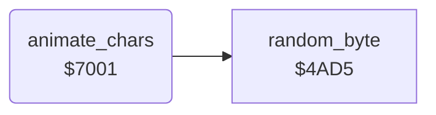

<!-- Generated by c64-docs from knowledge revision 20261024T232120.926-729orp and .c64-re-tools/local/generated/src/source-map.json. Do not edit: change the knowledge, generate the source again, then run docs.ts generate. -->
# screen/animate_chars.asm: Character animation

Range `$7001-$70BC`. Source: [screen/animate_chars.asm](../../../../src/screen/animate_chars.asm). Index: [the reference](../../index.md).

## Call graph

A solid arrow is a call, a thick arrow a table entry, a dotted arrow a jump. Rounded nodes are in this file.

## Names

### [`animate_chars`](../../../../src/screen/animate_chars.asm#L6) `$7001`

*routine*

Builds the animated characters from the masters at $3380-$35b7 into the charset at $2380-$25b7, with masks and random bits. main_loop_draw_status calls it once per main loop pass.

- **Called from:** [`$448B`](../../../../src/screen/status_line.asm#L111)
- **Calls:** [`random_byte`](../game/random.md#random_byte)
- **Reads:** [`frame_count`](../data/variables.md#frame_count), [`masked_chars_source`](../data/charset_source.md#masked_chars_source), [`build_map_row`](../ground/map_row.md#build_map_row), [`city_row`](../ground/city.md#city_row), [`zp_temp0`](../../memory-map.md#zp_temp0), [`charset+992`](../../memory-map.md#charset), [`BASZPT`](../../memory-map.md#BASZPT), [`random_seed`](../../memory-map.md#random_seed), [`dot_chars_source`](../data/charset_source.md#dot_chars_source), [`dot_chars_source_odd`](../data/charset_source.md#dot_chars_source_odd), [`building_kind_hit`](../data/variables.md#building_kind_hit), [`dither_chars_source`](../data/charset_source.md#dither_chars_source), [`zp_temp1`](../../memory-map.md#zp_temp1), [`airfield_bombed`](../data/variables.md#airfield_bombed), [`airfield_chars_source`](../data/charset_source.md#airfield_chars_source)
- **Writes:** [`zp_temp0`](../../memory-map.md#zp_temp0), [`charset+992`](../../memory-map.md#charset), [`charset+960`](../../memory-map.md#charset), [`charset+896`](../../memory-map.md#charset), [`charset+897`](../../memory-map.md#charset), [`zp_temp1`](../../memory-map.md#zp_temp1), [`charset+1032`](../../memory-map.md#charset), [`random_seed`](../../memory-map.md#random_seed), [`charset+1336`](../../memory-map.md#charset)

### [`animate_chars_mask_loop`](../../../../src/screen/animate_chars.asm#L10) `$7007`

*label*

Chars $7c-$7f: master masked by the moving tables $4879 and $5066.

- **Jumped to from:** [`animate_chars`](animate_chars.md#animate_chars) [`$7029`](../../../../src/screen/animate_chars.asm#L25)

### [`animate_chars_noise_loop`](../../../../src/screen/animate_chars.asm#L30) `$7034`

*label*

Chars $70-$75: master with random bits from $d9 and $d0.

- **Jumped to from:** [`animate_chars`](animate_chars.md#animate_chars) [`$704A`](../../../../src/screen/animate_chars.asm#L41)

### [`animate_chars_group_loop`](../../../../src/screen/animate_chars.asm#L43) `$704E`

*label*

Four groups of six chars from $2408; flag $4003+X selects random flicker or a plain copy.

- **Jumped to from:** [`animate_chars`](animate_chars.md#animate_chars) [`$709B`](../../../../src/screen/animate_chars.asm#L87)

### [`animate_chars_group_flicker`](../../../../src/screen/animate_chars.asm#L60) `$7068`

*label*

- **Jumped to from:** [`animate_chars`](animate_chars.md#animate_chars) [`$708A`](../../../../src/screen/animate_chars.asm#L77)

### [`animate_chars_group_copy`](../../../../src/screen/animate_chars.asm#L79) `$708F`

*label*

- **Jumped to from:** [`animate_chars`](animate_chars.md#animate_chars) [`$7066`](../../../../src/screen/animate_chars.asm#L59), [`animate_chars`](animate_chars.md#animate_chars) [`$7098`](../../../../src/screen/animate_chars.asm#L84)

### [`animate_chars_group_next`](../../../../src/screen/animate_chars.asm#L85) `$709A`

*label*

- **Jumped to from:** [`animate_chars`](animate_chars.md#animate_chars) [`$708C`](../../../../src/screen/animate_chars.asm#L78)

### [`animate_chars_flicker_high`](../../../../src/screen/animate_chars.asm#L91) `$70A4`

*label*

With $4079 set, chars $a7-$b6 get random bits.

- **Jumped to from:** [`animate_chars`](animate_chars.md#animate_chars) [`$70B0`](../../../../src/screen/animate_chars.asm#L98)

### [`animate_chars_copy_high`](../../../../src/screen/animate_chars.asm#L100) `$70B3`

*label*

- **Jumped to from:** [`animate_chars`](animate_chars.md#animate_chars) [`$70A2`](../../../../src/screen/animate_chars.asm#L90), [`animate_chars`](animate_chars.md#animate_chars) [`$70BA`](../../../../src/screen/animate_chars.asm#L104)
