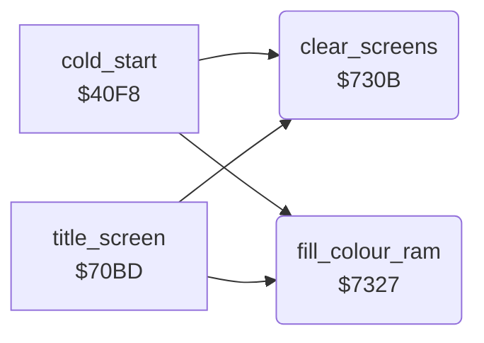

<!-- Generated by c64-docs from knowledge revision 20261024T232120.926-729orp and .c64-re-tools/local/generated/src/source-map.json. Do not edit: change the knowledge, generate the source again, then run docs.ts generate. -->
# screen/screen_fill.asm: Screen and colour RAM fill

Range `$730B-$7338`. Source: [screen/screen_fill.asm](../../../../src/screen/screen_fill.asm). Index: [the reference](../../index.md).

## Call graph

A solid arrow is a call, a thick arrow a table entry, a dotted arrow a jump. Rounded nodes are in this file.

## Names

### [`clear_screens`](../../../../src/screen/screen_fill.asm#L6) `$730B`

*routine*

Clears $0400-$0bff (both screens) to 0 and sets $d3 = 4.

- **Called from:** [`cold_start`](../init/game_start.md#cold_start) [`$427C`](../../../../src/init/game_start.asm#L147), [`title_screen`](title_screen.md#title_screen) [`$70EE`](../../../../src/screen/title_screen.asm#L25), [`title_screen`](title_screen.md#title_screen) [`$7212`](../../../../src/screen/title_screen.asm#L164)
- **Reads:** [`map_ptr`](../../memory-map.md#map_ptr), [`map_ptr_hi`](../../memory-map.md#map_ptr_hi)
- **Writes:** [`map_ptr_hi`](../../memory-map.md#map_ptr_hi), [`map_ptr`](../../memory-map.md#map_ptr), [`zp_count`](../../memory-map.md#zp_count)
- **Refers to:** [`screen_a`](../../memory-map.md#screen_a)

### [`clear_screens_page`](../../../../src/screen/screen_fill.asm#L13) `$7317`

*label*

- **Jumped to from:** [`clear_screens`](screen_fill.md#clear_screens) [`$7324`](../../../../src/screen/screen_fill.asm#L22)

### [`clear_screens_loop`](../../../../src/screen/screen_fill.asm#L15) `$7319`

*label*

- **Jumped to from:** [`clear_screens`](screen_fill.md#clear_screens) [`$731C`](../../../../src/screen/screen_fill.asm#L18)

### [`fill_colour_ram`](../../../../src/screen/screen_fill.asm#L25) `$7327`

*routine*

Fills colour RAM $d800-$dbff with the colour in A.

- **Called from:** [`cold_start`](../init/game_start.md#cold_start) [`$4273`](../../../../src/init/game_start.asm#L143), [`title_screen`](title_screen.md#title_screen) [`$70F3`](../../../../src/screen/title_screen.asm#L27), [`title_screen`](title_screen.md#title_screen) [`$7217`](../../../../src/screen/title_screen.asm#L166)
- **Writes:** `$D800`, `$D900`, `$DA00`, `$DB00`

### [`fill_colour_ram_loop`](../../../../src/screen/screen_fill.asm#L27) `$7329`

*label*

- **Jumped to from:** [`fill_colour_ram`](screen_fill.md#fill_colour_ram) [`$7336`](../../../../src/screen/screen_fill.asm#L33)

### [`text_by_author_base`](../../../../src/screen/screen_fill.asm#L34) `$7338`

*label*

RTS; title_screen also reads 'BY PETER ADAMS' from here with index 1-40.

- **Read by:** [`title_screen`](title_screen.md#title_screen) [`$714A`](../../../../src/screen/title_screen.asm#L68)
