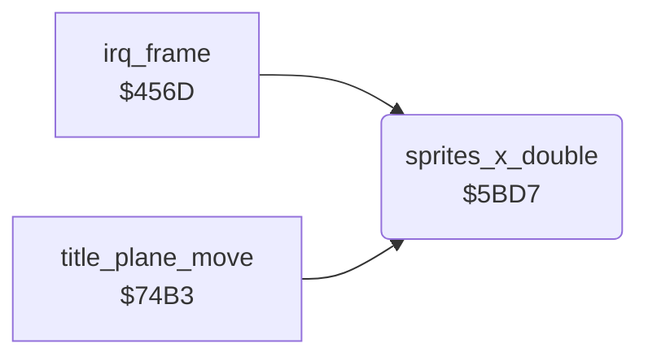

<!-- Generated by c64-docs from knowledge revision 20261025T214620.804-eudhn0 and .c64-re-tools/local/generated/src/source-map.json. Do not edit: change the knowledge, generate the source again, then run docs.ts generate. -->
# screen/sprite_positions.asm: Sprite X positions

Range `$5BD7-$5C02`. Source: [screen/sprite_positions.asm](../../../../src/screen/sprite_positions.asm). Index: [the reference](../../index.md).

## Routines

| Routine | Address | Reached from | Summary |
|---|---|---|---|
| [`sprites_x_double`](sprite_positions.md#sprites_x_double) | `$5BD7` | [`irq_frame`](../irq/frame_irq.md#irq_frame), [`title_plane_move`](title_plane.md#title_plane_move) | Doubles the sprite X values $40c4-$40cb into $40dc-$40e3 and puts bit 8 of each into the MSB byte $4043. |

## Call graph

A solid arrow is a call, a thick arrow a table entry. Rounded nodes are in this file.

## Details

### [`sprites_x_double`](../../../../src/screen/sprite_positions.asm#L6) `$5BD7`

*routine*

Doubles the sprite X values $40c4-$40cb into $40dc-$40e3 and puts bit 8 of each into the MSB byte $4043.
$d3 = MSB bit mask, starts at sprite 7.

- **Called from:** [`irq_frame`](../irq/frame_irq.md#irq_frame), [`title_plane_move`](title_plane.md#title_plane_move)
- **Reads:** [`plane_x`](../data/variables.md#plane_x), [`sprite_x_msb`](../data/variables.md#sprite_x_msb), [`zp_count`](../../memory-map.md#zp_count)
- **Writes:** [`zp_count`](../../memory-map.md#zp_count), [`sprite_x_msb`](../data/variables.md#sprite_x_msb), [`sprite_x`](../data/variables.md#sprite_x)

| Label | Address | Comment |
|---|---|---|
| [`sprites_x_double_loop`](../../../../src/screen/sprite_positions.asm#L12) | `$5BE2` |  |
| [`sprites_x_double_clear`](../../../../src/screen/sprite_positions.asm#L20) | `$5BF3` |  |
| [`sprites_x_double_next`](../../../../src/screen/sprite_positions.asm#L24) | `$5BFA` |  |
