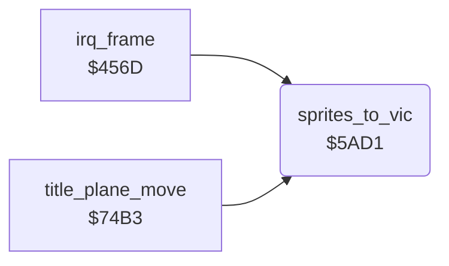

<!-- Generated by c64-docs from knowledge revision 20261025T214620.804-eudhn0 and .c64-re-tools/local/generated/src/source-map.json. Do not edit: change the knowledge, generate the source again, then run docs.ts generate. -->
# screen/sprite_registers.asm: Sprite register copy

Range `$5AD1-$5BC1`. Source: [screen/sprite_registers.asm](../../../../src/screen/sprite_registers.asm). Index: [the reference](../../index.md).

## Routines

| Routine | Address | Reached from | Summary |
|---|---|---|---|
| [`sprites_to_vic`](sprite_registers.md#sprites_to_vic) | `$5AD1` | [`irq_frame`](../irq/frame_irq.md#irq_frame), [`title_plane_move`](title_plane.md#title_plane_move) | Copies the sprite shadow registers to the VIC-II: enable, pointers for both screens, X, MSB, Y, colours and expansion. |

## Call graph

A solid arrow is a call, a thick arrow a table entry. Rounded nodes are in this file.

## Details

### [`sprites_to_vic`](../../../../src/screen/sprite_registers.asm#L6) `$5AD1`

*routine*

Copies the sprite shadow registers to the VIC-II: enable, pointers for both screens, X, MSB, Y, colours and expansion.

- **Called from:** [`irq_frame`](../irq/frame_irq.md#irq_frame), [`title_plane_move`](title_plane.md#title_plane_move)
- **Reads:** [`sprite_enable`](../data/variables.md#sprite_enable), [`enemy_shadow_frame`](../data/variables.md#enemy_shadow_frame), [`plane_frame`](../data/variables.md#plane_frame), [`enemy_frame`](../data/variables.md#enemy_frame), [`bomb_frame`](../data/variables.md#bomb_frame), [`bullet_frame`](../data/variables.md#bullet_frame), [`flak_frame`](../data/variables.md#flak_frame), [`flak_1_frame`](../data/variables.md#flak_1_frame), [`shadow_frame`](../data/variables.md#shadow_frame), [`sprite_x`](../data/variables.md#sprite_x), [`sprite_x_1`](../data/variables.md#sprite_x_1), [`sprite_x_2`](../data/variables.md#sprite_x_2) and 24 more
- **Writes:** [`SPENA`](../../memory-map.md#SPENA), [`screen_a_sprite_ptrs`](../../memory-map.md#screen_a_sprite_ptrs), [`screen_b_sprite_ptrs`](../../memory-map.md#screen_b_sprite_ptrs), [`SP0X`](../../memory-map.md#SP0X), [`SP1X`](../../memory-map.md#SP1X), [`SP2X`](../../memory-map.md#SP2X), [`SP3X`](../../memory-map.md#SP3X), [`SP4X`](../../memory-map.md#SP4X), [`SP5X`](../../memory-map.md#SP5X), [`SP6X`](../../memory-map.md#SP6X), [`SP7X`](../../memory-map.md#SP7X), [`MSIGX`](../../memory-map.md#MSIGX) and 18 more
