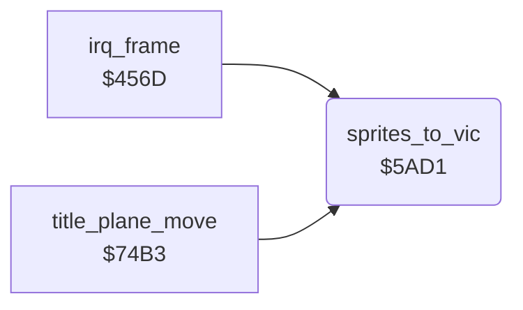

<!-- Generated by c64-docs from knowledge revision 20261024T232120.926-729orp and .c64-re-tools/local/generated/src/source-map.json. Do not edit: change the knowledge, generate the source again, then run docs.ts generate. -->
# screen/sprite_registers.asm: Sprite register copy

Range `$5AD1-$5BC1`. Source: [screen/sprite_registers.asm](../../../../src/screen/sprite_registers.asm). Index: [the reference](../../index.md).

## Call graph

A solid arrow is a call, a thick arrow a table entry, a dotted arrow a jump. Rounded nodes are in this file.

## Names

### [`sprites_to_vic`](../../../../src/screen/sprite_registers.asm#L6) `$5AD1`

*routine*

Copies the sprite shadow registers to the VIC-II: enable, pointers for both screens, X, MSB, Y, colours and expansion.

- **Called from:** [`irq_frame`](../irq/frame_irq.md#irq_frame) [`$469F`](../../../../src/irq/frame_irq.asm#L157), [`title_plane_move`](title_plane.md#title_plane_move) [`$74EF`](../../../../src/screen/title_plane.asm#L35)
- **Reads:** [`sprite_enable`](../data/variables.md#sprite_enable), [`enemy_shadow_frame`](../data/variables.md#enemy_shadow_frame), [`plane_frame`](../data/variables.md#plane_frame), [`enemy_frame`](../data/variables.md#enemy_frame), [`bomb_frame`](../data/variables.md#bomb_frame), [`bullet_frame`](../data/variables.md#bullet_frame), [`flak_frame`](../data/variables.md#flak_frame), [`flak_1_frame`](../data/variables.md#flak_1_frame), [`shadow_frame`](../data/variables.md#shadow_frame), [`sprite_x`](../data/variables.md#sprite_x), [`sprite_x_1`](../data/variables.md#sprite_x_1), [`sprite_x_2`](../data/variables.md#sprite_x_2), [`sprite_x_3`](../data/variables.md#sprite_x_3), [`sprite_x_4`](../data/variables.md#sprite_x_4), [`sprite_x_5`](../data/variables.md#sprite_x_5), [`sprite_x_6`](../data/variables.md#sprite_x_6), [`sprite_x_7`](../data/variables.md#sprite_x_7), [`sprite_x_msb`](../data/variables.md#sprite_x_msb), [`bomb_y`](../data/variables.md#bomb_y), [`bullet_y`](../data/variables.md#bullet_y), [`plane_y`](../data/variables.md#plane_y), [`enemy_y`](../data/variables.md#enemy_y), [`flak_y`](../data/variables.md#flak_y), [`flak_y_1`](../data/variables.md#flak_y_1), [`shadow_y`](../data/variables.md#shadow_y), [`enemy_shadow_y`](../data/variables.md#enemy_shadow_y), [`plane_colour`](../data/variables.md#plane_colour), [`enemy_colour`](../data/variables.md#enemy_colour), [`bomb_colour`](../data/variables.md#bomb_colour), [`bullet_colour`](../data/variables.md#bullet_colour), [`flak_colour`](../data/variables.md#flak_colour), [`flak_1_colour`](../data/variables.md#flak_1_colour), [`shadow_colour`](../data/variables.md#shadow_colour), [`enemy_shadow_colour`](../data/variables.md#enemy_shadow_colour), [`sprite_xexp_mask`](../data/variables.md#sprite_xexp_mask), [`sprite_yexp_mask`](../data/variables.md#sprite_yexp_mask)
- **Writes:** [`SPENA`](../../memory-map.md#SPENA), [`screen_a_sprite_ptrs+7`](../../memory-map.md#screen_a_sprite_ptrs), [`screen_b_sprite_ptrs+7`](../../memory-map.md#screen_b_sprite_ptrs), [`screen_a_sprite_ptrs`](../../memory-map.md#screen_a_sprite_ptrs), [`screen_b_sprite_ptrs`](../../memory-map.md#screen_b_sprite_ptrs), [`screen_a_sprite_ptrs+1`](../../memory-map.md#screen_a_sprite_ptrs), [`screen_b_sprite_ptrs+1`](../../memory-map.md#screen_b_sprite_ptrs), [`screen_a_sprite_ptrs+2`](../../memory-map.md#screen_a_sprite_ptrs), [`screen_b_sprite_ptrs+2`](../../memory-map.md#screen_b_sprite_ptrs), [`screen_a_sprite_ptrs+3`](../../memory-map.md#screen_a_sprite_ptrs), [`screen_b_sprite_ptrs+3`](../../memory-map.md#screen_b_sprite_ptrs), [`screen_a_sprite_ptrs+4`](../../memory-map.md#screen_a_sprite_ptrs), [`screen_b_sprite_ptrs+4`](../../memory-map.md#screen_b_sprite_ptrs), [`screen_a_sprite_ptrs+5`](../../memory-map.md#screen_a_sprite_ptrs), [`screen_b_sprite_ptrs+5`](../../memory-map.md#screen_b_sprite_ptrs), [`screen_a_sprite_ptrs+6`](../../memory-map.md#screen_a_sprite_ptrs), [`screen_b_sprite_ptrs+6`](../../memory-map.md#screen_b_sprite_ptrs), [`SP0X`](../../memory-map.md#SP0X), [`SP1X`](../../memory-map.md#SP1X), [`SP2X`](../../memory-map.md#SP2X), [`SP3X`](../../memory-map.md#SP3X), [`SP4X`](../../memory-map.md#SP4X), [`SP5X`](../../memory-map.md#SP5X), [`SP6X`](../../memory-map.md#SP6X), [`SP7X`](../../memory-map.md#SP7X), [`MSIGX`](../../memory-map.md#MSIGX), [`SP2Y`](../../memory-map.md#SP2Y), [`SP3Y`](../../memory-map.md#SP3Y), [`SP0Y`](../../memory-map.md#SP0Y), [`SP1Y`](../../memory-map.md#SP1Y), [`SP4Y`](../../memory-map.md#SP4Y), [`SP5Y`](../../memory-map.md#SP5Y), [`SP6Y`](../../memory-map.md#SP6Y), [`SP7Y`](../../memory-map.md#SP7Y), [`SP0COL`](../../memory-map.md#SP0COL), [`SP1COL`](../../memory-map.md#SP1COL), [`SP2COL`](../../memory-map.md#SP2COL), [`SP3COL`](../../memory-map.md#SP3COL), [`SP4COL`](../../memory-map.md#SP4COL), [`SP5COL`](../../memory-map.md#SP5COL) and 4 more
