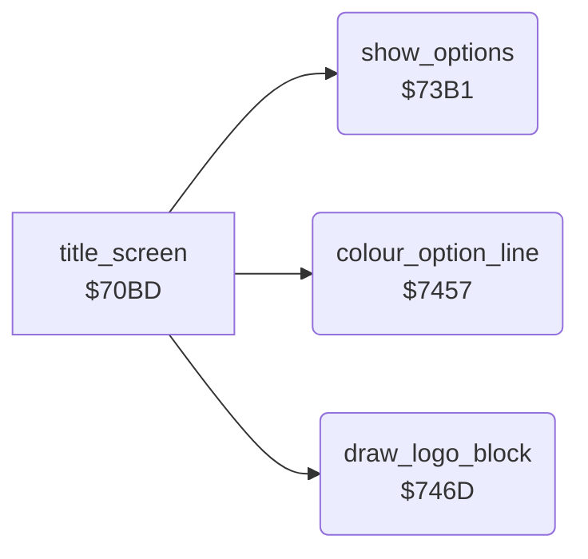

<!-- Generated by c64-docs from knowledge revision 20261024T232120.926-729orp and .c64-re-tools/local/generated/src/source-map.json. Do not edit: change the knowledge, generate the source again, then run docs.ts generate. -->
# screen/title_options.asm: Title options

Range `$73B1-$74B2`. Source: [screen/title_options.asm](../../../../src/screen/title_options.asm). Index: [the reference](../../index.md).

## Call graph

A solid arrow is a call, a thick arrow a table entry, a dotted arrow a jump. Rounded nodes are in this file.

## Data

| Range | Type | Name | Read by | Written by |
|---|---|---|---|---|
| [`$73E7`](../../../../src/screen/title_options.asm#L47)-`$7456` | petscii of 16 | [`option_texts`](../../../../src/screen/title_options.asm#L46) | [`show_options`](title_options.md#show_options) |  |

## Names

### [`show_options`](../../../../src/screen/title_options.asm#L6) `$73B1`

*routine*

Writes the three option lines (gravity, control, skill level) to rows 21-23 from column 13, from $4008-$400a.

- **Called from:** [`title_screen`](title_screen.md#title_screen) [`$71AD`](../../../../src/screen/title_screen.asm#L112), [`title_screen`](title_screen.md#title_screen) [`$71D0`](../../../../src/screen/title_screen.asm#L130)
- **Reads:** [`zp_temp1`](../../memory-map.md#zp_temp1), [`opt_gravity`](../data/variables.md#opt_gravity), [`zp_temp0`](../../memory-map.md#zp_temp0)
- **Writes:** [`zp_temp1`](../../memory-map.md#zp_temp1), [`zp_temp0`](../../memory-map.md#zp_temp0), [`screen_a+853`](../../memory-map.md#screen_a)

### [`show_options_line`](../../../../src/screen/title_options.asm#L8) `$73B3`

*label*

- **Jumped to from:** [`show_options`](title_options.md#show_options) [`$73E4`](../../../../src/screen/title_options.asm#L43)

### [`show_options_copy`](../../../../src/screen/title_options.asm#L33) `$73D5`

*label*

- **Jumped to from:** [`show_options`](title_options.md#show_options) [`$73DF`](../../../../src/screen/title_options.asm#L39)

### [`option_texts`](../../../../src/screen/title_options.asm#L46) `$73E7-$7456`

*data*

Option texts, 16 characters each: gravity off/on, normal/pilot control, beginner/advanced/expert.

- **Read by:** [`show_options`](title_options.md#show_options) [`$73D5`](../../../../src/screen/title_options.asm#L34)

### [`colour_option_line`](../../../../src/screen/title_options.asm#L55) `$7457`

*routine*

Sets colour X in 40 bytes of colour RAM from row 21 + A, column 13.

- **Called from:** [`title_screen`](title_screen.md#title_screen) [`$7104`](../../../../src/screen/title_screen.asm#L36), [`title_screen`](title_screen.md#title_screen) [`$71DF`](../../../../src/screen/title_screen.asm#L137), [`title_screen`](title_screen.md#title_screen) [`$71F3`](../../../../src/screen/title_screen.asm#L147)
- **Reads:** [`zp_temp0`](../../memory-map.md#zp_temp0)
- **Writes:** [`zp_temp0`](../../memory-map.md#zp_temp0), `$DB55`

### [`colour_option_line_loop`](../../../../src/screen/title_options.asm#L67) `$7465`

*label*

- **Jumped to from:** [`colour_option_line`](title_options.md#colour_option_line) [`$746A`](../../../../src/screen/title_options.asm#L71)

### [`draw_logo_block`](../../../../src/screen/title_options.asm#L74) `$746D`

*routine*

Copies 6 rows of 20 characters from ($fb) to the screen at ($fd). Characters $15-$19 get colour 2 (red).

- **Called from:** [`title_screen`](title_screen.md#title_screen) [`$7132`](../../../../src/screen/title_screen.asm#L56), [`title_screen`](title_screen.md#title_screen) [`$7145`](../../../../src/screen/title_screen.asm#L65)
- **Reads:** [`map_ptr`](../../memory-map.md#map_ptr), [`row_ptr`](../../memory-map.md#row_ptr), [`row_ptr_hi`](../../memory-map.md#row_ptr_hi), [`map_ptr_hi`](../../memory-map.md#map_ptr_hi), [`zp_temp0`](../../memory-map.md#zp_temp0)
- **Writes:** [`zp_temp0`](../../memory-map.md#zp_temp0), [`row_ptr_hi`](../../memory-map.md#row_ptr_hi), [`map_ptr`](../../memory-map.md#map_ptr), [`map_ptr_hi`](../../memory-map.md#map_ptr_hi), [`row_ptr`](../../memory-map.md#row_ptr)

### [`draw_logo_block_row`](../../../../src/screen/title_options.asm#L77) `$7471`

*label*

- **Jumped to from:** [`draw_logo_block`](title_options.md#draw_logo_block) [`$74B0`](../../../../src/screen/title_options.asm#L114)

### [`draw_logo_block_char`](../../../../src/screen/title_options.asm#L79) `$7473`

*label*

- **Jumped to from:** [`draw_logo_block`](title_options.md#draw_logo_block) [`$7492`](../../../../src/screen/title_options.asm#L98)

### [`draw_logo_block_next`](../../../../src/screen/title_options.asm#L96) `$7491`

*label*

- **Jumped to from:** [`draw_logo_block`](title_options.md#draw_logo_block) [`$7479`](../../../../src/screen/title_options.asm#L83), [`draw_logo_block`](title_options.md#draw_logo_block) [`$747D`](../../../../src/screen/title_options.asm#L85)
