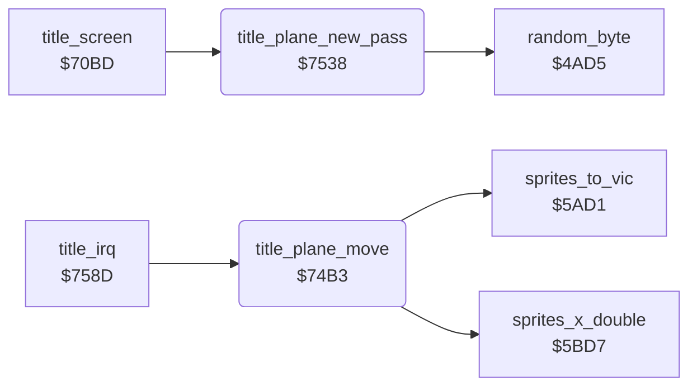

<!-- Generated by c64-docs from knowledge revision 20261025T214620.804-eudhn0 and .c64-re-tools/local/generated/src/source-map.json. Do not edit: change the knowledge, generate the source again, then run docs.ts generate. -->
# screen/title_plane.asm: Title plane

Range `$74B3-$7564`. Source: [screen/title_plane.asm](../../../../src/screen/title_plane.asm). Index: [the reference](../../index.md).

## Routines

| Routine | Address | Reached from | Summary |
|---|---|---|---|
| [`title_plane_move`](title_plane.md#title_plane_move) | `$74B3` | [`title_irq`](../irq/title_irq.md#title_irq) | Moves the title plane (sprite 0) one step right and animates it. |
| [`title_plane_new_pass`](title_plane.md#title_plane_new_pass) | `$7538` | [`title_screen`](title_screen.md#title_screen) | Starts the next pass: counts $4035, takes the row from title_plane_rows for passes 0-2, else a random row; sets X to 0. |

## Data

| Range | Type | Name | Read by | Written by |
|---|---|---|---|---|
| [`$7562`](../../../../src/screen/title_plane.asm#L102)-`$7564` | bytes | [`title_plane_rows`](../../../../src/screen/title_plane.asm#L101) | [`title_plane_new_pass`](title_plane.md#title_plane_new_pass) |  |

## Call graph

A solid arrow is a call, a thick arrow a table entry. Rounded nodes are in this file.

## Details

### [`title_plane_move`](../../../../src/screen/title_plane.asm#L6) `$74B3`

*routine*

Moves the title plane (sprite 0) one step right and animates it. On passes 0-2 it colours the text row under it white.

- **Called from:** [`title_irq`](../irq/title_irq.md#title_irq)
- **Calls:** [`sprites_x_double`](sprite_positions.md#sprites_x_double), [`sprites_to_vic`](sprite_registers.md#sprites_to_vic)
- **Jumps to:** [`title_plane_new_pass`](title_plane.md#title_plane_new_pass)
- **Reads:** [`loop_count`](../data/variables.md#loop_count), [`plane_frame`](../data/variables.md#plane_frame), [`plane_x`](../data/variables.md#plane_x), [`map_section`](../data/variables.md#map_section), [`plane_y`](../data/variables.md#plane_y), [`map_ptr_hi`](../../memory-map.md#map_ptr_hi), [`map_ptr`](../../memory-map.md#map_ptr), [`zp_temp0`](../../memory-map.md#zp_temp0)
- **Writes:** [`loop_count`](../data/variables.md#loop_count), [`sprite_enable`](../data/variables.md#sprite_enable), [`SPENA`](../../memory-map.md#SPENA), [`plane_frame`](../data/variables.md#plane_frame), [`plane_x`](../data/variables.md#plane_x), [`plane_colour`](../data/variables.md#plane_colour), [`map_ptr_hi`](../../memory-map.md#map_ptr_hi), [`map_ptr`](../../memory-map.md#map_ptr), [`zp_temp0`](../../memory-map.md#zp_temp0)

| Label | Address | Comment |
|---|---|---|
| [`title_plane_store_frame`](../../../../src/screen/title_plane.asm#L21) | `$74D4` |  |
| [`title_plane_step_x`](../../../../src/screen/title_plane.asm#L23) | `$74D7` |  |
| [`title_plane_show`](../../../../src/screen/title_plane.asm#L31) | `$74E7` |  |
| [`title_plane_no_paint`](../../../../src/screen/title_plane.asm#L44) | `$7504` |  |
| [`title_plane_paint`](../../../../src/screen/title_plane.asm#L46) | `$7507` | Colour RAM row = ($40cc - $28) / 8, column = ($40c4 - $0e) / 4. |
| [`title_plane_done`](../../../../src/screen/title_plane.asm#L74) | `$7537` |  |

### [`title_plane_new_pass`](../../../../src/screen/title_plane.asm#L77) `$7538`

*routine*

Starts the next pass: counts $4035, takes the row from title_plane_rows for passes 0-2, else a random row; sets X to 0.

- **Called from:** [`title_screen`](title_screen.md#title_screen)
- **Jumped to from:** [`title_plane_move`](title_plane.md#title_plane_move)
- **Calls:** [`random_byte`](../game/random.md#random_byte)
- **Reads:** [`map_section`](../data/variables.md#map_section)
- **Writes:** [`map_section`](../data/variables.md#map_section), [`plane_y`](../data/variables.md#plane_y), [`plane_x`](../data/variables.md#plane_x)

| Label | Address | Comment |
|---|---|---|
| [`title_plane_random_row`](../../../../src/screen/title_plane.asm#L88) | `$754F` |  |
| [`title_plane_store_row`](../../../../src/screen/title_plane.asm#L94) | `$7559` |  |
| [`title_plane_reset_x`](../../../../src/screen/title_plane.asm#L96) | `$755C` |  |

### [`title_plane_rows`](../../../../src/screen/title_plane.asm#L101) `$7562-$7564`

*data*

Sprite Y of passes 0-2: rows 1, 17 and 19 of the title texts.

- **Read by:** [`title_plane_new_pass`](title_plane.md#title_plane_new_pass)
