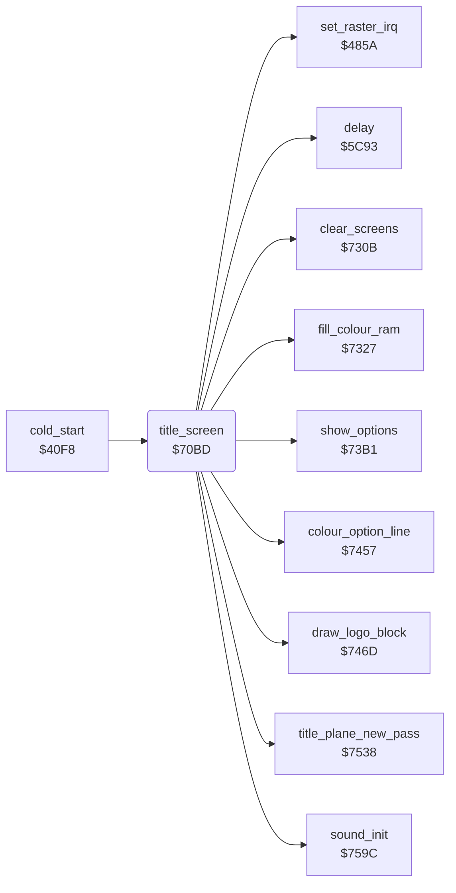

<!-- Generated by c64-docs from knowledge revision 20261024T232120.926-729orp and .c64-re-tools/local/generated/src/source-map.json. Do not edit: change the knowledge, generate the source again, then run docs.ts generate. -->
# screen/title_screen.asm: Title screen and options

Range `$70BD-$730A`. Source: [screen/title_screen.asm](../../../../src/screen/title_screen.asm). Index: [the reference](../../index.md).

## Call graph

A solid arrow is a call, a thick arrow a table entry, a dotted arrow a jump. Rounded nodes are in this file.

## Data

| Range | Type | Name | Read by | Written by |
|---|---|---|---|---|
| [`$721B`](../../../../src/screen/title_screen.asm#L170)-`$7292` | bytes of 20 | [`title_logo_blue`](../../../../src/screen/title_screen.asm#L169) |  |  |
| [`$7293`](../../../../src/screen/title_screen.asm#L190)-`$730A` | bytes of 20 | [`title_logo_max`](../../../../src/screen/title_screen.asm#L189) |  |  |

## Names

### [`title_screen`](../../../../src/screen/title_screen.asm#L6) `$70BD`

*routine*

Shows the title, plays the tune and reads the keys F1, F3, F5. Returns at fire, F7, or at the end of the tune (demo).

- **Called from:** [`cold_start`](../init/game_start.md#cold_start) [`$4123`](../../../../src/init/game_start.asm#L21)
- **Calls:** [`title_plane_new_pass`](title_plane.md#title_plane_new_pass), [`clear_screens`](screen_fill.md#clear_screens), [`fill_colour_ram`](screen_fill.md#fill_colour_ram), [`colour_option_line`](title_options.md#colour_option_line), [`draw_logo_block`](title_options.md#draw_logo_block), [`delay`](../game/delay.md#delay), [`sound_init`](../music/music_player.md#sound_init), [`set_raster_irq`](../irq/raster.md#set_raster_irq), [`show_options`](title_options.md#show_options)
- **Reads:** [`text_by_author_base`](screen_fill.md#text_by_author_base), [`text_copyright_base`](../text/title_texts.md#text_copyright_base), [`text_bob_polin_base`](../text/title_texts.md#text_bob_polin_base), [`music_ended`](../data/variables.md#music_ended), [`CIAPRA`](../../memory-map.md#CIAPRA), [`fkey_code`](../data/variables.md#fkey_code), [`option_line`](../data/variables.md#option_line), [`opt_gravity`](../data/variables.md#opt_gravity), [`text_music_credit`](../text/music_credit.md#text_music_credit)
- **Writes:** [`option_line`](../data/variables.md#option_line), [`map_section`](../data/variables.md#map_section), [`invincible`](../data/variables.md#invincible), [`fkey_code`](../data/variables.md#fkey_code), [`YXPAND`](../../memory-map.md#YXPAND), [`XXPAND`](../../memory-map.md#XXPAND), [`SPBGPR`](../../memory-map.md#SPBGPR), [`SPMC`](../../memory-map.md#SPMC), [`sprite_xexp_mask`](../data/variables.md#sprite_xexp_mask), [`sprite_yexp_mask`](../data/variables.md#sprite_yexp_mask), [`sprite_prio_mask`](../data/variables.md#sprite_prio_mask), [`plane_frame`](../data/variables.md#plane_frame), `$DB4F`, [`VMCSB`](../../memory-map.md#VMCSB), [`SCROLX`](../../memory-map.md#SCROLX), [`SCROLY`](../../memory-map.md#SCROLY), [`zp_count`](../../memory-map.md#zp_count), [`EXTCOL`](../../memory-map.md#EXTCOL), [`BGCOL0`](../../memory-map.md#BGCOL0), [`map_ptr_hi`](../../memory-map.md#map_ptr_hi), [`map_ptr`](../../memory-map.md#map_ptr), [`row_ptr_hi`](../../memory-map.md#row_ptr_hi), [`row_ptr`](../../memory-map.md#row_ptr), [`screen_a+680`](../../memory-map.md#screen_a), `$DAA8`, [`screen_a+760`](../../memory-map.md#screen_a), `$DAF8`, [`screen_a+38`](../../memory-map.md#screen_a), `$D826`, [`demo_mode`](../data/variables.md#demo_mode), [`sound_volume`](../data/variables.md#sound_volume), [`opt_gravity`](../data/variables.md#opt_gravity), [`SPENA`](../../memory-map.md#SPENA)
- **Refers to:** [`screen_a`](../../memory-map.md#screen_a)

### [`title_screen_colour_loop`](../../../../src/screen/title_screen.asm#L30) `$70FA`

*label*

- **Jumped to from:** [`title_screen`](title_screen.md#title_screen) [`$70FE`](../../../../src/screen/title_screen.asm#L33)

### [`title_screen_text_loop`](../../../../src/screen/title_screen.asm#L67) `$714A`

*label*

Rows 17, 19 and 1 start in black; the title plane colours them.

- **Jumped to from:** [`title_screen`](title_screen.md#title_screen) [`$716C`](../../../../src/screen/title_screen.asm#L81)

### [`title_screen_wait`](../../../../src/screen/title_screen.asm#L92) `$7185`

*label*

$4085 bit 7: the tune is at its end; start the demo with $4093 = 1.

- **Jumped to from:** [`title_screen`](title_screen.md#title_screen) [`$719C`](../../../../src/screen/title_screen.asm#L104), [`title_screen`](title_screen.md#title_screen) [`$7209`](../../../../src/screen/title_screen.asm#L159)

### [`title_screen_leave`](../../../../src/screen/title_screen.asm#L97) `$718F`

*label*

- **Jumped to from:** [`title_screen`](title_screen.md#title_screen) [`$7197`](../../../../src/screen/title_screen.asm#L102)

### [`title_screen_check_fire`](../../../../src/screen/title_screen.asm#L99) `$7192`

*label*

- **Jumped to from:** [`title_screen`](title_screen.md#title_screen) [`$7188`](../../../../src/screen/title_screen.asm#L94)

### [`title_screen_toggle_value`](../../../../src/screen/title_screen.asm#L126) `$71CB`

*label*

- **Jumped to from:** [`title_screen`](title_screen.md#title_screen) [`$71C0`](../../../../src/screen/title_screen.asm#L121)

### [`title_screen_store_value`](../../../../src/screen/title_screen.asm#L128) `$71CD`

*label*

- **Jumped to from:** [`title_screen`](title_screen.md#title_screen) [`$71C4`](../../../../src/screen/title_screen.asm#L123), [`title_screen`](title_screen.md#title_screen) [`$71C8`](../../../../src/screen/title_screen.asm#L125)

### [`title_screen_check_f3`](../../../../src/screen/title_screen.asm#L132) `$71D6`

*label*

F3: next option line, colour white for the old line and grey for the new line.

- **Jumped to from:** [`title_screen`](title_screen.md#title_screen) [`$71B3`](../../../../src/screen/title_screen.asm#L115)

### [`title_screen_store_line`](../../../../src/screen/title_screen.asm#L144) `$71EE`

*label*

- **Jumped to from:** [`title_screen`](title_screen.md#title_screen) [`$71EA`](../../../../src/screen/title_screen.asm#L142)

### [`title_screen_show_credit`](../../../../src/screen/title_screen.asm#L149) `$71F9`

*label*

F1: the music credit replaces the copyright line (row 19).

- **Jumped to from:** [`title_screen`](title_screen.md#title_screen) [`$71D8`](../../../../src/screen/title_screen.asm#L134)

### [`title_screen_credit_loop`](../../../../src/screen/title_screen.asm#L151) `$71FB`

*label*

- **Jumped to from:** [`title_screen`](title_screen.md#title_screen) [`$7202`](../../../../src/screen/title_screen.asm#L155)

### [`title_screen_key_delay`](../../../../src/screen/title_screen.asm#L156) `$7204`

*label*

- **Jumped to from:** [`title_screen`](title_screen.md#title_screen) [`$71D3`](../../../../src/screen/title_screen.asm#L131), [`title_screen`](title_screen.md#title_screen) [`$71F6`](../../../../src/screen/title_screen.asm#L148)

### [`title_screen_exit`](../../../../src/screen/title_screen.asm#L160) `$720C`

*label*

- **Jumped to from:** [`title_screen`](title_screen.md#title_screen) [`$718F`](../../../../src/screen/title_screen.asm#L98), [`title_screen`](title_screen.md#title_screen) [`$71AA`](../../../../src/screen/title_screen.asm#L110)

### [`title_logo_blue`](../../../../src/screen/title_screen.asm#L169) `$721B-$7292`

*data*

Big logo 'BLUE': 6 rows of 20 screen codes, drawn by draw_logo_block.

- **Referred to by:** [`title_screen`](title_screen.md#title_screen) [`$7122`](../../../../src/screen/title_screen.asm#L48), [`title_screen`](title_screen.md#title_screen) [`$7126`](../../../../src/screen/title_screen.asm#L50)

### [`title_logo_max`](../../../../src/screen/title_screen.asm#L189) `$7293-$730A`

*data*

Big logo 'MAX': 6 rows of 20 screen codes, drawn by draw_logo_block.

- **Referred to by:** [`title_screen`](title_screen.md#title_screen) [`$713D`](../../../../src/screen/title_screen.asm#L61), [`title_screen`](title_screen.md#title_screen) [`$7141`](../../../../src/screen/title_screen.asm#L63)
