<!-- Generated by c64-docs from knowledge revision 20261025T214620.804-eudhn0 and .c64-re-tools/local/generated/src/source-map.json. Do not edit: change the knowledge, generate the source again, then run docs.ts generate. -->
# sound/sound_effects.asm: Engine sound and sound effects

Range `$7B62-$7D32`. Source: [sound/sound_effects.asm](../../../../src/sound/sound_effects.asm). Index: [the reference](../../index.md).

## Routines

| Routine | Address | Reached from | Summary |
|---|---|---|---|
| [`engine_sound`](sound_effects.md#engine_sound) | `$7B62` | [`irq_frame`](../irq/frame_irq.md#irq_frame) | Sets the voice 1 engine pitch from speed, two times altitude and $32. |
| [`engine_sound_start`](sound_effects.md#engine_sound_start) | `$7B94` | [`cold_start`](../init/game_start.md#cold_start), [`plane_service`](../plane/plane_states.md#plane_service) | Starts the engine sound on voice 1 and sets volume $1f. |
| [`sound_explosion_small`](sound_effects.md#sound_explosion_small) | `$7BC8` | [`bomb_impact`](../ground/bomb_impact.md#bomb_impact), [`road_vehicle_update`](../enemy/road_vehicle.md#road_vehicle_update), [`check_bullet_enemy`](../plane/weapons.md#check_bullet_enemy), [`sound_explosion_double`](sound_effects.md#sound_explosion_double) | Voice 3 noise, pitch $10, attack/decay $6c: short explosion. |
| [`sound_explosion_large`](sound_effects.md#sound_explosion_large) | `$7BE7` | [`bomb_impact`](../ground/bomb_impact.md#bomb_impact), [`runway_attacker_start`](../enemy/runway_attacker.md#runway_attacker_start), [`update_weapons`](../plane/weapons.md#update_weapons), [`check_bullet_enemy`](../plane/weapons.md#check_bullet_enemy), [`destroy_object`](../ground/ground_hits.md#destroy_object), [`clear_flak_gun`](../ground/ground_hits.md#clear_flak_gun), [`draw_ruin`](../ground/ground_hits.md#draw_ruin), [`update_crash`](../plane/crash.md#update_crash), [`sound_plane_hit`](sound_effects.md#sound_plane_hit) | Voice 3 noise, pitch $10, attack/decay $6d: long explosion. |
| [`sound_noise_hit`](sound_effects.md#sound_noise_hit) | `$7C06` | [`bomb_impact`](../ground/bomb_impact.md#bomb_impact), [`update_weapons`](../plane/weapons.md#update_weapons), [`bullet_hit_ground`](../ground/ground_hits.md#bullet_hit_ground), [`update_shells`](../enemy/flak_shells.md#update_shells) | Voice 3 noise, pitch $64, attack/decay $6a: hit sound. |
| [`sound_bomb_impact`](sound_effects.md#sound_bomb_impact) | `$7C25` | [`update_weapons`](../plane/weapons.md#update_weapons) | When no effect runs ($4087 = 0): voice 2 noise, pitch $28. |
| [`sound_voice2_release`](sound_effects.md#sound_voice2_release) | `$7C49` | [`update_weapons`](../plane/weapons.md#update_weapons) | Voice 2 noise, gate off. |
| [`sound_explosion_double`](sound_effects.md#sound_explosion_double) | `$7C4F` | [`destroy_object`](../ground/ground_hits.md#destroy_object) | Short explosion on voice 3 and noise on voice 2; effect timer 10, bomb whistle off. |
| [`sound_beep_high`](sound_effects.md#sound_beep_high) | `$7C76` | [`map_airfield_rows`](../ground/airfield_rows.md#map_airfield_rows), [`bomb_impact`](../ground/bomb_impact.md#bomb_impact), [`read_keys`](../input/keyboard.md#read_keys) | Voice 2 triangle, pitch $64: beep. |
| [`sound_beep_low`](sound_effects.md#sound_beep_low) | `$7C98` | [`plane_service`](../plane/plane_states.md#plane_service) | Voice 2 triangle, pitch $32: low beep at the end of a service step. |
| [`sound_nothing`](sound_effects.md#sound_nothing) | `$7CBA` | [`update_wind`](../plane/wind.md#update_wind) | Empty sound routine, called from $5e79. |
| [`sound_plane_hit`](sound_effects.md#sound_plane_hit) | `$7CBB` | [`check_enemy_collision`](../enemy/enemy_collision.md#check_enemy_collision), [`plane_hit_by_shell`](../plane/shell_damage.md#plane_hit_by_shell) | Long explosion on voice 3 and sawtooth pitch $0f on voice 2; effect timer 10, bomb whistle off. |
| [`sound_gun`](sound_effects.md#sound_gun) | `$7CE2` | [`update_weapons`](../plane/weapons.md#update_weapons) | Gun shot: voice 2 noise, pitch $28, on frames with $405e bit 1 clear, when no effect runs. |
| [`sound_bomb_drop`](sound_effects.md#sound_bomb_drop) | `$7D06` | [`update_weapons`](../plane/weapons.md#update_weapons) | Bomb whistle: voice 2 sawtooth, effect timer $30, $409e = 1 (engine_sound sets the falling pitch). |
| [`sound_bomb_stop`](sound_effects.md#sound_bomb_stop) | `$7D2A` | [`update_weapons`](../plane/weapons.md#update_weapons), [`update_crash`](../plane/crash.md#update_crash) | Stops voice 2 and clears the bomb whistle flag $409e. |

## Call graph

A solid arrow is a call, a thick arrow a table entry. Rounded nodes are in this file.

The graph shows 30 of the 34 edges.

```mermaid
flowchart LR
  n40f8["cold_start<br/>$40F8"]
  n456d["irq_frame<br/>$456D"]
  n4a59["map_airfield_rows<br/>$4A59"]
  n57cb["bomb_impact<br/>$57CB"]
  n5d2b["read_keys<br/>$5D2B"]
  n5e3f["update_wind<br/>$5E3F"]
  n5f0c["runway_attacker_start<br/>$5F0C"]
  n6256["road_vehicle_update<br/>$6256"]
  n6342["check_enemy_collision<br/>$6342"]
  n6382["update_weapons<br/>$6382"]
  n657a["check_bullet_enemy<br/>$657A"]
  n6660["bullet_hit_ground<br/>$6660"]
  n6738["destroy_object<br/>$6738"]
  n67ba["clear_flak_gun<br/>$67BA"]
  n6824["draw_ruin<br/>$6824"]
  n68fd["update_crash<br/>$68FD"]
  n6974["plane_hit_by_shell<br/>$6974"]
  n6bf7["update_shells<br/>$6BF7"]
  n7b62("engine_sound<br/>$7B62")
  n7b94("engine_sound_start<br/>$7B94")
  n7bc8("sound_explosion_small<br/>$7BC8")
  n7be7("sound_explosion_large<br/>$7BE7")
  n7c06("sound_noise_hit<br/>$7C06")
  n7c25("sound_bomb_impact<br/>$7C25")
  n7c49("sound_voice2_release<br/>$7C49")
  n7c4f("sound_explosion_double<br/>$7C4F")
  n7c76("sound_beep_high<br/>$7C76")
  n7c98("sound_beep_low<br/>$7C98")
  n7cba("sound_nothing<br/>$7CBA")
  n7cbb("sound_plane_hit<br/>$7CBB")
  n7ce2("sound_gun<br/>$7CE2")
  n7d06("sound_bomb_drop<br/>$7D06")
  n7d2a("sound_bomb_stop<br/>$7D2A")
  n40f8 --> n7b94
  n456d --> n7b62
  n4a59 --> n7c76
  n57cb --> n7bc8
  n57cb --> n7be7
  n57cb --> n7c06
  n57cb --> n7c76
  n5d2b --> n7c76
  n5e3f --> n7cba
  n5f0c --> n7be7
  n6256 --> n7bc8
  n6342 --> n7cbb
  n6382 --> n7be7
  n6382 --> n7c06
  n6382 --> n7c25
  n6382 --> n7c49
  n6382 --> n7ce2
  n6382 --> n7d06
  n6382 --> n7d2a
  n657a --> n7bc8
  n657a --> n7be7
  n6660 --> n7c06
  n6738 --> n7be7
  n6738 --> n7c4f
  n67ba --> n7be7
  n6824 --> n7be7
  n68fd --> n7be7
  n68fd --> n7d2a
  n6974 --> n7cbb
  n6bf7 --> n7c06
```

## Details

### [`engine_sound`](../../../../src/sound/sound_effects.asm#L6) `$7B62`

*routine*

Sets the voice 1 engine pitch from speed, two times altitude and $32. Counts down effect timer $4087 and sets the bomb whistle pitch.

- **Called from:** [`irq_frame`](../irq/frame_irq.md#irq_frame)
- **Reads:** [`speed`](../data/variables.md#speed), [`altitude`](../data/variables.md#altitude), [`sfx_timer`](../data/variables.md#sfx_timer), [`bomb_whistle_on`](../data/variables.md#bomb_whistle_on), [`bomb_height`](../data/variables.md#bomb_height)
- **Writes:** [`FRELO1`](../../memory-map.md#FRELO1), [`FREHI1`](../../memory-map.md#FREHI1), [`sfx_timer`](../data/variables.md#sfx_timer), [`FREHI2`](../../memory-map.md#FREHI2)

| Label | Address | Comment |
|---|---|---|
| [`engine_sound_add_alt`](../../../../src/sound/sound_effects.asm#L14) | `$7B70` |  |
| [`engine_sound_store`](../../../../src/sound/sound_effects.asm#L19) | `$7B77` |  |
| [`engine_sound_whistle`](../../../../src/sound/sound_effects.asm#L25) | `$7B85` |  |
| [`engine_sound_done`](../../../../src/sound/sound_effects.asm#L32) | `$7B93` |  |

### [`engine_sound_start`](../../../../src/sound/sound_effects.asm#L35) `$7B94`

*routine*

Starts the engine sound on voice 1 and sets volume $1f. In demo mode ($4093) it sets volume 0.

- **Called from:** [`cold_start`](../init/game_start.md#cold_start), [`plane_service`](../plane/plane_states.md#plane_service)
- **Reads:** [`demo_mode`](../data/variables.md#demo_mode)
- **Writes:** [`PWHI1`](../../memory-map.md#PWHI1), [`ATDCY1`](../../memory-map.md#ATDCY1), [`SUREL1`](../../memory-map.md#SUREL1), [`VCREG1`](../../memory-map.md#VCREG1), [`SIGVOL`](../../memory-map.md#SIGVOL), [`sound_volume`](../data/variables.md#sound_volume), [`RESON`](../../memory-map.md#RESON), [`CUTHI`](../../memory-map.md#CUTHI)

| Label | Address | Comment |
|---|---|---|
| [`engine_sound_filter`](../../../../src/sound/sound_effects.asm#L52) | `$7BBD` | Resonance 15, filter on voices 1 and 3. |

### [`sound_explosion_small`](../../../../src/sound/sound_effects.asm#L59) `$7BC8`

*routine*

Voice 3 noise, pitch $10, attack/decay $6c: short explosion.

- **Called from:** [`bomb_impact`](../ground/bomb_impact.md#bomb_impact), [`road_vehicle_update`](../enemy/road_vehicle.md#road_vehicle_update), [`check_bullet_enemy`](../plane/weapons.md#check_bullet_enemy), [`sound_explosion_double`](sound_effects.md#sound_explosion_double)
- **Writes:** [`CUTHI`](../../memory-map.md#CUTHI), [`FREHI3`](../../memory-map.md#FREHI3), [`ATDCY3`](../../memory-map.md#ATDCY3), [`SUREL3`](../../memory-map.md#SUREL3), [`VCREG3`](../../memory-map.md#VCREG3)

### [`sound_explosion_large`](../../../../src/sound/sound_effects.asm#L74) `$7BE7`

*routine*

Voice 3 noise, pitch $10, attack/decay $6d: long explosion.

- **Called from:** [`bomb_impact`](../ground/bomb_impact.md#bomb_impact), [`runway_attacker_start`](../enemy/runway_attacker.md#runway_attacker_start), [`update_weapons`](../plane/weapons.md#update_weapons), [`check_bullet_enemy`](../plane/weapons.md#check_bullet_enemy), [`destroy_object`](../ground/ground_hits.md#destroy_object), [`clear_flak_gun`](../ground/ground_hits.md#clear_flak_gun), [`draw_ruin`](../ground/ground_hits.md#draw_ruin), [`update_crash`](../plane/crash.md#update_crash), [`sound_plane_hit`](sound_effects.md#sound_plane_hit)
- **Writes:** [`CUTHI`](../../memory-map.md#CUTHI), [`FREHI3`](../../memory-map.md#FREHI3), [`ATDCY3`](../../memory-map.md#ATDCY3), [`SUREL3`](../../memory-map.md#SUREL3), [`VCREG3`](../../memory-map.md#VCREG3)

### [`sound_noise_hit`](../../../../src/sound/sound_effects.asm#L89) `$7C06`

*routine*

Voice 3 noise, pitch $64, attack/decay $6a: hit sound.

- **Called from:** [`bomb_impact`](../ground/bomb_impact.md#bomb_impact), [`update_weapons`](../plane/weapons.md#update_weapons), [`bullet_hit_ground`](../ground/ground_hits.md#bullet_hit_ground), [`update_shells`](../enemy/flak_shells.md#update_shells)
- **Writes:** [`CUTHI`](../../memory-map.md#CUTHI), [`FREHI3`](../../memory-map.md#FREHI3), [`ATDCY3`](../../memory-map.md#ATDCY3), [`SUREL3`](../../memory-map.md#SUREL3), [`VCREG3`](../../memory-map.md#VCREG3)

### [`sound_bomb_impact`](../../../../src/sound/sound_effects.asm#L104) `$7C25`

*routine*

When no effect runs ($4087 = 0): voice 2 noise, pitch $28. Clears the bomb whistle flag $409e.

- **Called from:** [`update_weapons`](../plane/weapons.md#update_weapons)
- **Reads:** [`sfx_timer`](../data/variables.md#sfx_timer)
- **Writes:** [`FREHI2`](../../memory-map.md#FREHI2), [`ATDCY2`](../../memory-map.md#ATDCY2), [`SUREL2`](../../memory-map.md#SUREL2), [`VCREG2`](../../memory-map.md#VCREG2), [`bomb_whistle_on`](../data/variables.md#bomb_whistle_on)

| Label | Address | Comment |
|---|---|---|
| [`sound_bomb_impact_done`](../../../../src/sound/sound_effects.asm#L120) | `$7C48` |  |

### [`sound_voice2_release`](../../../../src/sound/sound_effects.asm#L123) `$7C49`

*routine*

Voice 2 noise, gate off.

- **Called from:** [`update_weapons`](../plane/weapons.md#update_weapons)
- **Writes:** [`VCREG2`](../../memory-map.md#VCREG2)

### [`sound_explosion_double`](../../../../src/sound/sound_effects.asm#L128) `$7C4F`

*routine*

Short explosion on voice 3 and noise on voice 2; effect timer 10, bomb whistle off.

- **Called from:** [`destroy_object`](../ground/ground_hits.md#destroy_object)
- **Calls:** [`sound_explosion_small`](sound_effects.md#sound_explosion_small)
- **Writes:** [`FREHI2`](../../memory-map.md#FREHI2), [`ATDCY2`](../../memory-map.md#ATDCY2), [`SUREL2`](../../memory-map.md#SUREL2), [`VCREG2`](../../memory-map.md#VCREG2), [`sfx_timer`](../data/variables.md#sfx_timer), [`bomb_whistle_on`](../data/variables.md#bomb_whistle_on)

### [`sound_beep_high`](../../../../src/sound/sound_effects.asm#L147) `$7C76`

*routine*

Voice 2 triangle, pitch $64: beep. Effect timer $11, bomb whistle off.

- **Called from:** [`map_airfield_rows`](../ground/airfield_rows.md#map_airfield_rows), [`bomb_impact`](../ground/bomb_impact.md#bomb_impact), [`read_keys`](../input/keyboard.md#read_keys)
- **Writes:** [`FREHI2`](../../memory-map.md#FREHI2), [`ATDCY2`](../../memory-map.md#ATDCY2), [`SUREL2`](../../memory-map.md#SUREL2), [`VCREG2`](../../memory-map.md#VCREG2), [`sfx_timer`](../data/variables.md#sfx_timer), [`bomb_whistle_on`](../data/variables.md#bomb_whistle_on)

### [`sound_beep_low`](../../../../src/sound/sound_effects.asm#L163) `$7C98`

*routine*

Voice 2 triangle, pitch $32: low beep at the end of a service step. Effect timer $11.

- **Called from:** [`plane_service`](../plane/plane_states.md#plane_service)
- **Writes:** [`FREHI2`](../../memory-map.md#FREHI2), [`ATDCY2`](../../memory-map.md#ATDCY2), [`SUREL2`](../../memory-map.md#SUREL2), [`VCREG2`](../../memory-map.md#VCREG2), [`sfx_timer`](../data/variables.md#sfx_timer), [`bomb_whistle_on`](../data/variables.md#bomb_whistle_on)

### [`sound_nothing`](../../../../src/sound/sound_effects.asm#L179) `$7CBA`

*routine*

Empty sound routine, called from $5e79.

- **Called from:** [`update_wind`](../plane/wind.md#update_wind)

### [`sound_plane_hit`](../../../../src/sound/sound_effects.asm#L182) `$7CBB`

*routine*

Long explosion on voice 3 and sawtooth pitch $0f on voice 2; effect timer 10, bomb whistle off.

- **Called from:** [`check_enemy_collision`](../enemy/enemy_collision.md#check_enemy_collision), [`plane_hit_by_shell`](../plane/shell_damage.md#plane_hit_by_shell)
- **Calls:** [`sound_explosion_large`](sound_effects.md#sound_explosion_large)
- **Writes:** [`FREHI2`](../../memory-map.md#FREHI2), [`ATDCY2`](../../memory-map.md#ATDCY2), [`SUREL2`](../../memory-map.md#SUREL2), [`VCREG2`](../../memory-map.md#VCREG2), [`sfx_timer`](../data/variables.md#sfx_timer), [`bomb_whistle_on`](../data/variables.md#bomb_whistle_on)

### [`sound_gun`](../../../../src/sound/sound_effects.asm#L200) `$7CE2`

*routine*

Gun shot: voice 2 noise, pitch $28, on frames with $405e bit 1 clear, when no effect runs.

- **Called from:** [`update_weapons`](../plane/weapons.md#update_weapons)
- **Reads:** [`sfx_timer`](../data/variables.md#sfx_timer), [`frame_count`](../data/variables.md#frame_count)
- **Writes:** [`FREHI2`](../../memory-map.md#FREHI2), [`ATDCY2`](../../memory-map.md#ATDCY2), [`SUREL2`](../../memory-map.md#SUREL2), [`VCREG2`](../../memory-map.md#VCREG2)

| Label | Address | Comment |
|---|---|---|
| [`sound_gun_done`](../../../../src/sound/sound_effects.asm#L215) | `$7D05` |  |

### [`sound_bomb_drop`](../../../../src/sound/sound_effects.asm#L218) `$7D06`

*routine*

Bomb whistle: voice 2 sawtooth, effect timer $30, $409e = 1 (engine_sound sets the falling pitch).

- **Called from:** [`update_weapons`](../plane/weapons.md#update_weapons)
- **Reads:** [`sfx_timer`](../data/variables.md#sfx_timer)
- **Writes:** [`ATDCY2`](../../memory-map.md#ATDCY2), [`SUREL2`](../../memory-map.md#SUREL2), [`VCREG2`](../../memory-map.md#VCREG2), [`sfx_timer`](../data/variables.md#sfx_timer), [`bomb_whistle_on`](../data/variables.md#bomb_whistle_on)

| Label | Address | Comment |
|---|---|---|
| [`sound_bomb_drop_done`](../../../../src/sound/sound_effects.asm#L233) | `$7D29` |  |

### [`sound_bomb_stop`](../../../../src/sound/sound_effects.asm#L236) `$7D2A`

*routine*

Stops voice 2 and clears the bomb whistle flag $409e.

- **Called from:** [`update_weapons`](../plane/weapons.md#update_weapons), [`update_crash`](../plane/crash.md#update_crash)
- **Writes:** [`VCREG2`](../../memory-map.md#VCREG2), [`bomb_whistle_on`](../data/variables.md#bomb_whistle_on)
