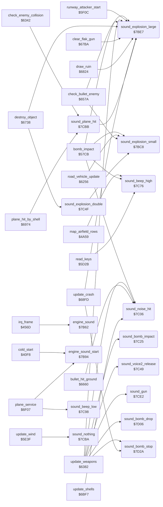

<!-- Generated by c64-docs from knowledge revision 20261024T232120.926-729orp and .c64-re-tools/local/generated/src/source-map.json. Do not edit: change the knowledge, generate the source again, then run docs.ts generate. -->
# sound/sound_effects.asm: Engine sound and sound effects

Range `$7B62-$7D32`. Source: [sound/sound_effects.asm](../../../../src/sound/sound_effects.asm). Index: [the reference](../../index.md).

## Call graph

A solid arrow is a call, a thick arrow a table entry, a dotted arrow a jump. Rounded nodes are in this file.

## Names

### [`engine_sound`](../../../../src/sound/sound_effects.asm#L6) `$7B62`

*routine*

Sets the voice 1 engine pitch from speed, two times altitude and $32. Counts down effect timer $4087 and sets the bomb whistle pitch.

- **Called from:** [`irq_frame`](../irq/frame_irq.md#irq_frame) [`$46B8`](../../../../src/irq/frame_irq.asm#L167)
- **Reads:** [`speed`](../data/variables.md#speed), [`altitude`](../data/variables.md#altitude), [`sfx_timer`](../data/variables.md#sfx_timer), [`bomb_whistle_on`](../data/variables.md#bomb_whistle_on), [`bomb_height`](../data/variables.md#bomb_height)
- **Writes:** [`FRELO1`](../../memory-map.md#FRELO1), [`FREHI1`](../../memory-map.md#FREHI1), [`sfx_timer`](../data/variables.md#sfx_timer), [`FREHI2`](../../memory-map.md#FREHI2)

### [`engine_sound_add_alt`](../../../../src/sound/sound_effects.asm#L14) `$7B70`

*label*

- **Jumped to from:** [`engine_sound`](sound_effects.md#engine_sound) [`$7B6D`](../../../../src/sound/sound_effects.asm#L12)

### [`engine_sound_store`](../../../../src/sound/sound_effects.asm#L19) `$7B77`

*label*

- **Jumped to from:** [`engine_sound`](sound_effects.md#engine_sound) [`$7B74`](../../../../src/sound/sound_effects.asm#L17)

### [`engine_sound_whistle`](../../../../src/sound/sound_effects.asm#L25) `$7B85`

*label*

- **Jumped to from:** [`engine_sound`](sound_effects.md#engine_sound) [`$7B80`](../../../../src/sound/sound_effects.asm#L23)

### [`engine_sound_done`](../../../../src/sound/sound_effects.asm#L32) `$7B93`

*label*

- **Jumped to from:** [`engine_sound`](sound_effects.md#engine_sound) [`$7B88`](../../../../src/sound/sound_effects.asm#L27)

### [`engine_sound_start`](../../../../src/sound/sound_effects.asm#L35) `$7B94`

*routine*

Starts the engine sound on voice 1 and sets volume $1f. In demo mode ($4093) it sets volume 0.

- **Called from:** [`cold_start`](../init/game_start.md#cold_start) [`$4345`](../../../../src/init/game_start.asm#L234), [`plane_service`](../plane/plane_states.md#plane_service) [`$6FB6`](../../../../src/plane/plane_states.asm#L216)
- **Reads:** [`demo_mode`](../data/variables.md#demo_mode)
- **Writes:** [`PWHI1`](../../memory-map.md#PWHI1), [`ATDCY1`](../../memory-map.md#ATDCY1), [`SUREL1`](../../memory-map.md#SUREL1), [`VCREG1`](../../memory-map.md#VCREG1), [`SIGVOL`](../../memory-map.md#SIGVOL), [`sound_volume`](../data/variables.md#sound_volume), [`RESON`](../../memory-map.md#RESON), [`CUTHI`](../../memory-map.md#CUTHI)

### [`engine_sound_filter`](../../../../src/sound/sound_effects.asm#L52) `$7BBD`

*label*

Resonance 15, filter on voices 1 and 3.

- **Jumped to from:** [`engine_sound_start`](sound_effects.md#engine_sound_start) [`$7BB3`](../../../../src/sound/sound_effects.asm#L48)

### [`sound_explosion_small`](../../../../src/sound/sound_effects.asm#L59) `$7BC8`

*routine*

Voice 3 noise, pitch $10, attack/decay $6c: short explosion.

- **Called from:** [`bomb_impact`](../ground/bomb_impact.md#bomb_impact) [`$57F4`](../../../../src/ground/bomb_impact.asm#L29), [`road_vehicle_update`](../enemy/road_vehicle.md#road_vehicle_update) [`$62AD`](../../../../src/enemy/road_vehicle.asm#L83), [`check_bullet_enemy`](../plane/weapons.md#check_bullet_enemy) [`$65E6`](../../../../src/plane/weapons.asm#L329), [`check_bullet_enemy`](../plane/weapons.md#check_bullet_enemy) [`$6615`](../../../../src/plane/weapons.asm#L356), [`check_bullet_enemy`](../plane/weapons.md#check_bullet_enemy) [`$6643`](../../../../src/plane/weapons.asm#L377), [`sound_explosion_double`](sound_effects.md#sound_explosion_double) [`$7C4F`](../../../../src/sound/sound_effects.asm#L130)
- **Writes:** [`CUTHI`](../../memory-map.md#CUTHI), [`FREHI3`](../../memory-map.md#FREHI3), [`ATDCY3`](../../memory-map.md#ATDCY3), [`SUREL3`](../../memory-map.md#SUREL3), [`VCREG3`](../../memory-map.md#VCREG3)

### [`sound_explosion_large`](../../../../src/sound/sound_effects.asm#L74) `$7BE7`

*routine*

Voice 3 noise, pitch $10, attack/decay $6d: long explosion.

- **Called from:** [`bomb_impact`](../ground/bomb_impact.md#bomb_impact) [`$5848`](../../../../src/ground/bomb_impact.asm#L69), [`runway_attacker_start`](../enemy/runway_attacker.md#runway_attacker_start) [`$5F9D`](../../../../src/enemy/runway_attacker.asm#L81), [`update_weapons`](../plane/weapons.md#update_weapons) [`$647C`](../../../../src/plane/weapons.asm#L141), [`update_weapons`](../plane/weapons.md#update_weapons) [`$6576`](../../../../src/plane/weapons.asm#L264), [`check_bullet_enemy`](../plane/weapons.md#check_bullet_enemy) [`$6631`](../../../../src/plane/weapons.asm#L369), [`destroy_object`](../ground/ground_hits.md#destroy_object) [`$679E`](../../../../src/ground/ground_hits.asm#L179), [`clear_flak_gun`](../ground/ground_hits.md#clear_flak_gun) [`$67ED`](../../../../src/ground/ground_hits.asm#L222), [`draw_ruin`](../ground/ground_hits.md#draw_ruin) [`$685C`](../../../../src/ground/ground_hits.asm#L295), [`update_crash`](../plane/crash.md#update_crash) [`$6940`](../../../../src/plane/crash.asm#L34), [`sound_plane_hit`](sound_effects.md#sound_plane_hit) [`$7CBB`](../../../../src/sound/sound_effects.asm#L183)
- **Writes:** [`CUTHI`](../../memory-map.md#CUTHI), [`FREHI3`](../../memory-map.md#FREHI3), [`ATDCY3`](../../memory-map.md#ATDCY3), [`SUREL3`](../../memory-map.md#SUREL3), [`VCREG3`](../../memory-map.md#VCREG3)

### [`sound_noise_hit`](../../../../src/sound/sound_effects.asm#L89) `$7C06`

*routine*

Voice 3 noise, pitch $64, attack/decay $6a: hit sound.

- **Called from:** [`bomb_impact`](../ground/bomb_impact.md#bomb_impact) [`$586F`](../../../../src/ground/bomb_impact.asm#L88), [`update_weapons`](../plane/weapons.md#update_weapons) [`$6499`](../../../../src/plane/weapons.asm#L156), [`bullet_hit_ground`](../ground/ground_hits.md#bullet_hit_ground) [`$66A1`](../../../../src/ground/ground_hits.asm#L43), [`bullet_hit_ground`](../ground/ground_hits.md#bullet_hit_ground) [`$66CF`](../../../../src/ground/ground_hits.asm#L67), [`bullet_hit_ground`](../ground/ground_hits.md#bullet_hit_ground) [`$66EA`](../../../../src/ground/ground_hits.asm#L79), [`update_shells`](../enemy/flak_shells.md#update_shells) [`$6D26`](../../../../src/enemy/flak_shells.asm#L145)
- **Writes:** [`CUTHI`](../../memory-map.md#CUTHI), [`FREHI3`](../../memory-map.md#FREHI3), [`ATDCY3`](../../memory-map.md#ATDCY3), [`SUREL3`](../../memory-map.md#SUREL3), [`VCREG3`](../../memory-map.md#VCREG3)

### [`sound_bomb_impact`](../../../../src/sound/sound_effects.asm#L104) `$7C25`

*routine*

When no effect runs ($4087 = 0): voice 2 noise, pitch $28. Clears the bomb whistle flag $409e.

- **Called from:** [`update_weapons`](../plane/weapons.md#update_weapons) [`$64D0`](../../../../src/plane/weapons.asm#L183)
- **Reads:** [`sfx_timer`](../data/variables.md#sfx_timer)
- **Writes:** [`FREHI2`](../../memory-map.md#FREHI2), [`ATDCY2`](../../memory-map.md#ATDCY2), [`SUREL2`](../../memory-map.md#SUREL2), [`VCREG2`](../../memory-map.md#VCREG2), [`bomb_whistle_on`](../data/variables.md#bomb_whistle_on)

### [`sound_bomb_impact_done`](../../../../src/sound/sound_effects.asm#L120) `$7C48`

*label*

- **Jumped to from:** [`sound_bomb_impact`](sound_effects.md#sound_bomb_impact) [`$7C28`](../../../../src/sound/sound_effects.asm#L106)

### [`sound_voice2_release`](../../../../src/sound/sound_effects.asm#L123) `$7C49`

*routine*

Voice 2 noise, gate off.

- **Called from:** [`update_weapons`](../plane/weapons.md#update_weapons) [`$63C7`](../../../../src/plane/weapons.asm#L38)
- **Writes:** [`VCREG2`](../../memory-map.md#VCREG2)

### [`sound_explosion_double`](../../../../src/sound/sound_effects.asm#L128) `$7C4F`

*routine*

Short explosion on voice 3 and noise on voice 2; effect timer 10, bomb whistle off.

- **Called from:** [`destroy_object`](../ground/ground_hits.md#destroy_object) [`$6782`](../../../../src/ground/ground_hits.asm#L161)
- **Calls:** [`sound_explosion_small`](sound_effects.md#sound_explosion_small)
- **Writes:** [`FREHI2`](../../memory-map.md#FREHI2), [`ATDCY2`](../../memory-map.md#ATDCY2), [`SUREL2`](../../memory-map.md#SUREL2), [`VCREG2`](../../memory-map.md#VCREG2), [`sfx_timer`](../data/variables.md#sfx_timer), [`bomb_whistle_on`](../data/variables.md#bomb_whistle_on)

### [`sound_beep_high`](../../../../src/sound/sound_effects.asm#L147) `$7C76`

*routine*

Voice 2 triangle, pitch $64: beep. Effect timer $11, bomb whistle off.

- **Called from:** [`map_airfield_rows`](../ground/airfield_rows.md#map_airfield_rows) [`$4A8E`](../../../../src/ground/airfield_rows.asm#L33), [`bomb_impact`](../ground/bomb_impact.md#bomb_impact) [`$584B`](../../../../src/ground/bomb_impact.asm#L70), [`read_keys`](../input/keyboard.md#read_keys) [`$5D55`](../../../../src/input/keyboard.asm#L35)
- **Writes:** [`FREHI2`](../../memory-map.md#FREHI2), [`ATDCY2`](../../memory-map.md#ATDCY2), [`SUREL2`](../../memory-map.md#SUREL2), [`VCREG2`](../../memory-map.md#VCREG2), [`sfx_timer`](../data/variables.md#sfx_timer), [`bomb_whistle_on`](../data/variables.md#bomb_whistle_on)

### [`sound_beep_low`](../../../../src/sound/sound_effects.asm#L163) `$7C98`

*routine*

Voice 2 triangle, pitch $32: low beep at the end of a service step. Effect timer $11.

- **Called from:** [`plane_service`](../plane/plane_states.md#plane_service) [`$6F52`](../../../../src/plane/plane_states.asm#L169), [`plane_service`](../plane/plane_states.md#plane_service) [`$6F6E`](../../../../src/plane/plane_states.asm#L183), [`plane_service`](../plane/plane_states.md#plane_service) [`$6F90`](../../../../src/plane/plane_states.asm#L199)
- **Writes:** [`FREHI2`](../../memory-map.md#FREHI2), [`ATDCY2`](../../memory-map.md#ATDCY2), [`SUREL2`](../../memory-map.md#SUREL2), [`VCREG2`](../../memory-map.md#VCREG2), [`sfx_timer`](../data/variables.md#sfx_timer), [`bomb_whistle_on`](../data/variables.md#bomb_whistle_on)

### [`sound_nothing`](../../../../src/sound/sound_effects.asm#L179) `$7CBA`

*routine*

Empty sound routine, called from $5e79.

- **Called from:** [`update_wind`](../plane/wind.md#update_wind) [`$5E79`](../../../../src/plane/wind.asm#L38)

### [`sound_plane_hit`](../../../../src/sound/sound_effects.asm#L182) `$7CBB`

*routine*

Long explosion on voice 3 and sawtooth pitch $0f on voice 2; effect timer 10, bomb whistle off.

- **Called from:** [`check_enemy_collision`](../enemy/enemy_collision.md#check_enemy_collision) [`$637A`](../../../../src/enemy/enemy_collision.asm#L35), [`plane_hit_by_shell`](../plane/shell_damage.md#plane_hit_by_shell) [`$6974`](../../../../src/plane/shell_damage.asm#L7)
- **Calls:** [`sound_explosion_large`](sound_effects.md#sound_explosion_large)
- **Writes:** [`FREHI2`](../../memory-map.md#FREHI2), [`ATDCY2`](../../memory-map.md#ATDCY2), [`SUREL2`](../../memory-map.md#SUREL2), [`VCREG2`](../../memory-map.md#VCREG2), [`sfx_timer`](../data/variables.md#sfx_timer), [`bomb_whistle_on`](../data/variables.md#bomb_whistle_on)

### [`sound_gun`](../../../../src/sound/sound_effects.asm#L200) `$7CE2`

*routine*

Gun shot: voice 2 noise, pitch $28, on frames with $405e bit 1 clear, when no effect runs.

- **Called from:** [`update_weapons`](../plane/weapons.md#update_weapons) [`$6525`](../../../../src/plane/weapons.asm#L226)
- **Reads:** [`sfx_timer`](../data/variables.md#sfx_timer), [`frame_count`](../data/variables.md#frame_count)
- **Writes:** [`FREHI2`](../../memory-map.md#FREHI2), [`ATDCY2`](../../memory-map.md#ATDCY2), [`SUREL2`](../../memory-map.md#SUREL2), [`VCREG2`](../../memory-map.md#VCREG2)

### [`sound_gun_done`](../../../../src/sound/sound_effects.asm#L215) `$7D05`

*label*

- **Jumped to from:** [`sound_gun`](sound_effects.md#sound_gun) [`$7CE5`](../../../../src/sound/sound_effects.asm#L202), [`sound_gun`](sound_effects.md#sound_gun) [`$7CEC`](../../../../src/sound/sound_effects.asm#L205)

### [`sound_bomb_drop`](../../../../src/sound/sound_effects.asm#L218) `$7D06`

*routine*

Bomb whistle: voice 2 sawtooth, effect timer $30, $409e = 1 (engine_sound sets the falling pitch).

- **Called from:** [`update_weapons`](../plane/weapons.md#update_weapons) [`$63F3`](../../../../src/plane/weapons.asm#L71)
- **Reads:** [`sfx_timer`](../data/variables.md#sfx_timer)
- **Writes:** [`ATDCY2`](../../memory-map.md#ATDCY2), [`SUREL2`](../../memory-map.md#SUREL2), [`VCREG2`](../../memory-map.md#VCREG2), [`sfx_timer`](../data/variables.md#sfx_timer), [`bomb_whistle_on`](../data/variables.md#bomb_whistle_on)

### [`sound_bomb_drop_done`](../../../../src/sound/sound_effects.asm#L233) `$7D29`

*label*

- **Jumped to from:** [`sound_bomb_drop`](sound_effects.md#sound_bomb_drop) [`$7D09`](../../../../src/sound/sound_effects.asm#L220)

### [`sound_bomb_stop`](../../../../src/sound/sound_effects.asm#L236) `$7D2A`

*routine*

Stops voice 2 and clears the bomb whistle flag $409e.

- **Called from:** [`update_weapons`](../plane/weapons.md#update_weapons) [`$64E0`](../../../../src/plane/weapons.asm#L191), [`update_crash`](../plane/crash.md#update_crash) [`$6902`](../../../../src/plane/crash.asm#L9)
- **Writes:** [`VCREG2`](../../memory-map.md#VCREG2), [`bomb_whistle_on`](../data/variables.md#bomb_whistle_on)
