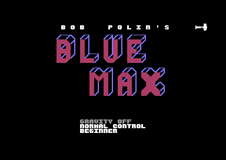
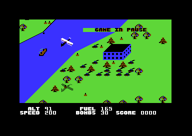
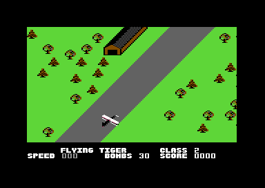

# The screens

Blue Max shows a title screen before each game. A plane rolls across the title and makes the credit lines visible, one line at each pass. The function keys show the three options, and the end of the tune starts a demo game. During the play, two status rows under the landscape show the altitude, the speed, the fuel, the bombs and the score. They also show the damage and a warning letter. The status rows also change colour when an enemy plane flies at the altitude of the player. At the end of a game, the first status row shows the rank and the class of the pilot. This page also tells how the game builds its character set, animates some characters and gives the eight sprites to the parts of the game.

**Conventions.**
- Addresses are C64 addresses. Names are the names of the knowledge.
- A *frame* is one raster interrupt, 1/50 second on a PAL C64. A *pass* is one run of the main loop.
- A *row* is a text row 0-24 and a *column* is a text column 0-39.
- The *play area* is the rows 0-21 of the screen `$0400` or `$0800`. The game shows one and writes the next landscape into the other one (the *double buffer*).
- The *status rows* are the rows 22 and 23 of the screen `$0C00`. A raster split shows them under the play area.
- The *status letter* is sprite 0 in the status rows: the letters P, W or L.
- **Observed** marks a fact that a run showed. **Code** marks a fact from the code only. **Conclusion** marks an interpretation.

## How it works

The program has no state variable for its screens. Each routine jumps to the next one. [`cold_start` `$40F8`](../src/init/game_start.asm#L6) clears the options one time and continues at `restart_title`. This calls [`title_screen` `$70BD`](../src/screen/title_screen.asm#L6), and the title returns into [`game_start` `$4126`](../src/init/game_start.asm#L23). At the end of a game, the rank screen waits for a key or the fire button (**Code**).

~~~mermaid
stateDiagram-v2
  state "Title screen (title_screen)" as Title
  state "Game (game_start, main_loop)" as Game
  state "Demo game" as Demo
  state "Pause" as Pause
  state "Rank screen (rank_screen)" as Rank
  [*] --> Title
  Title --> Game: fire or F7
  Title --> Demo: the tune ends
  Game --> Pause: SPACE
  Pause --> Game: fire
  Game --> Rank: crash or mission end
  Demo --> Rank: crash
  Game --> Title: F7
  Demo --> Title: F7
  Rank --> Game: fire
  Rank --> Title: function key, or demo
~~~

| State | Condition | Next state | Code |
|---|---|---|---|
| Title screen | Fire on port 2, or F7 | Game | `title_screen_exit` |
| Title screen | The tune ends, `demo_mode` = 1 | Demo game | `title_screen_wait` |
| Game | SPACE, bit 1 of `scroll_fine_y` is 0 | Pause | `main_loop` |
| Pause | Fire on port 2 | Game | `main_loop_pause_wait` |
| Game or demo | Crash, or landing after the mission | Rank screen | `rank_screen` |
| Game or demo | F7 | Title screen | `main_loop_check_end` |
| Rank screen | Fire on port 2 | Game | `rank_screen_input` |
| Rank screen | A function key, or `demo_mode` is not 0 | Title screen | `rank_screen_input` |

The title and the game use two different raster interrupts. [`set_raster_irq` `$485A`](../src/irq/raster.asm#L15) writes the line and the address of the handler. The title uses `title_irq` at line `$FA`. The game and the rank screen use `irq_frame` at line `$DB` (**Code**).

## The title screen

The title after three passes of the plane: the logo, the author and the copyright line.

`title_screen` does these steps (**Code**):

1. It clears the options line counter, `invincible`, `fkey_code` and the sprite registers. It sets `map_section` to `$FF`. The title uses this variable as the pass counter of the plane.
2. It clears both screens, fills the colour RAM with `$0E` (light blue) and makes the rows 21-24 white from column 8.
3. It sets `$D018` to `$1C`: screen `$0400` and the charset at `$3000`. The title thus uses the source of the charset, not the copy at `$2000`. It sets 40 columns, 25 rows and a black border and background.
4. It draws the logo "BLUE" at the rows 3-8, column 8, and "MAX" at the rows 10-15, column 15, with [`draw_logo_block` `$746D`](../src/screen/title_options.asm#L74).
5. It writes three black texts of 40 characters. "BOB POLIN'S" goes to row 1, "BY PETER ADAMS" to row 17 and the copyright line to row 19.
6. It waits in `delay` with Y = 200, starts the tune with `sound_init` and clears `demo_mode`.
7. It installs `title_irq` and waits in the loop `title_screen_wait`.

The logo uses the characters `$14-$1F` of the charset. `draw_logo_block` copies 6 rows of 20 characters. It gives the characters `$15-$19` the colour 2 (red), and the other characters keep the light blue (**Code**). The red characters are the faces of the letters, and the light blue characters are their sides (**Conclusion**). The title image shows red letters with blue edges (**Observed**).

The three texts read their bytes with an index of 1-40 from a label one byte before the text. The base of "BY PETER ADAMS" is `text_by_author_base`, the `RTS` at the end of `fill_colour_ram`. The base of each next text is the last byte of the text before it (**Code**).

### The plane on the title

The plane rolls from the left to the right of the screen. [`title_plane_move` `$74B3`](../src/screen/title_plane.asm#L6) runs in each frame from `title_irq` (**Code**):

1. It moves the plane 1 step to the right. The X value in `plane_x` is half of the sprite X, so the step is 2 pixels.
2. Each 4 frames, it shows the next of the 12 frames `$A0-$AB` of the roll. A full roll thus takes 48 frames.
3. At X `$DC` it starts a new pass with `title_plane_new_pass`.
4. On the passes 0-2, it writes white (1) into the colour RAM cell under the left edge of the plane.

`title_plane_rows` holds the sprite Y of the passes 0-2: `$35`, `$B5` and `$C5`. These are the rows 1, 17 and 19, the rows of the three black texts. Thus the plane makes the texts visible, one character after the next. From pass 3, the plane flies at a random height, or at Y 0 in the top border, out of sight (**Code**). A pass takes 220 frames, about 4.4 seconds (**Conclusion**).

The colour cell is column (X - `$0E`) / 4 for X from `$0B` to `$A9`. For X `$0B-$0D`, the subtraction gives a negative value and the column is 63. The plane then writes white into column 23 of the next row. These cells are empty, so the bug has no visible effect (**Code**).

### The keys of the title

The options after F1: the selected line is grey. The rows 17 and 19 are still black because the plane did not pass them yet.

`title_irq` calls `read_keys`, which puts the function key into `fkey_code` (1 F1, 2 F3, 3 F5, 4 F7). `title_screen_wait` reads it (**Code**):

| Input | What it does |
|---|---|
| Fire, port 2 | Starts the game. |
| F7 | Starts the game. |
| F1 | Shows the options, and writes the music credit over the copyright line on row 19. |
| F3 | Shows the options and selects the next option line. |
| F5 | Shows the options and changes the value of the selected line. |

Each function key clears `demo_mode` and writes `$1F` into `sound_volume`. Each function key except F7 shows the options. After F1, F3 and F5, a delay of 256 x 256 loops follows. This stops one key press from changing a value many times (**Conclusion**). The runs showed that F1 opens the options, F3 selects a line, F5 changes it, and F7 or fire starts the game (**Observed**).

The music credit is `text_music_credit`: "MUSIC PROGRAMMED BY STEPHEN C BIGGS". It goes to row 19, which is black until the third pass of the plane. Thus F1 early on the title shows the credit only after the plane passes row 19 (**Conclusion**).

### The options

[`show_options` `$73B1`](../src/screen/title_options.asm#L6) writes the three option lines at the rows 21-23, column 13. Each text has 16 characters in `option_texts`. The value of the option selects the text (**Code**):

| Row | Variable | Values |
|---|---|---|
| 21 | `opt_gravity` | GRAVITY OFF, GRAVITY ON |
| 22 | `opt_reverse_control` | NORMAL CONTROL, PILOT CONTROL |
| 23 | `opt_skill_level` | BEGINNER, ADVANCED, EXPERT |

F5 adds 1 to the value. The skill level counts 0-2, the two other options change between 0 and 1. F3 moves the selection from line 0 to 2 and then to line 0 again. [`colour_option_line` `$7457`](../src/screen/title_options.asm#L55) makes the old line white and the new line grey (`$0C`) (**Code**). The options image shows GRAVITY OFF in grey and the other lines in white (**Observed**).

With NORMAL CONTROL, `plane_control` swaps the up and down bits of the joystick, so up climbs. With PILOT CONTROL, the joystick works as the stick of a plane, and down climbs (**Code**). Only `cold_start` clears the options. A new game after the rank screen thus keeps the options of the last game (**Code**).

### The end of the title

`title_screen_exit` turns off the sprites, clears both screens and fills the colour RAM with 8. Then it returns, and the game starts at `game_start` (**Code**).

When the tune ends, `music_end` writes `$FF` to `music_ended`. `title_screen_wait` then sets `demo_mode` to 1 and leaves the title. The tune lasts about 2740 frames, about 55 seconds on a PAL C64 (**Conclusion**, from the tune ticks).

## The demo game

The demo game: the autopilot flies the plane, and the score is 0030.

The demo is a normal game with `demo_mode` set. `plane_control` then takes its joystick value from [`autopilot_joystick` `$5C10`](../src/input/autopilot.asm#L6) in place of port 2 (**Code**). The autopilot climbs at speed 100 and more while the altitude is below 20. At altitude 20 and more, it keeps its last value on 15 of 16 random values. Else it takes a new direction from `autopilot_dirs` and a random fire bit (**Code**). The demo recording shows the plane fly by itself, with the score 0030 (**Observed**).

The demo game has no sound. `engine_sound_start` writes 0 to `sound_volume` and to the SID volume when `demo_mode` is not 0 (**Code**). A crash shows the rank screen. `rank_screen_input` sees `demo_mode` and goes to the title after its delay of 5 frames (**Code**).

The next title can stay silent after a demo. `sound_init` sets the SID volume to 6 AND `sound_volume`, and the demo left 0 in `sound_volume`. A function key on the title writes `$1F` into `sound_volume`, but not into the SID. The next normal game writes `$1F` into both (**Code**). No run checked the volume at this title (see **Still open**).

## The frame interrupt and the status rows

The status rows come from a third screen at `$0C00`, and the play area comes from `$0400` or `$0800`. [`irq_frame` `$456D`](../src/irq/frame_irq.asm#L6) makes the split in each frame (**Code**):

~~~mermaid
flowchart TB
  A["Raster line $DB: interrupt (irq_frame)"] --> B["Wait for line $DD"]
  B --> C["Screen $0C00, hires, 24 rows, status colour"]
  C --> D["Only sprite 0: the status letter"]
  D --> E["Wait for line $F8"]
  E --> F["Count frames, play time and fuel"]
  F --> G["Play area: screen $0400 or $0800, multicolour, fine scroll"]
  G --> H["Sprites, keys and the game routines"]
~~~

1. The interrupt starts at line `$DB` and waits for line `$DD`. It reads the line number from `$10DD` in the identity table that the loader leaves (**Code**). Without the table, the split waits for a wrong line (**Conclusion**).
2. It sets `$D018` to `$38`: screen `$0C00` and the charset at `$2000`. It sets hires text with fine X scroll 0, 24 rows and fine Y scroll 6.
3. After 15 `NOP` instructions, it writes `status_bg_colour` into the background colour. The delay puts the change of colour at the edge of the screen (**Conclusion**).
4. It turns on only sprite 0, with the pointer `status_sprite_ptr`, white, at X `$76` and Y `$E5`.
5. At line `$F8`, it sets the play area again at [`irq_frame_set_vic` `$4624`](../src/irq/frame_irq.asm#L103): multicolour text, the fine scroll, the screen in `screen_page_hi` and the ground colours.

The play area and the status rows both use 38 columns (bit 3 of `$D016` is 0). The title uses 40 columns (**Code**).

### The status text

At game start, `game_start_status_text` copies `status_text` to `$0F71-$0FBF` in white. The main loop then writes the values in each pass with [`main_loop_draw_status` `$43BC`](../src/screen/status_line.asm#L6) (**Code**):

| Row | Columns | Content | Source |
|---|---|---|---|
| 22 | 3-5, 7-8 | ALT and 2 digits | `altitude` |
| 22 | 16-19, 21-23 | FUEL and 3 digits | `fuel` |
| 22 | 30, 32, 34, 36 | Damage letters F, B, M, G | `damage_fuel`, `damage_bombs`, `damage_motor`, `damage_gun` |
| 22 | 38 | Arrow up: the enemy plane is higher | `update_altitude_alert` |
| 23 | 1-5, 7-9 | SPEED and 3 digits | `speed` |
| 23 | 15-19, 21-22 | BOMBS and 2 digits | `bombs` |
| 23 | 25-29, 30-34 | SCORE and 5 digits | `score_10000` to `score_1` |
| 23 | 38 | Arrow down: the enemy plane is lower | `update_altitude_alert` |

`print_number_3` and `print_number_2` change a byte into decimal digits by subtraction of 100 and 10. The score is 5 bytes, one decimal digit in each byte. `draw_score` writes the first digit only when it is not 0. Thus the score shows 4 digits below 10000 (**Code**). The images show "SCORE 0000" at the start and "SCORE10000" after a score of 10000 (**Observed**).

The speed has its own colours. Below the lift-off speed 100, the digits are grey and the word SPEED blinks white and black every 16 frames. From 100, the word and the digits are white (**Code**). The service image shows grey speed digits on the runway (**Observed**).

### The damage letters

Each damage flag shows one letter from `damage_letters`: F fuel, B bombs, M motor, G gun. The loop at [`main_loop_damage_loop` `$4417`](../src/screen/status_line.asm#L47) writes the letter when the flag is not 0, else a space. The letter blinks white and yellow every 16 frames (**Code**). The service run set all four flags and showed F B M G on the status row (**Observed**).

### The status letter

The status letter is a large sprite letter, 14 lines high. At X `$76` it is near column 12 of the status rows (**Conclusion**). The game writes the pointer into `status_sprite_ptr`, and `irq_frame` copies it to `$0FF8` (**Code**):

| Pointer | Address | Letter | Set by | Meaning |
|---|---|---|---|---|
| `$AF` | `$2BC0` | none | `enemy_plane_delay_set`, `update_wind_stop`, `plane_service`, `rank_screen` | No warning |
| `$B0` | `$2C00` | L | `plane_landing` | The plane is over an airfield (state 3) |
| `$B1` | `$2C40` | R | nothing | Not used |
| `$B2` | `$2C80` | P | `enemy_plane_draw` | An enemy plane is in sight |
| `$B3` | `$2CC0` | W | `update_wind_push` | The wind pushes the plane |

The four letters are at [`letter_l_sprite` `$2C00`](../src/data/graphics_leftovers.asm#L40). The knowledge calls this block unused, and it calls the fourth letter M. The bitmap and the reference image show a W, and three of the four pointers are in use (**Code**). The blank pointer `$AF` reads `$2BC0-$2BFF`, the zero bytes at the end of `old_chars_copy_a` and the bytes `$2BE0-$2BFF` (**Code**).

The four sprites `$B0-$B3` of the status letter: L, R, P and W.

### The status colour

The background colour of the status rows tells the altitude of the plane. [`update_altitude_alert` `$6862`](../src/screen/altitude_alert.asm#L6) sets `status_bg_colour` on the even frames (**Code**):

1. An enemy plane flies, and its altitude is from 3 below to 4 above the altitude of the player: light blue (`$0E`). Then the routine stops.
2. Else, it shows an arrow at column 38. Arrow up (`$2D`) on row 22 means that the enemy plane is higher. Arrow down (`$2E`) on row 23 means that it is lower.
3. Altitude 26 and higher: black.
4. Altitude below 26: colour 9 (brown).
5. Altitude at or below `obstacle_altitude`: black and yellow, in turns of 16 frames.
6. On the runway (plane states 1, 4 and 5): black.

`obstacle_altitude` is 16 in the image, and the main loop sets it to a random value of 16-19 when `random_byte` gives 0. The help page of the ANON disk says "red" for altitude 25 or less and "yellow" for 15 or less (**Code**). The routine also writes 0 into `$0C27` and `$0C4F`. These are cells of the rows 0 and 1 of the status screen, which the VIC never shows (**Code**).

## The pause

The pause: GAME IN PAUSE on row 3 over the landscape.

`read_keys` reads the keyboard on alternate frames. It reads the function keys for two frames, then SPACE for two frames. [`main_loop_check_pause` `$4362`](../src/game/main_loop.asm#L18) starts the pause when SPACE is down and bit 1 of `scroll_fine_y` is 0 (**Code**). The pause does these steps (**Code**):

1. It sets `game_frozen`, so the interrupt stops the play, the time and the fuel.
2. It writes 0 to the SID volume.
3. It copies the first 16 bytes of `pause_text` to row 3, column 16, of both screens. Thus the text shows on the screen that the VIC shows now.
4. It waits for fire on port 2, then clears `game_frozen` and writes `sound_volume` back to the SID.

The text stays until the next screen copy writes the landscape over row 3 (**Conclusion**). The pause run pressed SPACE in flight and saw GAME IN PAUSE until fire (**Observed**).

## The rank screen

The rank screen after a crash with a score of 10000: KAMIKAZE TRAINEE, class 1.

The rank screen is not a new screen. It replaces the first status row and keeps the frozen landscape over it. [`rank_screen` `$7ED7`](../src/game/rank.asm#L232) gets the rank in `rank_index` and the class in `rank_class` from the rank routines on [game.md](game.md) (**Code**). It does these steps (**Code**):

1. It copies `text_class_line` to row 22: spaces and the word CLASS at the columns 25-29.
2. It resets the stack to `$F0`. The game loop does not continue.
3. It writes the class digit at column 31.
4. It copies 17 characters of `rank_texts` to the columns 3-19 of row 22.
5. It sets the blank status letter and makes the word SPEED white.
6. It sets `rank_screen_on`, `game_frozen` and the frame interrupt again, then waits in an endless loop.

Each frame, `irq_frame` calls `rank_screen_input` at line `$F8`. After a delay of 5 frames, a function key or `demo_mode` goes to the title through `restart_title`. Fire on port 2 starts a new game at `game_start` (**Code**).

The six rank texts are KAMIKAZE TRAINEE, RUNWAY SWEEPER, AIR CADET, FLYING TIGER, SQUADRON LEADER and BLUE MAX. Each has 17 characters, with spaces at the left (**Code**).

### Worked example: FLYING TIGER, class 2

The rank screen after the mission: FLYING TIGER, class 2.

The mission run landed after the three special targets, and the rank screen showed FLYING TIGER, class 2 (**Observed**). For this screen, `rank_index` is 3 and `rank_class` is 2. `rank_screen` computes these values (**Code**):

1. The text offset is `rank_index` x 17 + 16 = 3 x 17 + 16 = 67.
2. The copy loop runs Y from 16 to 0 and X from 67 to 51. It copies `rank_texts` bytes 51-67, "    FLYING TIGER ", to `$0F73-$0F83`.
3. `$0F73` is `$0C00` + 883: row 22, column 3. FLYING TIGER thus shows at the columns 7-18.
4. The class digit is 2 + `$30` = `$32`, the character "2", at `$0F8F`: row 22, column 31.

Row 22 thus reads "FLYING TIGER" and "CLASS 2", as in the image (**Observed**).

## The charset

The game has one charset of 256 characters at [`charset_source` `$3000`](../src/data/charset_source.asm#L6). The title shows it at `$3000`. `game_start_copy_charset` copies it to `$2000-$27FF` for the play area and the status rows. The copy also clears `$0F00-$0FFF`, the page of the status rows (**Code**). The game then changes some characters in the copy, and the masters at `$3000` stay the same (**Conclusion**).

The texts of the program are PETSCII bytes: letters `$41-$5A` and digits `$30-$39`. The charset has its letters and digits at the same codes. Thus the program writes the PETSCII bytes as screen codes, without a change (**Code**). The characters `$2D` and `$2E` are the arrows of the status rows, and `$2F` is the apostrophe of "BOB POLIN'S" (**Code**).

The charset source in multicolour, in the pattern colours of the reference.

### The animated characters

[`animate_chars` `$7001`](../src/screen/animate_chars.asm#L6) changes four groups of characters in the copy at `$2000`. `main_loop_draw_status` calls it once in each pass of the main loop (**Code**):

| Characters | Master | What changes |
|---|---|---|
| `$70-$75` | `dot_chars_source` | The master with random `%01` pixel pairs, a new pattern each pass |
| `$78-$7B`, `$7C-$7F` | `masked_chars_source` | A round 2 x 2 shape, masked by bytes of the code at `build_map_row` and `city_row`, indexed by `frame_count` |
| `$81-$98` | `dither_chars_source` | Four groups of 6 characters. A group gets random dither when its flag in `building_kind_hit` is not 0 |
| `$A7-$B6` | `airfield_chars_source` | The airfield buildings. Random bits when `airfield_bombed` is not 0 |

The masks of `$7C-$7F` come from the machine code of two routines. The program uses the code bytes as a table of patterns (**Code**).

## The sprites

The game uses the 8 sprites as fixed roles (**Code**):

| Sprite | Role | Pointers |
|---|---|---|
| 0 | The plane of the player. On the title, the rolling plane. In the status rows, the status letter | `$E0-$E5`, `$FC`, `$A0-$AB`, `$AF-$B3` |
| 1 | Enemy plane, boat or road vehicle | `$E0-$E5`, `$EA`, `$F0-$F2`, `$F5-$F8`, `$FA` |
| 2 | Bomb | `$EF` |
| 3 | Bullets | `$EE` |
| 4, 5 | Flak shells and their explosions | `$FB`, `$F5-$F8` |
| 6 | Shadow of the plane | `$E6`, `$E8`, `$FD` |
| 7 | Shadow of the enemy plane, or the marker of a special target | `$E6`, `$E8`, `$EC`, `$F3`, `$F8`, `$F9` |

The game keeps all sprite values in shadow variables and [`sprites_to_vic` `$5AD1`](../src/screen/sprite_registers.asm#L6) copies them to the VIC in each frame. It writes each pointer to `$07F8` and to `$0BF8`, the pointers of both screens of the double buffer (**Code**). The X variables hold half of the sprite X. [`sprites_x_double` `$5BD7`](../src/screen/sprite_positions.asm#L6) doubles them and builds the bits of `$D010`. A sprite thus moves in steps of 2 pixels (**Code**).

At the end of each frame, `irq_frame` sets the sprite multicolours to red (2) and black (0) (**Code**). The game sprites are at `$3800-$3FFF` (pointers `$E0-$FF`). The title plane is at `$2800-$2B7F` (pointers `$A0-$AD`), and the frames `$AC` and `$AD` never show (**Code**).

The game sprites `$E0-$FF` in multicolour, in the pattern colours of the reference.

The 14 frames of the title plane, `$A0-$AD`.

## Still open

- Is the title silent after a demo game? The code leaves 0 in `sound_volume`. A run that lets the demo crash and reads the SID volume at the next title can show it.
- No image of this page shows the status letters P, W and L. A screen capture with an enemy plane, with wind and over an airfield can show them.
- The help page says "red" for a low altitude, and the code uses colour 9 (brown). The help says 15 for yellow, and the code uses `obstacle_altitude`, 16 at the start. A capture of the status rows at altitude 16 can show the colour.
- Why does `update_altitude_alert` write 0 to `$0C27` and `$0C4F`? These cells never show. It can be a leftover of an earlier layout of the status screen.
- What was the letter R (`$B1`) for? No code sets this pointer.

The reference has each routine: [title screen](reference/modules/screen/title_screen.md), [options](reference/modules/screen/title_options.md), [title plane](reference/modules/screen/title_plane.md), [status line](reference/modules/screen/status_line.md), [altitude alert](reference/modules/screen/altitude_alert.md), [rank](reference/modules/game/rank.md), [character animation](reference/modules/screen/animate_chars.md), [graphics](reference/graphics.md).
