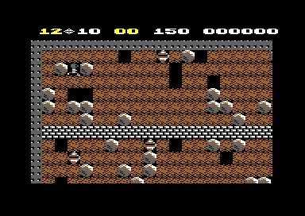

# The cave format

Boulder Dash keeps its 16 caves and 4 intermissions as short programs of drawing commands. Each cave has a header of 32 bytes and a list of objects. A seeded random generator fills the cave with dirt, boulders and diamonds before the objects are drawn. Thus a 40 x 22 cave needs only 39 to 145 bytes. The cave data and the cave order have the same bytes at the same addresses in both builds. The code that reads them is at the v1 address plus `$398` in v2.

**Conventions.**
- Addresses are C64 addresses of v1. Names are the names of the knowledge. The label `v1:` or `v2:` names the build.
- The *map* is the array of cell codes at `$0800`: 24 rows of 40 cells, one byte for each cell. A *row* is a map row. The cave uses rows 2-23. Rows 0-1 are not part of the cave.
- A *cell code* is the byte of one map cell. An *element* is the thing that a cell code shows, for example a boulder.
- *Cave 1-20* is the value of `cave_number`: 1-16 are caves A-P, 17-20 are intermissions 1-4. A *level* is the value of `level`, 0-4, shown as 1-5.
- **Observed** marks a fact that a run showed. **Code** marks a fact from the code only. **Conclusion** marks an interpretation.

## Where the data is

The table `cave_data_offsets` at `$5806` holds 20 words. Each word is the offset of one cave from `$582E`. The caves follow each other from `$582E` to `$5EA7`, 1658 bytes in all, in the order A-P, then intermissions 1-4. Each cave ends with `$FF`. **Code**

[`v1:start_cave` `$8722`](../v1/src/cave/cave_start.asm#L6) builds a cave in five steps. [`v1:load_cave_data` `$7E8E`](../v1/src/cave/setup.asm#L6) copies 240 bytes of the cave to `cave_data` at `$2400`. It copies only when `cave_number` is different from `decoded_cave`. It always sets the seed of the level and the colours. Then the program fills the map at random, draws the steel border, draws the objects and sets the variables of the play. **Code**

~~~mermaid
flowchart TB
  A["Copy 240 bytes to $2400 (load_cave_data)"] --> B["Seed of the level, colours"]
  B --> C["Fill rows 3-23 at random (fill_cave_random)"]
  C --> D["Steel border, 40 x 22 from row 2 (draw_steel_border)"]
  D --> E["Objects until $FF (draw_cave_objects)"]
  E --> F["Time, diamonds, points, birth delay (init_cave_state)"]
~~~

The copy always takes 240 bytes, but the longest cave, F, has 145 bytes. The rest of the copy holds bytes of the next caves, and the decoder stops at the first `$FF`. In v2 the same routines are at [`v2:load_cave_data` `$8226`](../v2/src/cave/setup.asm#L6) and [`v2:start_cave` `$8AB9`](../v2/src/cave/cave_start.asm#L6). A byte compare shows that the v2 game file has the same bytes at `$5806-$5EA7` and the same cave order as v1. **Code**

## The header

The first 32 bytes of each cave are a header. Five fields have one byte for each level, so each level can have its own seed, diamond count and time. [`v1:init_cave_state` `$7EDC`](../v1/src/cave/setup.asm#L46) reads the time, the diamonds needed and the points. It changes them to decimal digits for the status line. **Code**

| Byte | Address | Name | Meaning |
|---|---|---|---|
| 0 | `$2400` | `cave_data` | Cave number 1-20. No code reads it. |
| 1 | `$2401` | `cave_magic_time` | Seconds of the active magic wall. Also the second of the cave time when the amoeba starts to grow fast. |
| 2 | `$2402` | `cave_diamond_value` | Points for each diamond. |
| 3 | `$2403` | `cave_extra_value` | Points for each diamond after the player has enough diamonds. |
| 4-8 | `$2404` | `cave_seeds` | Seed of the random fill, one byte for each level. |
| 9-13 | `$2409` | `cave_diamonds_needed` | Diamonds that open the exit, one byte for each level. |
| 14-18 | `$240E` | `cave_times` | Cave time in seconds, one byte for each level. |
| 19 | `$2413` | `cave_color1` | Background colour 1 (`$D022`) of the multicolour characters. |
| 20 | `$2414` | `cave_color2` | Background colour 2 (`$D023`). |
| 21 | `$2415` | `cave_color3` | Colour RAM value of the cave rows. Bit 3 selects multicolour, bits 0-2 give the colour. |
| 22-23 | `$2416` | | No code reads them. |
| 24-27 | `$2418` | `cave_random_elements` | Four cell codes of the random fill. |
| 28-31 | `$241C` | `cave_random_odds` | Four limits, one for each random cell code. |
| 32- | `$2420` | `cave_objects` | Object commands until `$FF`. |

Bytes 22 and 23 are 0 in 18 caves. Cave A has `$D4 $20` there and cave C has `$04 $00`. No code reads these bytes, so they have no effect in the game (**Code**). They can be leftovers of the cave editor of the authors (**Conclusion**).

Byte 21 is `$09` (multicolour, white) in 18 caves. Caves G and M have `$0D` (multicolour, green), and these two caves have the amoeba. **Code**

## The cell codes

A cell code has 6 bits, `$00-$3F`. Each code has an entry in three tables of 64 entries. `cell_glyph_chars` gives the first of the four characters of the cell, `element_handler_lo` gives the routine of the scan, and `cell_scan_reset` gives the code that the scan writes back. The page [engine.md](../v1/docs/engine.md) tells how the scan uses the handlers and the scanned codes. **Code**

| Code | Element | Characters | Scan |
|---|---|---|---|
| `$00` | Space | `$60` | |
| `$01` | Dirt | `$46` | |
| `$02` | Brick wall | `$4E` | |
| `$03` | Magic wall | `$22` | Falling objects test it. |
| `$04` | Closed exit, looks like steel wall | `$2E` | `handle_closed_exit` |
| `$05` | Open exit, flashes | `$62` | `handle_flashing_box` |
| `$06` | Looks like steel wall. No cave uses it. | `$2E` | |
| `$07` | Steel wall | `$4A` | |
| `$08-$0B` | Firefly, bits 0-1 are the direction | `$64` | `handle_firefly` |
| `$0C-$0F` | Scanned firefly | `$64` | Back to `$08-$0B` |
| `$10` | Boulder | `$44` | `handle_boulder` |
| `$11` | Scanned boulder | `$44` | Back to `$10` |
| `$12` | Falling boulder | `$44` | `handle_falling_boulder` |
| `$13` | Scanned falling boulder | `$44` | Back to `$12` |
| `$14` | Diamond | `$48` | `handle_diamond` |
| `$15` | Scanned diamond | `$48` | Back to `$14` |
| `$16` | Falling diamond | `$48` | `handle_falling_diamond` |
| `$17` | Scanned falling diamond | `$48` | Back to `$16` |
| `$18-$1A` | Not used | | |
| `$1B-$1F` | Explosion that ends in space | `$66-$6A` | `handle_explosion` |
| `$20-$24` | Explosion that ends in a diamond | `$24-$2C` | `handle_explosion` |
| `$25` | Inbox, the start of Rockford, flashes | `$62` | `handle_flashing_box` |
| `$26-$28` | Rockford birth stages | `$66-$6A` | `handle_rockford_birth` |
| `$29-$2F` | Not used | | |
| `$30-$33` | Butterfly, bits 0-1 are the direction | `$20` | `handle_butterfly` |
| `$34-$37` | Scanned butterfly | `$20` | Back to `$30-$33` |
| `$38` | Rockford | `$4C` | `handle_rockford` |
| `$39` | Scanned Rockford | `$4C` | Back to `$38` |
| `$3A` | Amoeba | `$40` | `handle_amoeba` |
| `$3B` | Scanned amoeba | `$40` | Back to `$3A` |
| `$3C-$3F` | Not used | | |

The characters `$2E` and `$4A` have the same bitmaps in the cell character set. Thus the closed exit `$04` looks the same as the steel wall `$07`, and the player cannot see the exit before it opens. **Code**

## The object commands

[`v1:draw_cave_objects` `$8180`](../v1/src/cave/draw_objects.asm#L151) reads the object list from `$2420`. Bits 7-6 of the first byte of each object give the command. Bits 5-0 give the cell code that the command draws. Each command writes over the cells of the commands before it. **Code**

| Bits 7-6 | First byte | Command | Bytes | Arguments |
|---|---|---|---|---|
| `00` | `$00-$3F` | Point | 3 | column, row |
| `01` | `$40-$7F` | Line | 5 | column, row, length, direction |
| `10` | `$80-$BF` | Filled box | 6 | column, row, width, height, inside code |
| `11` | `$C0-$FE` | Box | 5 | column, row, width, height |
| | `$FF` | End of the list | 1 | |

- **The coordinates.** The column is 0-39. The row is a map row, 2-23, so the first row of the cave is row 2. The status rows 0-1 are not part of the cave. **Code**
- **The line.** The line writes `length` cells. It starts at the column and the row, and moves one step in the direction after each cell. **Code**
- **The filled box.** The box has an edge of the cell code of the first byte. The program draws the full box with that code, then draws the inside, 2 cells smaller in each direction, with the inside code. **Code**
- **The box.** The box draws only the edge: `width - 1` cells to the right, `height - 1` cells down, `width - 1` cells to the left, then `height - 1` cells up. [`v1:draw_steel_border` `$820F`](../v1/src/cave/steel_border.asm#L6) uses the same routine for the steel wall of 40 x 22 cells at column 0, row 2. **Code**
- **The start of Rockford.** When the cell code of an object is `$25`, the inbox, the decoder copies its column and row to `rockford_col` and `rockford_row`. Each cave has one point command with `$25`. **Code**

The direction of a line is a number 0-7. The table `direction_step` gives the step in the map for each direction. Number 0 is up, and the next numbers go clockwise. **Code**

| Direction | Step | Map offset |
|---|---|---|
| 0 | Up | `-40` |
| 1 | Up and right | `-39` |
| 2 | Right | `+1` |
| 3 | Down and right | `+41` |
| 4 | Down | `+40` |
| 5 | Down and left | `+39` |
| 6 | Left | `-1` |
| 7 | Up and left | `-41` |

## The random fill

Before the steel border and the objects, [`v1:fill_cave_random` `$7CAB`](../v1/src/cave/random_fill.asm#L23) writes a cell code to each cell of rows 3-23. It goes from left to right in each row and from the top row down. The steel border later writes over row 23 and columns 0 and 39. The real random area is rows 3-22 and columns 1-38. **Code**

For each cell, [`v1:place_random_element` `$7C91`](../v1/src/cave/random_fill.asm#L6) gets one number from the generator. It starts with dirt, `$01`. Then it compares the number with each of the four limits. When the number is less than limit `i`, the cell gets random code `i`. A later match replaces an earlier match, so the last match wins. **Code**

```
cell = $01                          ; dirt
r = next_cave_random()              ; the new random_seed2
for i = 0 to 3:
    if r < cave_random_odds[i]:
        cell = cave_random_elements[i]
```

A limit of 0 never matches. Most caves give the limits in a falling order, for example `$3C`, `$32`, `$09`, `$00` in cave A. With that order, each code takes a band of numbers below the code before it. Cave I gives `$F0` for boulders, then `$78` for diamonds. At level 1 the generator gives 840 numbers for cave I. Of these, 375 make a diamond, 420 make a boulder and 45 make dirt. **Code**

[`v1:next_cave_random` `$6CED`](../v1/src/cave/cave_random.asm#L6) is a 16-bit generator with the state `random_seed1` and `random_seed2`. `load_cave_data` sets `random_seed1` to the seed of the level and `random_seed2` to 0. One step of the generator does this, with 8-bit additions and the carry of each addition: **Code**

```
t1 = (seed2 & 1) << 7
t2 = seed1 >> 1
a  = seed1 + ((seed1 & 1) << 7)          ; carry c1
seed1 = (a + $13 + c1) & $FF             ; carry c2
b  = seed2 + t1 + c2                     ; carry c3
seed2 = (b + t2 + c3) & $FF
return seed2
```

The generator does not read the CIA timers or any other changing value. Thus a cave at one level has the same layout each time it starts. Each level has its own seed, so the five levels of a cave have five different layouts. Intermissions 1-3 use the seeds `$0A-$0E`, the same seeds as cave A. **Code**

`load_cave_data` also writes the seed to `random_seed_copy` at `$40-$41`. No code reads these two bytes. **Code**

## The decoder

```
start_cave:
    if cave_number != decoded_cave:
        decoded_cave = cave_number
        intermission_flag = second byte of the cave_sequence entry
        copy 240 bytes from $582E + cave_data_offsets[cave_number - 1] to $2400
    random_seed1 = cave_seeds[level], random_seed2 = 0
    $D022 = byte 19, $D023 = byte 20
    colour RAM row 0 = $09, the other rows = byte 21
    for row = 3 to 23, column = 0 to 39: map[row][column] = random cell
    draw a box of $07, 40 x 22, at column 0, row 2
    p = $2420
    while byte p != $FF:
        code = byte p & $3F
        if code == $25: rockford_col = byte p+1, rockford_row = byte p+2
        command = byte p & $C0
        $00: point (p+1, p+2)                                ; p += 3
        $40: line (p+1, p+2), length p+3, direction p+4      ; p += 5
        $80: filled box (p+1, p+2), size p+3 x p+4, inside p+5 ; p += 6
        $C0: box (p+1, p+2), size p+3 x p+4                  ; p += 5
    init_cave_state
```

## The cave sequence and the intermissions

`cave_sequence` at `$7E66` holds two bytes for each cave 1-20: the next cave, and 1 when the cave is an intermission. In v2 the same 40 bytes are at `$81FE`. After the bonus count of an exit, [`v1:next_cave` `$8841`](../v1/src/cave/cave_end.asm#L6) reads the next cave from this table. **Code**

| Cave | Next | Cave | Next | Cave | Next | Cave | Next |
|---|---|---|---|---|---|---|---|
| A | B | E | F | I | J | M | N |
| B | C | F | G | J | K | N | O |
| C | D | G | H | K | L | O | P |
| D | Int. 1 | H | Int. 2 | L | Int. 3 | P | Int. 4 |
| Int. 1 | E | Int. 2 | I | Int. 3 | M | Int. 4 | `$15` |

The value `$15` after intermission 4 is not a cave. `next_cave` sees it, starts cave A again and adds 1 to the level. At level 5 the level stays 5. No run reached this path. **Code**

The flag of an intermission changes the play in four places. **Code**

- The scan covers only rows 3-16 in place of rows 3-23. The cave numbers 17-20 select this limit, not the flag.
- When Rockford dies in an intermission, the game goes to the next cave and the player keeps the life.
- Before an intermission starts, the status line shows `B O N U S  L I F E` and the player gets one life.
- All three groups of animated characters run. A normal cave uses its byte of `cave_anim_flags_table`.

`cave_anim_flags_table` at `$8379` is the one more data item of each cave that is not in the cave data. It has one byte for each cave 1-20: bit 0 animates the firefly characters, bit 1 the butterfly characters and bit 2 the amoeba characters. Caves A, C and I have 0. Cave G has 5 and cave M has 6. **Code**

## A worked example: cave A

These are the 49 bytes of cave A in the knowledge listing, from `$582E` to `$585E`:

```
$582E  01 14 0A 0F 0A 0B 0C 0D
$5836  0E 0C 0C 0C 0C 0C 96 6E
$583E  46 28 1E 08 0B 09 D4 20
$5846  00 10 14 00 3C 32 09 00
$584E  42 01 09 1E 02 42 09 10
$5856  1E 02 25 03 04 04 26 12
$585E  FF
```

The header gives these values:

| Bytes | Value | Meaning |
|---|---|---|
| `01` | 1 | Cave A |
| `14` | 20 | 20 seconds for the magic wall and the slow amoeba. Cave A has neither. |
| `0A 0F` | 10, 15 | 10 points for each diamond, 15 points after 12 diamonds |
| `0A 0B 0C 0D 0E` | | Seeds of levels 1-5 |
| `0C 0C 0C 0C 0C` | 12 | 12 diamonds at each level |
| `96 6E 46 28 1E` | 150, 110, 70, 40, 30 | Seconds at levels 1-5 |
| `08 0B 09` | | Orange, dark grey, white multicolour |
| `D4 20` | | Not read |
| `00 10 14 00` | | Space, boulder, diamond, space |
| `3C 32 09 00` | 60, 50, 9, 0 | The limits of the four random codes |

With these limits, a random number of 0-8 gives a diamond and 9-49 gives a boulder. A number of 50-59 gives space and 60-255 gives dirt. The fourth limit is 0 and never matches. **Code**

The object list has four commands:

| Bytes | Command | Result |
|---|---|---|
| `42 01 09 1E 02` | Line of `$02` | Brick wall, 30 cells to the right from column 1, row 9 |
| `42 09 10 1E 02` | Line of `$02` | Brick wall, 30 cells to the right from column 9, row 16 |
| `25 03 04` | Point of `$25` | Inbox at column 3, row 4. Rockford starts there. |
| `04 26 12` | Point of `$04` | Closed exit at column 38, row 18 |
| `FF` | End | |

At level 1 the generator starts with `random_seed1` = `$0A` and `random_seed2` = `$00`. The first step gives `t1` = 0 and `t2` = `$05`. Then `random_seed1` = `$0A` + `$13` = `$1D`, and `random_seed2` = 0 + 0 + `$05` = `$05`. The second step gives `t1` = `$80` and `t2` = `$0E`. Then `random_seed1` = `$1D` + `$80` + `$13` = `$B0`, and `random_seed2` = `$05` + `$80` + `$0E` = `$93`. **Code**

The first 14 numbers fill row 3, columns 0-13:

| Column | 0 | 1 | 2 | 3 | 4 | 5 | 6 | 7 | 8 | 9 | 10 | 11 | 12 | 13 |
|---|---|---|---|---|---|---|---|---|---|---|---|---|---|---|
| Number | `$05` | `$93` | `$6C` | `$CD` | `$79` | `$6E` | `$EC` | `$34` | `$46` | `$A2` | `$07` | `$B6` | `$30` | `$32` |
| Cell | diamond | dirt | dirt | dirt | dirt | dirt | dirt | space | dirt | dirt | diamond | dirt | boulder | space |

The steel border then writes `$07` over the diamond in column 0. Thus the first row under the top border has space in column 7 and a diamond in column 10. It has a boulder in column 12 and space in column 13. Row 4 has the inbox in column 3, with a boulder at each side of it. These are the first rows of the map at level 1, columns 0-19:

```
row 2   07 07 07 07 07 07 07 07 07 07 07 07 07 07 07 07 07 07 07 07
row 3   07 01 01 01 01 01 01 00 01 01 14 01 10 00 01 01 01 01 01 10
row 4   07 01 10 25 10 01 01 01 01 01 01 00 01 01 01 01 01 01 01 01
row 5   07 01 01 01 01 01 01 01 01 01 01 00 01 01 10 01 01 01 01 01
row 9   07 02 02 02 02 02 02 02 02 02 02 02 02 02 02 02 02 02 02 02
```

A screen capture of cave A at level 1 shows the same cells. The run took it 5 frames after Rockford appeared at column 3, row 4. The first row under the border has the space, the diamond, the boulder and the space at these columns. Rockford stands between two boulders, and the brick wall crosses the cave in row 9. **Observed**



A model of the decoder in Python makes the map of each of the 20 caves at level 1. A run started each cave on the original and saved the map after 300 frames. Each cell that does not move is the same in the model and in the run. Only falling objects, moving fireflies, explosions and the birth of Rockford are different. In cave A, 33 of 880 cells are different. Each of them is a cell that a falling boulder or diamond left or reached, or the inbox that changed to Rockford. **Observed**

The cave A run starts at this map, collects 12 diamonds and goes into the exit in row 18. Then cave B starts, as `cave_sequence` gives. **Observed**

## Still open

- Bytes 22-23 of caves A and C (`$D4 $20` and `$04 $00`) have no known use. The First Star release, which the forum post names as the parent of both builds, can show if its code reads them.
- No run started a cave after intermission 4. A run that writes 20 to `cave_number` and enters the exit can show the change to cave A and to the next level.
