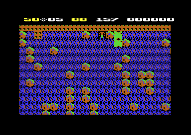
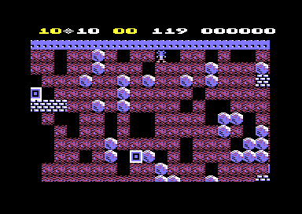

# The cave engine

The cave engine makes the cave live. It lets boulders and diamonds fall and roll, moves the fireflies and butterflies, grows the amoeba and runs the explosions. It also starts Rockford from the inbox and opens the exit. The engine does all of this in one pass over the map, the *scan*. The scan visits each cell one time and runs the routine of its element. The main loop repeats the scan until the cave ends. Thus the speed of the scan is the speed of the game.

**Conventions.**
- Addresses are C64 addresses. Names are the names of the knowledge.
- The *map* is the array of cell codes at `$0800`: 24 rows of 40 cells. A *row* is a map row. The cave uses rows 2-23. The page [cave_format.md](../../docs/cave_format.md) gives the cell codes and the way the program builds the map.
- A *tick* is one run of `scan_cave`. A *frame* is one screen frame. The interrupt runs the clock, the sound and the screen drawing one time in each frame.
- A *handler* is the routine of a cell code. A *scanned code* is a cell code that the scan writes to an object after the object moves. A scanned code has no handler.
- The *current cell* is the cell that the scan visits. `cell_ptr` points 41 cells before it.
- **Observed** marks a fact that a run showed. **Code** marks a fact from the code only. **Conclusion** marks an interpretation.

## How it works

~~~mermaid
flowchart TB
  A["Main loop (play_cave)"] --> B["Start of the tick: row limit, Rockford count, fire, amoeba room"]
  B --> C["Next cell: read its code"]
  C --> D{"Handler in the table?"}
  D -- yes --> E["Run the handler: move, change or explode"]
  D -- no --> F["Settle the cell above and left"]
  E --> F
  F --> G{"End of the row?"}
  G -- no --> C
  G -- yes --> H["Row delay of the level"]
  H --> I{"Last row?"}
  I -- no --> C
  I -- yes --> J["Game keys (check_game_keys)"]
  J --> A
~~~

[`play_cave` `$88FB`](../src/engine/play_loop.asm#L6) calls [`scan_cave` `$7DD9`](../src/engine/cave_scan.asm#L39) until `cave_end_state` is not 0. The interrupt runs at the same time and does the work of each frame. It runs the cave clock, the magic wall time, the sound, the scroll and the drawing of the screen. The scan and the interrupt do not wait for each other. **Code**

`scan_cave` does these steps:

1. **It sets the row limit.** A normal cave has the limit 22, so the scan covers rows 3-23. An intermission, cave 17-20, has the limit 15, so the scan covers rows 3-16. Row 2 is the top steel wall, and nothing in it moves. **Code**
2. **It counts the ticks without Rockford.** `rockford_absent` gets 1 more, up to 16. The Rockford handler sets it to 0 in each tick. **Code**
3. **It reads the fire button.** The life ends when three conditions are true. Rockford is absent for 16 ticks, at least one second of cave time passed, and the player presses fire. Thus the player presses fire after a death to continue. During the birth the cave time does not count, so fire has no effect. **Code**
4. **It updates the amoeba state** with the result of the tick before. The section about the amoeba tells how. **Code**
5. **It visits each cell** from left to right, and each row from the top down. For each cell it reads the code and doubles it. Then it reads the handler address from `element_handler_lo` at `$5F68`. When the high byte is 0, the code has no handler. Else it jumps to the handler through `handler_vector`. **Code**
6. **It settles a cell.** Each handler ends with a jump to [`scan_cell_settle` `$7E15`](../src/engine/cave_scan.asm#L72). This step reads the cell one row above and one column left of the current cell. When `cell_scan_reset` gives a value for its code, the step writes that value. Thus a scanned code changes back to its normal code. **Code**
7. **It waits after each row.** [`scan_row_delay` `$7CD2`](../src/engine/row_delay.asm#L9) waits for the delay of the level. **Code**
8. **It reads the game keys** after the last row. [`check_game_keys` `$7D6B`](../src/input/game_keys.asm#L69) handles SPACE, RUN/STOP and F1. **Code**

### The scanned codes

A handler can move an object into a cell that the scan has not visited. Without a mark, the scan would find the object again and move it a second time in the same tick. Thus each handler writes a moved object with a scanned code, for example `$13` for a falling boulder. A scanned code has no handler, so the scan does not move the object again. **Code**

The settle step changes the scanned code back. It works on the cell 41 cells before the current cell, so it changes a cell only after the scan passes it. An object that moves down or right in a tick thus moves again only in the next tick. **Code**

| Scanned codes | Normal codes | Element |
|---|---|---|
| `$0C-$0F` | `$08-$0B` | Firefly |
| `$11` | `$10` | Boulder |
| `$13` | `$12` | Falling boulder |
| `$15` | `$14` | Diamond |
| `$17` | `$16` | Falling diamond |
| `$34-$37` | `$30-$33` | Butterfly |
| `$39` | `$38` | Rockford |
| `$3B` | `$3A` | Amoeba |

### The neighbours of a cell

The handlers read the neighbours of the current cell with `lda (cell_ptr),y`. Because `cell_ptr` points 41 cells before the current cell, each neighbour has a fixed value of Y. **Code**

| Y | Cell | Y | Cell | Y | Cell |
|---|---|---|---|---|---|
| `$00` | up and left | `$01` | up | `$02` | up and right |
| `$28` | left | `$29` | current | `$2A` | right |
| `$50` | down and left | `$51` | down | `$52` | down and right |
| `$27` | two cells left | `$2B` | two cells right | `$79` | two cells down |

[`set_cell` `$6CB6`](../src/engine/cell_draw.asm#L41) writes a code at one of these cells. It also draws the cell as 2 x 2 characters in the 80-column screen buffer at `$4000`. Thus the screen changes in the same tick as the map. **Code**

### The speed

The scan has a delay after each row. `level_row_delays` gives one byte for each level. The delay is that value times a loop of 16 steps. **Code**

| Level | 1 | 2 | 3 | 4 | 5 |
|---|---|---|---|---|---|
| Delay value | 12 | 6 | 3 | 1 | 0 |

At level 1 the delay is about 1030 cycles after each row, or about 21 700 cycles for the 21 rows of a tick. That is a little more than one frame of CPU time (**Conclusion**). In the magic wall run, cave H at level 1, a tick starts each 8 frames (**Observed**). The interrupt and the drawing of the screen use the other part of the time (**Conclusion**).

## The handlers

`element_handler_lo` holds 64 addresses, one for each cell code. These codes have a handler: **Code**

| Codes | Element | Handler |
|---|---|---|
| `$04` | Closed exit | `handle_closed_exit` |
| `$05`, `$25` | Open exit, inbox | `handle_flashing_box` |
| `$08-$0B` | Firefly | `handle_firefly` |
| `$10` | Boulder | `handle_boulder` |
| `$12` | Falling boulder | `handle_falling_boulder` |
| `$14` | Diamond | `handle_diamond` |
| `$16` | Falling diamond | `handle_falling_diamond` |
| `$1B-$24` | Explosion stages | `handle_explosion` |
| `$26-$28` | Rockford birth stages | `handle_rockford_birth` |
| `$30-$33` | Butterfly | `handle_butterfly` |
| `$38` | Rockford | `handle_rockford` |
| `$3A` | Amoeba | `handle_amoeba` |

Space, dirt, the walls and the magic wall have no handler. They change only when another element writes them. **Code**

## Boulders and diamonds

Boulders and diamonds use the same rules. Only the cell codes and the sounds are different. A diamond has the codes `$14` and `$16` in place of `$10` and `$12`. [`handle_boulder` `$7360`](../src/engine/boulder.asm#L6) handles a boulder at rest. [`handle_falling_boulder` `$73AD`](../src/engine/boulder.asm#L47) handles a falling boulder. **Code**

A boulder at rest does this in each tick: **Code**

1. When the cell below is space, the boulder moves down at once as a scanned falling boulder `$13`.
2. When the cell below is a boulder, a diamond or a brick wall, the boulder can roll. [`check_slippery` `$6E65`](../src/engine/falling_checks.asm#L6) tests these three codes. Steel wall, dirt and the magic wall are not round.
3. The boulder rolls left when the left cell and the cell below it are space. It moves to the left cell as a falling boulder.
4. Else it rolls right when the right cell and the cell below it are space.
5. Else the boulder stays.

A falling boulder does this in each tick: **Code**

1. When the cell below is space, the boulder moves down one cell.
2. When the cell below is the magic wall, the boulder goes into the wall. The section about the magic wall tells the rest.
3. Else the boulder lands and plays its sound. On a round cell it rolls left or right as above. When it cannot roll, it stops as a boulder `$11`.
4. When the cell below is Rockford `$38`, the boulder explodes the 3 x 3 cells around Rockford to space.
5. When the cell below is a firefly or a butterfly, the boulder explodes it. [`check_hit_enemy` `$6E7C`](../src/engine/falling_checks.asm#L23) selects the explosion: space for a firefly, diamonds for a butterfly.
6. Else the boulder stops.

A boulder that falls one cell and lands on dirt thus stops in the next tick. A boulder at rest is not dangerous: only a falling boulder or a falling diamond kills Rockford. A run lets a boulder fall on Rockford in cave A, and Rockford explodes (**Observed**). The paths of a diamond that rolls from rest, and of a falling diamond that kills, did not run (**Code**).

## Fireflies and butterflies

A firefly and a butterfly keep a direction in bits 0-1 of the cell code. The table `dir_offsets` gives the neighbour of each direction: 0 left, 1 up, 2 right, 3 down. The numbers go clockwise. The two enemies move only into space, one cell in each tick. **Code**

[`handle_firefly` `$6DDA`](../src/engine/firefly.asm#L35) first tests the four neighbours for Rockford or the amoeba. When one touches the firefly, the firefly explodes the 3 x 3 cells around it to space. Else the firefly follows the wall on its left side: **Code**

1. When the cell on its left side is space, it turns left and moves there.
2. Else, when the cell ahead is space, it moves ahead.
3. Else it turns right and stays in its cell.

[`handle_butterfly` `$6EAD`](../src/engine/butterfly.asm#L6) is the mirror of the firefly. A butterfly follows the wall on its right side, and it turns left when it cannot move. When Rockford or the amoeba touches it, it explodes to diamonds. The direction in its code is one step clockwise from the direction in which it moves. Thus code `$30` moves down and code `$32` moves up. **Code**

The runs executed the firefly explosion and the movement of both enemies. No run executed the butterfly explosion. **Observed**

## Explosions

An explosion writes a stage code into each of 9 cells. [`explode_cell` `$6D16`](../src/engine/explosion.asm#L6) writes each cell that is not steel wall `$07`. Thus an explosion also removes brick walls, boulders, diamonds and the exit. **Code**

The cells before the current cell get the first stage. The cells after it get one stage less. The scan visits the later cells in the same tick and moves them one stage, so all 9 cells reach the same stage. [`handle_explosion` `$72D3`](../src/engine/stages.asm#L28) then moves each cell one stage in each tick: **Code**

| Explosion | Tick 0 | Tick 1 | Tick 2 | Tick 3 | Tick 4 |
|---|---|---|---|---|---|
| To space | `$1C` | `$1D` | `$1E` | `$1F` | `$00` space |
| To diamonds | `$21` | `$22` | `$23` | `$24` | `$14` diamond |

The explosion sound uses SID voice 2 and blocks the other sounds of voice 2 for 80 frames. **Code**

## The amoeba

The amoeba grows at random into space and dirt. [`handle_amoeba` `$6FD0`](../src/engine/amoeba.asm#L9) runs for each amoeba cell `$3A`: **Code**

1. It counts the cell in `amoeba_count`.
2. When the amoeba had 200 cells or more in the tick before, the cell changes to a boulder.
3. Else, when `amoeba_growing` is 0, the cell changes to a diamond.
4. Else, when no amoeba cell of this tick found room before, it tests the four neighbours. Space or dirt is room, and the result goes to `amoeba_room_found`.
5. It reads a random number from the CIA timers and masks it with `amoeba_grow_mask`. A result of 0-3 selects one neighbour: up, left, right or down.
6. When that neighbour is space or dirt, it becomes a scanned amoeba cell `$3B`.

The mask sets the speed of the growth. [`init_cave_state` `$7EDC`](../src/cave/setup.asm#L46) sets `$7F`, so a cell tries to grow in about 4 of 128 ticks. When the cave time reaches the second in `cave_magic_time`, [`tick_cave_time` `$70E0`](../src/status/score_time.asm#L111) sets `$0F`. Then a cell tries to grow in about 4 of 16 ticks. Cave G has 75 seconds and cave M has 140 seconds of slow growth. **Code**

[`update_amoeba_room` `$7DA3`](../src/engine/cave_scan.asm#L6) runs at the start of each tick. It stops the growth when no amoeba cell had room in the last tick, but one had room in the tick before. Then all amoeba cells of this tick change to diamonds. **Code**

`amoeba_room_last` starts at 0 in each cave. Thus an amoeba that has no room from its first tick on never changes to diamonds. It stays an amoeba until the cave ends. **Code**

The runs show the growth into dirt (**Observed**). No run enclosed the amoeba, let it reach 200 cells or let it grow into space (**Observed** in the coverage).

## The magic wall

The magic wall changes a falling boulder into a falling diamond, and a falling diamond into a falling boulder. It works only for the time in `cave_magic_time`. The magic wall cell `$03` has no handler. The handlers of the falling boulder and the falling diamond test it. **Code**

When a falling object lands on a magic wall cell: **Code**

1. When `magic_wall_state` is 0, it becomes 1. Thus the first object starts the wall.
2. When the state is 1, the program tests the cell under the wall. When that cell is space, the other object appears there as a scanned falling object.
3. The falling object leaves its cell in each state. When the state is 2 or 3, or the cell under the wall is not space, the object is lost.

The interrupt does the rest in each frame. [`count_magic_wall_time` `$7B07`](../src/engine/magic_wall_time.asm#L6) counts 60 frames as one second while the state is 1 and the game does not pause. At `cave_magic_time` seconds it sets state 2. [`update_magic_wall` `$7ADF`](../src/engine/magic_wall.asm#L54) runs from the screen drawing. In state 1 it animates the wall characters and plays a noise on voice 3. In state 2 it gives the wall its brick characters again, stops voice 3 and sets state 3. **Code**

### The state machine of the magic wall

~~~mermaid
stateDiagram-v2
  state "Dormant (0)" as Dormant
  state "Active (1)" as Active
  state "Expiring (2)" as Expiring
  state "Expired (3)" as Expired
  [*] --> Dormant
  Dormant --> Active: a falling object lands on it
  Active --> Active: object changes, if space below
  Active --> Expiring: cave_magic_time seconds
  Expiring --> Expired: next screen drawing
  Expired --> Expired: object is lost
~~~

| State | Condition | Next state | Code |
|---|---|---|---|
| Dormant `0` | A falling boulder or diamond lands on `$03` | Active `1` | `handle_falling_boulder`, `handle_falling_diamond` |
| Active `1` | `magic_wall_seconds` = `cave_magic_time` | Expiring `2` | `count_magic_wall_time` |
| Expiring `2` | The next drawing of the screen | Expired `3` | `update_magic_wall` |
| Any | A new cave starts | Dormant `0` | `init_cave_state` |
| Any | The game is over | Expiring `2` | `end_of_life` |

The magic wall run puts a falling boulder above the wall of cave H. The state goes from 0 to 1, a diamond appears under the wall, and the wall runs until its time ends. **Observed**

### The scan stop: a finding

When a falling boulder goes into the magic wall, the handler does not jump back to the scan. It ends with `JMP play_diamond_sound` at `$73DD`, and the `RTS` of the sound routine returns from `scan_cave` to `play_cave`. The source marks this jump. **Code**

The magic wall run traced the code in this tick. The handler reads the wall at `$73BF` and runs the jump at `$73DD`. Then `scan_cave` starts again in the same frame, and `check_game_keys` at `$7E3A` does not run. In the other ticks of the trace, `$7E3A` runs before each new start of `scan_cave`. **Observed**

The effect in the game: **Conclusion**

- The cells after the boulder in the scan get no handler in this tick. In cave H the boulder was in row 16, column 14. Thus the rest of row 16 and rows 17-23 stopped for one tick.
- Objects with a scanned code that the settle step did not reach stay scanned. Each of them moves one tick later than the others.
- The game keys are not read in this tick. The next tick reads them.
- The falling diamond has no `JMP` like this. It ends with a jump to `clear_cell_and_next`, so the scan continues.

The jump runs for each falling boulder that lands on a magic wall cell, in each state (**Code**). The run showed only the first boulder (**Observed**). A player sees at most a short stop of the objects under the wall, because a tick lasts 8 frames at level 1 (**Conclusion**).

## Rockford, the inbox and the exit

### The birth from the inbox

The cave starts with the inbox `$25` at the start cell. [`handle_flashing_box` `$7344`](../src/engine/stages.asm#L99) handles the inbox and the open exit. Each visit adds 1 to `flash_counter`. On an even count it draws the cell with its own characters. On an odd count it draws steel wall, so the box flashes. **Code**

`init_cave_state` sets `birth_countdown` to 4 seconds. Two players with one joystick get 6 seconds. Cave B gets 1 second more. The clock of the interrupt counts this time down. At 0, [`tick_inbox_delay` `$70F1`](../src/status/score_time.asm#L122) plays the crack sound and starts the cave clock. **Code**

When the countdown is 0, the inbox changes on its next even visit to `$26`. [`handle_rockford_birth` `$72F0`](../src/engine/stages.asm#L46) then moves the cell one stage in each tick: `$26`, `$27`, `$28`, then Rockford `$38`. **Code**

### Rockford

[`handle_rockford` `$7294`](../src/rockford/movement.asm#L166) reads the joystick of the current player, or the moves of the demo. Rockford moves at most one cell in each tick. He moves into space and dirt, collects a diamond and enters the open exit. When the player holds fire, Rockford clears the cell next to him and stays. He pushes a boulder left or right when the cell after the boulder is space. A push works in 1 of 4 ticks, from a random number of the CIA timers. **Code**

A run shows the collection of diamonds, the push of a boulder and the entry into the exit (**Observed**). No run used fire to clear a cell or pushed a boulder to the left (**Observed** in the coverage).

### The exit

The closed exit `$04` looks like steel wall. [`handle_closed_exit` `$6D54`](../src/engine/explosion.asm#L37) changes it to the open exit `$05` when `enough_diamonds` is 1. The diamond that reaches the needed count sets this flag. It also plays the crack sound, flashes the screen white for 6 frames and changes the diamond points to the extra value. **Code**

When Rockford moves into the open exit, [`check_rockford_target` `$71BD`](../src/rockford/movement.asm#L31) sets `cave_end_state` to 2 and `exit_reached` to 1. `play_cave` ends, and the time bonus starts. **Code**

The cave A run collects 12 diamonds, sees the exit open, enters it and gets the time bonus. **Observed**

## A worked example: the boulder in the magic wall

The magic wall run starts cave H at level 1. After 270 frames it writes a falling boulder `$12` into row 16, column 14. Before the next tick, these are the three cells of column 14: **Observed**

| Address | Row | Code | Element |
|---|---|---|---|
| `$0A8E` | 16 | `$12` | Falling boulder, written by the run over dirt `$01` |
| `$0AB6` | 17 | `$03` | Magic wall, from the line object `43 0E 11 08 02` of cave H |
| `$0ADE` | 18 | `$00` | Space, from the point object `00 0E 12` of cave H |

The address of a cell is `$0800 + 40 x row + column`. For row 16, column 14 that is `$0800 + 640 + 14` = `$0A8E`. **Code**

The scan reaches `$0A8E` and decodes the tick by hand: **Code**

1. The code `$12`, times 2, is `$24`. The handler table at `$5F68 + $24` = `$5F8C` holds `$AD $73`. Thus the scan jumps to `handle_falling_boulder` at `$73AD`.
2. The cell at Y = `$51` is `$0AB6`, the magic wall `$03`. `magic_wall_state` is 0, so the handler sets it to 1.
3. The cell at Y = `$79` is `$0ADE`, space. The handler writes a scanned falling diamond `$17` there.
4. The handler writes space `$00` at `$0A8E`. Then it jumps to `play_diamond_sound`, and the scan stops.
5. In the next tick the scan finds `$17` and runs no handler. The settle step changes it to `$16`.
6. In the tick after it, the falling diamond lands. It stops as `$15` and settles to `$14`.

After 60 frames the cells are `$00`, `$03` and `$14`, and `magic_wall_state` is 1 (**Observed**). The run saw only the final cells. Thus step 6 comes from the code: the cell under `$0ADE` was not space, or the diamond would have fallen on (**Conclusion**).

## Still open

- The butterfly explosion, the amoeba that changes to diamonds or boulders, and the falling diamond in the magic wall did not run. A recording that writes these elements into a cave, as the magic wall run does, can show them.
- No run let a boulder land on an expired magic wall. A longer magic wall run with a second boulder after the wall time can show that the boulder is lost.
- The reason for the extra second of the birth in cave B is not known.
