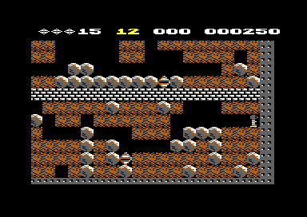
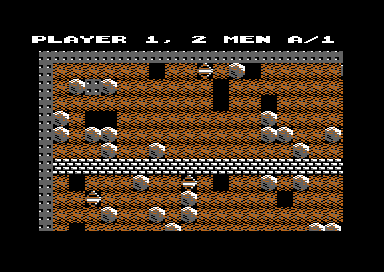

# The main loop and the game flow

The main loop is the frame of the whole game. It starts the title, then a cave, and it decides what comes after each cave. The player sees this part as the order of the screens. Examples are the title, the cave, the bonus count, OUT OF TIME, GAME OVER and the next player. The cave itself runs in ticks. One tick scans each cell of the cave one time and moves the boulders, the diamonds, the enemies and Rockford. A raster interrupt does the work of each frame in parallel. It shows the screen, counts the cave time, plays the sound and reads the keys. The game needs this split because the tick has no fixed length, but the clock and the screen must have a fixed rate.

**Conventions.**
- Addresses are C64 addresses. Names are the names of the knowledge.
- A *tick* is one call of `scan_cave`: one scan of each cell of the cave. A *frame* is one video frame. The raster interrupt comes two times in each frame, one time for each *split*.
- The *cave number* is 1-20: 1-16 are the caves A-P, 17-20 are the intermissions 1-4. The *level* is 0-4, and the screen shows it as 1-5.
- The *player state* is the 15 bytes at `$5C-$6A`. The *saved copies* are the states of player 1 at `$6B` and of player 2 at `$7A`.
- The *cave end* is `cave_end_state` = 2. It ends the play of a cave.
- **Observed** marks a fact that a run showed. **Code** marks a fact from the code only. **Conclusion** marks an interpretation.

## How it works

The program has one loop at the top. It shows the title when the cave number is 0, and else it plays the cave of the current player. Each cave returns to this loop. The end of a game writes 0 into the cave number, so the next pass shows the title again (**Code**).

~~~mermaid
flowchart TB
  A["Cold start (cold_start)"] --> B{"Cave number 0?"}
  B -->|yes| C["Title, options and tune (run_title)"]
  C --> D["New game: both player states (new_game_players)"]
  D --> B
  B -->|no| E["Build the cave (start_cave)"]
  E --> F{"Demo?"}
  F -->|no| G["Ticks until the cave end (play_cave)"]
  F -->|yes| H["Ticks with the demo moves (run_demo)"]
  G --> I["Texts, cover, next state (end_of_life)"]
  H --> I
  I --> B
~~~

### The cold start

The BASIC line `SYS 35507` jumps to [`cold_start` `$8AB3`](../src/init/cold_start.asm#L9). The NMI vector points to [`nmi_restart` `$8AB2`](../src/init/cold_start.asm#L6), one byte before it. That byte is a CLI, so RESTORE also starts the program again at the cold start (**Code**). A run pressed RESTORE during a game, and the title came back (**Observed**).

The cold start does these steps (**Code**):

1. It sets the stack pointer to `$FF` and disables all interrupts of CIA 1 and CIA 2. After this step, the CIAs cause no interrupts.
2. It writes the latch `$FFFF` to timer A of CIA 1. It loads and starts timers A (`$A0A0`) and B (`$6868`) of CIA 2 in continuous mode. `random_from_timers` reads these three timers for the random numbers of the play.
3. It writes `nmi_restart` into the NMI vector at `$0318`.
4. It writes `$36` into `$01`. The BASIC ROM goes away, and the RAM at `$A000-$BFFF` is free. The I/O and the KERNAL stay.
5. It calls `init_game_vars`. This routine stops the sound, clears the scroll and the counters, and sets the title defaults.
6. It copies the screen drawer at `$7B58-$7D57` to `$9E00-$9FFF`. The interrupt calls this copy in each second frame.
7. It writes the start text of the status line and the score 000000, then it continues into `top_loop`.

[`init_game_vars` `$8A15`](../src/init/init_vars.asm#L6) does more work at the first start after the load. `first_start_flag` is not 0 only then. At the first start it makes the screen black and clears the best scores of both players. It also sets one player, writes the score lines and builds the screens, the charsets and the sprites. F1 and RESTORE also start the program at `cold_start`, but they keep the best scores and the player mode (**Code**).

### The top loop

[`top_loop` `$8B2F`](../src/init/cold_start.asm#L69) reads the cave number in each pass (**Code**):

1. When the cave number is 0, it starts the title. It sets the title interrupt with `init_irq`, draws the title with `title_screen_setup` and runs `run_title`. The title returns when fire starts a game, or when the demo starts. Then the loop fills the play screen with character `$7C` and calls `new_game_players`.
2. When the cave number is not 0, it calls `start_cave`. Then it calls `run_demo` in demo mode, or `play_cave` for a player.
3. After the cave, it calls `end_of_life`. This routine shows the texts of the end and covers the cave.
4. It clears character 0 of the text charset, because the title uses that character for its moving pattern. Then it starts the next pass.

The page [title.md](title.md) explains the title.

### The start of a cave

[`start_cave` `$8722`](../src/cave/cave_start.asm#L6) builds the cave of the current cave number and level. It copies the 240 bytes of the cave data when the cave changed, and it sets the seed of the level. Then it fills the cave with the random elements, draws the steel wall and the objects, and resets the cave variables. At the end it stops the scroll and uncovers the cave (**Code**).

[`init_cave_state` `$7EDC`](../src/cave/setup.asm#L46) sets the time and the diamonds that the level needs, and the birth countdown of Rockford (**Code**):

- Rockford comes out of the inbox after 4 seconds.
- With two players and one joystick, the countdown is 6 seconds. The players probably need the 2 seconds more to pass the joystick (**Conclusion**).
- Cave B adds one second to the countdown.
- The row delay of the level sets the speed of the ticks. The values are `$0C`, `$06`, `$03`, `$01` and `$00` for the levels 1 to 5. Thus level 5 runs the scan without a delay.

### The play of a cave

[`play_cave` `$88FB`](../src/engine/play_loop.asm#L6) is the main loop of the play. It calls `scan_cave` until `cave_end_state` is not 0. Then it stops the sound and calls `end_cave`. It waits until `bonus_life_timer` is 0, so the sparkle of a bonus life ends before the next screen (**Code**).

The main loop does not wait for the raster. A tick takes the time of the scan plus the row delay of the level. Thus the speed of the cave changes with the number of moving elements. The cave time does not change with it, because the interrupt counts the time (**Conclusion**).

~~~mermaid
flowchart TB
  A["Count the ticks without Rockford, at most 16"] --> B["Fire after a death ends the cave (check_restart_fire)"]
  B --> C["Amoeba room of the last tick (update_amoeba_room)"]
  C --> D["Next cell: read its element"]
  D --> E{"Element has a handler?"}
  E -->|yes| F["Run the handler of the element"]
  E -->|no| G["Settle the cell one row up and one column left"]
  F --> G
  F -.->|"boulder enters the magic wall"| X["Return at once: no keys"]
  G --> H{"End of the row?"}
  H -->|no| D
  H -->|yes| I["Row delay of the level (scan_row_delay)"]
  I --> J{"Last row?"}
  J -->|no| D
  J -->|yes| K["Game keys (check_game_keys)"]
~~~

[`scan_cave` `$7DD9`](../src/engine/cave_scan.asm#L39) does one tick (**Code**):

1. It sets the last row: row 21 for a cave, row 14 for an intermission. The scan starts at row 1, because row 0 is the steel wall.
2. It adds 1 to `rockford_absent`, up to 16. The handler of Rockford sets this counter to 0 in each tick.
3. `check_restart_fire` ends the cave when Rockford is absent for 16 ticks, the cave time ran for one second, and the player presses fire. The test of the time stops a press during the birth countdown, because the cave time does not count then (**Conclusion**).
4. For each of the 40 cells of a row, it reads the element and jumps to its handler through `element_handler_lo` and `element_handler_hi`. An element without a handler has a high byte of 0.
5. After each cell, it writes the settled code from `cell_scan_reset` into the cell one row up and one column left. A handler marks a moved element with a "scanned" code, so the scan does not move it two times. The settled code removes the mark after the scan passed (**Conclusion**).
6. After each row, it waits the row delay.
7. After the last row, it calls `check_game_keys`.

One handler leaves the tick early. When a falling boulder enters the magic wall, the handler jumps to a sound routine, and the RTS of that routine returns from `scan_cave`. A trace of cave H shows it. In that tick the next `scan_cave` starts without a call of `check_game_keys`, and in all other ticks the call runs (**Observed**). The cells after the boulder do not get a scan in that tick (**Code**).

### The end of a cave or a life

Four events set the cave end (**Code**):

| Event | Condition | Code that sets it |
|---|---|---|
| Rockford enters the open exit | Also sets `exit_reached` | `move_rockford` (move to element `$05`) |
| The cave time is 000 | The time digits are all 0 | `check_time` |
| RUN/STOP | Only after the birth countdown | `check_game_keys` |
| Fire after a death | 16 ticks without Rockford, one second of cave time | `check_restart_fire` |

Thus a dead Rockford does not end the cave. The cave continues until the player presses fire. A run showed this wait after a boulder killed Rockford (**Observed**).

[`end_cave` `$88AB`](../src/cave/cave_end.asm#L69) selects one of three paths (**Code**):

1. When Rockford reached the exit, `count_time_bonus` counts the remaining time down to 0. Each second of time adds the level plus 1 points, with a sound. Then `next_cave` sets the next cave.
2. When an intermission ends without the exit, `next_cave` sets the next cave, and the player keeps the life. A death, the end of the time and RUN/STOP take this path. Thus RUN/STOP skips an intermission without a cost (**Conclusion**). No run reached this path.
3. Else `lose_life` takes one life. It also updates the best score and changes the turn.

Then `end_cave` writes the player digit, the lives, MAN or MEN, the cave letter and the level into the status line. The demo skips this step (**Code**).

[`count_time_bonus` `$8859`](../src/cave/cave_end.asm#L24) uses `check_time` as its end test. `check_time` writes the cave end when the time is 000, so the routine first clears `cave_end_state`. Then it counts until `check_time` writes the cave end again (**Code**). A run collected 12 diamonds in cave A and entered the exit. The time counted down to 000, then cave B started (**Observed**).

The end of the time bonus in cave A: the time shows 000 and the score is 000250.

[`next_cave` `$8841`](../src/cave/cave_end.asm#L6) reads the next cave from `cave_sequence`. After intermission 4 the table gives 21. The code then sets cave A and adds 1 to the level, but the level stays at 5 after level 5 (**Code**). No run reached this wrap.

[`end_of_life` `$802E`](../src/status/end_of_life.asm#L93) runs from the top loop after each cave (**Code**):

1. When the cave time ran out, it blinks OUT OF TIME with the saved status line. It stops when the player presses fire, or after 20 blinks.
2. When the game is over, it shows G A M E   O V E R.
3. Else `show_next_cave_text` shows the status line of the next cave. When the next cave is an intermission, it shows B O N U S  L I F E and calls `add_bonus_life`.
4. It covers the cave with the random cover pattern. After a game over, it waits a long delay.

Cave A at the start of the second life: the status line shows PLAYER 1, 2 MEN and A/1 (**Observed**).

The bonus life of an intermission comes at the start of the intermission, not at its end. `show_next_cave_text` reads the intermission flag of the cave that comes next. Thus the life comes when the player completes cave D, H, L or P (**Code**). No run reached this code. The game also gives a life for each 500 points. A run set the score to 490 and collected a diamond: the lives went up and the spaces of the cave sparkled (**Observed**).

The wait for fire in OUT OF TIME reads `current_player` EOR 1, except in an intermission. At this time `end_turn` already changed the turn. Thus the wait reads the fire button of the player who lost the life (**Conclusion**).

### Two players and turns

Each player has a saved copy of the player state. At the end of a life, the game copies the current player state into the copy of the player. Then it loads the state of the next player. A player who completes a cave keeps the turn. Thus the turn changes only after a lost life (**Code**). A run with two players gave up each life with RUN/STOP, and the turn changed after each lost life (**Observed**).

[`new_game_players` `$8746`](../src/status/players.asm#L6) starts a game. It sets player 1, three lives and the score 0. It copies the lives, the cave, the level and the score into both saved copies. Thus both players start at the cave and the level of the options. It loads the best score of player 1 from its saved copy (**Code**).

[`end_turn` `$876E`](../src/status/players.asm#L33) does these steps (**Code**):

1. It takes one life from the current player state.
2. It saves the 15 bytes into the copy of the current player.
3. With two players, it changes to the other player when the lives byte of the other copy is not 0.
4. It loads the 15 bytes of the selected player.
5. When the loaded player has no lives, it sets `game_over`. It also sets three lives and player 1 for the next game.

`lose_life` calls `update_best_score` before `end_turn`. Thus the best score changes only at the end of a life. At a game over, `lose_life` writes 0 into the cave number and the level, and `copy_scores_to_title` fills the LAST and HIGH lines of the title (**Code**).

### The raster interrupt

[`init_irq` `$8A81`](../src/irq/irq_setup.asm#L6) enables the raster interrupt at line `$28` and writes [`irq_handler` `$8675`](../src/irq/irq_handler.asm#L6) into the vector at `$0314`. The KERNAL ROM stays on, so each interrupt goes through the KERNAL entry. The handler ends with the pulls of Y, X and A that match the pushes of the KERNAL (**Code**).

The handler does these steps (**Code**):

1. It acknowledges the VIC-II interrupt. It changes `irq_split_index` between 1 and 0 and writes the `$D011`, `$D016` and `$D018` values of the new split. It also writes the raster line of the next split.
2. It calls `irq_joystick_guard`, scans keyboard rows 0 and 7, and calls the guard again.
3. In title mode (`irq_mode` = 1), it calls `title_irq_frame` in each interrupt, thus two times in a frame.
4. In game mode (`irq_mode` = 0), it turns on sprites 0-6 and calls `play_frame_irq`. That routine works only in split 0, thus one time in a frame.

The split values come from `$54-$5B`. `init_irq` copies the title values, and `run_title` copies the game values when a game starts (**Code**):

| Split | Title | Game |
|---|---|---|
| From line `$28` | Screen `$0800`, text charset `$2000` | Status line: screen `$0C00`, text charset `$2000` |
| From line `$C2` (title) or `$3B` (game) | Screen `$0C00` with the licence lines, or screen `$0800` when the options show | Cave: screen `$0C00` or `$2C00`, cave charset `$3000`, multicolour, 38 columns, 24 rows |

[`play_frame_irq` `$7B2B`](../src/irq/play_frame.asm#L6) does the frame work of the game. It flashes the screen, moves the cover, counts the magic wall time and the cave time, plays the sound and moves the scroll. Then it changes the screen in each second frame. In an even frame it shows the screen that the drawer filled last. In an odd frame it runs the drawer at `$9E00` into the other screen. Thus the game has two screens at `$0C00` and `$2C00`, and each picture of the cave takes two frames (**Code**).

`update_clock` counts 60 frames for one second of cave time. On a PAL C64 with 50 frames each second, one second of cave time thus takes 1.2 seconds (**Conclusion**). The count of 60 suggests that the authors timed the clock for an NTSC machine (**Conclusion**).

The keyboard scan reads row 0 (F1, F3) and row 7 (SPACE, RUN/STOP). A value counts only when two scans in a row agree. A scan without a key does not clear the value. Thus a key stays in `key_row0` or `key_row7` until the program clears it (**Code**).

[`irq_joystick_guard` `$8704`](../src/irq/irq_handler.asm#L84) solves a problem of the C64 hardware. Joystick port 1 uses the same lines of CIA 1 port B as the keyboard rows. The fire button is bit 4, the same bit as F1 in row 0 and SPACE in row 7. The guard reads port B with no keyboard column selected. When a line is low, it writes `$FF` into the four key values and pulls its own return address. Then it jumps over the scan to the frame work (**Code**). Without the guard, fire on port 1 would pause the game or start it again (**Conclusion**).

### The keys

`check_game_keys` reads the keys at the end of each tick. Thus a key acts at the rate of the ticks, not at the rate of the frames (**Code**).

| Key | Where | Effect |
|---|---|---|
| F1 | Title, options hidden | Shows the credits and the options |
| F3 | Title | Changes the player mode: 1 player, 2 players with 1 joystick, 2 players with 2 joysticks |
| Fire, port 1 | Options | Starts the game |
| SPACE | Cave | Pauses the game, SPACE again continues |
| RUN/STOP | Cave, after the birth countdown | Ends the life |
| F1 | Cave and demo | Starts the program again at the cold start |
| RESTORE | Any time | NMI: starts the program again at the cold start |
| Fire | Cave, after a death | Ends the cave |
| Fire, port 1 | Demo | Ends the demo |

[`pause_game` `$7D2B`](../src/input/game_keys.asm#L38) stops the cave time and the sound. It blinks SPACEBAR TO RESUME with the saved status line until the player presses SPACE again (**Code**). A run paused cave A with SPACE for 300 frames and continued with SPACE. A press of F1 in the cave then started the program again (**Observed**).

## The data

### The player state

The player state is the live copy of the current player. The code reads the cave and the level from it, so each player plays his own cave (**Code**).

| Offset | Address | Name | Meaning |
|---|---|---|---|
| 0 | `$5C` | `lives` | Lives, 0-9 |
| 1 | `$5D` | `cave_number` | Cave 1-20 |
| 2 | `$5E` | `level` | Level 0-4 |
| 3-8 | `$5F-$64` | `score_digits` | Score, 6 decimal digits 0-9 |
| 9-14 | `$65-$6A` | `best_score` | Best score, 6 screen codes `$10-$19` |

The saved copies are at `$6B-$79` (player 1) and `$7A-$88` (player 2). These addresses are in the zero page of BASIC, so the source shows some of them with the names of the platform. `CHRGET+1` is the best score of player 1, `CHRGET+16` is the best score of player 2, and `FAC2+5` is the score of player 1 (**Code**).

### The order of the caves

`cave_sequence` has two bytes for each cave 1-20. Byte 0 is the next cave. Byte 1 is 1 when the cave itself is an intermission. `next_cave` reads byte 0, and `load_cave_data` and `show_next_cave_text` read byte 1 (**Code**).

## The state machine of the game

The cave number and two flags, `demo_mode` and `game_over`, select the next state. [`end_of_life` `$802E`](../src/status/end_of_life.asm#L93) runs after each cave and leads to the next state.

~~~mermaid
stateDiagram-v2
  state "Cold start" as Cold
  state "Title (cave 0)" as Title
  state "Build the cave" as Start
  state "Play: ticks" as Play
  state "Demo: ticks" as Demo
  state "Time bonus" as Bonus
  state "Lose a life" as Lose
  state "Texts and cover" as Texts
  state "Game over" as Over
  [*] --> Cold
  Cold --> Title
  Title --> Start: fire or two tune loops
  Start --> Play: demo_mode = 0
  Start --> Demo: demo_mode = 1
  Demo --> Texts: fire or end of the moves
  Play --> Bonus: exit reached
  Play --> Texts: death in an intermission
  Play --> Lose: death, time out, RUN/STOP
  Bonus --> Texts
  Lose --> Texts: lives left
  Lose --> Over: no lives
  Over --> Title
  Texts --> Start: cave not 0
  Texts --> Title: cave 0 after the demo
  Play --> Cold: F1 or RESTORE
~~~

| State | Condition | Next state | Code |
|---|---|---|---|
| Cold start | Cave number 0 | Title | `cold_start`, `top_loop` |
| Title | Fire on the options | Build the cave | `title_options_loop` |
| Title | Tune played two times in demo mode | Build the cave | `play_title_tune` |
| Build the cave | `demo_mode` = 0 | Play | `top_loop` |
| Build the cave | `demo_mode` = 1 | Demo | `top_loop` |
| Play | Exit reached | Time bonus | `end_cave` |
| Play | Death or RUN/STOP in an intermission | Texts and cover, next cave | `end_cave`, `next_cave` |
| Play | Death, time out or RUN/STOP | Lose a life | `end_cave`, `lose_life` |
| Time bonus | Time is 000 | Texts and cover, next cave | `count_time_bonus`, `next_cave` |
| Lose a life | A player has lives | Texts and cover | `end_turn` |
| Lose a life | No player has lives | Game over, cave 0 | `end_turn`, `lose_life` |
| Game over | Always | Title | `end_of_life`, `top_loop` |
| Demo | Fire or the end byte of the moves | Texts and cover, cave 0 | `run_demo` |
| Play or demo | F1 or RESTORE | Cold start | `check_game_keys`, `nmi_restart` |

## The worked example: the order of the caves

The bytes of `cave_sequence` at `$7E66` give this order (**Code**):

| Cave | Number | Bytes | Next | Intermission |
|---|---|---|---|---|
| A | 1 | `$02,$00` | B | no |
| D | 4 | `$11,$00` | 17 (intermission 1) | no |
| 1 | 17 | `$05,$01` | E | yes |
| P | 16 | `$14,$00` | 20 (intermission 4) | no |
| 4 | 20 | `$15,$01` | 21: cave A, next level | yes |

The full order is `A B C D 1 E F G H 2 I J K L 3 M N O P 4`, then cave A of the next level. When the player completes cave D, `next_cave` writes 17. Then `show_next_cave_text` reads byte 1 of entry 17, which is 1. It shows B O N U S  L I F E and adds a life before intermission 1 starts (**Code**). In intermission 1, `scan_cave` reads the cave number 17, which is not below `$11`, and scans only the rows 1-14 (**Code**).

## Still open

- No run reached three parts of the flow. They are the bonus life before an intermission (`$8011`), the death in an intermission (`$88BD`) and the wrap after intermission 4 (`$884C`). A recording that completes cave D can show the bonus life. A recording that writes the cave number 20 can show the other two.
- No run reached the end of the demo (`$894F`). A recording that waits on the title for two tune loops and then presses fire can show it.
- The tick rate of each level is not measured. A run with a frame count between two calls of `scan_cave` can give it for the levels 1 and 5.
