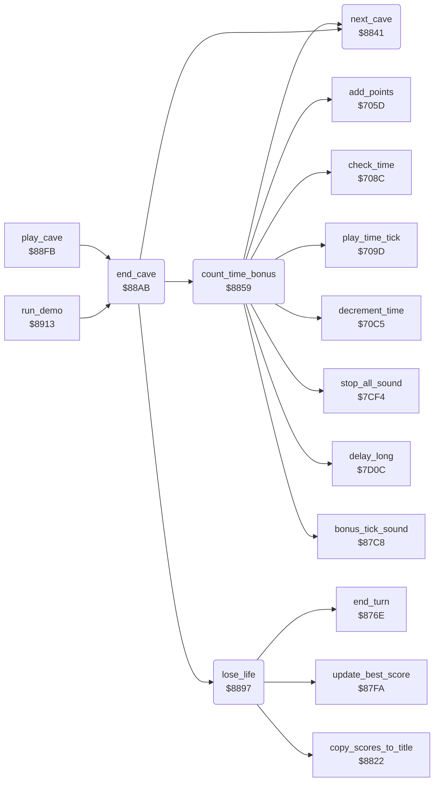

<!-- Generated by c64-docs from knowledge revision 20261024T103116.541-jn0vrj and .c64-re-tools/local/generated/src/source-map.json. Do not edit: change the knowledge, generate the source again, then run docs.ts generate. -->
# cave/cave_end.asm: End of a cave

Range `$8841-$88FA`. Source: [cave/cave_end.asm](../../../../src/cave/cave_end.asm). Index: [the reference](../../index.md).

## Call graph

A solid arrow is a call, a thick arrow a table entry, a dotted arrow a jump. Rounded nodes are in this file.

## Names

### [`next_cave`](../../../../src/cave/cave_end.asm#L6) `$8841`

*routine*

Sets cave_number to the next cave from the cave table. After intermission 4 it sets cave A and the next level, at most 4.

- **Called from:** [`count_time_bonus`](cave_end.md#count_time_bonus) [`$8893`](../../../../src/cave/cave_end.asm#L54), [`end_cave`](cave_end.md#end_cave) [`$88BD`](../../../../src/cave/cave_end.asm#L80)
- **Reads:** [`cave_number`](../../memory-map.md#cave_number), [`cave_sequence_base`](../status/decimal.md#cave_sequence_base), [`level`](../../memory-map.md#level)
- **Writes:** [`level`](../../memory-map.md#level), [`cave_number`](../../memory-map.md#cave_number)
- **Refers to:** [`cave_sequence`](sequence.md#cave_sequence)

### [`next_cave_wrap`](../../../../src/cave/cave_end.asm#L18) `$8854`

*label*

- **Jumped to from:** [`next_cave`](cave_end.md#next_cave) [`$8850`](../../../../src/cave/cave_end.asm#L16)

### [`next_cave_store`](../../../../src/cave/cave_end.asm#L20) `$8856`

*label*

- **Jumped to from:** [`next_cave`](cave_end.md#next_cave) [`$884A`](../../../../src/cave/cave_end.asm#L12)

### [`count_time_bonus`](../../../../src/cave/cave_end.asm#L24) `$8859`

*routine*

Counts the remaining time down to 0. Each unit adds level plus 1 to the score with a sound. Then goes to the next cave.

- **Called from:** [`end_cave`](cave_end.md#end_cave) [`$88B3`](../../../../src/cave/cave_end.asm#L74)
- **Calls:** [`check_time`](../status/score_time.md#check_time), [`stop_all_sound`](../sound/voices_off.md#stop_all_sound), [`decrement_time`](../status/score_time.md#decrement_time), [`add_points`](../status/score_time.md#add_points), [`bonus_tick_sound`](../sound/bonus_sound.md#bonus_tick_sound), [`play_time_tick`](../status/score_time.md#play_time_tick), [`delay_long`](../input/game_keys.md#delay_long), [`next_cave`](cave_end.md#next_cave)
- **Reads:** [`level`](../../memory-map.md#level), [`cave_end_state`](../../memory-map.md#cave_end_state)
- **Writes:** [`points_to_add`](../../memory-map.md#points_to_add), [`diamond_points_tens+1`](../../memory-map.md#diamond_points_tens), [`cave_end_state`](../../memory-map.md#cave_end_state), [`view_row_ptrs`](../../memory-map.md#view_row_ptrs), [`view_row_ptrs_hi`](../../memory-map.md#view_row_ptrs_hi)

### [`time_bonus_clear`](../../../../src/cave/cave_end.asm#L27) `$885D`

*label*

- **Jumped to from:** [`count_time_bonus`](cave_end.md#count_time_bonus) [`$8862`](../../../../src/cave/cave_end.asm#L31)

### [`time_bonus_loop`](../../../../src/cave/cave_end.asm#L43) `$887B`

*label*

- **Jumped to from:** [`count_time_bonus`](cave_end.md#count_time_bonus) [`$8888`](../../../../src/cave/cave_end.asm#L49)

### [`time_bonus_done`](../../../../src/cave/cave_end.asm#L50) `$888A`

*label*

- **Jumped to from:** [`count_time_bonus`](cave_end.md#count_time_bonus) [`$887D`](../../../../src/cave/cave_end.asm#L45)

### [`lose_life`](../../../../src/cave/cave_end.asm#L57) `$8897`

*routine*

After a lost life: updates the best score and changes turns. At game over it goes back to the title and fills the score lines.

- **Called from:** [`end_cave`](cave_end.md#end_cave) [`$88C3`](../../../../src/cave/cave_end.asm#L83)
- **Calls:** [`update_best_score`](../status/scores.md#update_best_score), [`end_turn`](../status/players.md#end_turn), [`copy_scores_to_title`](../status/scores.md#copy_scores_to_title)
- **Reads:** [`game_over`](../../memory-map.md#game_over)
- **Writes:** [`cave_number`](../../memory-map.md#cave_number), [`level`](../../memory-map.md#level)

### [`lose_life_done`](../../../../src/cave/cave_end.asm#L66) `$88AA`

*label*

- **Jumped to from:** [`lose_life`](cave_end.md#lose_life) [`$889F`](../../../../src/cave/cave_end.asm#L61)

### [`end_cave`](../../../../src/cave/cave_end.asm#L69) `$88AB`

*routine*

Ends a cave: the exit gives the time bonus, a death in an intermission goes on, another death costs a life. Updates the status line.

- **Called from:** [`play_cave`](../engine/play_loop.md#play_cave) [`$8905`](../../../../src/engine/play_loop.asm#L11), [`run_demo`](../title/demo.md#run_demo) [`$8956`](../../../../src/title/demo.asm#L46)
- **Calls:** [`count_time_bonus`](cave_end.md#count_time_bonus), [`next_cave`](cave_end.md#next_cave), [`lose_life`](cave_end.md#lose_life)
- **Reads:** [`exit_reached`](../../memory-map.md#exit_reached), [`intermission_flag`](../../memory-map.md#intermission_flag), [`demo_mode`](../../memory-map.md#demo_mode), [`current_player`](../../memory-map.md#current_player), [`lives`](../../memory-map.md#lives), [`cave_number`](../../memory-map.md#cave_number), [`level`](../../memory-map.md#level)
- **Writes:** [`pause_flag`](../../memory-map.md#pause_flag), [`status_line_text+7`](../../memory-map.md#status_line_text), [`status_line_text+10`](../../memory-map.md#status_line_text), [`status_line_text+13`](../../memory-map.md#status_line_text), [`status_line_text+16`](../../memory-map.md#status_line_text), [`status_line_text+18`](../../memory-map.md#status_line_text), [`cave_clock_on`](../../memory-map.md#cave_clock_on)

### [`end_cave_no_exit`](../../../../src/cave/cave_end.asm#L76) `$88B9`

*label*

A death in an intermission costs no life.

- **Jumped to from:** [`end_cave`](cave_end.md#end_cave) [`$88B1`](../../../../src/cave/cave_end.asm#L73)

### [`end_cave_lost_life`](../../../../src/cave/cave_end.asm#L82) `$88C3`

*label*

- **Jumped to from:** [`end_cave`](cave_end.md#end_cave) [`$88BB`](../../../../src/cave/cave_end.asm#L78)

### [`end_cave_status`](../../../../src/cave/cave_end.asm#L84) `$88C6`

*label*

- **Jumped to from:** [`end_cave`](cave_end.md#end_cave) [`$88B6`](../../../../src/cave/cave_end.asm#L75), [`end_cave`](cave_end.md#end_cave) [`$88C0`](../../../../src/cave/cave_end.asm#L81)

### [`end_cave_men_text`](../../../../src/cave/cave_end.asm#L100) `$88E3`

*label*

- **Jumped to from:** [`end_cave`](cave_end.md#end_cave) [`$88DF`](../../../../src/cave/cave_end.asm#L98)

### [`end_cave_done`](../../../../src/cave/cave_end.asm#L110) `$88F6`

*label*

- **Jumped to from:** [`end_cave`](cave_end.md#end_cave) [`$88C8`](../../../../src/cave/cave_end.asm#L86)
