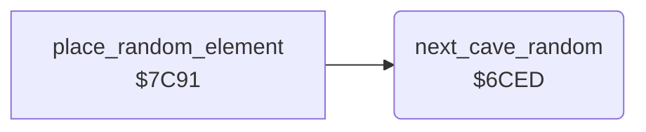

<!-- Generated by c64-docs from knowledge revision 20261025T214621.431-dj0nk4 and .c64-re-tools/local/generated/src/source-map.json. Do not edit: change the knowledge, generate the source again, then run docs.ts generate. -->
# cave/cave_random.asm: Random numbers of the cave generator

Range `$6CED-$6D15`. Source: [cave/cave_random.asm](../../../../src/cave/cave_random.asm). Index: [the reference](../../index.md).

## Routines

| Routine | Address | Reached from | Summary |
|---|---|---|---|
| [`next_cave_random`](cave_random.md#next_cave_random) | `$6CED` | [`place_random_element`](random_fill.md#place_random_element) | Steps the pseudo-random generator of the cave decoder: random_seed1 and random_seed2 get the next values. |

## Call graph

A solid arrow is a call, a thick arrow a table entry. Rounded nodes are in this file.

## Details

### [`next_cave_random`](../../../../src/cave/cave_random.asm#L6) `$6CED`

*routine*

Steps the pseudo-random generator of the cave decoder: random_seed1 and random_seed2 get the next values. Uses random_temp1 and random_temp2.

- **Called from:** [`place_random_element`](random_fill.md#place_random_element)
- **Reads:** [`random_seed2`](../../memory-map.md#random_seed2), [`random_seed1`](../../memory-map.md#random_seed1), [`random_temp1`](../../memory-map.md#random_temp1), [`random_temp2`](../../memory-map.md#random_temp2)
- **Writes:** [`random_temp1`](../../memory-map.md#random_temp1), [`random_temp2`](../../memory-map.md#random_temp2), [`random_seed1`](../../memory-map.md#random_seed1), [`random_seed2`](../../memory-map.md#random_seed2)
