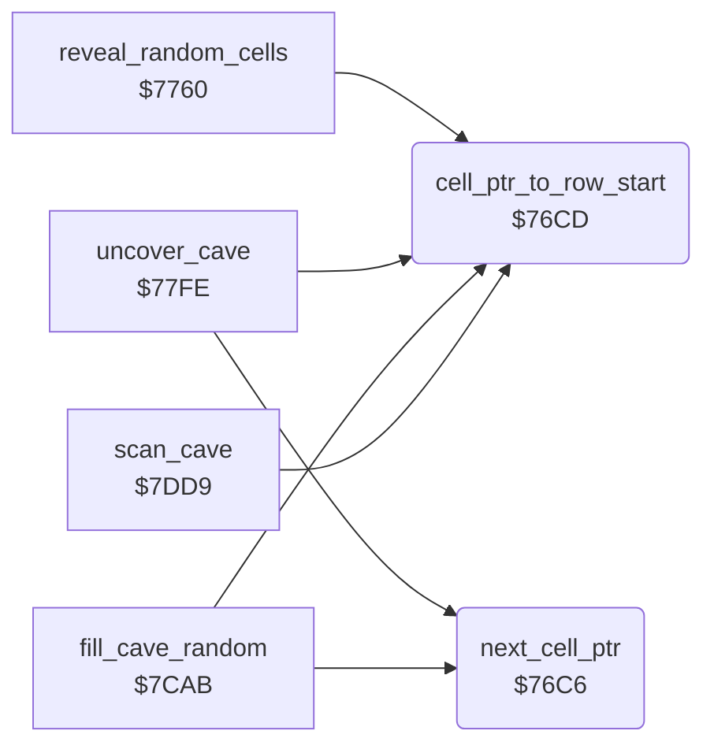

<!-- Generated by c64-docs from knowledge revision 20261025T214621.431-dj0nk4 and .c64-re-tools/local/generated/src/source-map.json. Do not edit: change the knowledge, generate the source again, then run docs.ts generate. -->
# cave/cell_ptr.asm: Cell pointer

Range `$76C6-$76DA`. Source: [cave/cell_ptr.asm](../../../../src/cave/cell_ptr.asm). Index: [the reference](../../index.md).

## Routines

| Routine | Address | Reached from | Summary |
|---|---|---|---|
| [`next_cell_ptr`](cell_ptr.md#next_cell_ptr) | `$76C6` | [`uncover_cave`](../screen/cover.md#uncover_cave), [`fill_cave_random`](random_fill.md#fill_cave_random) | Increments cell_ptr by one cell. |
| [`cell_ptr_to_row_start`](cell_ptr.md#cell_ptr_to_row_start) | `$76CD` | [`reveal_random_cells`](../screen/cover.md#reveal_random_cells), [`uncover_cave`](../screen/cover.md#uncover_cave), [`fill_cave_random`](random_fill.md#fill_cave_random), [`scan_cave`](../engine/cave_scan.md#scan_cave) | Sets cell_ptr for the first cell of cave row 0 (Z = 1) or cave row 1 (Z = 0). |

## Call graph

A solid arrow is a call, a thick arrow a table entry. Rounded nodes are in this file.

## Details

### [`next_cell_ptr`](../../../../src/cave/cell_ptr.asm#L6) `$76C6`

*routine*

Increments cell_ptr by one cell.

- **Called from:** [`uncover_cave`](../screen/cover.md#uncover_cave), [`fill_cave_random`](random_fill.md#fill_cave_random)
- **Reads:** [`cell_ptr`](../../memory-map.md#cell_ptr), [`cell_ptr_hi`](../../memory-map.md#cell_ptr_hi)
- **Writes:** [`cell_ptr`](../../memory-map.md#cell_ptr), [`cell_ptr_hi`](../../memory-map.md#cell_ptr_hi)

| Label | Address | Comment |
|---|---|---|
| [`next_cell_ptr_done`](../../../../src/cave/cell_ptr.asm#L10) | `$76CC` |  |

### [`cell_ptr_to_row_start`](../../../../src/cave/cell_ptr.asm#L13) `$76CD`

*routine*

Sets cell_ptr for the first cell of cave row 0 (Z = 1) or cave row 1 (Z = 0).

- **Called from:** [`reveal_random_cells`](../screen/cover.md#reveal_random_cells), [`uncover_cave`](../screen/cover.md#uncover_cave), [`fill_cave_random`](random_fill.md#fill_cave_random), [`scan_cave`](../engine/cave_scan.md#scan_cave)
- **Writes:** [`cell_ptr`](../../memory-map.md#cell_ptr), [`cell_ptr_hi`](../../memory-map.md#cell_ptr_hi)

| Label | Address | Comment |
|---|---|---|
| [`cell_ptr_to_row_start_set`](../../../../src/cave/cell_ptr.asm#L16) | `$76D1` |  |
