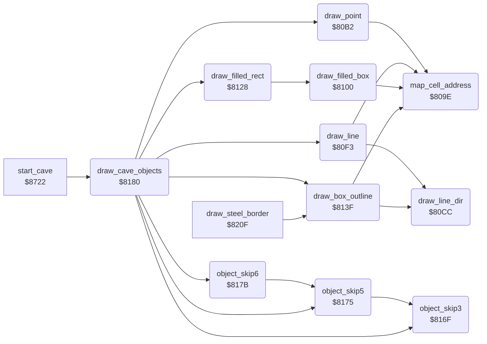

<!-- Generated by c64-docs from knowledge revision 20261025T214621.431-dj0nk4 and .c64-re-tools/local/generated/src/source-map.json. Do not edit: change the knowledge, generate the source again, then run docs.ts generate. -->
# cave/draw_objects.asm: Drawing of the cave objects

Range `$806E-$81EF`. Source: [cave/draw_objects.asm](../../../../src/cave/draw_objects.asm). Index: [the reference](../../index.md).

## Routines

| Routine | Address | Reached from | Summary |
|---|---|---|---|
| [`map_cell_address`](draw_objects.md#map_cell_address) | `$809E` | [`draw_point`](draw_objects.md#draw_point), [`draw_line`](draw_objects.md#draw_line), [`draw_filled_box`](draw_objects.md#draw_filled_box), [`draw_box_outline`](draw_objects.md#draw_box_outline) | Sets draw_ptr to the map cell at column object_x, row object_y. |
| [`draw_point`](draw_objects.md#draw_point) | `$80B2` | [`draw_cave_objects`](draw_objects.md#draw_cave_objects) | Writes object_element to the map cell at object_x, object_y. |
| [`draw_line_dir`](draw_objects.md#draw_line_dir) | `$80CC` | [`draw_line`](draw_objects.md#draw_line), [`draw_box_outline`](draw_objects.md#draw_box_outline) | Writes object_element to draw_count cells from draw_ptr in direction A. |
| [`draw_line`](draw_objects.md#draw_line) | `$80F3` | [`draw_cave_objects`](draw_objects.md#draw_cave_objects) | Draws a line object: object_width cells in direction object_height from object_x, object_y. |
| [`draw_filled_box`](draw_objects.md#draw_filled_box) | `$8100` | [`draw_filled_rect`](draw_objects.md#draw_filled_rect) | Fills object_width by object_height cells from object_x, object_y with object_element. |
| [`draw_filled_rect`](draw_objects.md#draw_filled_rect) | `$8128` | [`draw_cave_objects`](draw_objects.md#draw_cave_objects) | Draws a box with an edge of object_element and an inside of object_fill. |
| [`draw_box_outline`](draw_objects.md#draw_box_outline) | `$813F` | [`draw_cave_objects`](draw_objects.md#draw_cave_objects), [`draw_steel_border`](steel_border.md#draw_steel_border) | Draws the edge of a box of object_width by object_height cells: right, down, left, then up. |
| [`object_skip3`](draw_objects.md#object_skip3) | `$816F` | [`object_skip5`](draw_objects.md#object_skip5), [`draw_cave_objects`](draw_objects.md#draw_cave_objects) | Adds 3 to Y and stores it in object_index: the next object. |
| [`object_skip5`](draw_objects.md#object_skip5) | `$8175` | [`object_skip6`](draw_objects.md#object_skip6), [`draw_cave_objects`](draw_objects.md#draw_cave_objects) | Adds 5 to Y and stores it in object_index. |
| [`object_skip6`](draw_objects.md#object_skip6) | `$817B` | [`draw_cave_objects`](draw_objects.md#draw_cave_objects) | Adds 6 to Y and stores it in object_index. |
| [`draw_cave_objects`](draw_objects.md#draw_cave_objects) | `$8180` | [`start_cave`](cave_start.md#start_cave) | Draws the object list of the cave until $FF. |

## Data

| Range | Type | Name | Read by | Written by |
|---|---|---|---|---|
| [`$806E`](../../../../src/cave/draw_objects.asm#L7)-`$809D` | words | [`map_row_address`](../../../../src/cave/draw_objects.asm#L6) | [`map_cell_address`](draw_objects.md#map_cell_address) |  |
| [`$80BC`](../../../../src/cave/draw_objects.asm#L35)-`$80CB` | words | [`direction_step`](../../../../src/cave/draw_objects.asm#L34) | [`draw_line_dir`](draw_objects.md#draw_line_dir) |  |

## Call graph

A solid arrow is a call, a thick arrow a table entry. Rounded nodes are in this file.

## Details

### [`map_row_address`](../../../../src/cave/draw_objects.asm#L6) `$806E-$809D`

*data*

Address of each of the 24 map rows: $0800 plus 40 times the row. Rows 0-1 are the status rows.

- **Read by:** [`map_cell_address`](draw_objects.md#map_cell_address)

### [`map_cell_address`](../../../../src/cave/draw_objects.asm#L14) `$809E`

*routine*

Sets draw_ptr to the map cell at column object_x, row object_y.

- **Called from:** [`draw_point`](draw_objects.md#draw_point), [`draw_line`](draw_objects.md#draw_line), [`draw_filled_box`](draw_objects.md#draw_filled_box), [`draw_box_outline`](draw_objects.md#draw_box_outline)
- **Reads:** [`object_y`](../../memory-map.md#object_y), [`map_row_address`](draw_objects.md#map_row_address), [`object_x`](../../memory-map.md#object_x)
- **Writes:** [`map_draw_ptr`](../../memory-map.md#map_draw_ptr), [`map_draw_ptr_hi`](../../memory-map.md#map_draw_ptr_hi)
- **Refers to:** [`map_row_address`](draw_objects.md#map_row_address)

### [`draw_point`](../../../../src/cave/draw_objects.asm#L27) `$80B2`

*routine*

Writes object_element to the map cell at object_x, object_y.

- **Called from:** [`draw_cave_objects`](draw_objects.md#draw_cave_objects)
- **Calls:** [`map_cell_address`](draw_objects.md#map_cell_address)
- **Reads:** [`object_element`](../../memory-map.md#object_element), [`map_draw_ptr`](../../memory-map.md#map_draw_ptr)

### [`direction_step`](../../../../src/cave/draw_objects.asm#L34) `$80BC-$80CB`

*data*

Map offset of one step in each direction 0-7: up, up right, right, down right, down, down left, left, up left.

- **Read by:** [`draw_line_dir`](draw_objects.md#draw_line_dir)

### [`draw_line_dir`](../../../../src/cave/draw_objects.asm#L38) `$80CC`

*routine*

Writes object_element to draw_count cells from draw_ptr in direction A. Input: A is direction 0-7.

- **Called from:** [`draw_line`](draw_objects.md#draw_line), [`draw_box_outline`](draw_objects.md#draw_box_outline)
- **Reads:** [`direction_step`](draw_objects.md#direction_step), [`draw_count`](../../memory-map.md#draw_count), [`object_element`](../../memory-map.md#object_element), [`map_draw_ptr`](../../memory-map.md#map_draw_ptr), [`draw_step`](../../memory-map.md#draw_step), [`map_draw_ptr_hi`](../../memory-map.md#map_draw_ptr_hi), [`draw_step_hi`](../../memory-map.md#draw_step_hi)
- **Writes:** [`draw_step`](../../memory-map.md#draw_step), [`draw_step_hi`](../../memory-map.md#draw_step_hi), [`draw_count`](../../memory-map.md#draw_count), [`map_draw_ptr`](../../memory-map.md#map_draw_ptr), [`map_draw_ptr_hi`](../../memory-map.md#map_draw_ptr_hi)
- **Refers to:** [`direction_step`](draw_objects.md#direction_step)

| Label | Address | Comment |
|---|---|---|
| [`draw_line_loop`](../../../../src/cave/draw_objects.asm#L46) | `$80DA` |  |
| [`draw_line_done`](../../../../src/cave/draw_objects.asm#L59) | `$80F2` |  |

### [`draw_line`](../../../../src/cave/draw_objects.asm#L62) `$80F3`

*routine*

Draws a line object: object_width cells in direction object_height from object_x, object_y.

- **Called from:** [`draw_cave_objects`](draw_objects.md#draw_cave_objects)
- **Calls:** [`map_cell_address`](draw_objects.md#map_cell_address), [`draw_line_dir`](draw_objects.md#draw_line_dir)
- **Reads:** [`object_width`](../../memory-map.md#object_width), [`object_height`](../../memory-map.md#object_height)
- **Writes:** [`draw_count`](../../memory-map.md#draw_count)

### [`draw_filled_box`](../../../../src/cave/draw_objects.asm#L70) `$8100`

*routine*

Fills object_width by object_height cells from object_x, object_y with object_element.

- **Called from:** [`draw_filled_rect`](draw_objects.md#draw_filled_rect)
- **Calls:** [`map_cell_address`](draw_objects.md#map_cell_address)
- **Reads:** [`object_height`](../../memory-map.md#object_height), [`draw_count`](../../memory-map.md#draw_count), [`object_width`](../../memory-map.md#object_width), [`object_element`](../../memory-map.md#object_element), [`map_draw_ptr`](../../memory-map.md#map_draw_ptr), [`map_draw_ptr_hi`](../../memory-map.md#map_draw_ptr_hi)
- **Writes:** [`draw_count`](../../memory-map.md#draw_count), [`map_draw_ptr`](../../memory-map.md#map_draw_ptr), [`map_draw_ptr_hi`](../../memory-map.md#map_draw_ptr_hi)

| Label | Address | Comment |
|---|---|---|
| [`fill_box_row`](../../../../src/cave/draw_objects.asm#L74) | `$8107` |  |
| [`fill_box_cell`](../../../../src/cave/draw_objects.asm#L78) | `$810D` |  |
| [`fill_box_next_row`](../../../../src/cave/draw_objects.asm#L84) | `$8117` |  |
| [`fill_box_done`](../../../../src/cave/draw_objects.asm#L93) | `$8127` |  |

### [`draw_filled_rect`](../../../../src/cave/draw_objects.asm#L96) `$8128`

*routine*

Draws a box with an edge of object_element and an inside of object_fill.

- **Called from:** [`draw_cave_objects`](draw_objects.md#draw_cave_objects)
- **Calls:** [`draw_filled_box`](draw_objects.md#draw_filled_box)
- **Reads:** [`object_fill`](../../memory-map.md#object_fill), [`object_x`](../../memory-map.md#object_x), [`object_y`](../../memory-map.md#object_y), [`object_width`](../../memory-map.md#object_width), [`object_height`](../../memory-map.md#object_height)
- **Writes:** [`object_element`](../../memory-map.md#object_element), [`object_x`](../../memory-map.md#object_x), [`object_y`](../../memory-map.md#object_y), [`object_width`](../../memory-map.md#object_width), [`object_height`](../../memory-map.md#object_height)

### [`draw_box_outline`](../../../../src/cave/draw_objects.asm#L109) `$813F`

*routine*

Draws the edge of a box of object_width by object_height cells: right, down, left, then up.

- **Called from:** [`draw_cave_objects`](draw_objects.md#draw_cave_objects), [`draw_steel_border`](steel_border.md#draw_steel_border)
- **Calls:** [`map_cell_address`](draw_objects.md#map_cell_address), [`draw_line_dir`](draw_objects.md#draw_line_dir)
- **Reads:** [`object_width`](../../memory-map.md#object_width), [`draw_count`](../../memory-map.md#draw_count), [`object_height`](../../memory-map.md#object_height)
- **Writes:** [`draw_count`](../../memory-map.md#draw_count)

### [`object_skip3`](../../../../src/cave/draw_objects.asm#L133) `$816F`

*routine*

Adds 3 to Y and stores it in object_index: the next object.

- **Called from:** [`object_skip5`](draw_objects.md#object_skip5), [`draw_cave_objects`](draw_objects.md#draw_cave_objects)
- **Writes:** [`object_index`](../../memory-map.md#object_index)

### [`object_skip5`](../../../../src/cave/draw_objects.asm#L140) `$8175`

*routine*

Adds 5 to Y and stores it in object_index.

- **Called from:** [`object_skip6`](draw_objects.md#object_skip6), [`draw_cave_objects`](draw_objects.md#draw_cave_objects)
- **Calls:** [`object_skip3`](draw_objects.md#object_skip3)

### [`object_skip6`](../../../../src/cave/draw_objects.asm#L146) `$817B`

*routine*

Adds 6 to Y and stores it in object_index.

- **Called from:** [`draw_cave_objects`](draw_objects.md#draw_cave_objects)
- **Calls:** [`object_skip5`](draw_objects.md#object_skip5)

### [`draw_cave_objects`](../../../../src/cave/draw_objects.asm#L151) `$8180`

*routine*

Draws the object list of the cave until $FF. Bits 7-6: point, line, filled box, box. Bits 5-0: the element.

- **Called from:** [`start_cave`](cave_start.md#start_cave)
- **Calls:** [`object_skip3`](draw_objects.md#object_skip3), [`draw_point`](draw_objects.md#draw_point), [`object_skip5`](draw_objects.md#object_skip5), [`draw_line`](draw_objects.md#draw_line), [`object_skip6`](draw_objects.md#object_skip6), [`draw_filled_rect`](draw_objects.md#draw_filled_rect), [`draw_box_outline`](draw_objects.md#draw_box_outline)
- **Reads:** [`object_index`](../../memory-map.md#object_index), [`cave_objects`](../../memory-map.md#cave_objects)
- **Writes:** [`object_index`](../../memory-map.md#object_index), [`object_element`](../../memory-map.md#object_element), [`rockford_col`](../../memory-map.md#rockford_col), [`rockford_row`](../../memory-map.md#rockford_row), [`object_x`](../../memory-map.md#object_x), [`object_y`](../../memory-map.md#object_y), [`object_width`](../../memory-map.md#object_width), [`object_height`](../../memory-map.md#object_height), [`object_fill`](../../memory-map.md#object_fill)

| Label | Address | Comment |
|---|---|---|
| [`draw_objects_next`](../../../../src/cave/draw_objects.asm#L154) | `$8184` |  |
| [`draw_objects_params`](../../../../src/cave/draw_objects.asm#L167) | `$819F` |  |
| [`draw_objects_line`](../../../../src/cave/draw_objects.asm#L184) | `$81C8` | Kind 1: line, 5 bytes. |
| [`draw_objects_filled`](../../../../src/cave/draw_objects.asm#L190) | `$81D5` | Kind 2: filled box, 6 bytes. |
| [`draw_objects_box`](../../../../src/cave/draw_objects.asm#L196) | `$81E2` | Kind 3: box, 5 bytes. |
| [`draw_objects_loop`](../../../../src/cave/draw_objects.asm#L201) | `$81EC` |  |
| [`draw_objects_done`](../../../../src/cave/draw_objects.asm#L203) | `$81EF` |  |
