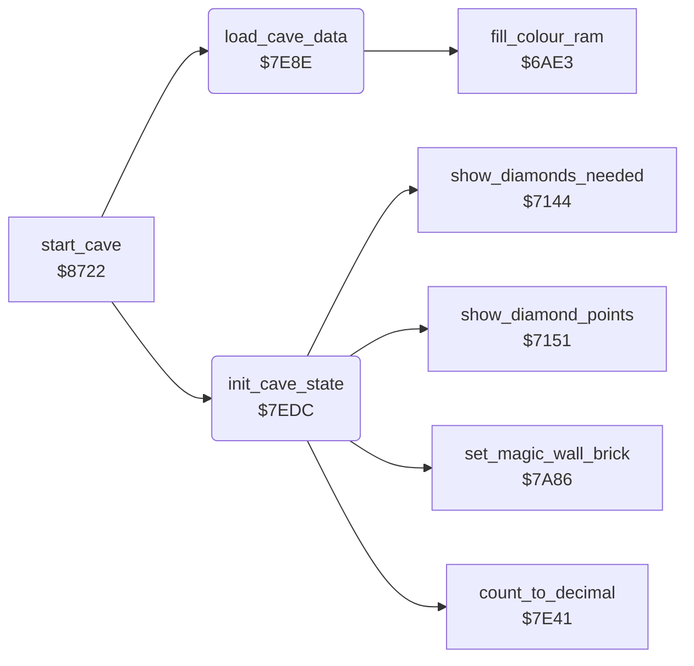

<!-- Generated by c64-docs from knowledge revision 20261025T214621.431-dj0nk4 and .c64-re-tools/local/generated/src/source-map.json. Do not edit: change the knowledge, generate the source again, then run docs.ts generate. -->
# cave/setup.asm: Cave set-up

Range `$7E8E-$7F9D`. Source: [cave/setup.asm](../../../../src/cave/setup.asm). Index: [the reference](../../index.md).

## Routines

| Routine | Address | Reached from | Summary |
|---|---|---|---|
| [`load_cave_data`](setup.md#load_cave_data) | `$7E8E` | [`start_cave`](cave_start.md#start_cave) | Copies the 240 bytes of cave data to cave_data when the cave changed. |
| [`init_cave_state`](setup.md#init_cave_state) | `$7EDC` | [`start_cave`](cave_start.md#start_cave) | Sets the variables for the play of a cave: counters, delay, time, diamonds needed, diamond values, birth countdown, amoeba speed and animations. |

## Call graph

A solid arrow is a call, a thick arrow a table entry. Rounded nodes are in this file.

## Details

### [`load_cave_data`](../../../../src/cave/setup.asm#L6) `$7E8E`

*routine*

Copies the 240 bytes of cave data to cave_data when the cave changed. Sets the level seed and the cave colours.

- **Called from:** [`start_cave`](cave_start.md#start_cave)
- **Calls:** [`fill_colour_ram`](../screen/colour_ram.md#fill_colour_ram)
- **Reads:** [`cave_number`](../../memory-map.md#cave_number), [`decoded_cave`](../../memory-map.md#decoded_cave), [`count_to_decimal_done`](../status/decimal.md#count_to_decimal_done), [`cave_data_offsets_base`](../data/element_glyphs.md#cave_data_offsets_base), [`cave_data_offsets_base_hi`](../data/element_glyphs.md#cave_data_offsets_base_hi), [`cave_data_ptr`](../../memory-map.md#cave_data_ptr), [`level`](../../memory-map.md#level), [`cave_seeds`](../../memory-map.md#cave_seeds), [`cave_color1`](../../memory-map.md#cave_color1), [`cave_color2`](../../memory-map.md#cave_color2), [`cave_color3`](../../memory-map.md#cave_color3)
- **Writes:** [`decoded_cave`](../../memory-map.md#decoded_cave), [`intermission_flag`](../../memory-map.md#intermission_flag), [`cave_data_ptr`](../../memory-map.md#cave_data_ptr), [`cave_data_ptr_hi`](../../memory-map.md#cave_data_ptr_hi), [`cave_data`](../../memory-map.md#cave_data), [`random_seed1`](../../memory-map.md#random_seed1), [`random_seed_copy`](../../memory-map.md#random_seed_copy), [`random_seed2`](../../memory-map.md#random_seed2), [`random_seed_copy_hi`](../../memory-map.md#random_seed_copy_hi), [`BGCOL1`](../../memory-map.md#BGCOL1), [`BGCOL2`](../../memory-map.md#BGCOL2)
- **Refers to:** [`cave_sequence`](sequence.md#cave_sequence)

| Label | Address | Comment |
|---|---|---|
| [`load_cave_copy`](../../../../src/cave/setup.asm#L23) | `$7EAE` |  |
| [`load_cave_level`](../../../../src/cave/setup.asm#L29) | `$7EB8` |  |

### [`init_cave_state`](../../../../src/cave/setup.asm#L46) `$7EDC`

*routine*

Sets the variables for the play of a cave: counters, delay, time, diamonds needed, diamond values, birth countdown, amoeba speed and animations.

- **Called from:** [`start_cave`](cave_start.md#start_cave)
- **Calls:** [`set_magic_wall_brick`](../engine/magic_wall.md#set_magic_wall_brick), [`count_to_decimal`](../status/decimal.md#count_to_decimal), [`show_diamonds_needed`](../status/score_time.md#show_diamonds_needed), [`show_diamond_points`](../status/score_time.md#show_diamond_points)
- **Reads:** [`level`](../../memory-map.md#level), [`level_row_delays`](../engine/row_delay.md#level_row_delays), [`cave_times`](../../memory-map.md#cave_times), [`decimal_digits`](../../memory-map.md#decimal_digits), [`cave_diamonds_needed`](../../memory-map.md#cave_diamonds_needed), [`cave_diamond_value`](../../memory-map.md#cave_diamond_value), [`cave_extra_value`](../../memory-map.md#cave_extra_value), [`exit_reached`](../../memory-map.md#exit_reached), [`two_joysticks`](../../memory-map.md#two_joysticks), [`two_players`](../../memory-map.md#two_players), [`cave_number`](../../memory-map.md#cave_number), [`birth_countdown`](../../memory-map.md#birth_countdown) and 1 more
- **Writes:** [`amoeba_room_found`](../../memory-map.md#amoeba_room_found), [`amoeba_room_last`](../../memory-map.md#amoeba_room_last), [`rockford_absent`](../../memory-map.md#rockford_absent), [`cave_end_state`](../../memory-map.md#cave_end_state), [`magic_wall_state`](../../memory-map.md#magic_wall_state), [`magic_wall_frames`](../../memory-map.md#magic_wall_frames), [`magic_wall_seconds`](../../memory-map.md#magic_wall_seconds), [`enough_diamonds`](../../memory-map.md#enough_diamonds), [`amoeba_count`](../../memory-map.md#amoeba_count), [`seconds_elapsed`](../../memory-map.md#seconds_elapsed), [`clock_frames`](../../memory-map.md#clock_frames), [`exit_reached`](../../memory-map.md#exit_reached) and 18 more

| Label | Address | Comment |
|---|---|---|
| [`init_cave_time`](../../../../src/cave/setup.asm#L71) | `$7F12` | Time digits to the status line. |
| [`init_cave_needed`](../../../../src/cave/setup.asm#L83) | `$7F2A` |  |
| [`init_cave_value`](../../../../src/cave/setup.asm#L93) | `$7F3E` |  |
| [`init_cave_extra_value`](../../../../src/cave/setup.asm#L102) | `$7F4F` |  |
| [`init_cave_check_b`](../../../../src/cave/setup.asm#L127) | `$7F81` |  |
| [`init_cave_slow_amoeba`](../../../../src/cave/setup.asm#L132) | `$7F89` |  |
| [`init_cave_done`](../../../../src/cave/setup.asm#L143) | `$7F9D` |  |
