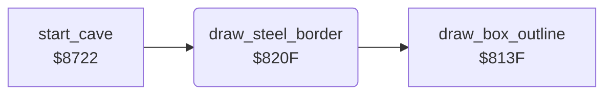

<!-- Generated by c64-docs from knowledge revision 20261025T214621.431-dj0nk4 and .c64-re-tools/local/generated/src/source-map.json. Do not edit: change the knowledge, generate the source again, then run docs.ts generate. -->
# cave/steel_border.asm: Steel border of the cave

Range `$820F-$8226`. Source: [cave/steel_border.asm](../../../../src/cave/steel_border.asm). Index: [the reference](../../index.md).

## Routines

| Routine | Address | Reached from | Summary |
|---|---|---|---|
| [`draw_steel_border`](steel_border.md#draw_steel_border) | `$820F` | [`start_cave`](cave_start.md#start_cave) | Draws the steel wall edge of the cave: 40 by 22 cells from map row 2. |

## Call graph

A solid arrow is a call, a thick arrow a table entry. Rounded nodes are in this file.

## Details

### [`draw_steel_border`](../../../../src/cave/steel_border.asm#L6) `$820F`

*routine*

Draws the steel wall edge of the cave: 40 by 22 cells from map row 2.
OUTWAL in the developer symbol table (symbol_table_leftover).

- **Called from:** [`start_cave`](cave_start.md#start_cave)
- **Calls:** [`draw_box_outline`](draw_objects.md#draw_box_outline)
- **Writes:** [`object_element`](../../memory-map.md#object_element), [`object_x`](../../memory-map.md#object_x), [`object_y`](../../memory-map.md#object_y), [`object_width`](../../memory-map.md#object_width), [`object_height`](../../memory-map.md#object_height)
