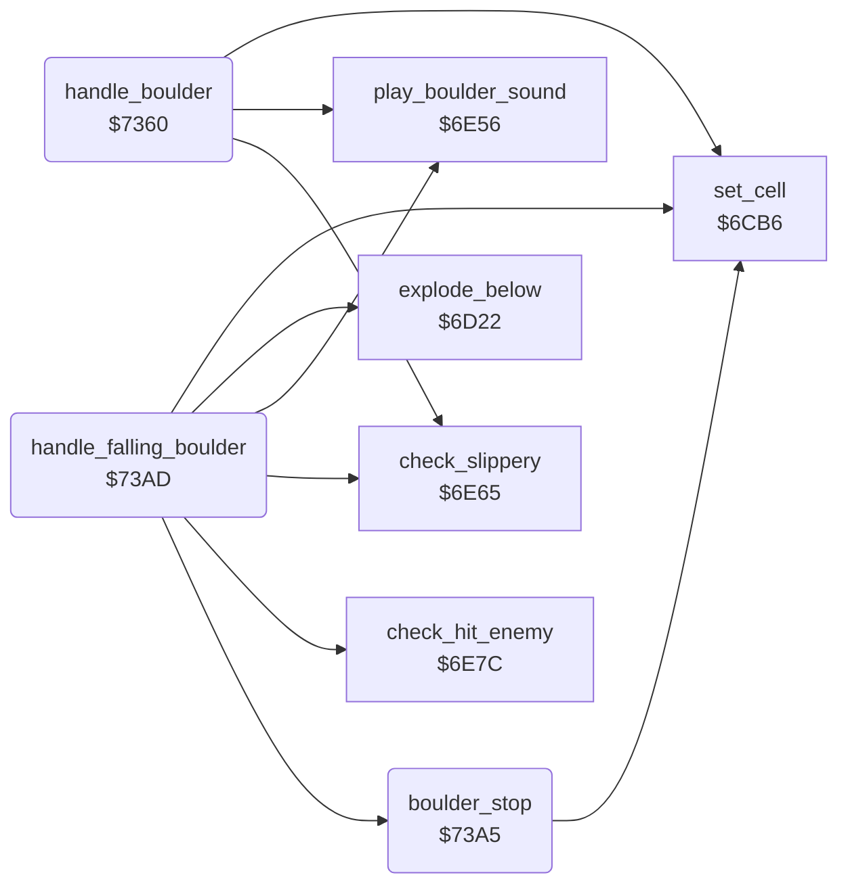

<!-- Generated by c64-docs from knowledge revision 20261025T214621.431-dj0nk4 and .c64-re-tools/local/generated/src/source-map.json. Do not edit: change the knowledge, generate the source again, then run docs.ts generate. -->
# engine/boulder.asm: Boulders

Range `$7360-$7438`. Source: [engine/boulder.asm](../../../../src/engine/boulder.asm). Index: [the reference](../../index.md).

## Routines

| Routine | Address | Reached from | Summary |
|---|---|---|---|
| [`handle_boulder`](boulder.md#handle_boulder) | `$7360` |  | Handler of the boulder $10. |
| [`boulder_stop`](boulder.md#boulder_stop) | `$73A5` | [`handle_falling_boulder`](boulder.md#handle_falling_boulder) | Changes the current cell to a scanned boulder $11. |
| [`handle_falling_boulder`](boulder.md#handle_falling_boulder) | `$73AD` |  | Handler of the falling boulder $12. |

## Call graph

A solid arrow is a call, a thick arrow a table entry. Rounded nodes are in this file.

## Details

### [`handle_boulder`](../../../../src/engine/boulder.asm#L6) `$7360`

*routine*

Handler of the boulder $10. It starts to fall into space below, or rolls off a slippery cell below.

- **Calls:** [`set_cell`](cell_draw.md#set_cell), [`play_boulder_sound`](../sound/element_sounds.md#play_boulder_sound), [`check_slippery`](falling_checks.md#check_slippery)
- **Jumps to:** [`clear_cell_and_next`](cell_draw.md#clear_cell_and_next), [`scan_cell_settle`](cave_scan.md#scan_cell_settle)
- **Reads:** [`cell_ptr`](../../memory-map.md#cell_ptr)

| Label | Address | Comment |
|---|---|---|
| [`boulder_check_roll`](../../../../src/engine/boulder.asm#L14) | `$7371` |  |
| [`boulder_roll_right`](../../../../src/engine/boulder.asm#L28) | `$738E` |  |
| [`boulder_next`](../../../../src/engine/boulder.asm#L38) | `$73A2` |  |

### [`boulder_stop`](../../../../src/engine/boulder.asm#L41) `$73A5`

*routine*

Changes the current cell to a scanned boulder $11.

- **Called from:** [`handle_falling_boulder`](boulder.md#handle_falling_boulder)
- **Calls:** [`set_cell`](cell_draw.md#set_cell)

### [`handle_falling_boulder`](../../../../src/engine/boulder.asm#L47) `$73AD`

*routine*

Handler of the falling boulder $12. It falls, passes through the magic wall, rolls off slippery cells, kills Rockford or an enemy, or stops.

- **Calls:** [`set_cell`](cell_draw.md#set_cell), [`play_boulder_sound`](../sound/element_sounds.md#play_boulder_sound), [`check_slippery`](falling_checks.md#check_slippery), [`boulder_stop`](boulder.md#boulder_stop), [`explode_below`](explosion.md#explode_below), [`check_hit_enemy`](falling_checks.md#check_hit_enemy)
- **Jumps to:** [`clear_cell_and_next`](cell_draw.md#clear_cell_and_next), [`play_diamond_sound`](../sound/element_sounds.md#play_diamond_sound), [`scan_cell_settle`](cave_scan.md#scan_cell_settle)
- **Reads:** [`cell_ptr`](../../memory-map.md#cell_ptr), [`magic_wall_state`](../../memory-map.md#magic_wall_state)
- **Writes:** [`magic_wall_state`](../../memory-map.md#magic_wall_state), [`explosion_code`](../../memory-map.md#explosion_code)

| Label | Address | Comment |
|---|---|---|
| [`falling_boulder_blocked`](../../../../src/engine/boulder.asm#L54) | `$73BB` |  |
| [`falling_boulder_magic`](../../../../src/engine/boulder.asm#L61) | `$73C7` |  |
| [`falling_boulder_magic_done`](../../../../src/engine/boulder.asm#L69) | `$73D6` |  |
| [`falling_boulder_land`](../../../../src/engine/boulder.asm#L74) | `$73E0` |  |
| [`fall_try_roll_right`](../../../../src/engine/boulder.asm#L90) | `$7400` | The object cannot roll left. It rolls right when the cells right and down-right are empty. |
| [`fall_land`](../../../../src/engine/boulder.asm#L101) | `$7414` | The object cannot roll. It comes to rest and the scan goes to the next cell. |
| [`fall_hit_check`](../../../../src/engine/boulder.asm#L105) | `$741A` | The cell below is not round. Rockford below explodes with the explosion to space. |
| [`fall_hit_creature`](../../../../src/engine/boulder.asm#L112) | `$7428` | Z = 1 when the cell below is a firefly or a butterfly. |
| [`fall_stop`](../../../../src/engine/boulder.asm#L117) | `$7433` |  |
