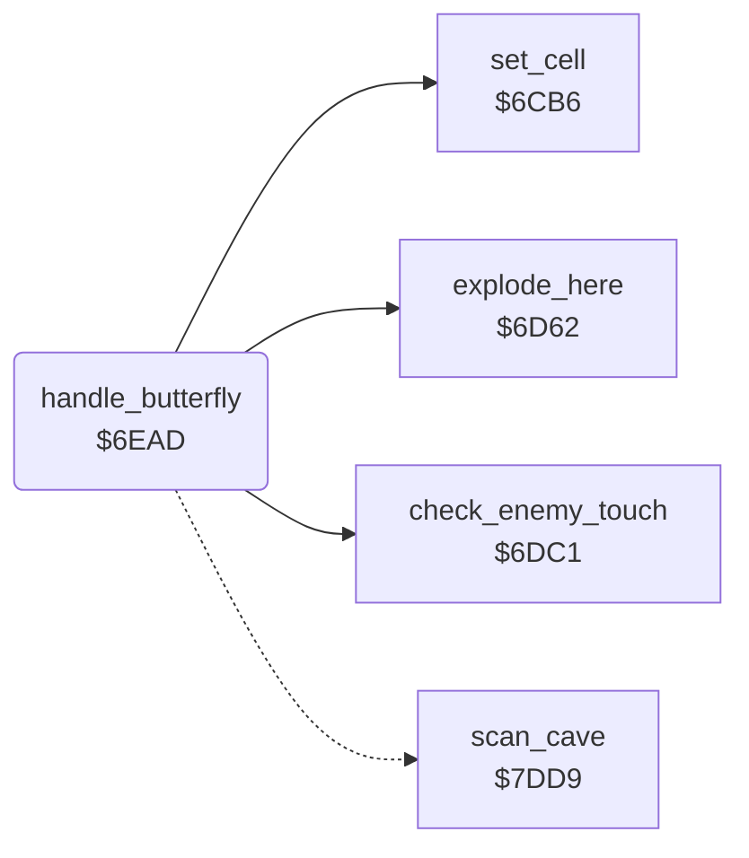

<!-- Generated by c64-docs from knowledge revision 20261024T103116.541-jn0vrj and .c64-re-tools/local/generated/src/source-map.json. Do not edit: change the knowledge, generate the source again, then run docs.ts generate. -->
# engine/butterfly.asm: Butterflies

Range `$6EAD-$6EFA`. Source: [engine/butterfly.asm](../../../../src/engine/butterfly.asm). Index: [the reference](../../index.md).

## Call graph

A solid arrow is a call, a thick arrow a table entry, a dotted arrow a jump. Rounded nodes are in this file.

## Names

### [`handle_butterfly`](../../../../src/engine/butterfly.asm#L6) `$6EAD`

*routine*

Handler of the butterflies $30-$33. Explodes to diamonds next to Rockford or amoeba. Else it turns right, moves ahead or turns left.

- **Calls:** [`check_enemy_touch`](firefly.md#check_enemy_touch), [`explode_here`](explosion.md#explode_here), [`set_cell`](cell_draw.md#set_cell)
- **Jumps to:** [`scan_cell_settle`](cave_scan.md#scan_cell_settle), [`clear_cell_and_next`](cell_draw.md#clear_cell_and_next)
- **Reads:** [`cell_ptr`](../../memory-map.md#cell_ptr), [`dir_offsets`](firefly.md#dir_offsets), [`dir_offsets_turned`](firefly.md#dir_offsets_turned)
- **Writes:** [`explosion_code`](../../memory-map.md#explosion_code)

### [`butterfly_move`](../../../../src/engine/butterfly.asm#L14) `$6EBC`

*label*

- **Jumped to from:** [`handle_butterfly`](butterfly.md#handle_butterfly) [`$6EB0`](../../../../src/engine/butterfly.asm#L8)

### [`butterfly_try_ahead`](../../../../src/engine/butterfly.asm#L29) `$6ED8`

*label*

- **Jumped to from:** [`handle_butterfly`](butterfly.md#handle_butterfly) [`$6EC8`](../../../../src/engine/butterfly.asm#L21)

### [`butterfly_turn_left`](../../../../src/engine/butterfly.asm#L39) `$6EEC`

*label*

- **Jumped to from:** [`handle_butterfly`](butterfly.md#handle_butterfly) [`$6EDD`](../../../../src/engine/butterfly.asm#L32)
