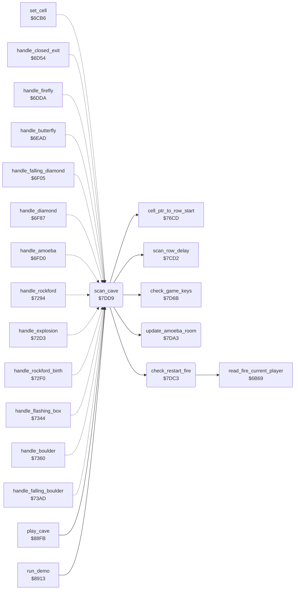

<!-- Generated by c64-docs from knowledge revision 20261024T103116.541-jn0vrj and .c64-re-tools/local/generated/src/source-map.json. Do not edit: change the knowledge, generate the source again, then run docs.ts generate. -->
# engine/cave_scan.asm: The scan of the cave map

Range `$7DA3-$7E3D`. Source: [engine/cave_scan.asm](../../../../src/engine/cave_scan.asm). Index: [the reference](../../index.md).

## Call graph

A solid arrow is a call, a thick arrow a table entry, a dotted arrow a jump. Rounded nodes are in this file.

## Names

### [`update_amoeba_room`](../../../../src/engine/cave_scan.asm#L6) `$7DA3`

*routine*

Stops the amoeba growth when no amoeba cell had room now but one had room in the scan before. Keeps the amoeba count.

- **Called from:** [`scan_cave`](cave_scan.md#scan_cave) [`$7DF9`](../../../../src/engine/cave_scan.asm#L57)
- **Reads:** [`amoeba_room_found`](../../memory-map.md#amoeba_room_found), [`amoeba_room_last`](../../memory-map.md#amoeba_room_last), [`amoeba_count`](../../memory-map.md#amoeba_count)
- **Writes:** [`amoeba_growing`](../../memory-map.md#amoeba_growing), [`amoeba_room_last`](../../memory-map.md#amoeba_room_last), [`amoeba_room_found`](../../memory-map.md#amoeba_room_found), [`amoeba_count_last`](../../memory-map.md#amoeba_count_last), [`amoeba_count`](../../memory-map.md#amoeba_count)

### [`update_amoeba_counts`](../../../../src/engine/cave_scan.asm#L14) `$7DAF`

*label*

- **Jumped to from:** [`update_amoeba_room`](cave_scan.md#update_amoeba_room) [`$7DA5`](../../../../src/engine/cave_scan.asm#L8), [`update_amoeba_room`](cave_scan.md#update_amoeba_room) [`$7DA9`](../../../../src/engine/cave_scan.asm#L10)

### [`check_restart_fire`](../../../../src/engine/cave_scan.asm#L25) `$7DC3`

*routine*

Reads fire. When no Rockford is in the cave for 16 scans, the clock ran a second and fire is pressed, it ends the play.

- **Called from:** [`scan_cave`](cave_scan.md#scan_cave) [`$7DF6`](../../../../src/engine/cave_scan.asm#L56)
- **Calls:** [`read_fire_current_player`](../input/joystick.md#read_fire_current_player)
- **Reads:** [`rockford_absent`](../../memory-map.md#rockford_absent), [`fire_button`](../../memory-map.md#fire_button), [`seconds_elapsed`](../../memory-map.md#seconds_elapsed)
- **Writes:** [`cave_end_state`](../../memory-map.md#cave_end_state)

### [`check_restart_done`](../../../../src/engine/cave_scan.asm#L36) `$7DD8`

*label*

- **Jumped to from:** [`check_restart_fire`](cave_scan.md#check_restart_fire) [`$7DCA`](../../../../src/engine/cave_scan.asm#L29), [`check_restart_fire`](cave_scan.md#check_restart_fire) [`$7DCE`](../../../../src/engine/cave_scan.asm#L31), [`check_restart_fire`](cave_scan.md#check_restart_fire) [`$7DD2`](../../../../src/engine/cave_scan.asm#L33)

### [`scan_cave`](../../../../src/engine/cave_scan.asm#L39) `$7DD9`

*routine*

Scans the cave once. Each cell runs the handler of its element or gets the settled code. Then it reads the game keys.
22 rows, or 15 rows for an intermission.

- **Called from:** [`play_cave`](play_loop.md#play_cave) [`$88FB`](../../../../src/engine/play_loop.asm#L7), [`run_demo`](../title/demo.md#run_demo) [`$8947`](../../../../src/title/demo.asm#L38)
- **Calls:** [`cell_ptr_to_row_start`](../cave/cell_ptr.md#cell_ptr_to_row_start), [`check_restart_fire`](cave_scan.md#check_restart_fire), [`update_amoeba_room`](cave_scan.md#update_amoeba_room), [`scan_row_delay`](row_delay.md#scan_row_delay), [`check_game_keys`](../input/game_keys.md#check_game_keys)
- **Reads:** [`cave_number`](../../memory-map.md#cave_number), [`rockford_absent`](../../memory-map.md#rockford_absent), [`cell_ptr`](../../memory-map.md#cell_ptr), [`element_handler_hi`](element_tables.md#element_handler_hi), [`element_handler_lo`](element_tables.md#element_handler_lo), [`handler_vector`](../../memory-map.md#handler_vector), [`cell_scan_reset`](element_tables.md#cell_scan_reset), [`cell_ptr_hi`](../../memory-map.md#cell_ptr_hi), [`scan_col`](../../memory-map.md#scan_col), [`scan_row`](../../memory-map.md#scan_row), [`view_row_ptrs`](../../memory-map.md#view_row_ptrs)
- **Writes:** [`view_row_ptrs`](../../memory-map.md#view_row_ptrs), [`scan_row`](../../memory-map.md#scan_row), [`rockford_absent`](../../memory-map.md#rockford_absent), [`scan_col`](../../memory-map.md#scan_col), [`handler_vector_hi`](../../memory-map.md#handler_vector_hi), [`handler_vector`](../../memory-map.md#handler_vector), [`cell_ptr`](../../memory-map.md#cell_ptr), [`cell_ptr_hi`](../../memory-map.md#cell_ptr_hi)

### [`scan_cave_start`](../../../../src/engine/cave_scan.asm#L47) `$7DE7`

*label*

- **Jumped to from:** [`scan_cave`](cave_scan.md#scan_cave) [`$7DE1`](../../../../src/engine/cave_scan.asm#L44)

### [`scan_cave_checks`](../../../../src/engine/cave_scan.asm#L55) `$7DF6`

*label*

- **Jumped to from:** [`scan_cave`](cave_scan.md#scan_cave) [`$7DF2`](../../../../src/engine/cave_scan.asm#L53)

### [`scan_cave_row`](../../../../src/engine/cave_scan.asm#L58) `$7DFC`

*label*

- **Jumped to from:** [`scan_cave`](cave_scan.md#scan_cave) [`$7E38`](../../../../src/engine/cave_scan.asm#L92)

### [`scan_cell`](../../../../src/engine/cave_scan.asm#L61) `$7E00`

*label*

- **Jumped to from:** [`scan_cave`](cave_scan.md#scan_cave) [`$7E2D`](../../../../src/engine/cave_scan.asm#L87)

### [`scan_cell_settle`](../../../../src/engine/cave_scan.asm#L72) `$7E15`

*label*

Sets the settled code of the element, when the table gives one.

- **Jumped to from:** [`set_cell`](cell_draw.md#set_cell) [`$6CEA`](../../../../src/engine/cell_draw.asm#L70), [`handle_closed_exit`](explosion.md#handle_closed_exit) [`$6D5F`](../../../../src/engine/explosion.asm#L44), [`handle_firefly`](firefly.md#handle_firefly) [`$6DE6`](../../../../src/engine/firefly.asm#L41), [`handle_firefly`](firefly.md#handle_firefly) [`$6E25`](../../../../src/engine/firefly.asm#L75), [`handle_butterfly`](butterfly.md#handle_butterfly) [`$6EB9`](../../../../src/engine/butterfly.asm#L13), [`handle_butterfly`](butterfly.md#handle_butterfly) [`$6EF8`](../../../../src/engine/butterfly.asm#L47), [`$6F02`](../../../../src/engine/diamond.asm#L10), [`handle_falling_diamond`](diamond.md#handle_falling_diamond) [`$6F76`](../../../../src/engine/diamond.asm#L72), [`handle_falling_diamond`](diamond.md#handle_falling_diamond) [`$6F81`](../../../../src/engine/diamond.asm#L78), [`handle_diamond`](diamond.md#handle_diamond) [`$6FC9`](../../../../src/engine/diamond.asm#L117), [`handle_amoeba`](amoeba.md#handle_amoeba) [`$6FDF`](../../../../src/engine/amoeba.asm#L17), [`handle_amoeba`](amoeba.md#handle_amoeba) [`$6FEB`](../../../../src/engine/amoeba.asm#L24), [`handle_amoeba`](amoeba.md#handle_amoeba) [`$7036`](../../../../src/engine/amoeba.asm#L68), [`handle_rockford`](../rockford/movement.md#handle_rockford) [`$72B4`](../../../../src/rockford/movement.asm#L185), [`handle_explosion`](stages.md#handle_explosion) [`$72ED`](../../../../src/engine/stages.asm#L44), [`handle_rockford_birth`](stages.md#handle_rockford_birth) [`$730E`](../../../../src/engine/stages.asm#L65), [`handle_flashing_box`](stages.md#handle_flashing_box) [`$735D`](../../../../src/engine/stages.asm#L113), [`handle_boulder`](boulder.md#handle_boulder) [`$73A2`](../../../../src/engine/boulder.asm#L39), [`handle_falling_boulder`](boulder.md#handle_falling_boulder) [`$7417`](../../../../src/engine/boulder.asm#L103), [`handle_falling_boulder`](boulder.md#handle_falling_boulder) [`$7425`](../../../../src/engine/boulder.asm#L111), [`handle_falling_boulder`](boulder.md#handle_falling_boulder) [`$7430`](../../../../src/engine/boulder.asm#L116), [`handle_falling_boulder`](boulder.md#handle_falling_boulder) [`$7436`](../../../../src/engine/boulder.asm#L119), [`scan_cave`](cave_scan.md#scan_cave) [`$7E09`](../../../../src/engine/cave_scan.asm#L67)

### [`scan_next_cell`](../../../../src/engine/cave_scan.asm#L79) `$7E21`

*label*

- **Jumped to from:** [`scan_cave`](cave_scan.md#scan_cave) [`$7E1D`](../../../../src/engine/cave_scan.asm#L77)

### [`scan_next_column`](../../../../src/engine/cave_scan.asm#L83) `$7E27`

*label*

- **Jumped to from:** [`scan_cave`](cave_scan.md#scan_cave) [`$7E23`](../../../../src/engine/cave_scan.asm#L81)
