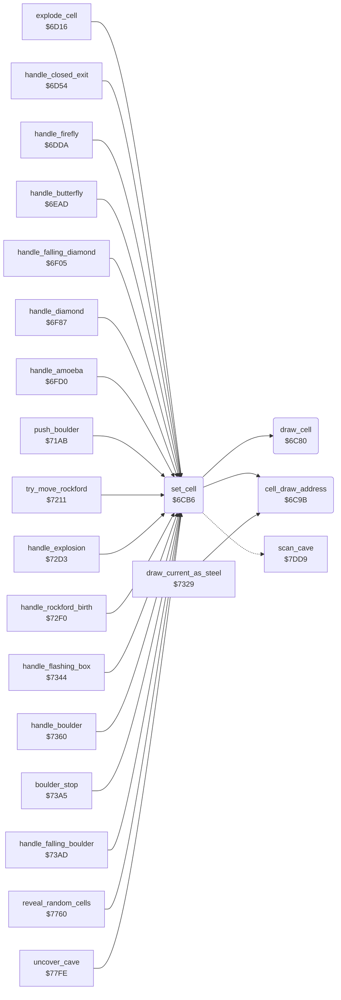

<!-- Generated by c64-docs from knowledge revision 20261024T103116.541-jn0vrj and .c64-re-tools/local/generated/src/source-map.json. Do not edit: change the knowledge, generate the source again, then run docs.ts generate. -->
# engine/cell_draw.asm: Writing and drawing cells

Range `$6C80-$6CEC`. Source: [engine/cell_draw.asm](../../../../src/engine/cell_draw.asm). Index: [the reference](../../index.md).

## Call graph

A solid arrow is a call, a thick arrow a table entry, a dotted arrow a jump. Rounded nodes are in this file.

## Names

### [`draw_cell`](../../../../src/engine/cell_draw.asm#L6) `$6C80`

*routine*

Draws cell code drawn_cell_code as 2 x 2 characters at draw_ptr in the 80-column map screen at $4000. Uses the character table $5f28.

- **Called from:** [`set_cell`](cell_draw.md#set_cell) [`$6CD1`](../../../../src/engine/cell_draw.asm#L56), [`set_cell`](cell_draw.md#set_cell) [`$6CE7`](../../../../src/engine/cell_draw.asm#L69)
- **Reads:** [`drawn_cell_code`](../../memory-map.md#drawn_cell_code), [`cell_glyph_chars`](element_tables.md#cell_glyph_chars), [`draw_ptr`](../../memory-map.md#draw_ptr)

### [`cell_draw_address`](../../../../src/engine/cell_draw.asm#L23) `$6C9B`

*routine*

Sets draw_ptr to cell_screen_ptr plus the screen delta of neighbour cell Y. The table at $53b0 holds triplets: cell offset, delta low, delta high.

- **Called from:** [`set_cell`](cell_draw.md#set_cell) [`$6CCE`](../../../../src/engine/cell_draw.asm#L55), [`draw_current_as_steel`](stages.md#draw_current_as_steel) [`$733D`](../../../../src/engine/stages.asm#L95)
- **Reads:** [`cell_offset_keys`](../screen/cell_screen_tables.md#cell_offset_keys), [`cell_buffer_ptr`](../../memory-map.md#cell_buffer_ptr), [`cell_offset_lo`](../screen/cell_screen_tables.md#cell_offset_lo), [`cell_buffer_ptr_hi`](../../memory-map.md#cell_buffer_ptr_hi), [`cell_offset_hi`](../screen/cell_screen_tables.md#cell_offset_hi)
- **Writes:** [`draw_ptr`](../../memory-map.md#draw_ptr), [`draw_ptr_hi`](../../memory-map.md#draw_ptr_hi)

### [`cell_draw_address_find`](../../../../src/engine/cell_draw.asm#L26) `$6C9E`

*label*

- **Jumped to from:** [`cell_draw_address`](cell_draw.md#cell_draw_address) [`$6CA4`](../../../../src/engine/cell_draw.asm#L31)

### [`set_cell`](../../../../src/engine/cell_draw.asm#L41) `$6CB6`

*routine*

Writes cell code A at scan_ptr+Y and draws it. Sets cell_screen_ptr for the current scan row and column. Returns the code in A.

- **Called from:** [`explode_cell`](explosion.md#explode_cell) [`$6D1E`](../../../../src/engine/explosion.asm#L11), [`handle_closed_exit`](explosion.md#handle_closed_exit) [`$6D5C`](../../../../src/engine/explosion.asm#L42), [`handle_firefly`](firefly.md#handle_firefly) [`$6DFF`](../../../../src/engine/firefly.asm#L55), [`handle_firefly`](firefly.md#handle_firefly) [`$6E13`](../../../../src/engine/firefly.asm#L65), [`handle_butterfly`](butterfly.md#handle_butterfly) [`$6ED2`](../../../../src/engine/butterfly.asm#L27), [`handle_butterfly`](butterfly.md#handle_butterfly) [`$6EE6`](../../../../src/engine/butterfly.asm#L37), [`$6EFF`](../../../../src/engine/diamond.asm#L9), [`handle_falling_diamond`](diamond.md#handle_falling_diamond) [`$6F0D`](../../../../src/engine/diamond.asm#L17), [`handle_falling_diamond`](diamond.md#handle_falling_diamond) [`$6F2B`](../../../../src/engine/diamond.asm#L34), [`handle_falling_diamond`](diamond.md#handle_falling_diamond) [`$6F4E`](../../../../src/engine/diamond.asm#L51), [`handle_falling_diamond`](diamond.md#handle_falling_diamond) [`$6F62`](../../../../src/engine/diamond.asm#L61), [`handle_diamond`](diamond.md#handle_diamond) [`$6F8F`](../../../../src/engine/diamond.asm#L87), [`handle_diamond`](diamond.md#handle_diamond) [`$6FAF`](../../../../src/engine/diamond.asm#L103), [`handle_diamond`](diamond.md#handle_diamond) [`$6FC3`](../../../../src/engine/diamond.asm#L114), [`handle_amoeba`](amoeba.md#handle_amoeba) [`$6FDC`](../../../../src/engine/amoeba.asm#L16), [`handle_amoeba`](amoeba.md#handle_amoeba) [`$6FE8`](../../../../src/engine/amoeba.asm#L23), [`handle_amoeba`](amoeba.md#handle_amoeba) [`$7033`](../../../../src/engine/amoeba.asm#L66), [`push_boulder`](../rockford/movement.md#push_boulder) [`$71B9`](../../../../src/rockford/movement.asm#L27), [`try_move_rockford`](../rockford/movement.md#try_move_rockford) [`$721F`](../../../../src/rockford/movement.asm#L91), [`try_move_rockford`](../rockford/movement.md#try_move_rockford) [`$7229`](../../../../src/rockford/movement.asm#L97), [`try_move_rockford`](../rockford/movement.md#try_move_rockford) [`$7230`](../../../../src/rockford/movement.asm#L100), [`handle_explosion`](stages.md#handle_explosion) [`$72EA`](../../../../src/engine/stages.asm#L43), [`handle_rockford_birth`](stages.md#handle_rockford_birth) [`$730B`](../../../../src/engine/stages.asm#L63), [`handle_flashing_box`](stages.md#handle_flashing_box) [`$7350`](../../../../src/engine/stages.asm#L106), [`handle_boulder`](boulder.md#handle_boulder) [`$7368`](../../../../src/engine/boulder.asm#L11), [`handle_boulder`](boulder.md#handle_boulder) [`$7388`](../../../../src/engine/boulder.asm#L26), [`handle_boulder`](boulder.md#handle_boulder) [`$739C`](../../../../src/engine/boulder.asm#L36), [`boulder_stop`](boulder.md#boulder_stop) [`$73A9`](../../../../src/engine/boulder.asm#L44), [`handle_falling_boulder`](boulder.md#handle_falling_boulder) [`$73B5`](../../../../src/engine/boulder.asm#L52), [`handle_falling_boulder`](boulder.md#handle_falling_boulder) [`$73D3`](../../../../src/engine/boulder.asm#L68), [`handle_falling_boulder`](boulder.md#handle_falling_boulder) [`$73DA`](../../../../src/engine/boulder.asm#L72), [`handle_falling_boulder`](boulder.md#handle_falling_boulder) [`$73FA`](../../../../src/engine/boulder.asm#L87), [`handle_falling_boulder`](boulder.md#handle_falling_boulder) [`$740E`](../../../../src/engine/boulder.asm#L98), [`reveal_random_cells`](../screen/cover.md#reveal_random_cells) [`$778C`](../../../../src/screen/cover.asm#L118), [`uncover_cave`](../screen/cover.md#uncover_cave) [`$7810`](../../../../src/screen/cover.asm#L188)
- **Calls:** [`cell_draw_address`](cell_draw.md#cell_draw_address), [`draw_cell`](cell_draw.md#draw_cell)
- **Jumps to:** [`scan_cell_settle`](cave_scan.md#scan_cell_settle)
- **Reads:** [`cell_ptr`](../../memory-map.md#cell_ptr), [`scan_row`](../../memory-map.md#scan_row), [`scan_col`](../../memory-map.md#scan_col), [`cave_row_addr_lo`](../screen/cell_screen_tables.md#cave_row_addr_lo), [`cave_row_addr_hi`](../screen/cell_screen_tables.md#cave_row_addr_hi), [`drawn_cell_code`](../../memory-map.md#drawn_cell_code), [`cell_buffer_ptr`](../../memory-map.md#cell_buffer_ptr), [`cell_buffer_ptr_hi`](../../memory-map.md#cell_buffer_ptr_hi)
- **Writes:** [`drawn_cell_code`](../../memory-map.md#drawn_cell_code), [`cell_buffer_ptr`](../../memory-map.md#cell_buffer_ptr), [`cell_buffer_ptr_hi`](../../memory-map.md#cell_buffer_ptr_hi), [`draw_ptr`](../../memory-map.md#draw_ptr), [`draw_ptr_hi`](../../memory-map.md#draw_ptr_hi)

### [`clear_cell_and_next`](../../../../src/engine/cell_draw.asm#L60) `$6CD7`

*label*

Writes space at the current cell, draws it and continues the cave scan. The handlers jump here after an object leaves its cell.

- **Jumped to from:** [`handle_firefly`](firefly.md#handle_firefly) [`$6E02`](../../../../src/engine/firefly.asm#L56), [`handle_firefly`](firefly.md#handle_firefly) [`$6E16`](../../../../src/engine/firefly.asm#L66), [`handle_butterfly`](butterfly.md#handle_butterfly) [`$6ED5`](../../../../src/engine/butterfly.asm#L28), [`handle_butterfly`](butterfly.md#handle_butterfly) [`$6EE9`](../../../../src/engine/butterfly.asm#L38), [`handle_falling_diamond`](diamond.md#handle_falling_diamond) [`$6F10`](../../../../src/engine/diamond.asm#L18), [`handle_falling_diamond`](diamond.md#handle_falling_diamond) [`$6F31`](../../../../src/engine/diamond.asm#L37), [`handle_falling_diamond`](diamond.md#handle_falling_diamond) [`$6F51`](../../../../src/engine/diamond.asm#L52), [`handle_falling_diamond`](diamond.md#handle_falling_diamond) [`$6F65`](../../../../src/engine/diamond.asm#L62), [`handle_diamond`](diamond.md#handle_diamond) [`$6F95`](../../../../src/engine/diamond.asm#L89), [`handle_diamond`](diamond.md#handle_diamond) [`$6FB2`](../../../../src/engine/diamond.asm#L104), [`handle_diamond`](diamond.md#handle_diamond) [`$6FC6`](../../../../src/engine/diamond.asm#L115), [`handle_boulder`](boulder.md#handle_boulder) [`$736E`](../../../../src/engine/boulder.asm#L13), [`handle_boulder`](boulder.md#handle_boulder) [`$738B`](../../../../src/engine/boulder.asm#L27), [`handle_boulder`](boulder.md#handle_boulder) [`$739F`](../../../../src/engine/boulder.asm#L37), [`handle_falling_boulder`](boulder.md#handle_falling_boulder) [`$73B8`](../../../../src/engine/boulder.asm#L53), [`handle_falling_boulder`](boulder.md#handle_falling_boulder) [`$73FD`](../../../../src/engine/boulder.asm#L88), [`handle_falling_boulder`](boulder.md#handle_falling_boulder) [`$7411`](../../../../src/engine/boulder.asm#L99)
