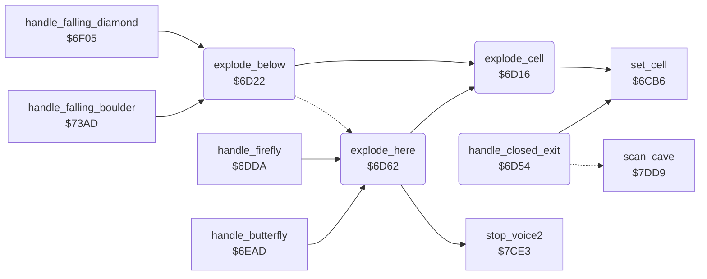

<!-- Generated by c64-docs from knowledge revision 20261024T103116.541-jn0vrj and .c64-re-tools/local/generated/src/source-map.json. Do not edit: change the knowledge, generate the source again, then run docs.ts generate. -->
# engine/explosion.asm: Explosions

Range `$6D16-$6DAB`. Source: [engine/explosion.asm](../../../../src/engine/explosion.asm). Index: [the reference](../../index.md).

## Call graph

A solid arrow is a call, a thick arrow a table entry, a dotted arrow a jump. Rounded nodes are in this file.

## Data

| Range | Type | Name | Read by | Written by |
|---|---|---|---|---|
| [`$6DA5`](../../../../src/engine/explosion.asm#L80)-`$6DAB` | bytes | [`explosion_sound_regs`](../../../../src/engine/explosion.asm#L79) | [`explode_here`](explosion.md#explode_here) |  |

## Names

### [`explode_cell`](../../../../src/engine/explosion.asm#L6) `$6D16`

*routine*

Writes explosion_code at scan_ptr+Y unless the cell is steel wall.

- **Called from:** [`explode_below`](explosion.md#explode_below) [`$6D24`](../../../../src/engine/explosion.asm#L17), [`explode_below`](explosion.md#explode_below) [`$6D29`](../../../../src/engine/explosion.asm#L19), [`explode_below`](explosion.md#explode_below) [`$6D30`](../../../../src/engine/explosion.asm#L22), [`explode_below`](explosion.md#explode_below) [`$6D35`](../../../../src/engine/explosion.asm#L24), [`explode_below`](explosion.md#explode_below) [`$6D3A`](../../../../src/engine/explosion.asm#L26), [`explode_below`](explosion.md#explode_below) [`$6D3F`](../../../../src/engine/explosion.asm#L28), [`explode_below`](explosion.md#explode_below) [`$6D44`](../../../../src/engine/explosion.asm#L30), [`explode_below`](explosion.md#explode_below) [`$6D49`](../../../../src/engine/explosion.asm#L32), [`explode_below`](explosion.md#explode_below) [`$6D4E`](../../../../src/engine/explosion.asm#L34), [`explode_here`](explosion.md#explode_here) [`$6D64`](../../../../src/engine/explosion.asm#L48), [`explode_here`](explosion.md#explode_here) [`$6D69`](../../../../src/engine/explosion.asm#L50), [`explode_here`](explosion.md#explode_here) [`$6D6E`](../../../../src/engine/explosion.asm#L52), [`explode_here`](explosion.md#explode_here) [`$6D73`](../../../../src/engine/explosion.asm#L54), [`explode_here`](explosion.md#explode_here) [`$6D78`](../../../../src/engine/explosion.asm#L56), [`explode_here`](explosion.md#explode_here) [`$6D7F`](../../../../src/engine/explosion.asm#L59), [`explode_here`](explosion.md#explode_here) [`$6D84`](../../../../src/engine/explosion.asm#L61), [`explode_here`](explosion.md#explode_here) [`$6D89`](../../../../src/engine/explosion.asm#L63), [`explode_here`](explosion.md#explode_here) [`$6D8E`](../../../../src/engine/explosion.asm#L65)
- **Calls:** [`set_cell`](cell_draw.md#set_cell)
- **Reads:** [`cell_ptr`](../../memory-map.md#cell_ptr), [`explosion_code`](../../memory-map.md#explosion_code)

### [`explode_cell_done`](../../../../src/engine/explosion.asm#L12) `$6D21`

*label*

- **Jumped to from:** [`explode_cell`](explosion.md#explode_cell) [`$6D1A`](../../../../src/engine/explosion.asm#L9)

### [`explode_below`](../../../../src/engine/explosion.asm#L15) `$6D22`

*routine*

Explodes the 3 x 3 cells around the cell below the current cell, then starts the explosion sound.

- **Called from:** [`handle_falling_diamond`](diamond.md#handle_falling_diamond) [`$6F73`](../../../../src/engine/diamond.asm#L71), [`handle_falling_diamond`](diamond.md#handle_falling_diamond) [`$6F7E`](../../../../src/engine/diamond.asm#L77), [`handle_falling_boulder`](boulder.md#handle_falling_boulder) [`$7422`](../../../../src/engine/boulder.asm#L110), [`handle_falling_boulder`](boulder.md#handle_falling_boulder) [`$742D`](../../../../src/engine/boulder.asm#L115)
- **Calls:** [`explode_cell`](explosion.md#explode_cell)
- **Jumps to:** [`play_explosion_sound`](explosion.md#play_explosion_sound)
- **Reads:** [`explosion_code`](../../memory-map.md#explosion_code)
- **Writes:** [`explosion_code`](../../memory-map.md#explosion_code)

### [`handle_closed_exit`](../../../../src/engine/explosion.asm#L37) `$6D54`

*routine*

Handler of cell $04 (closed exit, drawn as steel wall): changes it to the open exit $05 when exit_open is set.

- **Calls:** [`set_cell`](cell_draw.md#set_cell)
- **Jumps to:** [`scan_cell_settle`](cave_scan.md#scan_cell_settle)
- **Reads:** [`enough_diamonds`](../../memory-map.md#enough_diamonds)

### [`closed_exit_next`](../../../../src/engine/explosion.asm#L43) `$6D5F`

*label*

- **Jumped to from:** [`handle_closed_exit`](explosion.md#handle_closed_exit) [`$6D56`](../../../../src/engine/explosion.asm#L39)

### [`explode_here`](../../../../src/engine/explosion.asm#L46) `$6D62`

*routine*

Explodes the 3 x 3 cells around the current cell with explosion_code, then starts the explosion sound.

- **Called from:** [`handle_firefly`](firefly.md#handle_firefly) [`$6DE3`](../../../../src/engine/firefly.asm#L40), [`handle_butterfly`](butterfly.md#handle_butterfly) [`$6EB6`](../../../../src/engine/butterfly.asm#L12)
- **Calls:** [`explode_cell`](explosion.md#explode_cell), [`stop_voice2`](../sound/voices_off.md#stop_voice2)
- **Reads:** [`explosion_code`](../../memory-map.md#explosion_code)
- **Writes:** [`explosion_code`](../../memory-map.md#explosion_code), [`sound2_lock`](../../memory-map.md#sound2_lock), [`FRELO2`](../../memory-map.md#FRELO2)

### [`play_explosion_sound`](../../../../src/engine/explosion.asm#L67) `$6D91`

*label*

Starts the explosion sound on SID voice 2 and blocks other voice 2 sounds for 80 frames.

- **Jumped to from:** [`explode_below`](explosion.md#explode_below) [`$6D51`](../../../../src/engine/explosion.asm#L35)

### [`play_explosion_sound_loop`](../../../../src/engine/explosion.asm#L72) `$6D9B`

*label*

- **Jumped to from:** [`explode_here`](explosion.md#explode_here) [`$6DA2`](../../../../src/engine/explosion.asm#L76)

### [`explosion_sound_regs`](../../../../src/engine/explosion.asm#L79) `$6DA5-$6DAB`

*data*

SID voice 2 registers $d407-$d40d of the explosion sound: frequency, pulse width, control, attack/decay, sustain/release.

- **Read by:** [`explode_here`](explosion.md#explode_here) [`$6D9B`](../../../../src/engine/explosion.asm#L73)
