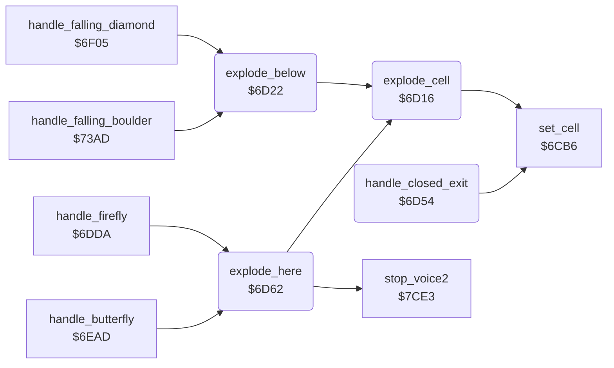

<!-- Generated by c64-docs from knowledge revision 20261025T214621.431-dj0nk4 and .c64-re-tools/local/generated/src/source-map.json. Do not edit: change the knowledge, generate the source again, then run docs.ts generate. -->
# engine/explosion.asm: Explosions

Range `$6D16-$6DAB`. Source: [engine/explosion.asm](../../../../src/engine/explosion.asm). Index: [the reference](../../index.md).

## Routines

| Routine | Address | Reached from | Summary |
|---|---|---|---|
| [`explode_cell`](explosion.md#explode_cell) | `$6D16` | [`explode_below`](explosion.md#explode_below), [`explode_here`](explosion.md#explode_here) | Writes explosion_code at scan_ptr+Y unless the cell is steel wall. |
| [`explode_below`](explosion.md#explode_below) | `$6D22` | [`handle_falling_diamond`](diamond.md#handle_falling_diamond), [`handle_falling_boulder`](boulder.md#handle_falling_boulder) | Explodes the 3 x 3 cells around the cell below the current cell, then starts the explosion sound. |
| [`handle_closed_exit`](explosion.md#handle_closed_exit) | `$6D54` |  | Handler of cell $04 (closed exit, drawn as steel wall): changes it to the open exit $05 when exit_open is set. |
| [`explode_here`](explosion.md#explode_here) | `$6D62` | [`handle_firefly`](firefly.md#handle_firefly), [`handle_butterfly`](butterfly.md#handle_butterfly) | Explodes the 3 x 3 cells around the current cell with explosion_code, then starts the explosion sound. |

## Data

| Range | Type | Name | Read by | Written by |
|---|---|---|---|---|
| [`$6DA5`](../../../../src/engine/explosion.asm#L80)-`$6DAB` | bytes | [`explosion_sound_regs`](../../../../src/engine/explosion.asm#L79) | [`explode_here`](explosion.md#explode_here) |  |

## Call graph

A solid arrow is a call, a thick arrow a table entry. Rounded nodes are in this file.

## Details

### [`explode_cell`](../../../../src/engine/explosion.asm#L6) `$6D16`

*routine*

Writes explosion_code at scan_ptr+Y unless the cell is steel wall.

- **Called from:** [`explode_below`](explosion.md#explode_below), [`explode_here`](explosion.md#explode_here)
- **Calls:** [`set_cell`](cell_draw.md#set_cell)
- **Reads:** [`cell_ptr`](../../memory-map.md#cell_ptr), [`explosion_code`](../../memory-map.md#explosion_code)

| Label | Address | Comment |
|---|---|---|
| [`explode_cell_done`](../../../../src/engine/explosion.asm#L12) | `$6D21` |  |

### [`explode_below`](../../../../src/engine/explosion.asm#L15) `$6D22`

*routine*

Explodes the 3 x 3 cells around the cell below the current cell, then starts the explosion sound.

- **Called from:** [`handle_falling_diamond`](diamond.md#handle_falling_diamond), [`handle_falling_boulder`](boulder.md#handle_falling_boulder)
- **Calls:** [`explode_cell`](explosion.md#explode_cell)
- **Jumps to:** [`play_explosion_sound`](explosion.md#play_explosion_sound)
- **Reads:** [`explosion_code`](../../memory-map.md#explosion_code)
- **Writes:** [`explosion_code`](../../memory-map.md#explosion_code)

### [`handle_closed_exit`](../../../../src/engine/explosion.asm#L37) `$6D54`

*routine*

Handler of cell $04 (closed exit, drawn as steel wall): changes it to the open exit $05 when exit_open is set.

- **Calls:** [`set_cell`](cell_draw.md#set_cell)
- **Jumps to:** [`scan_cell_settle`](cave_scan.md#scan_cell_settle)
- **Reads:** [`enough_diamonds`](../../memory-map.md#enough_diamonds)

| Label | Address | Comment |
|---|---|---|
| [`closed_exit_next`](../../../../src/engine/explosion.asm#L43) | `$6D5F` |  |

### [`explode_here`](../../../../src/engine/explosion.asm#L46) `$6D62`

*routine*

Explodes the 3 x 3 cells around the current cell with explosion_code, then starts the explosion sound.

- **Called from:** [`handle_firefly`](firefly.md#handle_firefly), [`handle_butterfly`](butterfly.md#handle_butterfly)
- **Calls:** [`explode_cell`](explosion.md#explode_cell), [`stop_voice2`](../sound/voices_off.md#stop_voice2)
- **Reads:** [`explosion_code`](../../memory-map.md#explosion_code)
- **Writes:** [`explosion_code`](../../memory-map.md#explosion_code), [`sound2_lock`](../../memory-map.md#sound2_lock), [`FRELO2`](../../memory-map.md#FRELO2)

| Label | Address | Comment |
|---|---|---|
| [`play_explosion_sound`](../../../../src/engine/explosion.asm#L67) | `$6D91` | Starts the explosion sound on SID voice 2 and blocks other voice 2 sounds for 80 frames. |
| [`play_explosion_sound_loop`](../../../../src/engine/explosion.asm#L72) | `$6D9B` |  |

### [`explosion_sound_regs`](../../../../src/engine/explosion.asm#L79) `$6DA5-$6DAB`

*data*

SID voice 2 registers $d407-$d40d of the explosion sound: frequency, pulse width, control, attack/decay, sustain/release.

- **Read by:** [`explode_here`](explosion.md#explode_here)
