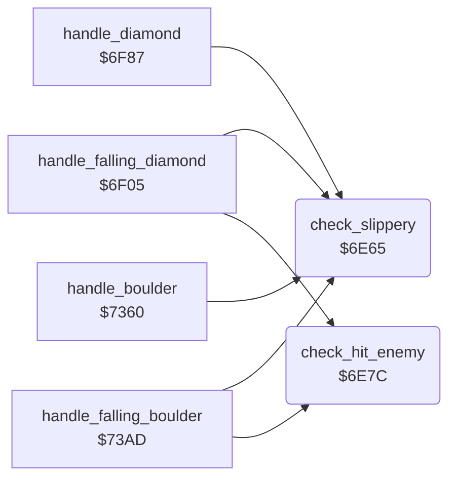

<!-- Generated by c64-docs from knowledge revision 20261024T103116.541-jn0vrj and .c64-re-tools/local/generated/src/source-map.json. Do not edit: change the knowledge, generate the source again, then run docs.ts generate. -->
# engine/falling_checks.asm: What a falling object lands on

Range `$6E65-$6EAC`. Source: [engine/falling_checks.asm](../../../../src/engine/falling_checks.asm). Index: [the reference](../../index.md).

## Call graph

A solid arrow is a call, a thick arrow a table entry, a dotted arrow a jump. Rounded nodes are in this file.

## Names

### [`check_slippery`](../../../../src/engine/falling_checks.asm#L6) `$6E65`

*routine*

Returns Z set when cell code A is a boulder, a diamond or brick wall. Falling objects roll off these cells.

- **Called from:** [`handle_falling_diamond`](diamond.md#handle_falling_diamond) [`$6F3B`](../../../../src/engine/diamond.asm#L42), [`handle_diamond`](diamond.md#handle_diamond) [`$6F9C`](../../../../src/engine/diamond.asm#L93), [`handle_boulder`](boulder.md#handle_boulder) [`$7375`](../../../../src/engine/boulder.asm#L17), [`handle_falling_boulder`](boulder.md#handle_falling_boulder) [`$73E7`](../../../../src/engine/boulder.asm#L78)

### [`check_slippery_diamond`](../../../../src/engine/falling_checks.asm#L11) `$6E6D`

*label*

- **Jumped to from:** [`check_slippery`](falling_checks.md#check_slippery) [`$6E69`](../../../../src/engine/falling_checks.asm#L9)

### [`check_slippery_wall`](../../../../src/engine/falling_checks.asm#L15) `$6E73`

*label*

- **Jumped to from:** [`check_slippery`](falling_checks.md#check_slippery) [`$6E6F`](../../../../src/engine/falling_checks.asm#L13)

### [`check_slippery_done`](../../../../src/engine/falling_checks.asm#L19) `$6E79`

*label*

- **Jumped to from:** [`check_slippery`](falling_checks.md#check_slippery) [`$6E75`](../../../../src/engine/falling_checks.asm#L17)

### [`check_hit_enemy`](../../../../src/engine/falling_checks.asm#L23) `$6E7C`

*routine*

Returns Z set when the cell at scan_ptr+Y is a butterfly ($30-$33) or firefly ($08-$0b). Sets explosion_code to $21 (diamonds) or $1c (space).

- **Called from:** [`handle_falling_diamond`](diamond.md#handle_falling_diamond) [`$6F79`](../../../../src/engine/diamond.asm#L74), [`handle_falling_boulder`](boulder.md#handle_falling_boulder) [`$7428`](../../../../src/engine/boulder.asm#L113)
- **Reads:** [`cell_ptr`](../../memory-map.md#cell_ptr)
- **Writes:** [`explosion_code`](../../memory-map.md#explosion_code)

### [`check_hit_firefly`](../../../../src/engine/falling_checks.asm#L36) `$6E92`

*label*

- **Jumped to from:** [`check_hit_enemy`](falling_checks.md#check_hit_enemy) [`$6E84`](../../../../src/engine/falling_checks.asm#L28), [`check_hit_enemy`](falling_checks.md#check_hit_enemy) [`$6E8A`](../../../../src/engine/falling_checks.asm#L31)

### [`check_hit_enemy_done`](../../../../src/engine/falling_checks.asm#L49) `$6EAA`

*label*

- **Jumped to from:** [`check_hit_enemy`](falling_checks.md#check_hit_enemy) [`$6E94`](../../../../src/engine/falling_checks.asm#L38), [`check_hit_enemy`](falling_checks.md#check_hit_enemy) [`$6E9E`](../../../../src/engine/falling_checks.asm#L43), [`check_hit_enemy`](falling_checks.md#check_hit_enemy) [`$6EA2`](../../../../src/engine/falling_checks.asm#L45)
