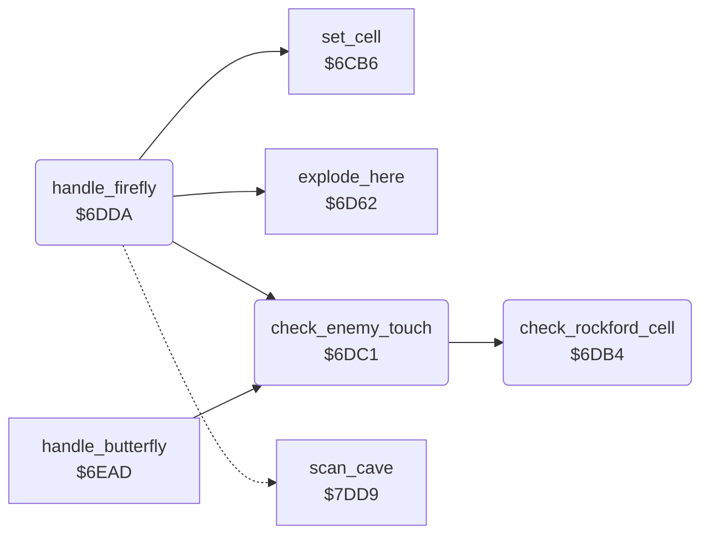

<!-- Generated by c64-docs from knowledge revision 20261024T103116.541-jn0vrj and .c64-re-tools/local/generated/src/source-map.json. Do not edit: change the knowledge, generate the source again, then run docs.ts generate. -->
# engine/firefly.asm: Direction tables, enemy contact and fireflies

Range `$6DAC-$6E27`. Source: [engine/firefly.asm](../../../../src/engine/firefly.asm). Index: [the reference](../../index.md).

## Call graph

A solid arrow is a call, a thick arrow a table entry, a dotted arrow a jump. Rounded nodes are in this file.

## Data

| Range | Type | Name | Read by | Written by |
|---|---|---|---|---|
| [`$6DAC`](../../../../src/engine/firefly.asm#L7)-`$6DAF` | bytes | [`dir_offsets`](../../../../src/engine/firefly.asm#L6) | [`handle_firefly`](firefly.md#handle_firefly), [`handle_butterfly`](butterfly.md#handle_butterfly) |  |
| [`$6DB0`](../../../../src/engine/firefly.asm#L10)-`$6DB3` | bytes | [`dir_offsets_turned`](../../../../src/engine/firefly.asm#L9) | [`handle_firefly`](firefly.md#handle_firefly), [`handle_butterfly`](butterfly.md#handle_butterfly) |  |

## Names

### [`dir_offsets`](../../../../src/engine/firefly.asm#L6) `$6DAC-$6DAF`

*data*

Cell offsets from scan_ptr for directions 0-3: left $28, up $01, right $2a, down $51.

- **Read by:** [`handle_firefly`](firefly.md#handle_firefly) [`$6E05`](../../../../src/engine/firefly.asm#L58), [`handle_firefly`](firefly.md#handle_firefly) [`$6E10`](../../../../src/engine/firefly.asm#L64), [`handle_butterfly`](butterfly.md#handle_butterfly) [`$6EC3`](../../../../src/engine/butterfly.asm#L19)

### [`dir_offsets_turned`](../../../../src/engine/firefly.asm#L9) `$6DB0-$6DB3`

*data*

Cell offsets of dir_offsets one step back: entry d is dir_offsets entry d-1.

- **Read by:** [`handle_firefly`](firefly.md#handle_firefly) [`$6DF0`](../../../../src/engine/firefly.asm#L47), [`handle_butterfly`](butterfly.md#handle_butterfly) [`$6ED8`](../../../../src/engine/butterfly.asm#L30), [`handle_butterfly`](butterfly.md#handle_butterfly) [`$6EE3`](../../../../src/engine/butterfly.asm#L36)

### [`check_rockford_cell`](../../../../src/engine/firefly.asm#L12) `$6DB4`

*routine*

Clears X when the cell at scan_ptr+Y is Rockford ($38, $39) or amoeba ($3a).

- **Called from:** [`check_enemy_touch`](firefly.md#check_enemy_touch) [`$6DC5`](../../../../src/engine/firefly.asm#L25), [`check_enemy_touch`](firefly.md#check_enemy_touch) [`$6DCA`](../../../../src/engine/firefly.asm#L27), [`check_enemy_touch`](firefly.md#check_enemy_touch) [`$6DCF`](../../../../src/engine/firefly.asm#L29), [`check_enemy_touch`](firefly.md#check_enemy_touch) [`$6DD4`](../../../../src/engine/firefly.asm#L31)
- **Reads:** [`cell_ptr`](../../memory-map.md#cell_ptr)

### [`check_rockford_cell_done`](../../../../src/engine/firefly.asm#L19) `$6DC0`

*label*

- **Jumped to from:** [`check_rockford_cell`](firefly.md#check_rockford_cell) [`$6DB8`](../../../../src/engine/firefly.asm#L15), [`check_rockford_cell`](firefly.md#check_rockford_cell) [`$6DBC`](../../../../src/engine/firefly.asm#L17)

### [`check_enemy_touch`](../../../../src/engine/firefly.asm#L22) `$6DC1`

*routine*

Checks the four neighbours of the current cell for Rockford or amoeba. Returns Z set when one touches it.

- **Called from:** [`handle_firefly`](firefly.md#handle_firefly) [`$6DDA`](../../../../src/engine/firefly.asm#L36), [`handle_butterfly`](butterfly.md#handle_butterfly) [`$6EAD`](../../../../src/engine/butterfly.asm#L7)
- **Calls:** [`check_rockford_cell`](firefly.md#check_rockford_cell)

### [`handle_firefly`](../../../../src/engine/firefly.asm#L35) `$6DDA`

*routine*

Handler of the fireflies $08-$0b (bits 0-1 = direction). Explodes next to Rockford or amoeba, else turns left, moves ahead or turns right.

- **Calls:** [`check_enemy_touch`](firefly.md#check_enemy_touch), [`explode_here`](explosion.md#explode_here), [`set_cell`](cell_draw.md#set_cell)
- **Jumps to:** [`scan_cell_settle`](cave_scan.md#scan_cell_settle), [`clear_cell_and_next`](cell_draw.md#clear_cell_and_next)
- **Reads:** [`cell_ptr`](../../memory-map.md#cell_ptr), [`dir_offsets_turned`](firefly.md#dir_offsets_turned), [`dir_offsets`](firefly.md#dir_offsets)
- **Writes:** [`explosion_code`](../../memory-map.md#explosion_code)

### [`firefly_move`](../../../../src/engine/firefly.asm#L42) `$6DE9`

*label*

- **Jumped to from:** [`handle_firefly`](firefly.md#handle_firefly) [`$6DDD`](../../../../src/engine/firefly.asm#L37)

### [`firefly_try_ahead`](../../../../src/engine/firefly.asm#L57) `$6E05`

*label*

- **Jumped to from:** [`handle_firefly`](firefly.md#handle_firefly) [`$6DF5`](../../../../src/engine/firefly.asm#L49)

### [`firefly_turn_right`](../../../../src/engine/firefly.asm#L67) `$6E19`

*label*

- **Jumped to from:** [`handle_firefly`](firefly.md#handle_firefly) [`$6E0A`](../../../../src/engine/firefly.asm#L60)
