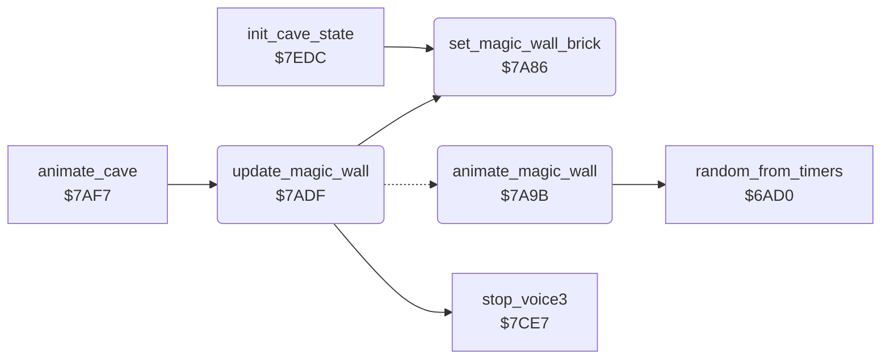

<!-- Generated by c64-docs from knowledge revision 20261024T103116.541-jn0vrj and .c64-re-tools/local/generated/src/source-map.json. Do not edit: change the knowledge, generate the source again, then run docs.ts generate. -->
# engine/magic_wall.asm: Magic wall

Range `$7A86-$7AF6`. Source: [engine/magic_wall.asm](../../../../src/engine/magic_wall.asm). Index: [the reference](../../index.md).

## Call graph

A solid arrow is a call, a thick arrow a table entry, a dotted arrow a jump. Rounded nodes are in this file.

## Names

### [`set_magic_wall_brick`](../../../../src/engine/magic_wall.asm#L6) `$7A86`

*routine*

Copies the brick wall character $4E into the four magic wall characters $22, $23, $32 and $33.

- **Called from:** [`update_magic_wall`](magic_wall.md#update_magic_wall) [`$7AEC`](../../../../src/engine/magic_wall.asm#L62), [`init_cave_state`](../cave/setup.md#init_cave_state) [`$7EFC`](../../../../src/cave/setup.asm#L62)
- **Reads:** [`gfx_brick`](../../memory-map.md#gfx_brick)
- **Writes:** [`gfx_magic_wall_tl`](../../memory-map.md#gfx_magic_wall_tl), [`gfx_magic_wall_tr`](../../memory-map.md#gfx_magic_wall_tr), [`gfx_magic_wall_bl`](../../memory-map.md#gfx_magic_wall_bl), [`gfx_magic_wall_br`](../../memory-map.md#gfx_magic_wall_br)

### [`set_magic_wall_brick_loop`](../../../../src/engine/magic_wall.asm#L8) `$7A88`

*label*

- **Jumped to from:** [`set_magic_wall_brick`](magic_wall.md#set_magic_wall_brick) [`$7A98`](../../../../src/engine/magic_wall.asm#L15)

### [`animate_magic_wall`](../../../../src/engine/magic_wall.asm#L18) `$7A9B`

*routine*

Active magic wall: plays its noise on voice 3 on odd frames and copies an animation frame into the four magic wall characters.

- **Jumped to from:** [`update_magic_wall`](magic_wall.md#update_magic_wall) [`$7AE5`](../../../../src/engine/magic_wall.asm#L58)
- **Calls:** [`random_from_timers`](random.md#random_from_timers)
- **Reads:** [`frame_counter`](../../memory-map.md#frame_counter), [`anim_frame`](../../memory-map.md#anim_frame), [`gfx_magic_wall_frames`](../../memory-map.md#gfx_magic_wall_frames)
- **Writes:** [`VCREG3`](../../memory-map.md#VCREG3), [`FREHI3`](../../memory-map.md#FREHI3), [`ATDCY3`](../../memory-map.md#ATDCY3), [`SUREL3`](../../memory-map.md#SUREL3), [`gfx_magic_wall_tl`](../../memory-map.md#gfx_magic_wall_tl), [`gfx_magic_wall_tr`](../../memory-map.md#gfx_magic_wall_tr), [`gfx_magic_wall_bl`](../../memory-map.md#gfx_magic_wall_bl), [`gfx_magic_wall_br`](../../memory-map.md#gfx_magic_wall_br)

### [`animate_magic_wall_gfx`](../../../../src/engine/magic_wall.asm#L37) `$7AC2`

*label*

- **Jumped to from:** [`animate_magic_wall`](magic_wall.md#animate_magic_wall) [`$7A9F`](../../../../src/engine/magic_wall.asm#L21)

### [`animate_magic_wall_loop`](../../../../src/engine/magic_wall.asm#L42) `$7AC9`

*label*

- **Jumped to from:** [`animate_magic_wall`](magic_wall.md#animate_magic_wall) [`$7ADC`](../../../../src/engine/magic_wall.asm#L51)

### [`update_magic_wall`](../../../../src/engine/magic_wall.asm#L54) `$7ADF`

*routine*

State 1 animates the magic wall. State 2 shows it as a brick wall, stops voice 3 and sets state 3.

- **Called from:** [`animate_cave`](../screen/animate_cave.md#animate_cave) [`$7B03`](../../../../src/screen/animate_cave.asm#L13)
- **Calls:** [`set_magic_wall_brick`](magic_wall.md#set_magic_wall_brick), [`stop_voice3`](../sound/voices_off.md#stop_voice3)
- **Jumps to:** [`animate_magic_wall`](magic_wall.md#animate_magic_wall)
- **Reads:** [`magic_wall_state`](../../memory-map.md#magic_wall_state)
- **Writes:** [`magic_wall_state`](../../memory-map.md#magic_wall_state)

### [`update_magic_wall_expire`](../../../../src/engine/magic_wall.asm#L59) `$7AE8`

*label*

- **Jumped to from:** [`update_magic_wall`](magic_wall.md#update_magic_wall) [`$7AE3`](../../../../src/engine/magic_wall.asm#L57)

### [`update_magic_wall_done`](../../../../src/engine/magic_wall.asm#L66) `$7AF6`

*label*

- **Jumped to from:** [`update_magic_wall`](magic_wall.md#update_magic_wall) [`$7AEA`](../../../../src/engine/magic_wall.asm#L61)
