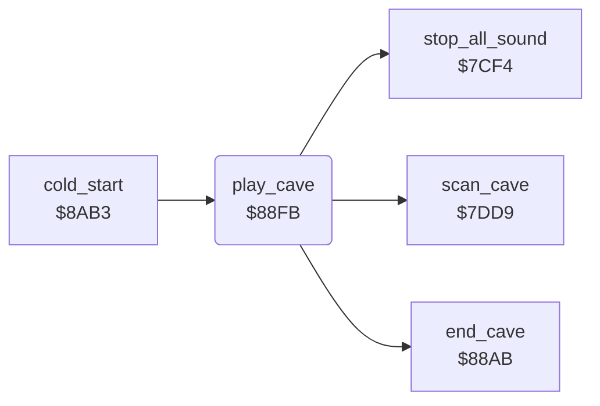

<!-- Generated by c64-docs from knowledge revision 20261024T103116.541-jn0vrj and .c64-re-tools/local/generated/src/source-map.json. Do not edit: change the knowledge, generate the source again, then run docs.ts generate. -->
# engine/play_loop.asm: Main game loop

Range `$88FB-$8912`. Source: [engine/play_loop.asm](../../../../src/engine/play_loop.asm). Index: [the reference](../../index.md).

## Call graph

A solid arrow is a call, a thick arrow a table entry, a dotted arrow a jump. Rounded nodes are in this file.

## Names

### [`play_cave`](../../../../src/engine/play_loop.asm#L6) `$88FB`

*routine*

Main game loop: runs one game tick at $7dd9 until cave_end_state is set. Then ends the cave and waits for the bonus life flash.
One game tick: scans all cells of the cave.

- **Called from:** [`cold_start`](../init/cold_start.md#cold_start) [`$8B70`](../../../../src/init/cold_start.asm#L100)
- **Calls:** [`scan_cave`](cave_scan.md#scan_cave), [`stop_all_sound`](../sound/voices_off.md#stop_all_sound), [`end_cave`](../cave/cave_end.md#end_cave)
- **Reads:** [`cave_end_state`](../../memory-map.md#cave_end_state), [`bonus_life_timer`](../../memory-map.md#bonus_life_timer)
- **Writes:** [`step_sound_pitch`](../../memory-map.md#step_sound_pitch), [`sound2_lock`](../../memory-map.md#sound2_lock)

### [`play_cave_wait_flash`](../../../../src/engine/play_loop.asm#L12) `$8908`

*label*

- **Jumped to from:** [`play_cave`](play_loop.md#play_cave) [`$890A`](../../../../src/engine/play_loop.asm#L14)
