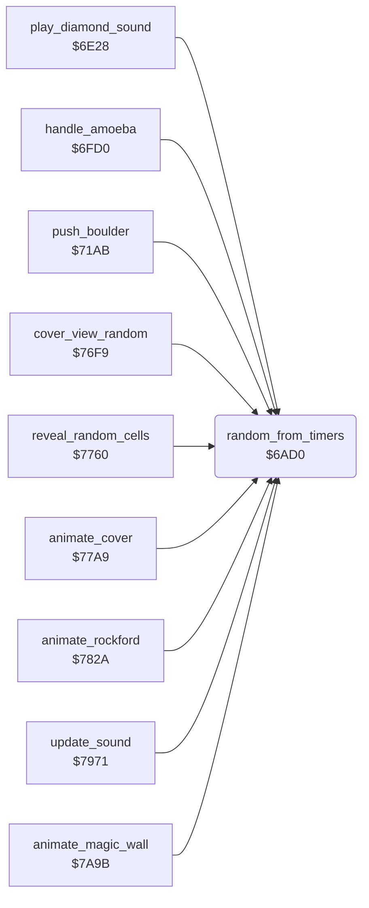

<!-- Generated by c64-docs from knowledge revision 20261025T214621.431-dj0nk4 and .c64-re-tools/local/generated/src/source-map.json. Do not edit: change the knowledge, generate the source again, then run docs.ts generate. -->
# engine/random.asm: Random numbers from the CIA timers

Range `$6AD0-$6AE2`. Source: [engine/random.asm](../../../../src/engine/random.asm). Index: [the reference](../../index.md).

## Routines

| Routine | Address | Reached from | Summary |
|---|---|---|---|
| [`random_from_timers`](random.md#random_from_timers) | `$6AD0` | [`play_diamond_sound`](../sound/element_sounds.md#play_diamond_sound), [`handle_amoeba`](amoeba.md#handle_amoeba), [`push_boulder`](../rockford/movement.md#push_boulder), [`cover_view_random`](../screen/cover.md#cover_view_random), [`reveal_random_cells`](../screen/cover.md#reveal_random_cells), [`animate_cover`](../screen/cover.md#animate_cover), [`animate_rockford`](../screen/animation.md#animate_rockford), [`update_sound`](../sound/effects.md#update_sound), [`animate_magic_wall`](magic_wall.md#animate_magic_wall) | Returns in A a random byte. |

## Call graph

A solid arrow is a call, a thick arrow a table entry. Rounded nodes are in this file.

## Details

### [`random_from_timers`](../../../../src/engine/random.asm#L6) `$6AD0`

*routine*

Returns in A a random byte. It combines the low and high bytes of CIA 1 timer A and CIA 2 timers A and B.

- **Called from:** [`play_diamond_sound`](../sound/element_sounds.md#play_diamond_sound), [`handle_amoeba`](amoeba.md#handle_amoeba), [`push_boulder`](../rockford/movement.md#push_boulder), [`cover_view_random`](../screen/cover.md#cover_view_random), [`reveal_random_cells`](../screen/cover.md#reveal_random_cells), [`animate_cover`](../screen/cover.md#animate_cover), [`animate_rockford`](../screen/animation.md#animate_rockford), [`update_sound`](../sound/effects.md#update_sound), [`animate_magic_wall`](magic_wall.md#animate_magic_wall)
- **Reads:** [`CIATALO`](../../memory-map.md#CIATALO), [`CIATAHI`](../../memory-map.md#CIATAHI), [`CI2TALO`](../../memory-map.md#CI2TALO), [`CI2TAHI`](../../memory-map.md#CI2TAHI), [`CI2TBLO`](../../memory-map.md#CI2TBLO), [`CI2TBHI`](../../memory-map.md#CI2TBHI)
