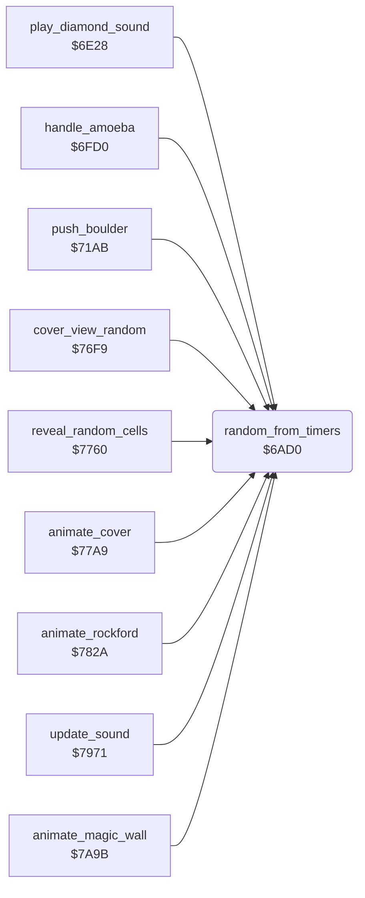

<!-- Generated by c64-docs from knowledge revision 20261024T103116.541-jn0vrj and .c64-re-tools/local/generated/src/source-map.json. Do not edit: change the knowledge, generate the source again, then run docs.ts generate. -->
# engine/random.asm: Random numbers from the CIA timers

Range `$6AD0-$6AE2`. Source: [engine/random.asm](../../../../src/engine/random.asm). Index: [the reference](../../index.md).

## Call graph

A solid arrow is a call, a thick arrow a table entry, a dotted arrow a jump. Rounded nodes are in this file.

## Names

### [`random_from_timers`](../../../../src/engine/random.asm#L6) `$6AD0`

*routine*

Returns in A a random byte. It combines the low and high bytes of CIA 1 timer A and CIA 2 timers A and B.

- **Called from:** [`play_diamond_sound`](../sound/element_sounds.md#play_diamond_sound) [`$6E3B`](../../../../src/sound/element_sounds.asm#L16), [`play_diamond_sound`](../sound/element_sounds.md#play_diamond_sound) [`$6E41`](../../../../src/sound/element_sounds.asm#L18), [`handle_amoeba`](amoeba.md#handle_amoeba) [`$7012`](../../../../src/engine/amoeba.asm#L47), [`push_boulder`](../rockford/movement.md#push_boulder) [`$71AB`](../../../../src/rockford/movement.asm#L21), [`cover_view_random`](../screen/cover.md#cover_view_random) [`$7728`](../../../../src/screen/cover.asm#L56), [`reveal_random_cells`](../screen/cover.md#reveal_random_cells) [`$776B`](../../../../src/screen/cover.asm#L101), [`animate_cover`](../screen/cover.md#animate_cover) [`$77C5`](../../../../src/screen/cover.asm#L147), [`animate_rockford`](../screen/animation.md#animate_rockford) [`$7874`](../../../../src/screen/animation.asm#L40), [`animate_rockford`](../screen/animation.md#animate_rockford) [`$787F`](../../../../src/screen/animation.asm#L46), [`update_sound`](../sound/effects.md#update_sound) [`$79B1`](../../../../src/sound/effects.asm#L42), [`animate_magic_wall`](magic_wall.md#animate_magic_wall) [`$7AA6`](../../../../src/engine/magic_wall.asm#L24)
- **Reads:** [`CIATALO`](../../memory-map.md#CIATALO), [`CIATAHI`](../../memory-map.md#CIATAHI), [`CI2TALO`](../../memory-map.md#CI2TALO), [`CI2TAHI`](../../memory-map.md#CI2TAHI), [`CI2TBLO`](../../memory-map.md#CI2TBLO), [`CI2TBHI`](../../memory-map.md#CI2TBHI)
