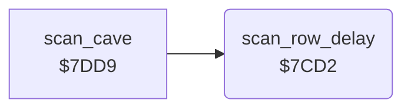

<!-- Generated by c64-docs from knowledge revision 20261024T103116.541-jn0vrj and .c64-re-tools/local/generated/src/source-map.json. Do not edit: change the knowledge, generate the source again, then run docs.ts generate. -->
# engine/row_delay.asm: Speed delay of the scan

Range `$7CCD-$7CDE`. Source: [engine/row_delay.asm](../../../../src/engine/row_delay.asm). Index: [the reference](../../index.md).

## Call graph

A solid arrow is a call, a thick arrow a table entry, a dotted arrow a jump. Rounded nodes are in this file.

## Data

| Range | Type | Name | Read by | Written by |
|---|---|---|---|---|
| [`$7CCD`](../../../../src/engine/row_delay.asm#L7)-`$7CD1` | bytes | [`level_row_delays`](../../../../src/engine/row_delay.asm#L6) | [`init_cave_state`](../cave/setup.md#init_cave_state) |  |

## Names

### [`level_row_delays`](../../../../src/engine/row_delay.asm#L6) `$7CCD-$7CD1`

*data*

Delay after each scanned row, one byte for each level 1-5. A larger value gives a slower game.

- **Read by:** [`init_cave_state`](../cave/setup.md#init_cave_state) [`$7F01`](../../../../src/cave/setup.asm#L64)

### [`scan_row_delay`](../../../../src/engine/row_delay.asm#L9) `$7CD2`

*routine*

Waits after a scanned row: row_delay times 16 loop steps. Changes X and Y.

- **Called from:** [`scan_cave`](cave_scan.md#scan_cave) [`$7E2F`](../../../../src/engine/cave_scan.asm#L88)
- **Reads:** [`row_delay`](../../memory-map.md#row_delay)

### [`scan_row_delay_outer`](../../../../src/engine/row_delay.asm#L12) `$7CD6`

*label*

- **Jumped to from:** [`scan_row_delay`](row_delay.md#scan_row_delay) [`$7CDC`](../../../../src/engine/row_delay.asm#L18)

### [`scan_row_delay_inner`](../../../../src/engine/row_delay.asm#L14) `$7CD8`

*label*

- **Jumped to from:** [`scan_row_delay`](row_delay.md#scan_row_delay) [`$7CD9`](../../../../src/engine/row_delay.asm#L16)

### [`scan_row_delay_done`](../../../../src/engine/row_delay.asm#L19) `$7CDE`

*label*

- **Jumped to from:** [`scan_row_delay`](row_delay.md#scan_row_delay) [`$7CD4`](../../../../src/engine/row_delay.asm#L11)
