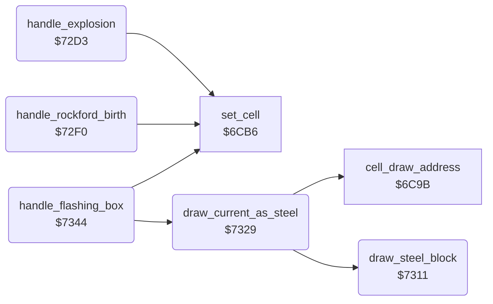

<!-- Generated by c64-docs from knowledge revision 20261025T214621.431-dj0nk4 and .c64-re-tools/local/generated/src/source-map.json. Do not edit: change the knowledge, generate the source again, then run docs.ts generate. -->
# engine/stages.asm: Explosion stages, Rockford birth and flashing boxes

Range `$72B7-$735F`. Source: [engine/stages.asm](../../../../src/engine/stages.asm). Index: [the reference](../../index.md).

## Routines

| Routine | Address | Reached from | Summary |
|---|---|---|---|
| [`handle_explosion`](stages.md#handle_explosion) | `$72D3` |  | Handler of the explosion stages $1b-$24: changes the cell to the next stage of explosion_stages. |
| [`handle_rockford_birth`](stages.md#handle_rockford_birth) | `$72F0` |  | Handler of $26-$28 and of the inbox: after inbox_delay changes the cell to the next stage of birth_stages. |
| [`draw_steel_block`](stages.md#draw_steel_block) | `$7311` | [`draw_current_as_steel`](stages.md#draw_current_as_steel) | Draws the steel wall characters ($2e) as 2 x 2 characters at draw_ptr. |
| [`draw_current_as_steel`](stages.md#draw_current_as_steel) | `$7329` | [`handle_flashing_box`](stages.md#handle_flashing_box) | Draws the current cell as steel wall without a change of its code. |
| [`handle_flashing_box`](stages.md#handle_flashing_box) | `$7344` |  | Handler of the open exit $05 and the inbox $25. |

## Data

| Range | Type | Name | Read by | Written by |
|---|---|---|---|---|
| [`$72B7`](../../../../src/engine/stages.asm#L7)-`$72CA` | bytes of 2 | [`explosion_stages`](../../../../src/engine/stages.asm#L6) | [`handle_explosion`](stages.md#handle_explosion) |  |
| [`$72CB`](../../../../src/engine/stages.asm#L21)-`$72D2` | bytes of 2 | [`birth_stages`](../../../../src/engine/stages.asm#L20) | [`handle_rockford_birth`](stages.md#handle_rockford_birth) |  |

## Call graph

A solid arrow is a call, a thick arrow a table entry. Rounded nodes are in this file.

## Details

### [`explosion_stages`](../../../../src/engine/stages.asm#L6) `$72B7`

*data*

10 pairs (code, next code): $1b-$1f end in space, $20-$24 end in a diamond.

- **Read by:** [`handle_explosion`](stages.md#handle_explosion)

### [`explosion_stage_next`](../../../../src/engine/stages.asm#L8) `$72B8-$72CA`

*data*

- **Read by:** [`handle_explosion`](stages.md#handle_explosion)

### [`birth_stages`](../../../../src/engine/stages.asm#L20) `$72CB`

*data*

4 pairs (code, next code): the inbox $25 changes through $26-$28 to Rockford $38.

- **Read by:** [`handle_rockford_birth`](stages.md#handle_rockford_birth)

### [`birth_stage_next`](../../../../src/engine/stages.asm#L22) `$72CC-$72D2`

*data*

- **Read by:** [`handle_rockford_birth`](stages.md#handle_rockford_birth)

### [`handle_explosion`](../../../../src/engine/stages.asm#L28) `$72D3`

*routine*

Handler of the explosion stages $1b-$24: changes the cell to the next stage of explosion_stages.

- **Calls:** [`set_cell`](cell_draw.md#set_cell)
- **Jumps to:** [`scan_cell_settle`](cave_scan.md#scan_cell_settle)
- **Reads:** [`cell_ptr`](../../memory-map.md#cell_ptr), [`explosion_stages`](stages.md#explosion_stages), [`explosion_stage_next`](stages.md#explosion_stage_next)

| Label | Address | Comment |
|---|---|---|
| [`explosion_find`](../../../../src/engine/stages.asm#L32) | `$72D9` |  |
| [`explosion_find_next`](../../../../src/engine/stages.asm#L36) | `$72E1` |  |

### [`handle_rockford_birth`](../../../../src/engine/stages.asm#L46) `$72F0`

*routine*

Handler of $26-$28 and of the inbox: after inbox_delay changes the cell to the next stage of birth_stages.

- **Jumped to from:** [`handle_flashing_box`](stages.md#handle_flashing_box)
- **Calls:** [`set_cell`](cell_draw.md#set_cell)
- **Jumps to:** [`scan_cell_settle`](cave_scan.md#scan_cell_settle)
- **Reads:** [`birth_countdown`](../../memory-map.md#birth_countdown), [`cell_ptr`](../../memory-map.md#cell_ptr), [`birth_stages`](stages.md#birth_stages), [`birth_stage_next`](stages.md#birth_stage_next)

| Label | Address | Comment |
|---|---|---|
| [`birth_find`](../../../../src/engine/stages.asm#L52) | `$72FA` |  |
| [`birth_find_next`](../../../../src/engine/stages.asm#L56) | `$7302` |  |
| [`birth_next`](../../../../src/engine/stages.asm#L64) | `$730E` |  |

### [`draw_steel_block`](../../../../src/engine/stages.asm#L67) `$7311`

*routine*

Draws the steel wall characters ($2e) as 2 x 2 characters at draw_ptr.

- **Called from:** [`draw_current_as_steel`](stages.md#draw_current_as_steel)
- **Reads:** [`draw_ptr`](../../memory-map.md#draw_ptr)

### [`draw_current_as_steel`](../../../../src/engine/stages.asm#L83) `$7329`

*routine*

Draws the current cell as steel wall without a change of its code.

- **Called from:** [`handle_flashing_box`](stages.md#handle_flashing_box)
- **Calls:** [`cell_draw_address`](cell_draw.md#cell_draw_address), [`draw_steel_block`](stages.md#draw_steel_block)
- **Reads:** [`scan_row`](../../memory-map.md#scan_row), [`scan_col`](../../memory-map.md#scan_col), [`cave_row_addr_lo`](../screen/cell_screen_tables.md#cave_row_addr_lo), [`cave_row_addr_hi`](../screen/cell_screen_tables.md#cave_row_addr_hi)
- **Writes:** [`cell_buffer_ptr`](../../memory-map.md#cell_buffer_ptr), [`cell_buffer_ptr_hi`](../../memory-map.md#cell_buffer_ptr_hi)

### [`handle_flashing_box`](../../../../src/engine/stages.asm#L99) `$7344`

*routine*

Handler of the open exit $05 and the inbox $25. Odd frames draw steel wall, even frames draw the cell and step the inbox birth.

- **Calls:** [`set_cell`](cell_draw.md#set_cell), [`draw_current_as_steel`](stages.md#draw_current_as_steel)
- **Jumps to:** [`handle_rockford_birth`](stages.md#handle_rockford_birth), [`scan_cell_settle`](cave_scan.md#scan_cell_settle)
- **Reads:** [`flash_counter`](../../memory-map.md#flash_counter), [`cell_ptr`](../../memory-map.md#cell_ptr)
- **Writes:** [`flash_counter`](../../memory-map.md#flash_counter)

| Label | Address | Comment |
|---|---|---|
| [`flashing_box_steel`](../../../../src/engine/stages.asm#L110) | `$735A` |  |
| [`flashing_box_next`](../../../../src/engine/stages.asm#L112) | `$735D` |  |
