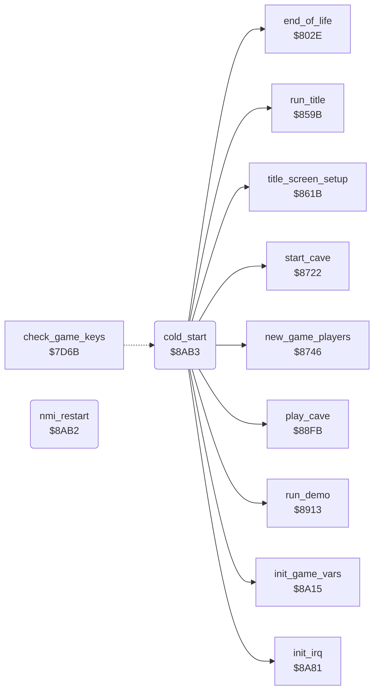

<!-- Generated by c64-docs from knowledge revision 20261024T103116.541-jn0vrj and .c64-re-tools/local/generated/src/source-map.json. Do not edit: change the knowledge, generate the source again, then run docs.ts generate. -->
# init/cold_start.asm: Cold start and top loop

Range `$8AB2-$8B85`. Source: [init/cold_start.asm](../../../../src/init/cold_start.asm). Index: [the reference](../../index.md).

## Call graph

A solid arrow is a call, a thick arrow a table entry, a dotted arrow a jump. Rounded nodes are in this file.

## Names

### [`nmi_restart`](../../../../src/init/cold_start.asm#L6) `$8AB2`

*routine*

NMI vector target: RESTORE enables interrupts and restarts the game at the cold start.

- **Referred to by:** [`cold_start`](cold_start.md#cold_start) [`$8ADF`](../../../../src/init/cold_start.asm#L28), [`cold_start`](cold_start.md#cold_start) [`$8AE4`](../../../../src/init/cold_start.asm#L30)

### [`cold_start`](../../../../src/init/cold_start.asm#L9) `$8AB3`

*routine*

Entry. Sets the stack, CIAs, NMI vector and $01, resets the variables, copies the screen drawer to $9e00, then runs title and game.

- **Jumped to from:** [`check_game_keys`](../input/game_keys.md#check_game_keys) [`$7D9F`](../../../../src/input/game_keys.asm#L97)
- **Calls:** [`init_game_vars`](init_vars.md#init_game_vars), [`init_irq`](../irq/irq_setup.md#init_irq), [`title_screen_setup`](../title/run_title.md#title_screen_setup), [`run_title`](../title/run_title.md#run_title), [`new_game_players`](../status/players.md#new_game_players), [`start_cave`](../cave/cave_start.md#start_cave), [`run_demo`](../title/demo.md#run_demo), [`play_cave`](../engine/play_loop.md#play_cave), [`end_of_life`](../status/end_of_life.md#end_of_life)
- **Reads:** [`view_row_ptrs`](../../memory-map.md#view_row_ptrs), [`view_row_ptrs_1`](../../memory-map.md#view_row_ptrs_1), [`text_player_men_cave`](../text/texts.md#text_player_men_cave), [`cave_number`](../../memory-map.md#cave_number), [`demo_mode`](../../memory-map.md#demo_mode)
- **Writes:** [`CIAICR`](../../memory-map.md#CIAICR), [`CI2ICR`](../../memory-map.md#CI2ICR), [`CIATALO`](../../memory-map.md#CIATALO), [`CIATAHI`](../../memory-map.md#CIATAHI), [`CI2TALO`](../../memory-map.md#CI2TALO), [`CI2TAHI`](../../memory-map.md#CI2TAHI), [`CI2TBLO`](../../memory-map.md#CI2TBLO), [`CI2TBHI`](../../memory-map.md#CI2TBHI), [`CI2CRA`](../../memory-map.md#CI2CRA), [`CI2CRB`](../../memory-map.md#CI2CRB), [`NMINV`](../../memory-map.md#NMINV), [`NMINV+1`](../../memory-map.md#NMINV), [`R6510`](../../memory-map.md#R6510), [`step_sound_length`](../../memory-map.md#step_sound_length), [`view_row_ptrs`](../../memory-map.md#view_row_ptrs), [`view_row_ptrs_1`](../../memory-map.md#view_row_ptrs_1), [`view_row_ptrs_hi`](../../memory-map.md#view_row_ptrs_hi), [`view_row_ptrs_1_hi`](../../memory-map.md#view_row_ptrs_1_hi), `$9E00`, `$9F00`, [`view_ptr`](../../memory-map.md#view_ptr), [`view_ptr_hi`](../../memory-map.md#view_ptr_hi), [`status_line_text`](../../memory-map.md#status_line_text), [`status_score`](../../memory-map.md#status_score), [`title_note_phase`](../../memory-map.md#title_note_phase), [`screen0+80`](../../memory-map.md#screen0), [`screen0+256`](../../memory-map.md#screen0), [`screen0+512`](../../memory-map.md#screen0), [`screen0+760`](../../memory-map.md#screen0), [`sound1_sr`](../../memory-map.md#sound1_sr), [`options_hidden`](../../memory-map.md#options_hidden), [`amoeba_room_found`](../../memory-map.md#amoeba_room_found), [`charset_text`](../../memory-map.md#charset_text)
- **Refers to:** [`nmi_restart`](cold_start.md#nmi_restart)

### [`cold_start_copy_drawer`](../../../../src/init/cold_start.asm#L46) `$8B05`

*label*

- **Jumped to from:** [`cold_start`](cold_start.md#cold_start) [`$8B10`](../../../../src/init/cold_start.asm#L52)

### [`cold_start_status_text`](../../../../src/init/cold_start.asm#L58) `$8B1C`

*label*

- **Jumped to from:** [`cold_start`](cold_start.md#cold_start) [`$8B23`](../../../../src/init/cold_start.asm#L62)

### [`cold_start_clear_score`](../../../../src/init/cold_start.asm#L65) `$8B29`

*label*

- **Jumped to from:** [`cold_start`](cold_start.md#cold_start) [`$8B2D`](../../../../src/init/cold_start.asm#L68)

### [`top_loop`](../../../../src/init/cold_start.asm#L69) `$8B2F`

*label*

No cave selected: title, else play a cave.

- **Jumped to from:** [`cold_start`](cold_start.md#cold_start) [`$8B84`](../../../../src/init/cold_start.asm#L112)

### [`top_loop_fill_screen`](../../../../src/init/cold_start.asm#L79) `$8B45`

*label*

- **Jumped to from:** [`cold_start`](cold_start.md#cold_start) [`$8B52`](../../../../src/init/cold_start.asm#L85)

### [`top_loop_play`](../../../../src/init/cold_start.asm#L88) `$8B5A`

*label*

- **Jumped to from:** [`cold_start`](cold_start.md#cold_start) [`$8B31`](../../../../src/init/cold_start.asm#L71)

### [`top_loop_player`](../../../../src/init/cold_start.asm#L99) `$8B70`

*label*

- **Jumped to from:** [`cold_start`](cold_start.md#cold_start) [`$8B64`](../../../../src/init/cold_start.asm#L93)

### [`top_loop_after_cave`](../../../../src/init/cold_start.asm#L103) `$8B77`

*label*

Shows the end of the cave and the next state.

- **Jumped to from:** [`cold_start`](cold_start.md#cold_start) [`$8B6D`](../../../../src/init/cold_start.asm#L98)

### [`top_loop_clear_char0`](../../../../src/init/cold_start.asm#L105) `$8B7A`

*label*

Clears character 0 of the text charset.

- **Jumped to from:** [`cold_start`](cold_start.md#cold_start) [`$8B57`](../../../../src/init/cold_start.asm#L87)

### [`top_loop_clear_char0_loop`](../../../../src/init/cold_start.asm#L108) `$8B7E`

*label*

- **Jumped to from:** [`cold_start`](cold_start.md#cold_start) [`$8B82`](../../../../src/init/cold_start.asm#L111)
